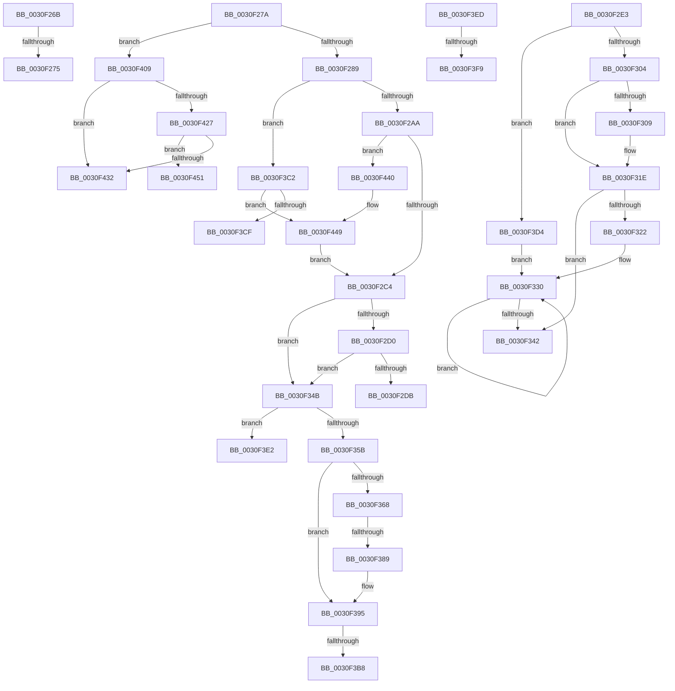

# sub_0030F26B

- RVA: `0x0030F26B`–`0x0030F459` (길이 `494` bytes)
- VA: `0x000000014030F26B`
- 실행 섹션: `.text`
- PDB 이름 있음: `아니요`; PDB Function 태그: `아니요`
- unwind 정보 RVA: `0x000740E8`
- 디코드: `118`개 명령, `494/494` bytes 표시
- 미해석 바이트: `0` (있으면 어셈블리에 `.byte`로 보존)

> 이 문서는 커널 이미지의 기계어와 PDB 기호를 분석해 생성했습니다. 4번과 5번은 함수 원형과 자료형을 바이너리 사용 방식에서 추정한 C 해석이며 원본 소스 복구 결과는 아닙니다.

## 1. Dependencies

- 직접 호출 지점: **5**; 고유 호출 대상: **5**
- 직접 호출자로 확인된 함수: **0**
- RIP 상대 이미지 참조: **2**

### Outgoing calls
- `0x0030F38D` → [KxWaitForLockChainValid](../21/KxWaitForLockChainValid_function_00217AA0.md) (function, `0x00217AA0`)
- `0x0030F3B8` → [KeWakeAddressAll](../21/KeWakeAddressAll_function_00217C20.md) (function, `0x00217C20`)
- `0x0030F416` → [KiAcquirePrcbLocksForIsolationUnit](KiAcquirePrcbLocksForIsolationUnit_function_0030ED60.md) (function, `0x0030ED60`)
- `0x0030F436` → [KiReleasePrcbLocksForIsolationUnit](../39/KiReleasePrcbLocksForIsolationUnit_function_00399C50.md) (function, `0x00399C50`)
- `0x0030F444` → [KxWaitForLockOwnerShip](../25/KxWaitForLockOwnerShip_function_00257EB0.md) (function, `0x00257EB0`)

### Direct callers
- 이 함수 시작 RVA로 연결되는 직접 call은 확인되지 않았습니다. 간접 호출은 완전히 역산할 수 없습니다.

### Static image references
- `0x0030F28F` → RVA `0x00FC6B38` (`ALMOSTRO`; read)
- `0x0030F379` → RVA `0x00FC8C40` (`ALMOSTRO`; read)

## 2. Other-region calls and transfers

- 다른 실행 섹션으로 향하는 call: **0**
- call이 아닌 외부 분기/꼬리 이동: **13**
  - `0x0030F26F` → [sub_0030EE9F + 0x1B3](Unknown_function_0030EE9F.md) (`tail-transfer`)
  - `0x0030F275` → [sub_0030EE9F + 0x1CD](Unknown_function_0030EE9F.md) (`tail-transfer`)
  - `0x0030F2DE` → [sub_0030EE9F + 0x153](Unknown_function_0030EE9F.md) (`tail-transfer`)
  - `0x0030F346` → [sub_0030EE9F + 0x7C](Unknown_function_0030EE9F.md) (`tail-transfer`)
  - `0x0030F383` → [sub_0030EE9F + 0x83](Unknown_function_0030EE9F.md) (`tail-transfer`)
  - `0x0030F3B2` → [sub_0030EE9F + 0x83](Unknown_function_0030EE9F.md) (`tail-transfer`)
  - `0x0030F3BD` → [sub_0030EE9F + 0x79](Unknown_function_0030EE9F.md) (`tail-transfer`)
  - `0x0030F3CF` → [sub_006E0EC2](../6E/Unknown_function_006E0EC2.md) (`tail-transfer`)
  - `0x0030F3E8` → [sub_0030EE9F + 0x7C](Unknown_function_0030EE9F.md) (`tail-transfer`)
  - `0x0030F3F3` → [sub_0030EE9F + 0x186](Unknown_function_0030EE9F.md) (`tail-transfer`)
  - `0x0030F404` → [sub_0030EE9F + 0x186](Unknown_function_0030EE9F.md) (`tail-transfer`)
  - `0x0030F43B` → [sub_0030EE9F + 0x79](Unknown_function_0030EE9F.md) (`tail-transfer`)
  - `0x0030F454` → [sub_0030EE9F + 0x153](Unknown_function_0030EE9F.md) (`tail-transfer`)

## 3. Assembly (complete function range)

```asm
0030F26B  2C 03                           sub al, 3
0030F26D  3C 03                           cmp al, 3
0030F26F  0F 86 DD FD FF FF               jbe 0x14030f052
0030F275  E9 F2 FD FF FF                  jmp 0x14030f06c
0030F27A  41 8B BE 18 02 00 00            mov edi, dword ptr [r14 + 0x218]
0030F281  85 FF                           test edi, edi
0030F283  0F 89 80 01 00 00               jns 0x14030f409
0030F289  8B C7                           mov eax, edi
0030F28B  0F BA F0 1F                     btr eax, 0x1f
0030F28F  F7 05 9F 78 CB 00 00 00 20 00   test dword ptr [rip + 0xcb789f], 0x200000
0030F299  48 8B 04 C2                     mov rax, qword ptr [rdx + rax*8]
0030F29D  4C 8B A8 48 8E 00 00            mov r13, qword ptr [rax + 0x8e48]
0030F2A4  0F 84 18 01 00 00               je 0x14030f3c2
0030F2AA  4C 89 6D D8                     mov qword ptr [rbp - 0x28], r13
0030F2AE  48 8D 55 D0                     lea rdx, [rbp - 0x30]
0030F2B2  4C 89 55 D0                     mov qword ptr [rbp - 0x30], r10
0030F2B6  90                              nop
0030F2B7  49 87 55 00                     xchg qword ptr [r13], rdx
0030F2BB  48 85 D2                        test rdx, rdx
0030F2BE  0F 85 7C 01 00 00               jne 0x14030f440
0030F2C4  41 0F B6 86 84 01 00 00         movzx eax, byte ptr [r14 + 0x184]
0030F2CC  3C 01                           cmp al, 1
0030F2CE  75 7B                           jne 0x14030f34b
0030F2D0  41 8B 86 18 02 00 00            mov eax, dword ptr [r14 + 0x218]
0030F2D7  3B C7                           cmp eax, edi
0030F2D9  75 70                           jne 0x14030f34b
0030F2DB  49 8B DA                        mov rbx, r10
0030F2DE  E9 0F FD FF FF                  jmp 0x14030eff2
0030F2E3  48 8B 45 40                     mov rax, qword ptr [rbp + 0x40]
0030F2E7  45 33 D2                        xor r10d, r10d
0030F2EA  4C 8B C8                        mov r9, rax
0030F2ED  45 8B C2                        mov r8d, r10d
0030F2F0  49 83 E1 FE                     and r9, 0xfffffffffffffffe
0030F2F4  41 8B D2                        mov edx, r10d
0030F2F7  4C 89 4D 50                     mov qword ptr [rbp + 0x50], r9
0030F2FB  83 E0 01                        and eax, 1
0030F2FE  0F 84 D0 00 00 00               je 0x14030f3d4
0030F304  83 F8 01                        cmp eax, 1
0030F307  75 15                           jne 0x14030f31e
0030F309  49 8B 81 58 8E 00 00            mov rax, qword ptr [r9 + 0x8e58]
0030F310  4D 8B 81 58 8E 00 00            mov r8, qword ptr [r9 + 0x8e58]
0030F317  49 83 C0 08                     add r8, 8
0030F31B  0F B6 10                        movzx edx, byte ptr [rax]
0030F31E  85 D2                           test edx, edx
0030F320  74 20                           je 0x14030f342
0030F322  0F 1F 40 00                     nop dword ptr [rax]
0030F326  66 66 0F 1F 84 00 00 00 00 00   nop word ptr [rax + rax]
0030F330  8D 42 FF                        lea eax, [rdx - 1]
0030F333  49 8B 0C C0                     mov rcx, qword ptr [r8 + rax*8]
0030F337  8B D0                           mov edx, eax
0030F339  F0 4C 21 51 30                  lock and qword ptr [rcx + 0x30], r10
0030F33E  85 C0                           test eax, eax
0030F340  75 EE                           jne 0x14030f330
0030F342  4C 89 55 40                     mov qword ptr [rbp + 0x40], r10
0030F346  E9 D0 FB FF FF                  jmp 0x14030ef1b
0030F34B  F7 05 E3 77 CB 00 00 00 20 00   test dword ptr [rip + 0xcb77e3], 0x200000
0030F355  0F 84 87 00 00 00               je 0x14030f3e2
0030F35B  0F 0D 4D D0                     prefetchw byte ptr [rbp - 0x30]
0030F35F  48 8B 45 D0                     mov rax, qword ptr [rbp - 0x30]
0030F363  48 85 C0                        test rax, rax
0030F366  75 2D                           jne 0x14030f395
0030F368  48 8B 4D D8                     mov rcx, qword ptr [rbp - 0x28]
0030F36C  48 8D 45 D0                     lea rax, [rbp - 0x30]
0030F370  F0 4C 0F B1 11                  lock cmpxchg qword ptr [rcx], r10
0030F375  48 8D 4D D0                     lea rcx, [rbp - 0x30]
0030F379  48 8D 15 C0 98 CB 00            lea rdx, [rip + 0xcb98c0]
0030F380  48 3B C1                        cmp rax, rcx
0030F383  0F 84 99 FB FF FF               je 0x14030ef22
0030F389  48 8D 4D D0                     lea rcx, [rbp - 0x30]
0030F38D  E8 0E 87 F0 FF                  call 0x140217aa0
0030F392  45 33 D2                        xor r10d, r10d
0030F395  48 8D 48 08                     lea rcx, [rax + 8]
0030F399  4C 89 55 D0                     mov qword ptr [rbp - 0x30], r10
0030F39D  48 8B 55 D8                     mov rdx, qword ptr [rbp - 0x28]
0030F3A1  48 8B C2                        mov rax, rdx
0030F3A4  48 87 01                        xchg qword ptr [rcx], rax
0030F3A7  32 C2                           xor al, dl
0030F3A9  48 8D 15 90 98 CB 00            lea rdx, [rip + 0xcb9890]
0030F3B0  A8 04                           test al, 4
0030F3B2  0F 84 6A FB FF FF               je 0x14030ef22
0030F3B8  E8 63 88 F0 FF                  call 0x140217c20
0030F3BD  E9 56 FB FF FF                  jmp 0x14030ef18
0030F3C2  44 89 55 38                     mov dword ptr [rbp + 0x38], r10d
0030F3C6  F0 49 0F BA 6D 00 00            lock bts qword ptr [r13], 0
0030F3CD  73 7A                           jae 0x14030f449
0030F3CF  E9 EE 1A 3D 00                  jmp 0x1406e0ec2
0030F3D4  4C 8D 45 50                     lea r8, [rbp + 0x50]
0030F3D8  BA 01 00 00 00                  mov edx, 1
0030F3DD  E9 4E FF FF FF                  jmp 0x14030f330
0030F3E2  F0 49 83 65 00 00               lock and qword ptr [r13], 0
0030F3E8  E9 2E FB FF FF                  jmp 0x14030ef1b
0030F3ED  41 8B 46 74                     mov eax, dword ptr [r14 + 0x74]
0030F3F1  A8 02                           test al, 2
0030F3F3  0F 84 2C FC FF FF               je 0x14030f025
0030F3F9  8B 02                           mov eax, dword ptr [rdx]
0030F3FB  41 2B 86 B4 01 00 00            sub eax, dword ptr [r14 + 0x1b4]
0030F402  03 C8                           add ecx, eax
0030F404  E9 1C FC FF FF                  jmp 0x14030f025
0030F409  48 8B 1C FA                     mov rbx, qword ptr [rdx + rdi*8]
0030F40D  4C 8D 45 40                     lea r8, [rbp + 0x40]
0030F411  48 8B CB                        mov rcx, rbx
0030F414  33 D2                           xor edx, edx
0030F416  E8 45 F9 FF FF                  call 0x14030ed60
0030F41B  41 0F B6 86 84 01 00 00         movzx eax, byte ptr [r14 + 0x184]
0030F423  3C 01                           cmp al, 1
0030F425  75 0B                           jne 0x14030f432
0030F427  41 8B 86 18 02 00 00            mov eax, dword ptr [r14 + 0x218]
0030F42E  3B C7                           cmp eax, edi
0030F430  74 1F                           je 0x14030f451
0030F432  48 8D 4D 40                     lea rcx, [rbp + 0x40]
0030F436  E8 15 A8 08 00                  call 0x140399c50
0030F43B  E9 D8 FA FF FF                  jmp 0x14030ef18
0030F440  48 8D 4D D0                     lea rcx, [rbp - 0x30]
0030F444  E8 67 8A F4 FF                  call 0x140257eb0
0030F449  45 33 D2                        xor r10d, r10d
0030F44C  E9 73 FE FF FF                  jmp 0x14030f2c4
0030F451  45 33 D2                        xor r10d, r10d
0030F454  E9 99 FB FF FF                  jmp 0x14030eff2
```

## 4. C-style interpretation (structured pseudocode)

```c
__int64 __fastcall sub_0030F26B(__int64 a1, __int64 a2)
{
    __int64 result;

    result = (unsigned __int8)((result) - (3));
}
```

## 5. (Beta) C Style

```c
int64_t sub_0030F26B(int64_t Arg1, int64_t Arg2)
{
    int64_t result;

    result = (uint8_t)((result) - (3));
}
```

## 6. Execution-region graph

[열기: 2D/3D 그래프와 함수 탐색 컨트롤 패널](../../../control-panel.html?section=text&rva=0x0030F26B&view=graph)

- 2D 그래프는 위에서 아래로 흐르고, 3D 그래프는 빈 공간을 드래그해 회전합니다. Shift+드래그는 이동, 휠은 확대·축소, 함수 노드 선택은 대상 보고서 이동입니다.

### Static fallback


