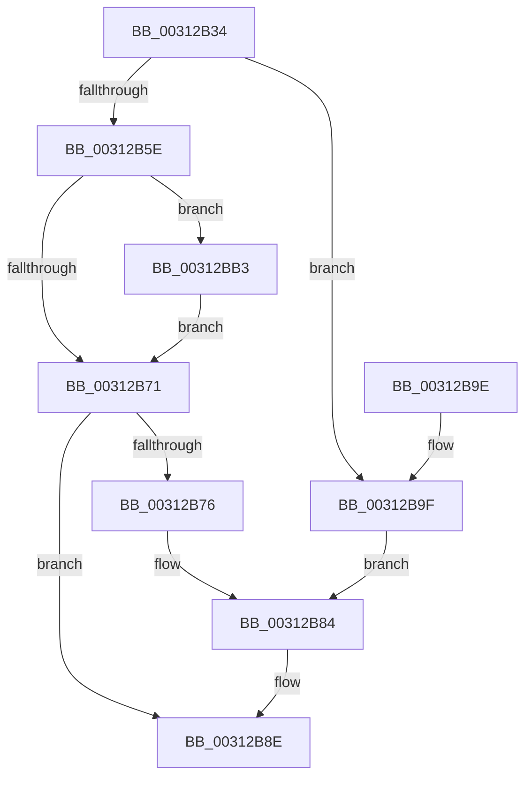

# ExFlushTb

- RVA: `0x00312B34`–`0x00312BCA` (길이 `150` bytes)
- VA: `0x0000000140312B34`
- 실행 섹션: `.text`
- PDB 이름 있음: `예`; PDB Function 태그: `아니요`
- unwind 정보 RVA: `0x000743B0`
- 디코드: `38`개 명령, `150/150` bytes 표시
- 미해석 바이트: `0` (있으면 어셈블리에 `.byte`로 보존)

> 이 문서는 커널 이미지의 기계어와 PDB 기호를 분석해 생성했습니다. 4번과 5번은 함수 원형과 자료형을 바이너리 사용 방식에서 추정한 C 해석이며 원본 소스 복구 결과는 아닙니다.

## 1. Dependencies

- 직접 호출 지점: **2**; 고유 호출 대상: **1**
- 직접 호출자로 확인된 함수: **5**
- RIP 상대 이미지 참조: **2**

### Outgoing calls
- `0x00312B89` → [guard_dispatch_icall](../6B/guard_dispatch_icall_function_006BAAD0.md) (function, `0x006BAAD0`)
- `0x00312BC3` → [guard_dispatch_icall](../6B/guard_dispatch_icall_function_006BAAD0.md) (function, `0x006BAAD0`)

### Direct callers
- [sub_003120A5](Unknown_function_003120A5.md) at `0x0031218F`
- [sub_003145C5](Unknown_function_003145C5.md) at `0x003145E2`
- [KeFlushEntireTb](../5B/KeFlushEntireTb_function_005BDBF0.md) at `0x005BDC6E`
- [KeFlushSingleCurrentTb](../5B/KeFlushSingleCurrentTb_function_005BDC9C.md) at `0x005BDE31`
- [KeFlushSingleTb](../5B/KeFlushSingleTb_function_005BDE84.md) at `0x005BE02D`

### Static image references
- `0x00312B76` → RVA `0x00E06D28` (`.data`; read)
- `0x00312BA6` → RVA `0x00EFA8E0` (`.data`; read)

## 2. Other-region calls and transfers

- 다른 실행 섹션으로 향하는 call: **0**
- 별도 외부 분기/꼬리 이동을 확인하지 못했습니다.

## 3. Assembly (complete function range)

```asm
00312B34  48 89 5C 24 08                  mov qword ptr [rsp + 8], rbx
00312B39  48 89 74 24 10                  mov qword ptr [rsp + 0x10], rsi
00312B3E  57                              push rdi
00312B3F  48 83 EC 20                     sub rsp, 0x20
00312B43  65 48 8B 04 25 88 01 00 00      mov rax, qword ptr gs:[0x188]
00312B4C  48 8B FA                        mov rdi, rdx
00312B4F  8B F1                           mov esi, ecx
00312B51  48 8B 98 B8 00 00 00            mov rbx, qword ptr [rax + 0xb8]
00312B58  41 83 F8 01                     cmp r8d, 1
00312B5C  75 41                           jne 0x140312b9f
00312B5E  48 8B 8B 08 06 00 00            mov rcx, qword ptr [rbx + 0x608]
00312B65  48 8B 9B E8 07 00 00            mov rbx, qword ptr [rbx + 0x7e8]
00312B6C  48 85 C9                        test rcx, rcx
00312B6F  75 42                           jne 0x140312bb3
00312B71  48 85 DB                        test rbx, rbx
00312B74  74 18                           je 0x140312b8e
00312B76  48 8B 05 AB 41 AF 00            mov rax, qword ptr [rip + 0xaf41ab]
00312B7D  48 8B CB                        mov rcx, rbx
00312B80  48 8B 40 48                     mov rax, qword ptr [rax + 0x48]
00312B84  4C 8B C7                        mov r8, rdi
00312B87  8B D6                           mov edx, esi
00312B89  E8 42 7F 3A 00                  call 0x1406baad0
00312B8E  48 8B 5C 24 30                  mov rbx, qword ptr [rsp + 0x30]
00312B93  48 8B 74 24 38                  mov rsi, qword ptr [rsp + 0x38]
00312B98  48 83 C4 20                     add rsp, 0x20
00312B9C  5F                              pop rdi
00312B9D  C3                              ret
00312B9E  CC                              int3
00312B9F  48 8B 05 82 41 AF 00            mov rax, qword ptr [rip + 0xaf4182]
00312BA6  48 8B 0D 33 7D BE 00            mov rcx, qword ptr [rip + 0xbe7d33]
00312BAD  48 8B 40 50                     mov rax, qword ptr [rax + 0x50]
00312BB1  EB D1                           jmp 0x140312b84
00312BB3  48 8B 05 6E 41 AF 00            mov rax, qword ptr [rip + 0xaf416e]
00312BBA  4C 8B C7                        mov r8, rdi
00312BBD  8B D6                           mov edx, esi
00312BBF  48 8B 40 48                     mov rax, qword ptr [rax + 0x48]
00312BC3  E8 08 7F 3A 00                  call 0x1406baad0
00312BC8  EB A7                           jmp 0x140312b71
```

## 4. C-style interpretation (structured pseudocode)

```c
__int64 __fastcall ExFlushTb(int a1, __int64 a2, int a3)
{
    __int64 result;
    __int64 v_rsp;
    unsigned __int64 v_stack_p10;
    unsigned __int64 v_stack_p8;

    v_stack_p8 = v_rbx;
    v_stack_p10 = v_rsi;
    v_rsp = (v_rsp) - (32);
    if (a3 != 1) goto loc_00312B9F;
    if (*(unsigned __int64 *)(*(unsigned __int64 *)(*(unsigned __int64 *)(gs_base + (0 + 392)) + 184) + 1544) != 0) goto loc_00312BB3;
loc_00312B71:
    if (*(unsigned __int64 *)(*(unsigned __int64 *)(*(unsigned __int64 *)(gs_base + (0 + 392)) + 184) + 2024) == 0) goto loc_00312B8E;
loc_00312B84:
    result = guard_dispatch_icall(*(unsigned __int64 *)(*(unsigned __int64 *)(*(unsigned __int64 *)(gs_base + (0 + 392)) + 184) + 2024), (unsigned int)((unsigned int)((unsigned int)(a1))), a2, a4);
loc_00312B8E:
    v_rsp = (v_rsp) + (32);
    return result;
loc_00312B9F:
    goto loc_00312B84;
loc_00312BB3:
    result = guard_dispatch_icall(*(unsigned __int64 *)(v_rip + 12483891), (unsigned int)((unsigned int)(v_stack_p10)), a2, a4);
    goto loc_00312B71;
}
```

## 5. (Beta) C Style

```c
int64_t ExFlushTb(int32_t Arg1, int64_t Arg2, int32_t Arg3)
{
    int64_t result;
    int64_t local_rsp;
    uint64_t v_stack_p10;
    uint64_t v_stack_p8;

    v_stack_p8 = local_rbx;
    v_stack_p10 = local_rsi;
    local_rsp = (local_rsp) - (32);
    if (Arg3 != 1) goto loc_00312B9F;
    if (*(uint64_t *)(*(uint64_t *)(*(uint64_t *)(gs_base + (0 + 0x188)) + 0xB8) + 0x608) != 0) goto loc_00312BB3;
loc_00312B71:
    if (*(uint64_t *)(*(uint64_t *)(*(uint64_t *)(gs_base + (0 + 0x188)) + 0xB8) + 0x7E8) == 0) goto loc_00312B8E;
loc_00312B84:
    result = guard_dispatch_icall(*(uint64_t *)(*(uint64_t *)(*(uint64_t *)(gs_base + (0 + 0x188)) + 0xB8) + 0x7E8), (uint32_t)((uint32_t)((uint32_t)(Arg1))), Arg2, a4);
loc_00312B8E:
    local_rsp = (local_rsp) + (32);
    return result;
loc_00312B9F:
    goto loc_00312B84;
loc_00312BB3:
    result = guard_dispatch_icall(*(uint64_t *)(v_rip + 0xBE7D33), (uint32_t)((uint32_t)(v_stack_p10)), Arg2, a4);
    goto loc_00312B71;
}
```

## 6. Execution-region graph

[열기: 2D/3D 그래프와 함수 탐색 컨트롤 패널](../../../control-panel.html?section=text&rva=0x00312B34&view=graph)

- 2D 그래프는 위에서 아래로 흐르고, 3D 그래프는 빈 공간을 드래그해 회전합니다. Shift+드래그는 이동, 휠은 확대·축소, 함수 노드 선택은 대상 보고서 이동입니다.

### Static fallback


