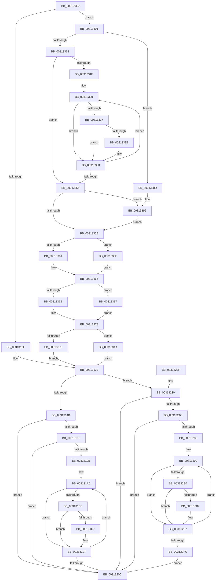

# HvcallFastExtended

- RVA: `0x003130E0`–`0x003133B8` (길이 `728` bytes)
- VA: `0x00000001403130E0`
- 실행 섹션: `.text`
- PDB 이름 있음: `예`; PDB Function 태그: `아니요`
- unwind 정보 RVA: `0x0007455C`
- 디코드: `196`개 명령, `728/728` bytes 표시
- 미해석 바이트: `0` (있으면 어셈블리에 `.byte`로 보존)

> 이 문서는 커널 이미지의 기계어와 PDB 기호를 분석해 생성했습니다. 4번과 5번은 함수 원형과 자료형을 바이너리 사용 방식에서 추정한 C 해석이며 원본 소스 복구 결과는 아닙니다.

## 1. Dependencies

- 직접 호출 지점: **8**; 고유 호출 대상: **7**
- 직접 호출자로 확인된 함수: **46**
- RIP 상대 이미지 참조: **4**

### Outgoing calls
- `0x0031314E` → [HvcallpExtendedFastHypercall](../6B/HvcallpExtendedFastHypercall_function_006BBE40.md) (function, `0x006BBE40`)
- `0x00313202` → [EtwpLogKernelEvent](../25/EtwpLogKernelEvent_function_0025CC00.md) (function, `0x0025CC00`)
- `0x00313216` → [_security_check_cookie](../6A/_security_check_cookie_function_006AC640.md) (function, `0x006AC640`)
- `0x0031323F` → [HvcallpExtendedFastHypercallWithOutput](../6B/HvcallpExtendedFastHypercallWithOutput_function_006BBEA0.md) (function, `0x006BBEA0`)
- `0x003132F2` → [EtwpLogKernelEvent](../25/EtwpLogKernelEvent_function_0025CC00.md) (function, `0x0025CC00`)
- `0x00313394` → [KeQueryPerformanceCounter](../37/KeQueryPerformanceCounter_function_0037E7E0.md) (function, `0x0037E7E0`)
- `0x0031339F` → [RtlGetSystemTimePrecise](../37/RtlGetSystemTimePrecise_function_0037EDD0.md) (function, `0x0037EDD0`)
- `0x003133AA` → [EtwpGetHostPerfCounter](../3A/EtwpGetHostPerfCounter_function_003A4134.md) (function, `0x003A4134`)

### Direct callers
- [HvlpFastSendSyntheticClusterIpiEx](../30/HvlpFastSendSyntheticClusterIpiEx_function_00304F78.md) at `0x00304FF0`
- [HvlParkedVirtualProcessors](../30/HvlParkedVirtualProcessors_function_00305724.md) at `0x003057ED`
- [HvlpFastFlushAddressSpaceTbEx](../30/HvlpFastFlushAddressSpaceTbEx_function_003065B4.md) at `0x0030664A`
- [HvlpFastFlushListTbEx](../30/HvlpFastFlushListTbEx_function_00306784.md) at `0x00306896`
- [HvlDmaUnmapDeviceLogicalRange](../30/HvlDmaUnmapDeviceLogicalRange_function_00307390.md) at `0x00307442`
- [HvlDmaMapDeviceLogicalRange](../30/HvlDmaMapDeviceLogicalRange_function_003077D0.md) at `0x00307977`
- [HvlFlushTbAllPartitions](../30/HvlFlushTbAllPartitions_function_00308D70.md) at `0x00308DD1`
- [sub_00312E68](Unknown_function_00312E68.md) at `0x00312F15`
- [HvlDmaMapDeviceSparsePages](../47/HvlDmaMapDeviceSparsePages_function_0047A390.md) at `0x0047A4D4`
- [HvlDmaUnmapDeviceSparsePages](../48/HvlDmaUnmapDeviceSparsePages_function_004844C0.md) at `0x00484676`
- [HvlpFastFlushPasidAddressList](../4A/HvlpFastFlushPasidAddressList_function_004A1C6C.md) at `0x004A1D18`
- [HvlpFlushPasidAddressSpace](../4A/HvlpFlushPasidAddressSpace_function_004A1D60.md) at `0x004A1D97`
- [HvlSetDeviceDmaEnabled](../4D/HvlSetDeviceDmaEnabled_function_004DD300.md) at `0x004DD3A2`
- [HvlpReadPerfRegister](../58/HvlpReadPerfRegister_function_00585CBC.md) at `0x00585CFD`
- [HvlpWritePerfRegister](../58/HvlpWritePerfRegister_function_00586EF0.md) at `0x00586F41`
- [HvlAttachPasidSpace](../58/HvlAttachPasidSpace_function_00587140.md) at `0x0058718E`
- [HvlAttachPrQueue](../58/HvlAttachPrQueue_function_005871F0.md) at `0x0058723E`
- [HvlClearPrqStalled](../58/HvlClearPrqStalled_function_005872A0.md) at `0x005872E3`
- [HvlCreatePasidSpace](../58/HvlCreatePasidSpace_function_00587300.md) at `0x00587361`
- [HvlCreatePrQueue](../58/HvlCreatePrQueue_function_005873C0.md) at `0x00587450`
- [HvlDeletePrQueue](../58/HvlDeletePrQueue_function_005874B0.md) at `0x005874E8`
- [HvlDetachPasidSpace](../58/HvlDetachPasidSpace_function_00587510.md) at `0x00587545`
- [HvlDetachPrQueue](../58/HvlDetachPrQueue_function_00587560.md) at `0x00587595`
- [HvlDisablePasid](../58/HvlDisablePasid_function_005875B0.md) at `0x005875FE`
- [HvlDmaAllocateDeviceDomain](../58/HvlDmaAllocateDeviceDomain_function_00587630.md) at `0x005876BA`
- [HvlDmaAttachDeviceDomain](../58/HvlDmaAttachDeviceDomain_function_00587700.md) at `0x00587774`
- [HvlDmaConfigureDeviceDomain](../58/HvlDmaConfigureDeviceDomain_function_005877C0.md) at `0x0058784B`
- [HvlDmaDeleteDeviceDomain](../58/HvlDmaDeleteDeviceDomain_function_00587880.md) at `0x005878E2`
- [HvlDmaDetachDeviceDomain](../58/HvlDmaDetachDeviceDomain_function_00587910.md) at `0x00587953`
- [HvlDmaFlushDeviceDomain](../58/HvlDmaFlushDeviceDomain_function_00587970.md) at `0x005879CC`
- [HvlDmaReserveDeviceDomainAttachment](../58/HvlDmaReserveDeviceDomainAttachment_function_00587C90.md) at `0x00587CFD`
- [HvlDmaUnreserveDeviceDomainAttachment](../58/HvlDmaUnreserveDeviceDomainAttachment_function_00587D50.md) at `0x00587D85`
- [HvlEnablePasid](../58/HvlEnablePasid_function_00587DA0.md) at `0x00587DEE`
- [HvlRestoreTime](../58/HvlRestoreTime_function_00589350.md) at `0x005893B4`
- [HvlSetDeviceCapabilities](../58/HvlSetDeviceCapabilities_function_005894C0.md) at `0x0058950E`
- [HvlSetPasidAddressSpace](../58/HvlSetPasidAddressSpace_function_00589790.md) at `0x005897DD`
- [HvlSetRootFaultReportingReady](../58/HvlSetRootFaultReportingReady_function_00589840.md) at `0x00589898`
- [HvlUnblockDefaultDma](../58/HvlUnblockDefaultDma_function_00589A50.md) at `0x00589AA8`
- [HvlUnregisterDeviceId](../58/HvlUnregisterDeviceId_function_00589B90.md) at `0x00589BC5`
- [HvlpDmaFastFlushDeviceDomainVaList](../58/HvlpDmaFastFlushDeviceDomainVaList_function_00589BE0.md) at `0x00589C8B`
- [HvlpFastAcknowledgePageRequest](../58/HvlpFastAcknowledgePageRequest_function_00589DC8.md) at `0x00589DFE`
- [HvlWakeVirtualProcessors](../58/HvlWakeVirtualProcessors_function_0058AA80.md) at `0x0058AB50`
- [HvlpProcessIommuPrq](../58/HvlpProcessIommuPrq_function_0058C2B0.md) at `0x0058C2E6`
- [HvlpGetVtlCallVa](../58/HvlpGetVtlCallVa_function_0058D560.md) at `0x0058D5CE`
- [HvlpAddRemovePhysicalMemory](../6A/HvlpAddRemovePhysicalMemory_function_006A7A98.md) at `0x006A7BA1`
- [HvlpDynamicUpdateMicrocode](../../page/71/HvlpDynamicUpdateMicrocode_function_007185E8.md) at `0x00718679`

### Static image references
- `0x003130F9` → RVA `0x00E0A740` (`.data`; read)
- `0x00313107` → RVA `0x00FC6B14` (`ALMOSTRO`; read)
- `0x00313176` → RVA `0x00FC6AA8` (`ALMOSTRO`; read)
- `0x00313301` → RVA `0x00FCFC80` (`CACHEALI`; read)

## 2. Other-region calls and transfers

- 다른 실행 섹션으로 향하는 call: **0**
- 별도 외부 분기/꼬리 이동을 확인하지 못했습니다.

## 3. Assembly (complete function range)

```asm
003130E0  40 55                           push rbp
003130E2  53                              push rbx
003130E3  56                              push rsi
003130E4  57                              push rdi
003130E5  41 54                           push r12
003130E7  41 55                           push r13
003130E9  41 56                           push r14
003130EB  41 57                           push r15
003130ED  48 8D 6C 24 E9                  lea rbp, [rsp - 0x17]
003130F2  48 81 EC 98 00 00 00            sub rsp, 0x98
003130F9  48 8B 05 40 76 AF 00            mov rax, qword ptr [rip + 0xaf7640]
00313100  48 33 C4                        xor rax, rsp
00313103  48 89 45 FF                     mov qword ptr [rbp - 1], rax
00313107  8B 05 07 3A CB 00               mov eax, dword ptr [rip + 0xcb3a07]
0031310D  0F 57 C0                        xorps xmm0, xmm0
00313110  45 33 ED                        xor r13d, r13d
00313113  4D 8B E1                        mov r12, r9
00313116  45 8B F0                        mov r14d, r8d
00313119  4C 8B FA                        mov r15, rdx
0031311C  48 8B D9                        mov rbx, rcx
0031311F  0F 11 45 BF                     movups xmmword ptr [rbp - 0x41], xmm0
00313123  0F 11 45 CF                     movups xmmword ptr [rbp - 0x31], xmm0
00313127  A8 10                           test al, 0x10
00313129  0F 85 D2 01 00 00               jne 0x140313301
0031312F  40 32 F6                        xor sil, sil
00313132  8B 45 7F                        mov eax, dword ptr [rbp + 0x7f]
00313135  45 8D 46 0F                     lea r8d, [r14 + 0xf]
00313139  41 C1 E8 04                     shr r8d, 4
0031313D  49 8B D7                        mov rdx, r15
00313140  48 8B CB                        mov rcx, rbx
00313143  85 C0                           test eax, eax
00313145  0F 85 E5 00 00 00               jne 0x140313230
0031314B  45 8B C6                        mov r8d, r14d
0031314E  E8 ED 8C 3A 00                  call 0x1406bbe40
00313153  48 8B F8                        mov rdi, rax
00313156  40 84 F6                        test sil, sil
00313159  0F 84 AD 00 00 00               je 0x14031320c
0031315F  0F B7 C3                        movzx eax, bx
00313162  4C 89 6D AF                     mov qword ptr [rbp - 0x51], r13
00313166  89 45 AF                        mov dword ptr [rbp - 0x51], eax
00313169  8B C3                           mov eax, ebx
0031316B  C1 EB 1F                        shr ebx, 0x1f
0031316E  C1 E8 10                        shr eax, 0x10
00313171  24 01                           and al, 1
00313173  88 5D B4                        mov byte ptr [rbp - 0x4c], bl
00313176  48 8B 1D 2B 39 CB 00            mov rbx, qword ptr [rip + 0xcb392b]
0031317D  88 45 B3                        mov byte ptr [rbp - 0x4d], al
00313180  48 8D 45 AF                     lea rax, [rbp - 0x51]
00313184  48 89 45 EF                     mov qword ptr [rbp - 0x11], rax
00313188  48 C7 45 F7 08 00 00 00         mov qword ptr [rbp - 9], 8
00313190  8B 9B A8 11 00 00               mov ebx, dword ptr [rbx + 0x11a8]
00313196  0F BC CB                        bsf ecx, ebx
00313199  74 71                           je 0x14031320c
0031319B  0F 1F 44 00 00                  nop dword ptr [rax + rax]
003131A0  48 8B 15 01 39 CB 00            mov rdx, qword ptr [rip + 0xcb3901]
003131A7  8D 43 FF                        lea eax, [rbx - 1]
003131AA  23 D8                           and ebx, eax
003131AC  44 8B C1                        mov r8d, ecx
003131AF  8B C1                           mov eax, ecx
003131B1  48 C1 E0 05                     shl rax, 5
003131B5  48 05 CC 11 00 00               add rax, 0x11cc
003131BB  48 03 C2                        add rax, rdx
003131BE  74 47                           je 0x140313207
003131C0  8B 40 14                        mov eax, dword ptr [rax + 0x14]
003131C3  A8 10                           test al, 0x10
003131C5  74 40                           je 0x140313207
003131C7  0F B6 84 4A 99 11 00 00         movzx eax, byte ptr [rdx + rcx*2 + 0x1199]
003131CF  41 B9 02 00 00 00               mov r9d, 2
003131D5  48 C7 45 E7 08 00 00 00         mov qword ptr [rbp - 0x19], 8
003131DD  C7 44 24 28 02 0E 50 00         mov dword ptr [rsp + 0x28], 0x500e02
003131E5  66 C7 44 24 20 72 0F            mov word ptr [rsp + 0x20], 0xf72
003131EC  48 8D 4C C5 B7                  lea rcx, [rbp + rax*8 - 0x49]
003131F1  48 89 4D DF                     mov qword ptr [rbp - 0x21], rcx
003131F5  48 8D 4D DF                     lea rcx, [rbp - 0x21]
003131F9  46 0F B6 84 42 98 11 00 00      movzx r8d, byte ptr [rdx + r8*2 + 0x1198]
00313202  E8 F9 99 F4 FF                  call 0x14025cc00
00313207  0F BC CB                        bsf ecx, ebx
0031320A  75 94                           jne 0x1403131a0
0031320C  48 8B C7                        mov rax, rdi
0031320F  48 8B 4D FF                     mov rcx, qword ptr [rbp - 1]
00313213  48 33 CC                        xor rcx, rsp
00313216  E8 25 94 39 00                  call 0x1406ac640
0031321B  48 81 C4 98 00 00 00            add rsp, 0x98
00313222  41 5F                           pop r15
00313224  41 5E                           pop r14
00313226  41 5D                           pop r13
00313228  41 5C                           pop r12
0031322A  5F                              pop rdi
0031322B  5E                              pop rsi
0031322C  5B                              pop rbx
0031322D  5D                              pop rbp
0031322E  C3                              ret
0031322F  CC                              int3
00313230  C1 E8 04                        shr eax, 4
00313233  45 33 C9                        xor r9d, r9d
00313236  89 44 24 28                     mov dword ptr [rsp + 0x28], eax
0031323A  4C 89 64 24 20                  mov qword ptr [rsp + 0x20], r12
0031323F  E8 5C 8C 3A 00                  call 0x1406bbea0
00313244  48 8B F8                        mov rdi, rax
00313247  40 84 F6                        test sil, sil
0031324A  74 C0                           je 0x14031320c
0031324C  0F B7 C3                        movzx eax, bx
0031324F  4C 89 6D AF                     mov qword ptr [rbp - 0x51], r13
00313253  89 45 AF                        mov dword ptr [rbp - 0x51], eax
00313256  8B C3                           mov eax, ebx
00313258  C1 E8 10                        shr eax, 0x10
0031325B  24 01                           and al, 1
0031325D  C1 EB 1F                        shr ebx, 0x1f
00313260  88 45 B3                        mov byte ptr [rbp - 0x4d], al
00313263  48 8D 45 AF                     lea rax, [rbp - 0x51]
00313267  48 89 45 EF                     mov qword ptr [rbp - 0x11], rax
0031326B  48 8B 05 36 38 CB 00            mov rax, qword ptr [rip + 0xcb3836]
00313272  88 5D B4                        mov byte ptr [rbp - 0x4c], bl
00313275  48 C7 45 F7 08 00 00 00         mov qword ptr [rbp - 9], 8
0031327D  8B 98 A8 11 00 00               mov ebx, dword ptr [rax + 0x11a8]
00313283  0F BC CB                        bsf ecx, ebx
00313286  74 84                           je 0x14031320c
00313288  0F 1F 84 00 00 00 00 00         nop dword ptr [rax + rax]
00313290  48 8B 15 11 38 CB 00            mov rdx, qword ptr [rip + 0xcb3811]
00313297  8D 43 FF                        lea eax, [rbx - 1]
0031329A  23 D8                           and ebx, eax
0031329C  44 8B C1                        mov r8d, ecx
0031329F  8B C1                           mov eax, ecx
003132A1  48 C1 E0 05                     shl rax, 5
003132A5  48 05 CC 11 00 00               add rax, 0x11cc
003132AB  48 03 C2                        add rax, rdx
003132AE  74 47                           je 0x1403132f7
003132B0  8B 40 14                        mov eax, dword ptr [rax + 0x14]
003132B3  A8 10                           test al, 0x10
003132B5  74 40                           je 0x1403132f7
003132B7  0F B6 84 4A 99 11 00 00         movzx eax, byte ptr [rdx + rcx*2 + 0x1199]
003132BF  41 B9 02 00 00 00               mov r9d, 2
003132C5  48 C7 45 E7 08 00 00 00         mov qword ptr [rbp - 0x19], 8
003132CD  C7 44 24 28 02 0E 50 00         mov dword ptr [rsp + 0x28], 0x500e02
003132D5  66 C7 44 24 20 72 0F            mov word ptr [rsp + 0x20], 0xf72
003132DC  48 8D 4C C5 B7                  lea rcx, [rbp + rax*8 - 0x49]
003132E1  48 89 4D DF                     mov qword ptr [rbp - 0x21], rcx
003132E5  48 8D 4D DF                     lea rcx, [rbp - 0x21]
003132E9  46 0F B6 84 42 98 11 00 00      movzx r8d, byte ptr [rdx + r8*2 + 0x1198]
003132F2  E8 09 99 F4 FF                  call 0x14025cc00
003132F7  0F BC CB                        bsf ecx, ebx
003132FA  75 94                           jne 0x140313290
003132FC  E9 0B FF FF FF                  jmp 0x14031320c
00313301  4C 8B 05 78 C9 CB 00            mov r8, qword ptr [rip + 0xcbc978]
00313308  40 B6 01                        mov sil, 1
0031330B  41 8B FD                        mov edi, r13d
0031330E  4D 85 C0                        test r8, r8
00313311  74 7A                           je 0x14031338d
00313313  41 8B 90 A8 11 00 00            mov edx, dword ptr [r8 + 0x11a8]
0031331A  0F BC CA                        bsf ecx, edx
0031331D  74 36                           je 0x140313355
0031331F  90                              nop
00313320  8D 42 FF                        lea eax, [rdx - 1]
00313323  23 D0                           and edx, eax
00313325  48 8B C1                        mov rax, rcx
00313328  48 C1 E0 05                     shl rax, 5
0031332C  48 05 CC 11 00 00               add rax, 0x11cc
00313332  49 03 C0                        add rax, r8
00313335  74 19                           je 0x140313350
00313337  8B 40 14                        mov eax, dword ptr [rax + 0x14]
0031333A  A8 10                           test al, 0x10
0031333C  74 12                           je 0x140313350
0031333E  41 0F B6 8C 48 99 11 00 00      movzx ecx, byte ptr [r8 + rcx*2 + 0x1199]
00313347  B8 01 00 00 00                  mov eax, 1
0031334C  D3 E0                           shl eax, cl
0031334E  0B F8                           or edi, eax
00313350  0F BC CA                        bsf ecx, edx
00313353  75 CB                           jne 0x140313320
00313355  40 F6 C7 02                     test dil, 2
00313359  75 37                           jne 0x140313392
0031335B  40 F6 C7 04                     test dil, 4
0031335F  75 3E                           jne 0x14031339f
00313361  4C 89 6D C7                     mov qword ptr [rbp - 0x39], r13
00313365  40 F6 C7 08                     test dil, 8
00313369  74 1C                           je 0x140313387
0031336B  0F 31                           rdtsc
0031336D  48 C1 E2 20                     shl rdx, 0x20
00313371  48 0B C2                        or rax, rdx
00313374  48 89 45 CF                     mov qword ptr [rbp - 0x31], rax
00313378  40 F6 C7 10                     test dil, 0x10
0031337C  75 2C                           jne 0x1403133aa
0031337E  4C 89 6D D7                     mov qword ptr [rbp - 0x29], r13
00313382  E9 AB FD FF FF                  jmp 0x140313132
00313387  4C 89 6D CF                     mov qword ptr [rbp - 0x31], r13
0031338B  EB EB                           jmp 0x140313378
0031338D  BF 1E 00 00 00                  mov edi, 0x1e
00313392  33 C9                           xor ecx, ecx
00313394  E8 47 B4 06 00                  call 0x14037e7e0
00313399  48 89 45 BF                     mov qword ptr [rbp - 0x41], rax
0031339D  EB BC                           jmp 0x14031335b
0031339F  E8 2C BA 06 00                  call 0x14037edd0
003133A4  48 89 45 C7                     mov qword ptr [rbp - 0x39], rax
003133A8  EB BB                           jmp 0x140313365
003133AA  E8 85 0D 09 00                  call 0x1403a4134
003133AF  48 89 45 D7                     mov qword ptr [rbp - 0x29], rax
003133B3  E9 7A FD FF FF                  jmp 0x140313132
```

## 4. C-style interpretation (structured pseudocode)

```c
__int64 __fastcall HvcallFastExtended(__int64 a1, __int64 a2, int a3, __int64 a4, unsigned int a5)
{
    __int64 result;
    __int64 v_r13;
    __int64 v_rbx;
    __int64 v_rdi;
    __int64 v_rsi;
    __int64 v_rsp;
    unsigned __int64 v_stack_m57;
    unsigned __int64 v_stack_m58;
    unsigned __int64 v_stack_m60;
    unsigned __int64 v_stack_m68;
    unsigned __int64 v_stack_m70;
    unsigned __int64 v_stack_m78;
    unsigned __int64 v_stack_m80;
    unsigned __int64 v_stack_m88;
    unsigned __int64 v_stack_m90;
    unsigned __int64 v_stack_m98;
    unsigned __int8 v_stack_mA3;
    unsigned __int8 v_stack_mA4;
    unsigned __int64 v_stack_mA8;
    unsigned int v_stack_mB0;
    unsigned __int16 v_stack_mB8;
    unsigned __int64 v_stack_p20;
    unsigned int v_stack_p28;

    v_rsp = (v_rsp) - (152);
    result = (*(unsigned __int64 *)(v_rip + 11499072)) ^ (v_rsp);
    v_stack_m58 = result;
    v_r13 = 0;
    v_stack_m98 = v_xmm0;
    v_stack_m88 = v_xmm0;
    if ((((unsigned __int8)((unsigned int)(*(unsigned int *)(v_rip + 13318663)))) & (16)) != 0) goto loc_00313301;
    v_rsi = 0;
loc_00313132:
    a3 = (unsigned int)(((unsigned int)(a3) + 15) >> (4));
    if ((unsigned int)((unsigned int)(a5)) != 0) goto loc_00313230;
    result = HvcallpExtendedFastHypercall(a1, a2, (unsigned int)((unsigned int)((unsigned int)(a3))), a4);
    if (0 == 0) goto loc_0031320C;
    v_stack_mA8 = 0;
    v_stack_mA8 = (unsigned int)((unsigned __int16)(a1));
    v_rbx = (unsigned int)((a1) >> (31));
    result = (unsigned int)(((unsigned int)((unsigned int)(a1))) >> (16));
    result = (unsigned __int8)((result) & (1));
    v_stack_mA3 = (unsigned __int8)(v_rbx);
    v_stack_mA4 = (unsigned __int8)(result);
    v_stack_m68 = v_stack_mA8;
    v_stack_m60 = 8;
    if (condition_is_equal) goto loc_0031320C;
loc_003131A0:
    v_rbx = (unsigned int)(((unsigned int)(*(unsigned int *)(*(unsigned __int64 *)(v_rip + 13318443) + 4520))) & ((unsigned int)((unsigned int)(*(unsigned int *)(*(unsigned __int64 *)(v_rip + 13318443) + 4520)) - 1)));
    result = ((unsigned int)((unsigned int)(a1))) << (5);
    result = (result) + (0x11CCULL);
    result = (result) + (*(unsigned __int64 *)(v_rip + 13318401));
    if (condition_is_equal) goto loc_00313207;
    result = (unsigned int)(*(unsigned int *)(result + 20));
    if ((((unsigned __int8)((unsigned int)(*(unsigned int *)(result + 20)))) & (16)) != 0) {
        result = *(unsigned __int8 *)(*(unsigned __int64 *)(v_rip + 13318401) + a1 * 2 + 4505);
        a4 = 2;
        v_stack_m70 = 8;
        v_stack_mB0 = 0x500E02ULL;
        v_stack_mB8 = 0xF72ULL;
        a1 = v_stack_m57 + result * 8 - 73;
        v_stack_m78 = a1;
        a1 = v_stack_m78;
        a3 = *(unsigned __int8 *)(*(unsigned __int64 *)(v_rip + 13318401) + (unsigned int)((unsigned int)(a1)) * 2 + 4504);
        result = EtwpLogKernelEvent(a1, *(unsigned __int64 *)(v_rip + 13318401), a3, a4);
    }
    if ((((unsigned __int8)((unsigned int)(*(unsigned int *)(result + 20)))) & (16)) != 0) goto loc_003131A0;
loc_0031320C:
    a1 = (v_stack_m58) ^ (v_rsp);
    result = _security_check_cookie(a1, *(unsigned __int64 *)(v_rip + 13318401), a3, a4);
    v_rsp = (v_rsp) + (152);
    return result;
loc_00313230:
    result = (unsigned int)((result) >> (4));
    a4 = 0;
    v_stack_p28 = (unsigned int)(result);
    v_stack_p20 = 0;
    result = HvcallpExtendedFastHypercallWithOutput(a1, *(unsigned __int64 *)(v_rip + 13318401), a3, a4);
    if (0 == 0) goto loc_0031320C;
    v_stack_mA8 = 0;
    v_stack_mA8 = (unsigned int)((unsigned __int16)(v_rbx));
    result = (unsigned int)(((unsigned int)((unsigned int)(v_rbx))) >> (16));
    result = (unsigned __int8)((result) & (1));
    v_rbx = (unsigned int)((v_rbx) >> (31));
    v_stack_mA4 = (unsigned __int8)(result);
    v_stack_m68 = v_stack_mA8;
    v_stack_mA3 = (unsigned __int8)(v_rbx);
    v_stack_m60 = 8;
    if (condition_is_equal) goto loc_0031320C;
loc_00313290:
    v_rbx = (unsigned int)(((unsigned int)(*(unsigned int *)(*(unsigned __int64 *)(v_rip + 13318198) + 4520))) & ((unsigned int)((unsigned int)(*(unsigned int *)(*(unsigned __int64 *)(v_rip + 13318198) + 4520)) - 1)));
    result = ((unsigned int)((unsigned int)(a1))) << (5);
    result = (result) + (0x11CCULL);
    result = (result) + (*(unsigned __int64 *)(v_rip + 13318161));
    if (condition_is_equal) goto loc_003132F7;
    result = (unsigned int)(*(unsigned int *)(result + 20));
    if ((((unsigned __int8)((unsigned int)(*(unsigned int *)(result + 20)))) & (16)) != 0) {
        result = *(unsigned __int8 *)(*(unsigned __int64 *)(v_rip + 13318161) + a1 * 2 + 4505);
        a4 = 2;
        v_stack_m70 = 8;
        v_stack_p28 = 0x500E02ULL;
        v_stack_p20 = 0xF72ULL;
        a1 = v_stack_m57 + result * 8 - 73;
        v_stack_m78 = a1;
        a1 = v_stack_m78;
        a3 = *(unsigned __int8 *)(*(unsigned __int64 *)(v_rip + 13318161) + (unsigned int)((unsigned int)(a1)) * 2 + 4504);
        result = EtwpLogKernelEvent(a1, *(unsigned __int64 *)(v_rip + 13318161), a3, a4);
    }
    if ((((unsigned __int8)((unsigned int)(*(unsigned int *)(result + 20)))) & (16)) != 0) goto loc_00313290;
    goto loc_0031320C;
loc_00313301:
    if (*(unsigned __int64 *)(v_rip + 13355384) == 0) goto loc_0031338D;
    if (*(unsigned __int64 *)(v_rip + 13355384) == 0) goto loc_00313355;
loc_00313320:
    a2 = (unsigned int)(((unsigned int)(*(unsigned int *)(*(unsigned __int64 *)(v_rip + 13355384) + 4520))) & ((unsigned int)((unsigned int)(*(unsigned int *)(*(unsigned __int64 *)(v_rip + 13355384) + 4520)) - 1)));
    result = (a1) << (5);
    result = (result) + (0x11CCULL);
    result = (result) + (*(unsigned __int64 *)(v_rip + 13355384));
    if (condition_is_equal) goto loc_00313350;
    result = (unsigned int)(*(unsigned int *)(result + 20));
    v_rdi = 0;
    if ((((unsigned __int8)((unsigned int)(*(unsigned int *)(result + 20)))) & (16)) != 0) {
        a1 = *(unsigned __int8 *)(*(unsigned __int64 *)(v_rip + 13355384) + a1 * 2 + 4505);
        result = 1;
        result = (unsigned int)((result) << ((unsigned __int8)(a1)));
        v_rdi = (unsigned int)((0) | ((unsigned int)(result)));
    }
    if (condition_is_not_equal) goto loc_00313320;
loc_00313355:
    if ((((unsigned __int8)(v_rdi)) & (2)) != 0) goto loc_00313392;
loc_0031335B:
    if ((((unsigned __int8)(v_rdi)) & (4)) != 0) goto loc_0031339F;
    v_stack_m90 = 0;
loc_00313365:
    if ((((unsigned __int8)(v_rdi)) & (8)) == 0) goto loc_00313387;
    a2 = (a2) << (32);
    result = (result) | (a2);
    v_stack_m88 = result;
loc_00313378:
    if ((((unsigned __int8)(v_rdi)) & (16)) != 0) goto loc_003133AA;
    v_stack_m80 = 0;
    goto loc_00313132;
loc_00313387:
    v_stack_m88 = 0;
    goto loc_00313378;
loc_0031338D:
loc_00313392:
    a1 = 0;
    result = KeQueryPerformanceCounter(a1, a2, *(unsigned __int64 *)(v_rip + 13355384), a4);
    v_stack_m98 = result;
    goto loc_0031335B;
loc_0031339F:
    result = RtlGetSystemTimePrecise(a1, a2, *(unsigned __int64 *)(v_rip + 13355384), a4);
    v_stack_m90 = result;
    goto loc_00313365;
loc_003133AA:
    result = EtwpGetHostPerfCounter(a1, a2, *(unsigned __int64 *)(v_rip + 13355384), a4);
    v_stack_m80 = result;
    goto loc_00313132;
}
```

## 5. (Beta) C Style

```c
int64_t HvcallFastExtended(int64_t Arg1, int64_t Arg2, void *Arg3, int64_t Arg4, uint32_t Arg5)
{
    uint8_t *arg3 = (uint8_t *)Arg3;

    int64_t result;
    int64_t local_r13;
    int64_t local_rbx;
    int64_t local_rdi;
    int64_t local_rsi;
    int64_t local_rsp;
    uint64_t v_stack_m57;
    uint64_t v_stack_m58;
    uint64_t v_stack_m60;
    uint64_t v_stack_m68;
    uint64_t v_stack_m70;
    uint64_t v_stack_m78;
    uint64_t v_stack_m80;
    uint64_t v_stack_m88;
    uint64_t v_stack_m90;
    uint64_t v_stack_m98;
    uint8_t v_stack_mA3;
    uint8_t v_stack_mA4;
    uint64_t v_stack_mA8;
    uint32_t v_stack_mB0;
    uint16_t v_stack_mB8;
    uint64_t v_stack_p20;
    uint32_t v_stack_p28;

    local_rsp = (local_rsp) - (152);
    result = (*(uint64_t *)(v_rip + 0xAF7640)) ^ (local_rsp);
    v_stack_m58 = result;
    local_r13 = 0;
    v_stack_m98 = v_xmm0;
    v_stack_m88 = v_xmm0;
    if ((((uint8_t)((uint32_t)(*(uint32_t *)(v_rip + 0xCB3A07)))) & (16)) != 0) goto loc_00313301;
    local_rsi = 0;
loc_00313132:
    Arg3 = (uint32_t)(((uint32_t)(Arg3) + 15) >> (4));
    if ((uint32_t)((uint32_t)(Arg5)) != 0) goto loc_00313230;
    result = HvcallpExtendedFastHypercall(Arg1, Arg2, (uint32_t)((uint32_t)((uint32_t)(Arg3))), Arg4);
    if (0 == 0) goto loc_0031320C;
    v_stack_mA8 = 0;
    v_stack_mA8 = (uint32_t)((uint16_t)(Arg1));
    local_rbx = (uint32_t)((Arg1) >> (31));
    result = (uint32_t)(((uint32_t)((uint32_t)(Arg1))) >> (16));
    result = (uint8_t)((result) & (1));
    v_stack_mA3 = (uint8_t)(local_rbx);
    v_stack_mA4 = (uint8_t)(result);
    v_stack_m68 = v_stack_mA8;
    v_stack_m60 = 8;
    if (condition_is_equal) goto loc_0031320C;
loc_003131A0:
    local_rbx = (uint32_t)(((uint32_t)(*(uint32_t *)(*(uint64_t *)(v_rip + 0xCB392B) + 0x11A8))) & ((uint32_t)((uint32_t)(*(uint32_t *)(*(uint64_t *)(v_rip + 0xCB392B) + 0x11A8)) - 1)));
    result = ((uint32_t)((uint32_t)(Arg1))) << (5);
    result = (result) + (0x11CCULL);
    result = (result) + (*(uint64_t *)(v_rip + 0xCB3901));
    if (condition_is_equal) goto loc_00313207;
    result = (uint32_t)(*(uint32_t *)(result + 0x14));
    if ((((uint8_t)((uint32_t)(*(uint32_t *)(result + 0x14)))) & (16)) != 0) {
        result = *(uint8_t *)(*(uint64_t *)(v_rip + 0xCB3901) + Arg1 * 2 + 0x1199);
        Arg4 = 2;
        v_stack_m70 = 8;
        v_stack_mB0 = 0x500E02ULL;
        v_stack_mB8 = 0xF72ULL;
        Arg1 = v_stack_m57 + result * 8 - 73;
        v_stack_m78 = Arg1;
        Arg1 = v_stack_m78;
        Arg3 = *(uint8_t *)(*(uint64_t *)(v_rip + 0xCB3901) + (uint32_t)((uint32_t)(Arg1)) * 2 + 0x1198);
        result = EtwpLogKernelEvent(Arg1, *(uint64_t *)(v_rip + 0xCB3901), Arg3, Arg4);
    }
    if ((((uint8_t)((uint32_t)(*(uint32_t *)(result + 0x14)))) & (16)) != 0) goto loc_003131A0;
loc_0031320C:
    Arg1 = (v_stack_m58) ^ (local_rsp);
    result = _security_check_cookie(Arg1, *(uint64_t *)(v_rip + 0xCB3901), Arg3, Arg4);
    local_rsp = (local_rsp) + (152);
    return result;
loc_00313230:
    result = (uint32_t)((result) >> (4));
    Arg4 = 0;
    v_stack_p28 = (uint32_t)(result);
    v_stack_p20 = 0;
    result = HvcallpExtendedFastHypercallWithOutput(Arg1, *(uint64_t *)(v_rip + 0xCB3901), Arg3, Arg4);
    if (0 == 0) goto loc_0031320C;
    v_stack_mA8 = 0;
    v_stack_mA8 = (uint32_t)((uint16_t)(local_rbx));
    result = (uint32_t)(((uint32_t)((uint32_t)(local_rbx))) >> (16));
    result = (uint8_t)((result) & (1));
    local_rbx = (uint32_t)((local_rbx) >> (31));
    v_stack_mA4 = (uint8_t)(result);
    v_stack_m68 = v_stack_mA8;
    v_stack_mA3 = (uint8_t)(local_rbx);
    v_stack_m60 = 8;
    if (condition_is_equal) goto loc_0031320C;
loc_00313290:
    local_rbx = (uint32_t)(((uint32_t)(*(uint32_t *)(*(uint64_t *)(v_rip + 0xCB3836) + 0x11A8))) & ((uint32_t)((uint32_t)(*(uint32_t *)(*(uint64_t *)(v_rip + 0xCB3836) + 0x11A8)) - 1)));
    result = ((uint32_t)((uint32_t)(Arg1))) << (5);
    result = (result) + (0x11CCULL);
    result = (result) + (*(uint64_t *)(v_rip + 0xCB3811));
    if (condition_is_equal) goto loc_003132F7;
    result = (uint32_t)(*(uint32_t *)(result + 0x14));
    if ((((uint8_t)((uint32_t)(*(uint32_t *)(result + 0x14)))) & (16)) != 0) {
        result = *(uint8_t *)(*(uint64_t *)(v_rip + 0xCB3811) + Arg1 * 2 + 0x1199);
        Arg4 = 2;
        v_stack_m70 = 8;
        v_stack_p28 = 0x500E02ULL;
        v_stack_p20 = 0xF72ULL;
        Arg1 = v_stack_m57 + result * 8 - 73;
        v_stack_m78 = Arg1;
        Arg1 = v_stack_m78;
        Arg3 = *(uint8_t *)(*(uint64_t *)(v_rip + 0xCB3811) + (uint32_t)((uint32_t)(Arg1)) * 2 + 0x1198);
        result = EtwpLogKernelEvent(Arg1, *(uint64_t *)(v_rip + 0xCB3811), Arg3, Arg4);
    }
    if ((((uint8_t)((uint32_t)(*(uint32_t *)(result + 0x14)))) & (16)) != 0) goto loc_00313290;
    goto loc_0031320C;
loc_00313301:
    if (*(uint64_t *)(v_rip + 0xCBC978) == 0) goto loc_0031338D;
    if (*(uint64_t *)(v_rip + 0xCBC978) == 0) goto loc_00313355;
loc_00313320:
    Arg2 = (uint32_t)(((uint32_t)(*(uint32_t *)(*(uint64_t *)(v_rip + 0xCBC978) + 0x11A8))) & ((uint32_t)((uint32_t)(*(uint32_t *)(*(uint64_t *)(v_rip + 0xCBC978) + 0x11A8)) - 1)));
    result = (Arg1) << (5);
    result = (result) + (0x11CCULL);
    result = (result) + (*(uint64_t *)(v_rip + 0xCBC978));
    if (condition_is_equal) goto loc_00313350;
    result = (uint32_t)(*(uint32_t *)(result + 0x14));
    local_rdi = 0;
    if ((((uint8_t)((uint32_t)(*(uint32_t *)(result + 0x14)))) & (16)) != 0) {
        Arg1 = *(uint8_t *)(*(uint64_t *)(v_rip + 0xCBC978) + Arg1 * 2 + 0x1199);
        result = 1;
        result = (uint32_t)((result) << ((uint8_t)(Arg1)));
        local_rdi = (uint32_t)((0) | ((uint32_t)(result)));
    }
    if (condition_is_not_equal) goto loc_00313320;
loc_00313355:
    if ((((uint8_t)(local_rdi)) & (2)) != 0) goto loc_00313392;
loc_0031335B:
    if ((((uint8_t)(local_rdi)) & (4)) != 0) goto loc_0031339F;
    v_stack_m90 = 0;
loc_00313365:
    if ((((uint8_t)(local_rdi)) & (8)) == 0) goto loc_00313387;
    Arg2 = (Arg2) << (32);
    result = (result) | (Arg2);
    v_stack_m88 = result;
loc_00313378:
    if ((((uint8_t)(local_rdi)) & (16)) != 0) goto loc_003133AA;
    v_stack_m80 = 0;
    goto loc_00313132;
loc_00313387:
    v_stack_m88 = 0;
    goto loc_00313378;
loc_0031338D:
loc_00313392:
    Arg1 = 0;
    result = KeQueryPerformanceCounter(Arg1, Arg2, *(uint64_t *)(v_rip + 0xCBC978), Arg4);
    v_stack_m98 = result;
    goto loc_0031335B;
loc_0031339F:
    result = RtlGetSystemTimePrecise(Arg1, Arg2, *(uint64_t *)(v_rip + 0xCBC978), Arg4);
    v_stack_m90 = result;
    goto loc_00313365;
loc_003133AA:
    result = EtwpGetHostPerfCounter(Arg1, Arg2, *(uint64_t *)(v_rip + 0xCBC978), Arg4);
    v_stack_m80 = result;
    goto loc_00313132;
}
```

### 관측된 메모리 오프셋

구조체 형식이 확인되지 않은 접근은 인자 기준의 오프셋으로만 기록했습니다.

| 기준 인자 | 오프셋 표현 | 폭 (bit) | 접근 |
|---|---:|---:|---|
| `Arg3` | `+ 0xF` | `32` | `R` |

## 6. Execution-region graph

[열기: 2D/3D 그래프와 함수 탐색 컨트롤 패널](../../../control-panel.html?section=text&rva=0x003130E0&view=graph)

- 2D 그래프는 위에서 아래로 흐르고, 3D 그래프는 빈 공간을 드래그해 회전합니다. Shift+드래그는 이동, 휠은 확대·축소, 함수 노드 선택은 대상 보고서 이동입니다.

### Static fallback


