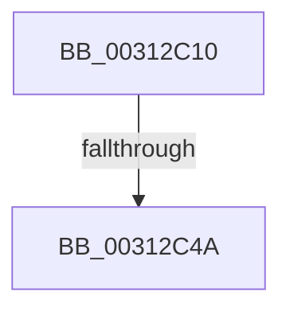

# HvlFlushRangeListTb

- RVA: `0x00312C10`–`0x00312C4C` (길이 `60` bytes)
- VA: `0x0000000140312C10`
- 실행 섹션: `.text`
- PDB 이름 있음: `예`; PDB Function 태그: `예`
- unwind 정보 RVA: `0x000743C4`
- 디코드: `15`개 명령, `60/60` bytes 표시
- 미해석 바이트: `0` (있으면 어셈블리에 `.byte`로 보존)

> 이 문서는 커널 이미지의 기계어와 PDB 기호를 분석해 생성했습니다. 4번과 5번은 함수 원형과 자료형을 바이너리 사용 방식에서 추정한 C 해석이며 원본 소스 복구 결과는 아닙니다.

## 1. Dependencies

- 직접 호출 지점: **0**; 고유 호출 대상: **0**
- 직접 호출자로 확인된 함수: **4**
- RIP 상대 이미지 참조: **1**

### Outgoing calls
- 직접 디코드된 call 명령이 없습니다.

### Direct callers
- [sub_00312223](Unknown_function_00312223.md) at `0x00312690`
- [sub_003127BF](Unknown_function_003127BF.md) at `0x0031297A`
- [KeFlushSingleCurrentTb](../5B/KeFlushSingleCurrentTb_function_005BDC9C.md) at `0x005BDD70`
- [KeFlushSingleTb](../5B/KeFlushSingleTb_function_005BDE84.md) at `0x005BDFB6`

### Static image references
- `0x00312C21` → RVA `0x00E0A740` (`.data`; read)

## 2. Other-region calls and transfers

- 다른 실행 섹션으로 향하는 call: **0**
- call이 아닌 외부 분기/꼬리 이동: **1**
  - `0x00312C44` → [sub_00312F3E + 0x19](Unknown_function_00312F3E.md) (`tail-transfer`)

## 3. Assembly (complete function range)

```asm
00312C10  40 55                           push rbp
00312C12  53                              push rbx
00312C13  41 56                           push r14
00312C15  48 8D 6C 24 A0                  lea rbp, [rsp - 0x60]
00312C1A  48 81 EC 60 01 00 00            sub rsp, 0x160
00312C21  48 8B 05 18 7B AF 00            mov rax, qword ptr [rip + 0xaf7b18]
00312C28  48 33 C4                        xor rax, rsp
00312C2B  48 89 45 30                     mov qword ptr [rbp + 0x30], rax
00312C2F  4C 8B B5 B0 00 00 00            mov r14, qword ptr [rbp + 0xb0]
00312C36  45 8B D1                        mov r10d, r9d
00312C39  44 89 4C 24 50                  mov dword ptr [rsp + 0x50], r9d
00312C3E  4C 8B D9                        mov r11, rcx
00312C41  48 85 D2                        test rdx, rdx
00312C44  0F 85 0D 03 00 00               jne 0x140312f57
00312C4A  33 DB                           xor ebx, ebx
```

## 4. C-style interpretation (structured pseudocode)

```c
__int64 __fastcall HvlFlushRangeListTb(__int64 a1, __int64 a2, __int64 a3, int a4, __int64 a5, __int64 a6, __int64 a7)
{
    __int64 result;
    __int64 v_rbx;
    __int64 v_rsp;
    unsigned int v_stack_m128;
    unsigned __int64 v_stack_m48;
    unsigned __int64 v_stack_m78;

    v_rsp = (v_rsp) - (352);
    result = (*(unsigned __int64 *)(v_rip + 11500312)) ^ (v_rsp);
    v_stack_m48 = result;
    v_stack_m128 = a4;
    v_rbx = 0;
    return result;
}
```

## 5. (Beta) C Style

```c
int64_t HvlFlushRangeListTb(int64_t Arg1, int64_t Arg2, int64_t Arg3, int32_t Arg4, uint64_t Arg5, uint64_t Arg6, int64_t Arg7)
{
    int64_t result;
    int64_t local_rbx;
    int64_t local_rsp;
    uint32_t v_stack_m128;
    uint64_t v_stack_m48;
    uint64_t v_stack_m78;

    local_rsp = (local_rsp) - (352);
    result = (*(uint64_t *)(v_rip + 0xAF7B18)) ^ (local_rsp);
    v_stack_m48 = result;
    v_stack_m128 = Arg4;
    local_rbx = 0;
    return result;
}
```

## 6. Execution-region graph

[열기: 2D/3D 그래프와 함수 탐색 컨트롤 패널](../../../control-panel.html?section=text&rva=0x00312C10&view=graph)

- 2D 그래프는 위에서 아래로 흐르고, 3D 그래프는 빈 공간을 드래그해 회전합니다. Shift+드래그는 이동, 휠은 확대·축소, 함수 노드 선택은 대상 보고서 이동입니다.

### Static fallback


