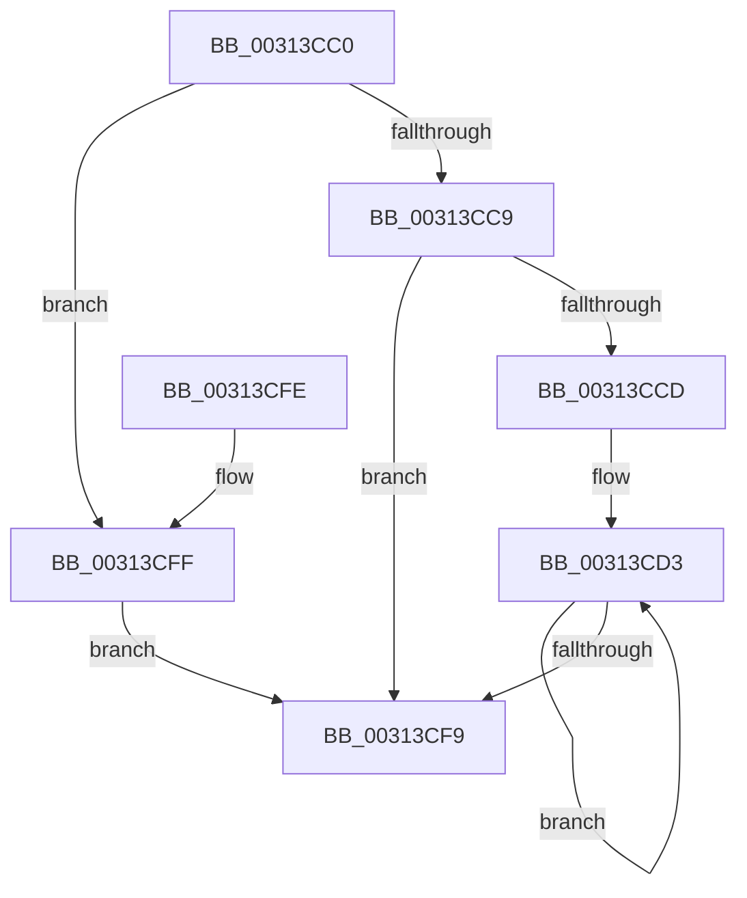

# HvlpCopyFlushVaList

- RVA: `0x00313CC0`–`0x00313D06` (길이 `70` bytes)
- VA: `0x0000000140313CC0`
- 실행 섹션: `.text`
- PDB 이름 있음: `예`; PDB Function 태그: `예`
- unwind 정보 RVA: `0x00074648`
- 디코드: `23`개 명령, `70/70` bytes 표시
- 미해석 바이트: `0` (있으면 어셈블리에 `.byte`로 보존)

> 이 문서는 커널 이미지의 기계어와 PDB 기호를 분석해 생성했습니다. 4번과 5번은 함수 원형과 자료형을 바이너리 사용 방식에서 추정한 C 해석이며 원본 소스 복구 결과는 아닙니다.

## 1. Dependencies

- 직접 호출 지점: **0**; 고유 호출 대상: **0**
- 직접 호출자로 확인된 함수: **6**
- RIP 상대 이미지 참조: **0**

### Outgoing calls
- 직접 디코드된 call 명령이 없습니다.

### Direct callers
- [HvlpFastFlushListTbEx](../30/HvlpFastFlushListTbEx_function_00306784.md) at `0x00306875`
- [sub_00312CF6](Unknown_function_00312CF6.md) at `0x00312D98`
- [HvlpSlowFlushListTbEx](../4A/HvlpSlowFlushListTbEx_function_004AFCF8.md) at `0x004AFDFD`
- [HvlpDmaFastFlushDeviceDomainVaList](../58/HvlpDmaFastFlushDeviceDomainVaList_function_00589BE0.md) at `0x00589C40`
- [HvlpDmaSlowFlushDeviceDomainVaList](../58/HvlpDmaSlowFlushDeviceDomainVaList_function_00589CC0.md) at `0x00589D54`
- [HvlpSlowFlushPasidAddressList](../58/HvlpSlowFlushPasidAddressList_function_00589EE4.md) at `0x00589F61`

### Static image references
- 디코드된 RIP-relative 메모리 참조가 없습니다.

## 2. Other-region calls and transfers

- 다른 실행 섹션으로 향하는 call: **0**
- 별도 외부 분기/꼬리 이동을 확인하지 못했습니다.

## 3. Assembly (complete function range)

```asm
00313CC0  48 83 EC 08                     sub rsp, 8
00313CC4  45 84 C0                        test r8b, r8b
00313CC7  75 36                           jne 0x140313cff
00313CC9  85 C9                           test ecx, ecx
00313CCB  74 2C                           je 0x140313cf9
00313CCD  49 2B D1                        sub rdx, r9
00313CD0  44 8B C1                        mov r8d, ecx
00313CD3  4A 8B 04 0A                     mov rax, qword ptr [rdx + r9]
00313CD7  4D 8D 49 08                     lea r9, [r9 + 8]
00313CDB  48 8B C8                        mov rcx, rax
00313CDE  81 E1 00 0C 00 00               and ecx, 0xc00
00313CE4  48 03 C8                        add rcx, rax
00313CE7  25 00 08 00 00                  and eax, 0x800
00313CEC  48 0B C8                        or rcx, rax
00313CEF  49 89 49 F8                     mov qword ptr [r9 - 8], rcx
00313CF3  49 83 E8 01                     sub r8, 1
00313CF7  75 DA                           jne 0x140313cd3
00313CF9  48 83 C4 08                     add rsp, 8
00313CFD  C3                              ret
00313CFE  CC                              int3
00313CFF  45 33 D2                        xor r10d, r10d
00313D02  85 C9                           test ecx, ecx
00313D04  74 F3                           je 0x140313cf9
```

## 4. C-style interpretation (structured pseudocode)

```c
__int64 __fastcall HvlpCopyFlushVaList(int a1, __int64 a2, unsigned __int8 a3, __int64 a4)
{
    __int64 result;
    __int64 v_r10;
    __int64 v_rsp;

    v_rsp = (v_rsp) - (8);
    if (a3 != 0) goto loc_00313CFF;
    if (a1 == 0) goto loc_00313CF9;
    a2 = (a2) - (a4);
loc_00313CD3:
    a1 = (unsigned int)((*(unsigned __int64 *)(a2 + a4 * 1)) & (0xC00ULL));
    a1 = (a1) + (*(unsigned __int64 *)(a2 + a4 * 1));
    result = (unsigned int)((*(unsigned __int64 *)(a2 + a4 * 1)) & (0x800ULL));
    a1 = (a1) | (result);
    *(unsigned __int64 *)(a4 + 8 - 8) = a1;
    a3 = ((unsigned int)(a1)) - (1);
    if (condition_is_not_equal) goto loc_00313CD3;
loc_00313CF9:
    v_rsp = (v_rsp) + (8);
    return result;
loc_00313CFF:
    v_r10 = 0;
    if (a1 == 0) goto loc_00313CF9;
}
```

## 5. (Beta) C Style

```c
int64_t HvlpCopyFlushVaList(int32_t Arg1, void *Arg2, uint8_t Arg3, void *Arg4)
{
    uint8_t *arg2 = (uint8_t *)Arg2;
    uint8_t *arg4 = (uint8_t *)Arg4;

    int64_t result;
    int64_t local_r10;
    int64_t local_rsp;

    local_rsp = (local_rsp) - (8);
    if (Arg3 != 0) goto loc_00313CFF;
    if (Arg1 == 0) goto loc_00313CF9;
    Arg2 = (Arg2) - (Arg4);
loc_00313CD3:
    Arg1 = (uint32_t)((*(uint64_t *)(arg2 + arg4 * 1)) & (0xC00ULL));
    Arg1 = (Arg1) + (*(uint64_t *)(arg2 + arg4 * 1));
    result = (uint32_t)((*(uint64_t *)(arg2 + arg4 * 1)) & (0x800ULL));
    Arg1 = (Arg1) | (result);
    *(uint64_t *)(arg4 + 0x8 - 0x8) = Arg1;
    Arg3 = ((uint32_t)(Arg1)) - (1);
    if (condition_is_not_equal) goto loc_00313CD3;
loc_00313CF9:
    local_rsp = (local_rsp) + (8);
    return result;
loc_00313CFF:
    local_r10 = 0;
    if (Arg1 == 0) goto loc_00313CF9;
}
```

### 관측된 메모리 오프셋

구조체 형식이 확인되지 않은 접근은 인자 기준의 오프셋으로만 기록했습니다.

| 기준 인자 | 오프셋 표현 | 폭 (bit) | 접근 |
|---|---:|---:|---|
| `Arg2` | `+ 0x0 + r9*1` | `64` | `R` |
| `Arg4` | `- 0x8` | `64` | `W` |
| `Arg4` | `+ 0x8` | `64` | `R` |

## 6. Execution-region graph

[열기: 2D/3D 그래프와 함수 탐색 컨트롤 패널](../../../control-panel.html?section=text&rva=0x00313CC0&view=graph)

- 2D 그래프는 위에서 아래로 흐르고, 3D 그래프는 빈 공간을 드래그해 회전합니다. Shift+드래그는 이동, 휠은 확대·축소, 함수 노드 선택은 대상 보고서 이동입니다.

### Static fallback


