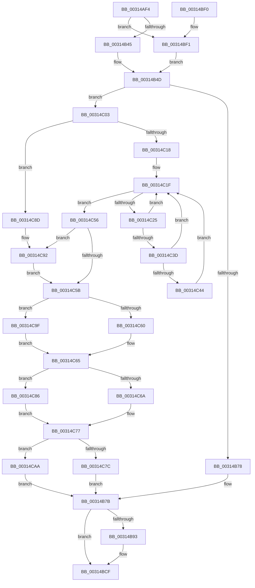

# HvlpFastFlushAddressSpaceTb

- RVA: `0x00314AF4`–`0x00314CB8` (길이 `452` bytes)
- VA: `0x0000000140314AF4`
- 실행 섹션: `.text`
- PDB 이름 있음: `예`; PDB Function 태그: `아니요`
- unwind 정보 RVA: `0x00074890`
- 디코드: `116`개 명령, `452/452` bytes 표시
- 미해석 바이트: `0` (있으면 어셈블리에 `.byte`로 보존)

> 이 문서는 커널 이미지의 기계어와 PDB 기호를 분석해 생성했습니다. 4번과 5번은 함수 원형과 자료형을 바이너리 사용 방식에서 추정한 C 해석이며 원본 소스 복구 결과는 아닙니다.

## 1. Dependencies

- 직접 호출 지점: **7**; 고유 호출 대상: **7**
- 직접 호출자로 확인된 함수: **3**
- RIP 상대 이미지 참조: **3**

### Outgoing calls
- `0x00314B89` → [HvcallpExtendedFastHypercall](../6B/HvcallpExtendedFastHypercall_function_006BBE40.md) (function, `0x006BBE40`)
- `0x00314BCA` → [EtwTraceTimedEvent](../3A/EtwTraceTimedEvent_function_003A3430.md) (function, `0x003A3430`)
- `0x00314BD6` → [_security_check_cookie](../6A/_security_check_cookie_function_006AC640.md) (function, `0x006AC640`)
- `0x00314BF5` → [HvlpAffinityToVirtualAffinity](../45/HvlpAffinityToVirtualAffinity_function_0045AD50.md) (function, `0x0045AD50`)
- `0x00314C94` → [KeQueryPerformanceCounter](../37/KeQueryPerformanceCounter_function_0037E7E0.md) (function, `0x0037E7E0`)
- `0x00314C9F` → [RtlGetSystemTimePrecise](../37/RtlGetSystemTimePrecise_function_0037EDD0.md) (function, `0x0037EDD0`)
- `0x00314CAA` → [EtwpGetHostPerfCounter](../3A/EtwpGetHostPerfCounter_function_003A4134.md) (function, `0x003A4134`)

### Direct callers
- [KiFlushAddressSpaceTb](../30/KiFlushAddressSpaceTb_function_00308F50.md) at `0x00308F8C`
- [KiFlushAddressSpaceTb](../30/KiFlushAddressSpaceTb_function_00308F50.md) at `0x00308FD9`
- [KeFlushCurrentTbOnly](KeFlushCurrentTbOnly_function_003134EC.md) at `0x003135E9`
- [sub_003143F3](Unknown_function_003143F3.md) at `0x00314488`
- [sub_003143F3](Unknown_function_003143F3.md) at `0x00314514`

### Static image references
- `0x00314B0B` → RVA `0x00E0A740` (`.data`; read)
- `0x00314B57` → RVA `0x00FC6B14` (`ALMOSTRO`; read)
- `0x00314C09` → RVA `0x00FCFC80` (`CACHEALI`; read)

## 2. Other-region calls and transfers

- 다른 실행 섹션으로 향하는 call: **0**
- 별도 외부 분기/꼬리 이동을 확인하지 못했습니다.

## 3. Assembly (complete function range)

```asm
00314AF4  48 89 5C 24 08                  mov qword ptr [rsp + 8], rbx
00314AF9  48 89 7C 24 10                  mov qword ptr [rsp + 0x10], rdi
00314AFE  55                              push rbp
00314AFF  48 8D 6C 24 A9                  lea rbp, [rsp - 0x57]
00314B04  48 81 EC 90 00 00 00            sub rsp, 0x90
00314B0B  48 8B 05 2E 5C AF 00            mov rax, qword ptr [rip + 0xaf5c2e]
00314B12  48 33 C4                        xor rax, rsp
00314B15  48 89 45 47                     mov qword ptr [rbp + 0x47], rax
00314B19  41 F6 D8                        neg r8b
00314B1C  48 C7 45 FF 02 00 00 00         mov qword ptr [rbp - 1], 2
00314B24  4C 8B D1                        mov r10, rcx
00314B27  1B C0                           sbb eax, eax
00314B29  F7 D0                           not eax
00314B2B  83 E0 04                        and eax, 4
00314B2E  44 8B C8                        mov r9d, eax
00314B31  41 83 C9 02                     or r9d, 2
00314B35  48 85 C9                        test rcx, rcx
00314B38  44 0F 45 C8                     cmovne r9d, eax
00314B3C  48 85 D2                        test rdx, rdx
00314B3F  0F 85 AC 00 00 00               jne 0x140314bf1
00314B45  41 83 C9 01                     or r9d, 1
00314B49  48 21 55 37                     and qword ptr [rbp + 0x37], rdx
00314B4D  41 8B C1                        mov eax, r9d
00314B50  0F 57 C0                        xorps xmm0, xmm0
00314B53  48 89 45 2F                     mov qword ptr [rbp + 0x2f], rax
00314B57  8B 05 B7 1F CB 00               mov eax, dword ptr [rip + 0xcb1fb7]
00314B5D  4C 89 55 27                     mov qword ptr [rbp + 0x27], r10
00314B61  C7 45 FF 02 00 01 00            mov dword ptr [rbp - 1], 0x10002
00314B68  0F 11 45 07                     movups xmmword ptr [rbp + 7], xmm0
00314B6C  0F 11 45 17                     movups xmmword ptr [rbp + 0x17], xmm0
00314B70  A8 10                           test al, 0x10
00314B72  0F 85 8B 00 00 00               jne 0x140314c03
00314B78  40 32 FF                        xor dil, dil
00314B7B  48 8B 4D FF                     mov rcx, qword ptr [rbp - 1]
00314B7F  48 8D 55 27                     lea rdx, [rbp + 0x27]
00314B83  41 B8 18 00 00 00               mov r8d, 0x18
00314B89  E8 B2 72 3A 00                  call 0x1406bbe40
00314B8E  40 84 FF                        test dil, dil
00314B91  74 3C                           je 0x140314bcf
00314B93  48 83 65 F7 00                  and qword ptr [rbp - 9], 0
00314B98  48 8D 45 07                     lea rax, [rbp + 7]
00314B9C  48 89 44 24 28                  mov qword ptr [rsp + 0x28], rax
00314BA1  4C 8D 45 F7                     lea r8, [rbp - 9]
00314BA5  B9 72 0F 00 00                  mov ecx, 0xf72
00314BAA  C7 44 24 20 02 0E 50 00         mov dword ptr [rsp + 0x20], 0x500e02
00314BB2  41 B9 08 00 00 00               mov r9d, 8
00314BB8  C7 45 F7 02 00 00 00            mov dword ptr [rbp - 9], 2
00314BBF  BA 10 00 00 A0                  mov edx, 0xa0000010
00314BC4  66 C7 45 FB 01 00               mov word ptr [rbp - 5], 1
00314BCA  E8 61 E8 08 00                  call 0x1403a3430
00314BCF  48 8B 4D 47                     mov rcx, qword ptr [rbp + 0x47]
00314BD3  48 33 CC                        xor rcx, rsp
00314BD6  E8 65 7A 39 00                  call 0x1406ac640
00314BDB  4C 8D 9C 24 90 00 00 00         lea r11, [rsp + 0x90]
00314BE3  49 8B 5B 10                     mov rbx, qword ptr [r11 + 0x10]
00314BE7  49 8B 7B 18                     mov rdi, qword ptr [r11 + 0x18]
00314BEB  49 8B E3                        mov rsp, r11
00314BEE  5D                              pop rbp
00314BEF  C3                              ret
00314BF0  CC                              int3
00314BF1  48 8B 4A 08                     mov rcx, qword ptr [rdx + 8]
00314BF5  E8 56 61 14 00                  call 0x14045ad50
00314BFA  48 89 45 37                     mov qword ptr [rbp + 0x37], rax
00314BFE  E9 4A FF FF FF                  jmp 0x140314b4d
00314C03  83 65 F7 00                     and dword ptr [rbp - 9], 0
00314C07  33 DB                           xor ebx, ebx
00314C09  48 8B 15 70 B0 CB 00            mov rdx, qword ptr [rip + 0xcbb070]
00314C10  40 B7 01                        mov dil, 1
00314C13  48 85 D2                        test rdx, rdx
00314C16  74 75                           je 0x140314c8d
00314C18  44 8B 82 A8 11 00 00            mov r8d, dword ptr [rdx + 0x11a8]
00314C1F  41 0F BC C8                     bsf ecx, r8d
00314C23  74 31                           je 0x140314c56
00314C25  41 8D 40 FF                     lea eax, [r8 - 1]
00314C29  44 23 C0                        and r8d, eax
00314C2C  8B C1                           mov eax, ecx
00314C2E  48 C1 E0 05                     shl rax, 5
00314C32  48 05 CC 11 00 00               add rax, 0x11cc
00314C38  48 03 C2                        add rax, rdx
00314C3B  74 E2                           je 0x140314c1f
00314C3D  8B 40 14                        mov eax, dword ptr [rax + 0x14]
00314C40  A8 10                           test al, 0x10
00314C42  74 DB                           je 0x140314c1f
00314C44  8A 8C 4A 99 11 00 00            mov cl, byte ptr [rdx + rcx*2 + 0x1199]
00314C4B  B8 01 00 00 00                  mov eax, 1
00314C50  D3 E0                           shl eax, cl
00314C52  0B D8                           or ebx, eax
00314C54  EB C9                           jmp 0x140314c1f
00314C56  F6 C3 02                        test bl, 2
00314C59  75 37                           jne 0x140314c92
00314C5B  F6 C3 04                        test bl, 4
00314C5E  75 3F                           jne 0x140314c9f
00314C60  48 83 65 0F 00                  and qword ptr [rbp + 0xf], 0
00314C65  F6 C3 08                        test bl, 8
00314C68  74 1C                           je 0x140314c86
00314C6A  0F 31                           rdtsc
00314C6C  48 C1 E2 20                     shl rdx, 0x20
00314C70  48 0B C2                        or rax, rdx
00314C73  48 89 45 17                     mov qword ptr [rbp + 0x17], rax
00314C77  F6 C3 10                        test bl, 0x10
00314C7A  75 2E                           jne 0x140314caa
00314C7C  48 83 65 1F 00                  and qword ptr [rbp + 0x1f], 0
00314C81  E9 F5 FE FF FF                  jmp 0x140314b7b
00314C86  48 83 65 17 00                  and qword ptr [rbp + 0x17], 0
00314C8B  EB EA                           jmp 0x140314c77
00314C8D  BB 1E 00 00 00                  mov ebx, 0x1e
00314C92  33 C9                           xor ecx, ecx
00314C94  E8 47 9B 06 00                  call 0x14037e7e0
00314C99  48 89 45 07                     mov qword ptr [rbp + 7], rax
00314C9D  EB BC                           jmp 0x140314c5b
00314C9F  E8 2C A1 06 00                  call 0x14037edd0
00314CA4  48 89 45 0F                     mov qword ptr [rbp + 0xf], rax
00314CA8  EB BB                           jmp 0x140314c65
00314CAA  E8 85 F4 08 00                  call 0x1403a4134
00314CAF  48 89 45 1F                     mov qword ptr [rbp + 0x1f], rax
00314CB3  E9 C3 FE FF FF                  jmp 0x140314b7b
```

## 4. C-style interpretation (structured pseudocode)

```c
__int64 __fastcall HvlpFastFlushAddressSpaceTb(__int64 a1, __int64 a2, unsigned __int8 a3)
{
    __int64 result;
    __int64 v_rbx;
    __int64 v_rdi;
    __int64 v_rsp;
    unsigned __int64 v_stack_m18;
    unsigned __int64 v_stack_m28;
    unsigned __int64 v_stack_m30;
    unsigned __int64 v_stack_m38;
    unsigned __int64 v_stack_m40;
    unsigned __int64 v_stack_m48;
    unsigned __int64 v_stack_m50;
    unsigned __int64 v_stack_m58;
    unsigned __int64 v_stack_m5F;
    unsigned __int64 v_stack_m60;
    unsigned __int16 v_stack_m64;
    unsigned __int64 v_stack_m68;
    unsigned __int64 v_stack_m70;
    unsigned int v_stack_m78;
    unsigned __int64 v_stack_m8;
    unsigned __int64 v_stack_p10;
    unsigned __int64 v_stack_p8;

    v_stack_p8 = v_rbx;
    v_stack_p10 = v_rdi;
    v_rsp = (v_rsp) - (144);
    result = (*(unsigned __int64 *)(v_rip + 11492398)) ^ (v_rsp);
    v_stack_m18 = result;
    a3 = (unsigned __int8)(-(a3));
    v_stack_m60 = 2;
    result = (unsigned int)(~(result));
    result = (unsigned int)((result) & (4));
    a4 = (unsigned int)(((unsigned int)((unsigned int)(result))) | (2));
    if (a1 != 0) { a4 = (unsigned int)(result); }
    if (a2 != 0) goto loc_00314BF1;
    a4 = (unsigned int)((a4) | (1));
loc_00314B4D:
    v_stack_m30 = (unsigned int)((unsigned int)(a4));
    v_stack_m38 = a1;
    v_stack_m60 = 0x10002ULL;
    v_stack_m58 = v_xmm0;
    v_stack_m48 = v_xmm0;
    if ((((unsigned __int8)((unsigned int)(*(unsigned int *)(v_rip + 13311927)))) & (16)) != 0) goto loc_00314C03;
    v_rdi = 0;
loc_00314B7B:
    result = HvcallpExtendedFastHypercall(v_stack_m60, v_stack_m38, 24, a4);
    if (0 != 0) {
        result = v_stack_m58;
        v_stack_m70 = result;
        a3 = v_stack_m68;
        a1 = 0xF72ULL;
        v_stack_m78 = 0x500E02ULL;
        a4 = 8;
        v_stack_m68 = 2;
        a2 = 0xA0000010ULL;
        v_stack_m64 = 1;
        result = EtwTraceTimedEvent(a1, a2, a3, a4);
    }
    a1 = (v_stack_m18) ^ (v_rsp);
    result = _security_check_cookie(a1, a2, a3, a4);
    return result;
loc_00314BF1:
    result = HvlpAffinityToVirtualAffinity(*(unsigned __int64 *)(a2 + 8), a2, a3, a4);
    v_stack_m28 = result;
    goto loc_00314B4D;
loc_00314C03:
    v_rbx = 0;
    if (*(unsigned __int64 *)(v_rip + 13348976) == 0) goto loc_00314C8D;
loc_00314C1F:
    if (*(unsigned __int64 *)(v_rip + 13348976) == 0) goto loc_00314C56;
    a3 = (unsigned int)(((unsigned int)(*(unsigned int *)(*(unsigned __int64 *)(v_rip + 13348976) + 4520))) & ((unsigned int)((unsigned int)(*(unsigned int *)(*(unsigned __int64 *)(v_rip + 13348976) + 4520)) - 1)));
    result = ((unsigned int)((unsigned int)(*(unsigned __int64 *)(a2 + 8)))) << (5);
    result = (result) + (0x11CCULL);
    result = (result) + (*(unsigned __int64 *)(v_rip + 13348976));
    if (condition_is_equal) goto loc_00314C1F;
    if ((((unsigned __int8)((unsigned int)(*(unsigned int *)(result + 20)))) & (16)) == 0) goto loc_00314C1F;
    result = (unsigned int)((1) << ((unsigned __int8)(*(unsigned __int8 *)(*(unsigned __int64 *)(v_rip + 13348976) + *(unsigned __int64 *)(a2 + 8) * 2 + 4505))));
    v_rbx = (unsigned int)((v_rbx) | ((unsigned int)(result)));
    goto loc_00314C1F;
loc_00314C56:
    if ((((unsigned __int8)(v_rbx)) & (2)) != 0) goto loc_00314C92;
loc_00314C5B:
    if ((((unsigned __int8)(v_rbx)) & (4)) != 0) goto loc_00314C9F;
loc_00314C65:
    if ((((unsigned __int8)(v_rbx)) & (8)) == 0) goto loc_00314C86;
    a2 = (*(unsigned __int64 *)(v_rip + 13348976)) << (32);
    result = (result) | (a2);
    v_stack_m48 = result;
loc_00314C77:
    if ((((unsigned __int8)(v_rbx)) & (16)) != 0) goto loc_00314CAA;
    goto loc_00314B7B;
loc_00314C86:
    goto loc_00314C77;
loc_00314C8D:
loc_00314C92:
    a1 = 0;
    result = KeQueryPerformanceCounter(a1, a2, a3, a4);
    v_stack_m58 = result;
    goto loc_00314C5B;
loc_00314C9F:
    result = RtlGetSystemTimePrecise(a1, a2, a3, a4);
    v_stack_m50 = result;
    goto loc_00314C65;
loc_00314CAA:
    result = EtwpGetHostPerfCounter(a1, a2, a3, a4);
    v_stack_m40 = result;
    goto loc_00314B7B;
}
```

## 5. (Beta) C Style

```c
int64_t HvlpFastFlushAddressSpaceTb(int64_t Arg1, int64_t Arg2, uint8_t Arg3)
{
    int64_t result;
    int64_t local_rbx;
    int64_t local_rdi;
    int64_t local_rsp;
    uint64_t v_stack_m18;
    uint64_t v_stack_m28;
    uint64_t v_stack_m30;
    uint64_t v_stack_m38;
    uint64_t v_stack_m40;
    uint64_t v_stack_m48;
    uint64_t v_stack_m50;
    uint64_t v_stack_m58;
    uint64_t v_stack_m5F;
    uint64_t v_stack_m60;
    uint16_t v_stack_m64;
    uint64_t v_stack_m68;
    uint64_t v_stack_m70;
    uint32_t v_stack_m78;
    uint64_t v_stack_m8;
    uint64_t v_stack_p10;
    uint64_t v_stack_p8;

    v_stack_p8 = local_rbx;
    v_stack_p10 = local_rdi;
    local_rsp = (local_rsp) - (144);
    result = (*(uint64_t *)(v_rip + 0xAF5C2E)) ^ (local_rsp);
    v_stack_m18 = result;
    Arg3 = (uint8_t)(-(Arg3));
    v_stack_m60 = 2;
    result = (uint32_t)(~(result));
    result = (uint32_t)((result) & (4));
    a4 = (uint32_t)(((uint32_t)((uint32_t)(result))) | (2));
    if (Arg1 != 0) { a4 = (uint32_t)(result); }
    if (Arg2 != 0) goto loc_00314BF1;
    a4 = (uint32_t)((a4) | (1));
loc_00314B4D:
    v_stack_m30 = (uint32_t)((uint32_t)(a4));
    v_stack_m38 = Arg1;
    v_stack_m60 = 0x10002ULL;
    v_stack_m58 = v_xmm0;
    v_stack_m48 = v_xmm0;
    if ((((uint8_t)((uint32_t)(*(uint32_t *)(v_rip + 0xCB1FB7)))) & (16)) != 0) goto loc_00314C03;
    local_rdi = 0;
loc_00314B7B:
    result = HvcallpExtendedFastHypercall(v_stack_m60, v_stack_m38, 24, a4);
    if (0 != 0) {
        result = v_stack_m58;
        v_stack_m70 = result;
        Arg3 = v_stack_m68;
        Arg1 = 0xF72ULL;
        v_stack_m78 = 0x500E02ULL;
        a4 = 8;
        v_stack_m68 = 2;
        Arg2 = 0xA0000010ULL;
        v_stack_m64 = 1;
        result = EtwTraceTimedEvent(Arg1, Arg2, Arg3, a4);
    }
    Arg1 = (v_stack_m18) ^ (local_rsp);
    result = _security_check_cookie(Arg1, Arg2, Arg3, a4);
    return result;
loc_00314BF1:
    result = HvlpAffinityToVirtualAffinity(*(uint64_t *)(Arg2 + 0x8), Arg2, Arg3, a4);
    v_stack_m28 = result;
    goto loc_00314B4D;
loc_00314C03:
    local_rbx = 0;
    if (*(uint64_t *)(v_rip + 0xCBB070) == 0) goto loc_00314C8D;
loc_00314C1F:
    if (*(uint64_t *)(v_rip + 0xCBB070) == 0) goto loc_00314C56;
    Arg3 = (uint32_t)(((uint32_t)(*(uint32_t *)(*(uint64_t *)(v_rip + 0xCBB070) + 0x11A8))) & ((uint32_t)((uint32_t)(*(uint32_t *)(*(uint64_t *)(v_rip + 0xCBB070) + 0x11A8)) - 1)));
    result = ((uint32_t)((uint32_t)(*(uint64_t *)(Arg2 + 0x8)))) << (5);
    result = (result) + (0x11CCULL);
    result = (result) + (*(uint64_t *)(v_rip + 0xCBB070));
    if (condition_is_equal) goto loc_00314C1F;
    if ((((uint8_t)((uint32_t)(*(uint32_t *)(result + 0x14)))) & (16)) == 0) goto loc_00314C1F;
    result = (uint32_t)((1) << ((uint8_t)(*(uint8_t *)(*(uint64_t *)(v_rip + 0xCBB070) + *(uint64_t *)(Arg2 + 0x8) * 2 + 0x1199))));
    local_rbx = (uint32_t)((local_rbx) | ((uint32_t)(result)));
    goto loc_00314C1F;
loc_00314C56:
    if ((((uint8_t)(local_rbx)) & (2)) != 0) goto loc_00314C92;
loc_00314C5B:
    if ((((uint8_t)(local_rbx)) & (4)) != 0) goto loc_00314C9F;
loc_00314C65:
    if ((((uint8_t)(local_rbx)) & (8)) == 0) goto loc_00314C86;
    Arg2 = (*(uint64_t *)(v_rip + 0xCBB070)) << (32);
    result = (result) | (Arg2);
    v_stack_m48 = result;
loc_00314C77:
    if ((((uint8_t)(local_rbx)) & (16)) != 0) goto loc_00314CAA;
    goto loc_00314B7B;
loc_00314C86:
    goto loc_00314C77;
loc_00314C8D:
loc_00314C92:
    Arg1 = 0;
    result = KeQueryPerformanceCounter(Arg1, Arg2, Arg3, a4);
    v_stack_m58 = result;
    goto loc_00314C5B;
loc_00314C9F:
    result = RtlGetSystemTimePrecise(Arg1, Arg2, Arg3, a4);
    v_stack_m50 = result;
    goto loc_00314C65;
loc_00314CAA:
    result = EtwpGetHostPerfCounter(Arg1, Arg2, Arg3, a4);
    v_stack_m40 = result;
    goto loc_00314B7B;
}
```

## 6. Execution-region graph

[열기: 2D/3D 그래프와 함수 탐색 컨트롤 패널](../../../control-panel.html?section=text&rva=0x00314AF4&view=graph)

- 2D 그래프는 위에서 아래로 흐르고, 3D 그래프는 빈 공간을 드래그해 회전합니다. Shift+드래그는 이동, 휠은 확대·축소, 함수 노드 선택은 대상 보고서 이동입니다.

### Static fallback


