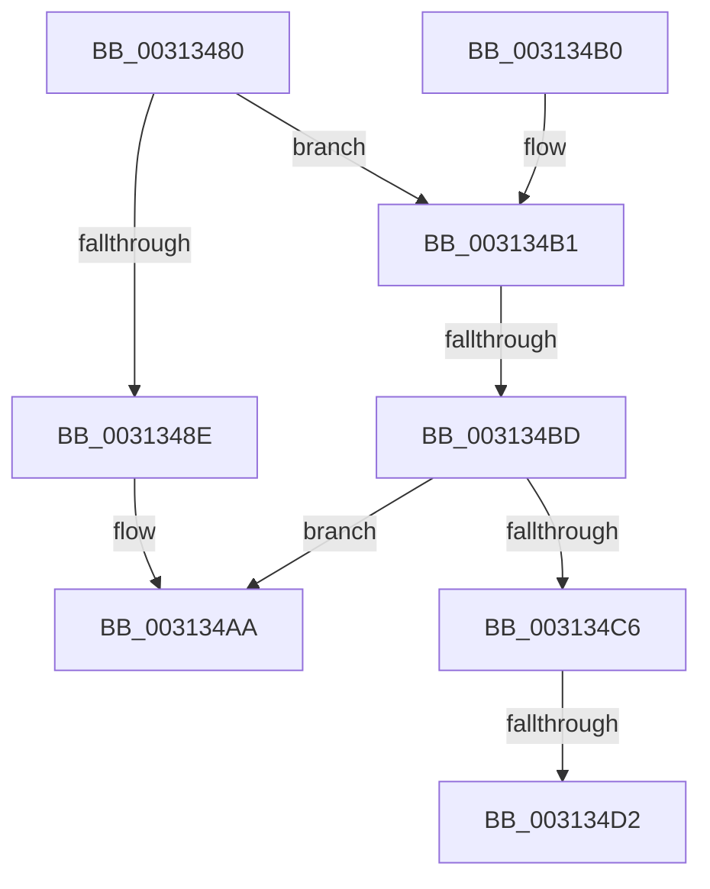

# HvlpReleaseHypercallPage

- RVA: `0x00313480`–`0x003134E3` (길이 `99` bytes)
- VA: `0x0000000140313480`
- 실행 섹션: `.text`
- PDB 이름 있음: `예`; PDB Function 태그: `예`
- unwind 정보 RVA: `0x0006CB78`
- 디코드: `29`개 명령, `99/99` bytes 표시
- 미해석 바이트: `0` (있으면 어셈블리에 `.byte`로 보존)

> 이 문서는 커널 이미지의 기계어와 PDB 기호를 분석해 생성했습니다. 4번과 5번은 함수 원형과 자료형을 바이너리 사용 방식에서 추정한 C 해석이며 원본 소스 복구 결과는 아닙니다.

## 1. Dependencies

- 직접 호출 지점: **2**; 고유 호출 대상: **2**
- 직접 호출자로 확인된 함수: **71**
- RIP 상대 이미지 참조: **1**

### Outgoing calls
- `0x003134A5` → [ExpInterlockedPushEntrySList](../6B/ExpInterlockedPushEntrySList_function_006BA5B0.md) (function, `0x006BA5B0`)
- `0x003134D8` → [KiLowerIrqlProcessIrqlFlags](../4F/KiLowerIrqlProcessIrqlFlags_function_004F5698.md) (function, `0x004F5698`)

### Direct callers
- [HvlpSlowSendSyntheticClusterIpiEx](../30/HvlpSlowSendSyntheticClusterIpiEx_function_003034E0.md) at `0x0030363D`
- [HvlpSlowSendSyntheticClusterIpiEx](../30/HvlpSlowSendSyntheticClusterIpiEx_function_003034E0.md) at `0x003036A7`
- [HvlRetargetDeviceInterrupt](../30/HvlRetargetDeviceInterrupt_function_003062A0.md) at `0x00306495`
- [HvlRetargetDeviceInterrupt](../30/HvlRetargetDeviceInterrupt_function_003062A0.md) at `0x0030649F`
- [HvlGetSparseGpaPagesAccessState](../30/HvlGetSparseGpaPagesAccessState_function_00306A78.md) at `0x00306BEB`
- [HvlGetSparseGpaPagesAccessState](../30/HvlGetSparseGpaPagesAccessState_function_00306A78.md) at `0x00306BF4`
- [sub_00312CF6](Unknown_function_00312CF6.md) at `0x00312E3D`
- [sub_00313017](Unknown_function_00313017.md) at `0x00313060`
- [HvlMapSparseGpaPages](../42/HvlMapSparseGpaPages_function_0042A160.md) at `0x0042A27E`
- [HvlGetGpaPagesAccessState](../42/HvlGetGpaPagesAccessState_function_0042A3D4.md) at `0x0042A59B`
- [HvlGetGpaPagesAccessState](../42/HvlGetGpaPagesAccessState_function_0042A3D4.md) at `0x0042A5A4`
- [HvlMapGpaPages](../46/HvlMapGpaPages_function_00462934.md) at `0x00462A6B`
- [HvlpSlowFlushListTbEx](../4A/HvlpSlowFlushListTbEx_function_004AFCF8.md) at `0x004AFE27`
- [HvlQueryHypervisorTscAdjustment](../58/HvlQueryHypervisorTscAdjustment_function_0058424C.md) at `0x00584329`
- [HvlQueryHypervisorTscAdjustment](../58/HvlQueryHypervisorTscAdjustment_function_0058424C.md) at `0x00584333`
- [HvlGetRootVpSharedPages](../58/HvlGetRootVpSharedPages_function_0058466C.md) at `0x0058471F`
- [HvlGetRootVpSharedPages](../58/HvlGetRootVpSharedPages_function_0058466C.md) at `0x00584728`
- [HvlQueryNumaDistance](../58/HvlQueryNumaDistance_function_00584A00.md) at `0x00584ACA`
- [HvlQueryNumaDistance](../58/HvlQueryNumaDistance_function_00584A00.md) at `0x00584AD3`
- [HvlSetupPhysicalFaultNotificationQueue](../58/HvlSetupPhysicalFaultNotificationQueue_function_00584CE0.md) at `0x00584DC1`
- [HvlSetupPhysicalFaultNotificationQueue](../58/HvlSetupPhysicalFaultNotificationQueue_function_00584CE0.md) at `0x00584DCA`
- [HvlStartBootLogicalProcessors](../58/HvlStartBootLogicalProcessors_function_00584E18.md) at `0x00585178`
- [HvlpDepositPages](../58/HvlpDepositPages_function_00585474.md) at `0x0058561A`
- [HvlpGetLogicalProcessorProperty](../58/HvlpGetLogicalProcessorProperty_function_00585774.md) at `0x00585820`
- [HvlpGetLogicalProcessorProperty](../58/HvlpGetLogicalProcessorProperty_function_00585774.md) at `0x00585829`
- [HvlpGetVpIndexFromApicId](../58/HvlpGetVpIndexFromApicId_function_00585880.md) at `0x00585931`
- [HvlpGetVpIndexFromApicId](../58/HvlpGetVpIndexFromApicId_function_00585880.md) at `0x0058593A`
- [HvlpMapStatisticsPage](../58/HvlpMapStatisticsPage_function_00585B68.md) at `0x00585C17`
- [HvlpMapStatisticsPage](../58/HvlpMapStatisticsPage_function_00585B68.md) at `0x00585C20`
- [HvlpSetupSchedulerAssist](../58/HvlpSetupSchedulerAssist_function_005868F8.md) at `0x00586971`
- [HvlpStartLogicalProcessor](../58/HvlpStartLogicalProcessor_function_00586988.md) at `0x00586A93`
- [HvlpStartLogicalProcessor](../58/HvlpStartLogicalProcessor_function_00586988.md) at `0x00586A9C`
- [HvlpStartVirtualProcessor](../58/HvlpStartVirtualProcessor_function_00586ADC.md) at `0x00586BBD`
- [HvlpUpdateLpcbIndex](../58/HvlpUpdateLpcbIndex_function_00586BD8.md) at `0x00586C59`
- [HvlpWithdrawPages](../58/HvlpWithdrawPages_function_00586C90.md) at `0x00586EA7`
- [HvlpWithdrawPages](../58/HvlpWithdrawPages_function_00586C90.md) at `0x00586EB1`
- [HvlpQueryHypervisorSchedulerType](../58/HvlpQueryHypervisorSchedulerType_function_00586FB4.md) at `0x0058705D`
- [HvlpQueryHypervisorSchedulerType](../58/HvlpQueryHypervisorSchedulerType_function_00586FB4.md) at `0x00587067`
- [HvlDmaGetDmaGuardEnabled](../58/HvlDmaGetDmaGuardEnabled_function_00587A50.md) at `0x00587B09`
- [HvlDmaGetDmaGuardEnabled](../58/HvlDmaGetDmaGuardEnabled_function_00587A50.md) at `0x00587B13`
- [HvlDmaGetHybridPassthroughReservedRegions](../58/HvlDmaGetHybridPassthroughReservedRegions_function_00587B50.md) at `0x00587C48`
- [HvlDmaGetHybridPassthroughReservedRegions](../58/HvlDmaGetHybridPassthroughReservedRegions_function_00587B50.md) at `0x00587C52`
- [HvlEnterSleepState](../58/HvlEnterSleepState_function_00587E50.md) at `0x00587EB9`
- [HvlGetDeviceCapabilities](../58/HvlGetDeviceCapabilities_function_00587EF0.md) at `0x00587FD5`
- [HvlGetDeviceCapabilities](../58/HvlGetDeviceCapabilities_function_00587EF0.md) at `0x00587FDE`
- [HvlGetSystemPasidCapabilities](../58/HvlGetSystemPasidCapabilities_function_00588520.md) at `0x005886A0`
- [HvlGetSystemPasidCapabilities](../58/HvlGetSystemPasidCapabilities_function_00588520.md) at `0x005886AA`
- [HvlHvDebuggerPowerHandler](../58/HvlHvDebuggerPowerHandler_function_00588770.md) at `0x005887D8`
- [HvlLpReadCpuid](../58/HvlLpReadCpuid_function_00588900.md) at `0x005889C6`
- [HvlLpReadCpuid](../58/HvlLpReadCpuid_function_00588900.md) at `0x005889CF`
- [HvlLpWritebackInvalidate](../58/HvlLpWritebackInvalidate_function_00588A00.md) at `0x00588A75`
- [HvlMapDeviceInterrupt](../58/HvlMapDeviceInterrupt_function_00588A90.md) at `0x00588BCC`
- [HvlMapDeviceInterrupt](../58/HvlMapDeviceInterrupt_function_00588A90.md) at `0x00588C86`
- [HvlMapDeviceInterrupt](../58/HvlMapDeviceInterrupt_function_00588A90.md) at `0x00588C90`
- [HvlNotifyAllProcessorsStarted](../58/HvlNotifyAllProcessorsStarted_function_00588CF4.md) at `0x00588D52`
- [HvlNotifyDebugDeviceAvailable](../58/HvlNotifyDebugDeviceAvailable_function_00588D80.md) at `0x00588DF1`
- [HvlNotifyHpetEnabled](../58/HvlNotifyHpetEnabled_function_00588E60.md) at `0x00588EC7`
- [HvlNotifyRootCrashdump](../58/HvlNotifyRootCrashdump_function_00588EF8.md) at `0x00588F65`
- [HvlQueryAssociatedProcessors](../58/HvlQueryAssociatedProcessors_function_00589060.md) at `0x0058917E`
- [HvlQueryAssociatedProcessors](../58/HvlQueryAssociatedProcessors_function_00589060.md) at `0x00589187`
- [HvlRegisterDeviceId](../58/HvlRegisterDeviceId_function_005891C0.md) at `0x005892FA`
- [HvlSetHpetConfig](../58/HvlSetHpetConfig_function_00589560.md) at `0x0058961B`
- [HvlSetHpetConfig](../58/HvlSetHpetConfig_function_00589560.md) at `0x005896B4`
- [HvlSetHpetConfig](../58/HvlSetHpetConfig_function_00589560.md) at `0x005896BE`
- [HvlSetPartitionProperty](../58/HvlSetPartitionProperty_function_005896F8.md) at `0x0058976A`
- [HvlSetSystemMachineCheckProperty](../58/HvlSetSystemMachineCheckProperty_function_005898D0.md) at `0x0058993D`
- [HvlSetSystemSleepProperty](../58/HvlSetSystemSleepProperty_function_00589970.md) at `0x005899EE`
- [HvlUnmapDeviceInterrupt](../58/HvlUnmapDeviceInterrupt_function_00589AE0.md) at `0x00589B5B`
- [HvlpDmaSlowFlushDeviceDomainVaList](../58/HvlpDmaSlowFlushDeviceDomainVaList_function_00589CC0.md) at `0x00589D98`
- [HvlpSlowAcknowledgePageRequest](../58/HvlpSlowAcknowledgePageRequest_function_00589E20.md) at `0x00589EBC`
- [HvlpSlowFlushPasidAddressList](../58/HvlpSlowFlushPasidAddressList_function_00589EE4.md) at `0x00589FA2`
- [HvlChangeIsolatedMemoryVisibility](../58/HvlChangeIsolatedMemoryVisibility_function_00589FD0.md) at `0x0058A0E6`
- [HvlMapDmaRanges](../58/HvlMapDmaRanges_function_0058A110.md) at `0x0058A1AD`
- [HvlUnmapDmaRanges](../58/HvlUnmapDmaRanges_function_0058A210.md) at `0x0058A2E9`
- [HvlNotifyAcpiReenabled](../58/HvlNotifyAcpiReenabled_function_0058A64C.md) at `0x0058A6AF`
- [HvlPrepareForHibernate](../58/HvlPrepareForHibernate_function_0058A6C4.md) at `0x0058A7B4`
- [HvlPrepareForHibernate](../58/HvlPrepareForHibernate_function_0058A6C4.md) at `0x0058A7BD`
- [HvlPrepareForSecureHibernate](../58/HvlPrepareForSecureHibernate_function_0058A7EC.md) at `0x0058A890`
- [HvlWakeVirtualProcessors](../58/HvlWakeVirtualProcessors_function_0058AA80.md) at `0x0058ABAA`
- [HvlWakeVirtualProcessors](../58/HvlWakeVirtualProcessors_function_0058AA80.md) at `0x0058AC0C`
- [HvlpInitializePowerStatistics](../58/HvlpInitializePowerStatistics_function_0058AC40.md) at `0x0058AD0A`
- [HvlpInitializePowerStatistics](../58/HvlpInitializePowerStatistics_function_0058AC40.md) at `0x0058AD13`
- [HvlCollectLivedump](../58/HvlCollectLivedump_function_0058B460.md) at `0x0058B5BC`
- [HvlCollectLivedump](../58/HvlCollectLivedump_function_0058B460.md) at `0x0058B5C6`
- [HvlpCheckTscSync](../58/HvlpCheckTscSync_function_0058C300.md) at `0x0058C3C3`
- [HvlpCheckTscSync](../58/HvlpCheckTscSync_function_0058C300.md) at `0x0058C3CD`
- [HvlpLogGuestStateScrubbingStatus](../58/HvlpLogGuestStateScrubbingStatus_function_0058C48C.md) at `0x0058C545`
- [HvlpLogGuestStateScrubbingStatus](../58/HvlpLogGuestStateScrubbingStatus_function_0058C48C.md) at `0x0058C54F`
- [HvlpLogIommuInitStatus](../58/HvlpLogIommuInitStatus_function_0058C724.md) at `0x0058C7F1`
- [HvlpLogIommuInitStatus](../58/HvlpLogIommuInitStatus_function_0058C724.md) at `0x0058C7FB`
- [HvlpDetermineEnlightenments](../58/HvlpDetermineEnlightenments_function_0058CC9C.md) at `0x0058D02E`
- [HvlpQueryExtendedCapabilities](../58/HvlpQueryExtendedCapabilities_function_0058D2C8.md) at `0x0058D32C`
- [HvlpApplyIoCachePolicy](../58/HvlpApplyIoCachePolicy_function_0058D45C.md) at `0x0058D4D3`
- [HvlpInvokeGetPageListHypercall](../58/HvlpInvokeGetPageListHypercall_function_0058D7AC.md) at `0x0058D830`
- [HvlpSecureFlushLargeRangeList](../6A/HvlpSecureFlushLargeRangeList_function_006A7C38.md) at `0x006A7D1D`
- [HvlpSlowFlushAddressSpaceTbEx](../6A/HvlpSlowFlushAddressSpaceTbEx_function_006A7D48.md) at `0x006A7E2D`
- [HvlNotifyPageHeat](../6A/HvlNotifyPageHeat_function_006A7E60.md) at `0x006A806E`
- [HvlNotifyPageHeat](../6A/HvlNotifyPageHeat_function_006A7E60.md) at `0x006A807F`
- [sub_006E0708](../6E/Unknown_function_006E0708.md) at `0x006E0754`
- [sub_006E0708](../6E/Unknown_function_006E0708.md) at `0x006E07B4`
- [sub_006E0928](../6E/Unknown_function_006E0928.md) at `0x006E098D`
- [sub_006FB0BC](../6F/Unknown_function_006FB0BC.md) at `0x006FB163`
- [HvlpCreateRootVirtualProcessor](../../page/71/HvlpCreateRootVirtualProcessor_function_00718280.md) at `0x0071833B`
- [HvlpLpCpuid](../../page/71/HvlpLpCpuid_function_007183B4.md) at `0x007184A6`
- [HvlpLpCpuid](../../page/71/HvlpLpCpuid_function_007183B4.md) at `0x007184AF`

### Static image references
- `0x003134C6` → RVA `0x00FC6D20` (`ALMOSTRO`; read)

## 2. Other-region calls and transfers

- 다른 실행 섹션으로 향하는 call: **0**
- call이 아닌 외부 분기/꼬리 이동: **3**
  - `0x003134B7` → [sub_006E112E + 0x9](../6E/Unknown_function_006E112E.md) (`tail-transfer`)
  - `0x003134CC` → [sub_006E112E](../6E/Unknown_function_006E112E.md) (`tail-transfer`)
  - `0x003134DE` → [sub_006E112E](../6E/Unknown_function_006E112E.md) (`tail-transfer`)

## 3. Assembly (complete function range)

```asm
00313480  40 53                           push rbx
00313482  48 83 EC 20                     sub rsp, 0x20
00313486  8B 01                           mov eax, dword ptr [rcx]
00313488  33 D2                           xor edx, edx
0031348A  A8 01                           test al, 1
0031348C  74 23                           je 0x1403134b1
0031348E  48 8B 51 10                     mov rdx, qword ptr [rcx + 0x10]
00313492  48 8B 41 18                     mov rax, qword ptr [rcx + 0x18]
00313496  48 89 42 10                     mov qword ptr [rdx + 0x10], rax
0031349A  48 8B 49 08                     mov rcx, qword ptr [rcx + 8]
0031349E  48 81 C1 C0 8B 00 00            add rcx, 0x8bc0
003134A5  E8 06 71 3A 00                  call 0x1406ba5b0
003134AA  48 83 C4 20                     add rsp, 0x20
003134AE  5B                              pop rbx
003134AF  C3                              ret
003134B0  CC                              int3
003134B1  41 B1 02                        mov r9b, 2
003134B4  41 84 C1                        test r9b, al
003134B7  0F 84 7A DC 3C 00               je 0x1406e1137
003134BD  0F B6 59 08                     movzx ebx, byte ptr [rcx + 8]
003134C1  41 3A D9                        cmp bl, r9b
003134C4  73 E4                           jae 0x1403134aa
003134C6  39 15 54 38 CB 00               cmp dword ptr [rip + 0xcb3854], edx
003134CC  0F 84 5C DC 3C 00               je 0x1406e112e
003134D2  44 0F 20 C1                     mov rcx, cr8
003134D6  8A D3                           mov dl, bl
003134D8  E8 BB 21 1E 00                  call 0x1404f5698
003134DD  90                              nop
003134DE  E9 4B DC 3C 00                  jmp 0x1406e112e
```

## 4. C-style interpretation (structured pseudocode)

```c
__int64 __fastcall HvlpReleaseHypercallPage(__int64 a1, int a2)
{
    __int64 result;
    __int64 v_rsp;

    v_rsp = (v_rsp) - (32);
    a2 = 0;
    if ((((unsigned __int8)((unsigned int)(*(unsigned int *)(a1)))) & (1)) == 0) goto loc_003134B1;
    *(unsigned __int64 *)(*(unsigned __int64 *)(a1 + 16) + 16) = *(unsigned __int64 *)(a1 + 24);
    a1 = (*(unsigned __int64 *)(a1 + 8)) + (0x8BC0ULL);
    result = ExpInterlockedPushEntrySList(a1, *(unsigned __int64 *)(a1 + 16), a3, a4);
loc_003134AA:
    v_rsp = (v_rsp) + (32);
    return result;
loc_003134B1:
    if (((unsigned __int8)(*(unsigned __int8 *)(a1 + 8))) >= 2) goto loc_003134AA;
    result = KiLowerIrqlProcessIrqlFlags(v_cr8, (unsigned __int8)(*(unsigned __int8 *)(a1 + 8)), a3, 2);
}
```

## 5. (Beta) C Style

```c
int64_t HvlpReleaseHypercallPage(void *Arg1, int32_t Arg2)
{
    uint8_t *arg1 = (uint8_t *)Arg1;

    int64_t result;
    int64_t local_rsp;

    local_rsp = (local_rsp) - (32);
    Arg2 = 0;
    if ((((uint8_t)((uint32_t)(*(uint32_t *)(arg1)))) & (1)) == 0) goto loc_003134B1;
    *(uint64_t *)(*(uint64_t *)(arg1 + 0x10) + 0x10) = *(uint64_t *)(arg1 + 0x18);
    Arg1 = (*(uint64_t *)(arg1 + 0x8)) + (0x8BC0ULL);
    result = ExpInterlockedPushEntrySList(Arg1, *(uint64_t *)(arg1 + 0x10), a3, a4);
loc_003134AA:
    local_rsp = (local_rsp) + (32);
    return result;
loc_003134B1:
    if (((uint8_t)(*(uint8_t *)(arg1 + 0x8))) >= 2) goto loc_003134AA;
    result = KiLowerIrqlProcessIrqlFlags(v_cr8, (uint8_t)(*(uint8_t *)(arg1 + 0x8)), a3, 2);
}
```

### 관측된 메모리 오프셋

구조체 형식이 확인되지 않은 접근은 인자 기준의 오프셋으로만 기록했습니다.

| 기준 인자 | 오프셋 표현 | 폭 (bit) | 접근 |
|---|---:|---:|---|
| `Arg1` | `+ 0x0` | `32` | `R` |
| `Arg1` | `+ 0x8` | `8` | `R` |
| `Arg1` | `+ 0x8` | `64` | `R` |
| `Arg1` | `+ 0x10` | `64` | `R` |
| `Arg1` | `+ 0x18` | `64` | `R` |

## 6. Execution-region graph

[열기: 2D/3D 그래프와 함수 탐색 컨트롤 패널](../../../control-panel.html?section=text&rva=0x00313480&view=graph)

- 2D 그래프는 위에서 아래로 흐르고, 3D 그래프는 빈 공간을 드래그해 회전합니다. Shift+드래그는 이동, 휠은 확대·축소, 함수 노드 선택은 대상 보고서 이동입니다.

### Static fallback


