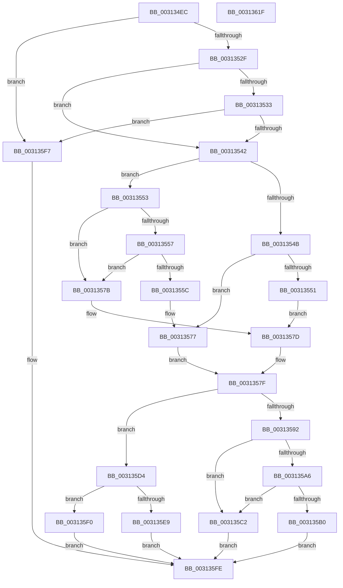

# KeFlushCurrentTbOnly

- RVA: `0x003134EC`–`0x00313620` (길이 `308` bytes)
- VA: `0x00000001403134EC`
- 실행 섹션: `.text`
- PDB 이름 있음: `예`; PDB Function 태그: `아니요`
- unwind 정보 RVA: `0x00074590`
- 디코드: `82`개 명령, `308/308` bytes 표시
- 미해석 바이트: `0` (있으면 어셈블리에 `.byte`로 보존)

> 이 문서는 커널 이미지의 기계어와 PDB 기호를 분석해 생성했습니다. 4번과 5번은 함수 원형과 자료형을 바이너리 사용 방식에서 추정한 C 해석이며 원본 소스 복구 결과는 아닙니다.

## 1. Dependencies

- 직접 호출 지점: **10**; 고유 호출 대상: **10**
- 직접 호출자로 확인된 함수: **2**
- RIP 상대 이미지 참조: **4**

### Outgoing calls
- `0x0031351A` → [memset](../6C/memset_function_006C6C40.md) (function, `0x006C6C40`)
- `0x00313535` → [KiIsFlushEntire](../30/KiIsFlushEntire_function_00309498.md) (function, `0x00309498`)
- `0x00313584` → [KiPrepareFlushCurrentAffinity](KiPrepareFlushCurrentAffinity_function_00313424.md) (function, `0x00313424`)
- `0x00313589` → [HvlpUseExtendedProcessorSetHypercalls](../30/HvlpUseExtendedProcessorSetHypercalls_function_0030906C.md) (function, `0x0030906C`)
- `0x003135BB` → [HvlpFastFlushAddressSpaceTbEx](../30/HvlpFastFlushAddressSpaceTbEx_function_003065B4.md) (function, `0x003065B4`)
- `0x003135CD` → [HvlpSlowFlushAddressSpaceTbEx](../6A/HvlpSlowFlushAddressSpaceTbEx_function_006A7D48.md) (function, `0x006A7D48`)
- `0x003135E9` → [HvlpFastFlushAddressSpaceTb](HvlpFastFlushAddressSpaceTb_function_00314AF4.md) (function, `0x00314AF4`)
- `0x003135F0` → [HvlpSlowFlushAddressSpaceTb](../44/HvlpSlowFlushAddressSpaceTb_function_004402C4.md) (function, `0x004402C4`)
- `0x003135F9` → [KiFlushCurrentTbOnly](../44/KiFlushCurrentTbOnly_function_00448080.md) (function, `0x00448080`)
- `0x00313609` → [_security_check_cookie](../6A/_security_check_cookie_function_006AC640.md) (function, `0x006AC640`)

### Direct callers
- [sub_003126AF](Unknown_function_003126AF.md) at `0x003126BB`
- [MI_FLUSH_ENTIRE_TB](MI_FLUSH_ENTIRE_TB_function_00314110.md) at `0x00314124`

### Static image references
- `0x003134F9` → RVA `0x00E0A740` (`.data`; read)
- `0x0031351F` → RVA `0x00FC6AB8` (`ALMOSTRO`; read)
- `0x00313542` → RVA `0x01201840` (`CFGRO`; read)
- `0x00313592` → RVA `0x00FC6A90` (`ALMOSTRO`; read)

## 2. Other-region calls and transfers

- 다른 실행 섹션으로 향하는 call: **0**
- 별도 외부 분기/꼬리 이동을 확인하지 못했습니다.

## 3. Assembly (complete function range)

```asm
003134EC  48 89 5C 24 08                  mov qword ptr [rsp + 8], rbx
003134F1  57                              push rdi
003134F2  48 81 EC 40 01 00 00            sub rsp, 0x140
003134F9  48 8B 05 40 72 AF 00            mov rax, qword ptr [rip + 0xaf7240]
00313500  48 33 C4                        xor rax, rsp
00313503  48 89 84 24 30 01 00 00         mov qword ptr [rsp + 0x130], rax
0031350B  8B D9                           mov ebx, ecx
0031350D  33 D2                           xor edx, edx
0031350F  48 8D 4C 24 20                  lea rcx, [rsp + 0x20]
00313514  41 B8 08 01 00 00               mov r8d, 0x108
0031351A  E8 21 37 3B 00                  call 0x1406c6c40
0031351F  8B 05 93 35 CB 00               mov eax, dword ptr [rip + 0xcb3593]
00313525  0F BA E0 17                     bt eax, 0x17
00313529  0F 83 C8 00 00 00               jae 0x1403135f7
0031352F  A8 02                           test al, 2
00313531  75 0F                           jne 0x140313542
00313533  8B CB                           mov ecx, ebx
00313535  E8 5E 5F FF FF                  call 0x140309498
0031353A  84 C0                           test al, al
0031353C  0F 84 B5 00 00 00               je 0x1403135f7
00313542  80 3D F7 E2 EE 00 00            cmp byte ptr [rip + 0xeee2f7], 0
00313549  74 08                           je 0x140313553
0031354B  33 FF                           xor edi, edi
0031354D  85 DB                           test ebx, ebx
0031354F  74 26                           je 0x140313577
00313551  EB 2A                           jmp 0x14031357d
00313553  85 DB                           test ebx, ebx
00313555  74 24                           je 0x14031357b
00313557  83 FB 01                        cmp ebx, 1
0031355A  75 1F                           jne 0x14031357b
0031355C  65 48 8B 04 25 88 01 00 00      mov rax, qword ptr gs:[0x188]
00313565  48 8B 88 B8 00 00 00            mov rcx, qword ptr [rax + 0xb8]
0031356C  48 8B 79 28                     mov rdi, qword ptr [rcx + 0x28]
00313570  48 81 E7 00 F0 FF FF            and rdi, 0xfffffffffffff000
00313577  32 DB                           xor bl, bl
00313579  EB 04                           jmp 0x14031357f
0031357B  33 FF                           xor edi, edi
0031357D  B3 01                           mov bl, 1
0031357F  48 8D 4C 24 20                  lea rcx, [rsp + 0x20]
00313584  E8 9B FE FF FF                  call 0x140313424
00313589  E8 DE 5A FF FF                  call 0x14030906c
0031358E  84 C0                           test al, al
00313590  74 42                           je 0x1403135d4
00313592  8B 05 F8 34 CB 00               mov eax, dword ptr [rip + 0xcb34f8]
00313598  C1 E8 08                        shr eax, 8
0031359B  83 E0 0F                        and eax, 0xf
0031359E  83 C0 05                        add eax, 5
003135A1  83 F8 0E                        cmp eax, 0xe
003135A4  77 1C                           ja 0x1403135c2
003135A6  8B 05 0C 35 CB 00               mov eax, dword ptr [rip + 0xcb350c]
003135AC  84 C0                           test al, al
003135AE  79 12                           jns 0x1403135c2
003135B0  44 8A C3                        mov r8b, bl
003135B3  48 8D 54 24 20                  lea rdx, [rsp + 0x20]
003135B8  48 8B CF                        mov rcx, rdi
003135BB  E8 F4 2F FF FF                  call 0x1403065b4
003135C0  EB 3C                           jmp 0x1403135fe
003135C2  44 8A C3                        mov r8b, bl
003135C5  48 8D 54 24 20                  lea rdx, [rsp + 0x20]
003135CA  48 8B CF                        mov rcx, rdi
003135CD  E8 76 47 39 00                  call 0x1406a7d48
003135D2  EB 2A                           jmp 0x1403135fe
003135D4  8B 05 DE 34 CB 00               mov eax, dword ptr [rip + 0xcb34de]
003135DA  48 8D 54 24 20                  lea rdx, [rsp + 0x20]
003135DF  44 8A C3                        mov r8b, bl
003135E2  48 8B CF                        mov rcx, rdi
003135E5  84 C0                           test al, al
003135E7  79 07                           jns 0x1403135f0
003135E9  E8 06 15 00 00                  call 0x140314af4
003135EE  EB 0E                           jmp 0x1403135fe
003135F0  E8 CF CC 12 00                  call 0x1404402c4
003135F5  EB 07                           jmp 0x1403135fe
003135F7  8B CB                           mov ecx, ebx
003135F9  E8 82 4A 13 00                  call 0x140448080
003135FE  48 8B 8C 24 30 01 00 00         mov rcx, qword ptr [rsp + 0x130]
00313606  48 33 CC                        xor rcx, rsp
00313609  E8 32 90 39 00                  call 0x1406ac640
0031360E  48 8B 9C 24 50 01 00 00         mov rbx, qword ptr [rsp + 0x150]
00313616  48 81 C4 40 01 00 00            add rsp, 0x140
0031361D  5F                              pop rdi
0031361E  C3                              ret
0031361F  CC                              int3
```

## 4. C-style interpretation (structured pseudocode)

```c
__int64 __fastcall KeFlushCurrentTbOnly(int a1, int a2)
{
    __int64 result;
    __int64 v_rbx;
    __int64 v_rdi;
    __int64 v_rsp;
    unsigned __int64 v_stack_m128;
    unsigned __int64 v_stack_m18;
    unsigned __int64 v_stack_p8;

    v_stack_p8 = v_rbx;
    v_rsp = (v_rsp) - (320);
    result = (*(unsigned __int64 *)(v_rip + 11498048)) ^ (v_rsp);
    v_stack_m18 = result;
    a2 = 0;
    result = memset(v_stack_m128, a2, 264, a4);
    if (condition_is_above_or_equal) goto loc_003135F7;
    if ((((unsigned __int8)((unsigned int)(*(unsigned int *)(v_rip + 13317523)))) & (2)) != 0) goto loc_00313542;
    result = KiIsFlushEntire((unsigned int)((unsigned int)((unsigned int)(a1))), a2, 264, a4);
    if ((unsigned __int8)(result) == 0) goto loc_003135F7;
loc_00313542:
    if ((*(unsigned __int8 *)(v_rip + 15655671)) == 0) goto loc_00313553;
    v_rdi = 0;
    if ((unsigned int)((unsigned int)(a1)) == 0) goto loc_00313577;
    goto loc_0031357D;
loc_00313553:
    if ((unsigned int)((unsigned int)(a1)) == 0) goto loc_0031357B;
    if (((unsigned int)((unsigned int)(a1))) != 1) goto loc_0031357B;
    v_rdi = (*(unsigned __int64 *)(*(unsigned __int64 *)(*(unsigned __int64 *)(gs_base + (0 + 392)) + 184) + 40)) & (0xFFFFFFFFFFFFF000ULL);
loc_00313577:
    v_rbx = 0;
    goto loc_0031357F;
loc_0031357B:
    v_rdi = 0;
loc_0031357D:
loc_0031357F:
    result = KiPrepareFlushCurrentAffinity(v_stack_m128, a2, 264, a4);
    result = HvlpUseExtendedProcessorSetHypercalls(v_stack_m128, a2, 264, a4);
    if ((unsigned __int8)(result) == 0) goto loc_003135D4;
    result = (unsigned int)(((unsigned int)(*(unsigned int *)(v_rip + 13317368))) >> (8));
    result = (unsigned int)((result) & (15));
    result = (unsigned int)((result) + (5));
    if (((unsigned int)(result)) > 14) goto loc_003135C2;
    if (!sign_flag) goto loc_003135C2;
    result = HvlpFastFlushAddressSpaceTbEx(0, v_stack_m128, 1, a4);
    goto loc_003135FE;
loc_003135C2:
    result = HvlpSlowFlushAddressSpaceTbEx(0, v_stack_m128, 1, a4);
    goto loc_003135FE;
loc_003135D4:
    if (!sign_flag) goto loc_003135F0;
    result = HvlpFastFlushAddressSpaceTb(0, v_stack_m128, 1, a4);
    goto loc_003135FE;
loc_003135F0:
    result = HvlpSlowFlushAddressSpaceTb(0, v_stack_m128, 1, a4);
    goto loc_003135FE;
loc_003135F7:
    result = KiFlushCurrentTbOnly(1, v_stack_m128, 1, a4);
loc_003135FE:
    a1 = (v_stack_m18) ^ (v_rsp);
    result = _security_check_cookie(a1, v_stack_m128, 1, a4);
    v_rsp = (v_rsp) + (320);
    return result;
}
```

## 5. (Beta) C Style

```c
int64_t KeFlushCurrentTbOnly(int32_t Arg1, int32_t Arg2)
{
    int64_t result;
    int64_t local_rbx;
    int64_t local_rdi;
    int64_t local_rsp;
    uint64_t v_stack_m128;
    uint64_t v_stack_m18;
    uint64_t v_stack_p8;

    v_stack_p8 = local_rbx;
    local_rsp = (local_rsp) - (320);
    result = (*(uint64_t *)(v_rip + 0xAF7240)) ^ (local_rsp);
    v_stack_m18 = result;
    Arg2 = 0;
    result = memset(v_stack_m128, Arg2, 264, a4);
    if (condition_is_above_or_equal) goto loc_003135F7;
    if ((((uint8_t)((uint32_t)(*(uint32_t *)(v_rip + 0xCB3593)))) & (2)) != 0) goto loc_00313542;
    result = KiIsFlushEntire((uint32_t)((uint32_t)((uint32_t)(Arg1))), Arg2, 264, a4);
    if ((uint8_t)(result) == 0) goto loc_003135F7;
loc_00313542:
    if ((*(uint8_t *)(v_rip + 0xEEE2F7)) == 0) goto loc_00313553;
    local_rdi = 0;
    if ((uint32_t)((uint32_t)(Arg1)) == 0) goto loc_00313577;
    goto loc_0031357D;
loc_00313553:
    if ((uint32_t)((uint32_t)(Arg1)) == 0) goto loc_0031357B;
    if (((uint32_t)((uint32_t)(Arg1))) != 1) goto loc_0031357B;
    local_rdi = (*(uint64_t *)(*(uint64_t *)(*(uint64_t *)(gs_base + (0 + 0x188)) + 0xB8) + 0x28)) & (0xFFFFFFFFFFFFF000ULL);
loc_00313577:
    local_rbx = 0;
    goto loc_0031357F;
loc_0031357B:
    local_rdi = 0;
loc_0031357D:
loc_0031357F:
    result = KiPrepareFlushCurrentAffinity(v_stack_m128, Arg2, 264, a4);
    result = HvlpUseExtendedProcessorSetHypercalls(v_stack_m128, Arg2, 264, a4);
    if ((uint8_t)(result) == 0) goto loc_003135D4;
    result = (uint32_t)(((uint32_t)(*(uint32_t *)(v_rip + 0xCB34F8))) >> (8));
    result = (uint32_t)((result) & (15));
    result = (uint32_t)((result) + (5));
    if (((uint32_t)(result)) > 14) goto loc_003135C2;
    if (!sign_flag) goto loc_003135C2;
    result = HvlpFastFlushAddressSpaceTbEx(0, v_stack_m128, 1, a4);
    goto loc_003135FE;
loc_003135C2:
    result = HvlpSlowFlushAddressSpaceTbEx(0, v_stack_m128, 1, a4);
    goto loc_003135FE;
loc_003135D4:
    if (!sign_flag) goto loc_003135F0;
    result = HvlpFastFlushAddressSpaceTb(0, v_stack_m128, 1, a4);
    goto loc_003135FE;
loc_003135F0:
    result = HvlpSlowFlushAddressSpaceTb(0, v_stack_m128, 1, a4);
    goto loc_003135FE;
loc_003135F7:
    result = KiFlushCurrentTbOnly(1, v_stack_m128, 1, a4);
loc_003135FE:
    Arg1 = (v_stack_m18) ^ (local_rsp);
    result = _security_check_cookie(Arg1, v_stack_m128, 1, a4);
    local_rsp = (local_rsp) + (320);
    return result;
}
```

## 6. Execution-region graph

[열기: 2D/3D 그래프와 함수 탐색 컨트롤 패널](../../../control-panel.html?section=text&rva=0x003134EC&view=graph)

- 2D 그래프는 위에서 아래로 흐르고, 3D 그래프는 빈 공간을 드래그해 회전합니다. Shift+드래그는 이동, 휠은 확대·축소, 함수 노드 선택은 대상 보고서 이동입니다.

### Static fallback


