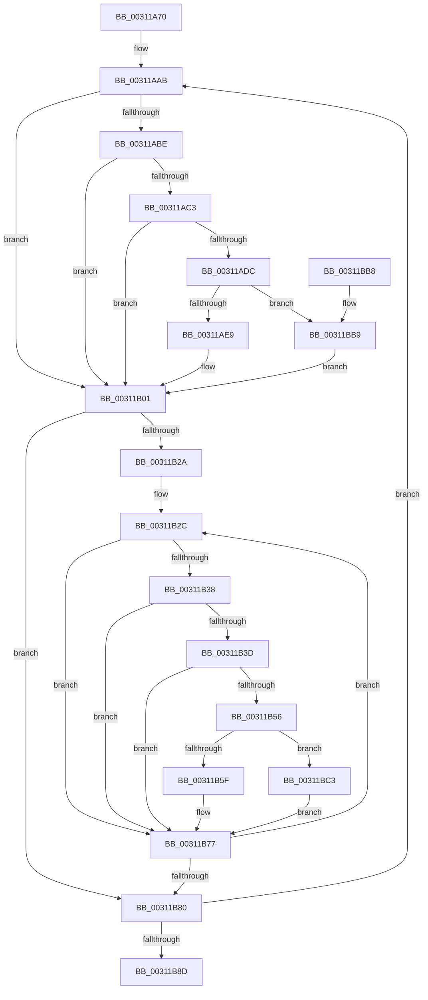

# KiFlushRangeWorker

- RVA: `0x00311A70`–`0x00311BCA` (길이 `346` bytes)
- VA: `0x0000000140311A70`
- 실행 섹션: `.text`
- PDB 이름 있음: `예`; PDB Function 태그: `아니요`
- unwind 정보 RVA: `0x00074180`
- 디코드: `87`개 명령, `346/346` bytes 표시
- 미해석 바이트: `0` (있으면 어셈블리에 `.byte`로 보존)

> 이 문서는 커널 이미지의 기계어와 PDB 기호를 분석해 생성했습니다. 4번과 5번은 함수 원형과 자료형을 바이너리 사용 방식에서 추정한 C 해석이며 원본 소스 복구 결과는 아닙니다.

## 1. Dependencies

- 직접 호출 지점: **3**; 고유 호출 대상: **2**
- 직접 호출자로 확인된 함수: **1**
- RIP 상대 이미지 참조: **2**

### Outgoing calls
- `0x00311B95` → [_security_check_cookie](../6A/_security_check_cookie_function_006AC640.md) (function, `0x006AC640`)
- `0x00311BB9` → [KiSetUserTbFlushPending](../6B/KiSetUserTbFlushPending_function_006B20C0.md) (function, `0x006B20C0`)
- `0x00311BC3` → [KiSetUserTbFlushPending](../6B/KiSetUserTbFlushPending_function_006B20C0.md) (function, `0x006B20C0`)

### Direct callers
- [sub_003127BF](Unknown_function_003127BF.md) at `0x003127C9`
- [sub_003127BF](Unknown_function_003127BF.md) at `0x0031280A`

### Static image references
- `0x00311A8C` → RVA `0x00E0A740` (`.data`; read)
- `0x00311AAB` → RVA `0x00FC6A87` (`ALMOSTRO`; read)

## 2. Other-region calls and transfers

- 다른 실행 섹션으로 향하는 call: **0**
- 별도 외부 분기/꼬리 이동을 확인하지 못했습니다.

## 3. Assembly (complete function range)

```asm
00311A70  48 89 5C 24 08                  mov qword ptr [rsp + 8], rbx
00311A75  48 89 6C 24 10                  mov qword ptr [rsp + 0x10], rbp
00311A7A  48 89 74 24 18                  mov qword ptr [rsp + 0x18], rsi
00311A7F  57                              push rdi
00311A80  41 54                           push r12
00311A82  41 55                           push r13
00311A84  41 56                           push r14
00311A86  41 57                           push r15
00311A88  48 83 EC 50                     sub rsp, 0x50
00311A8C  48 8B 05 AD 8C AF 00            mov rax, qword ptr [rip + 0xaf8cad]
00311A93  48 33 C4                        xor rax, rsp
00311A96  48 89 44 24 40                  mov qword ptr [rsp + 0x40], rax
00311A9B  48 8B 19                        mov rbx, qword ptr [rcx]
00311A9E  4C 8B F1                        mov r14, rcx
00311AA1  8B 41 08                        mov eax, dword ptr [rcx + 8]
00311AA4  45 33 ED                        xor r13d, r13d
00311AA7  4C 8D 3C C3                     lea r15, [rbx + rax*8]
00311AAB  44 38 2D D5 4F CB 00            cmp byte ptr [rip + 0xcb4fd5], r13b
00311AB2  41 8B 76 0C                     mov esi, dword ptr [r14 + 0xc]
00311AB6  48 8B 3B                        mov rdi, qword ptr [rbx]
00311AB9  8D 46 FF                        lea eax, [rsi - 1]
00311ABC  74 43                           je 0x140311b01
00311ABE  83 F8 01                        cmp eax, 1
00311AC1  77 3E                           ja 0x140311b01
00311AC3  65 48 8B 04 25 88 01 00 00      mov rax, qword ptr gs:[0x188]
00311ACC  48 8B 88 B8 00 00 00            mov rcx, qword ptr [rax + 0xb8]
00311AD3  44 38 A9 60 01 00 00            cmp byte ptr [rcx + 0x160], r13b
00311ADA  75 25                           jne 0x140311b01
00311ADC  F6 05 A4 4F CB 00 02            test byte ptr [rip + 0xcb4fa4], 2
00311AE3  0F 84 D0 00 00 00               je 0x140311bb9
00311AE9  48 C7 44 24 20 01 00 00 00      mov qword ptr [rsp + 0x20], 1
00311AF2  48 89 7C 24 28                  mov qword ptr [rsp + 0x28], rdi
00311AF7  41 8B C5                        mov eax, r13d
00311AFA  66 0F 38 82 44 24 20            invpcid rax, xmmword ptr [rsp + 0x20]
00311B01  0F 01 3F                        invlpg byte ptr [rdi]
00311B04  48 8B CF                        mov rcx, rdi
00311B07  41 BC 00 10 00 00               mov r12d, 0x1000
00311B0D  48 C1 E9 0A                     shr rcx, 0xa
00311B11  48 8B EF                        mov rbp, rdi
00311B14  80 E1 03                        and cl, 3
00311B17  0F B6 C1                        movzx eax, cl
00311B1A  C0 E0 03                        shl al, 3
00311B1D  02 C8                           add cl, al
00311B1F  49 D3 E4                        shl r12, cl
00311B22  81 E5 FF 03 00 00               and ebp, 0x3ff
00311B28  74 56                           je 0x140311b80
00311B2A  FF CE                           dec esi
00311B2C  49 03 FC                        add rdi, r12
00311B2F  44 38 2D 51 4F CB 00            cmp byte ptr [rip + 0xcb4f51], r13b
00311B36  74 3F                           je 0x140311b77
00311B38  83 FE 01                        cmp esi, 1
00311B3B  77 3A                           ja 0x140311b77
00311B3D  65 48 8B 04 25 88 01 00 00      mov rax, qword ptr gs:[0x188]
00311B46  48 8B 88 B8 00 00 00            mov rcx, qword ptr [rax + 0xb8]
00311B4D  44 38 A9 60 01 00 00            cmp byte ptr [rcx + 0x160], r13b
00311B54  75 21                           jne 0x140311b77
00311B56  F6 05 2A 4F CB 00 02            test byte ptr [rip + 0xcb4f2a], 2
00311B5D  74 64                           je 0x140311bc3
00311B5F  48 C7 44 24 30 01 00 00 00      mov qword ptr [rsp + 0x30], 1
00311B68  48 89 7C 24 38                  mov qword ptr [rsp + 0x38], rdi
00311B6D  41 8B C5                        mov eax, r13d
00311B70  66 0F 38 82 44 24 30            invpcid rax, xmmword ptr [rsp + 0x30]
00311B77  0F 01 3F                        invlpg byte ptr [rdi]
00311B7A  48 83 ED 01                     sub rbp, 1
00311B7E  75 AC                           jne 0x140311b2c
00311B80  48 83 C3 08                     add rbx, 8
00311B84  49 3B DF                        cmp rbx, r15
00311B87  0F 82 1E FF FF FF               jb 0x140311aab
00311B8D  48 8B 4C 24 40                  mov rcx, qword ptr [rsp + 0x40]
00311B92  48 33 CC                        xor rcx, rsp
00311B95  E8 A6 AA 39 00                  call 0x1406ac640
00311B9A  4C 8D 5C 24 50                  lea r11, [rsp + 0x50]
00311B9F  49 8B 5B 30                     mov rbx, qword ptr [r11 + 0x30]
00311BA3  49 8B 6B 38                     mov rbp, qword ptr [r11 + 0x38]
00311BA7  49 8B 73 40                     mov rsi, qword ptr [r11 + 0x40]
00311BAB  49 8B E3                        mov rsp, r11
00311BAE  41 5F                           pop r15
00311BB0  41 5E                           pop r14
00311BB2  41 5D                           pop r13
00311BB4  41 5C                           pop r12
00311BB6  5F                              pop rdi
00311BB7  C3                              ret
00311BB8  CC                              int3
00311BB9  E8 02 05 3A 00                  call 0x1406b20c0
00311BBE  E9 3E FF FF FF                  jmp 0x140311b01
00311BC3  E8 F8 04 3A 00                  call 0x1406b20c0
00311BC8  EB AD                           jmp 0x140311b77
```

## 4. C-style interpretation (structured pseudocode)

```c
__int64 __fastcall KiFlushRangeWorker(__int64 a1)
{
    __int64 result;
    __int64 v_r12;
    __int64 v_r13;
    __int64 v_rbp;
    __int64 v_rbx;
    __int64 v_rdi;
    __int64 v_rsi;
    __int64 v_rsp;
    unsigned __int64 v_stack_m28;
    unsigned __int64 v_stack_m38;
    unsigned __int64 v_stack_m40;
    unsigned __int64 v_stack_m48;
    unsigned __int64 v_stack_m50;
    unsigned __int64 v_stack_m58;
    unsigned __int64 v_stack_p10;
    unsigned __int64 v_stack_p18;
    unsigned __int64 v_stack_p8;

    v_stack_p8 = v_rbx;
    v_stack_p10 = v_rbp;
    v_stack_p18 = v_rsi;
    v_rsp = (v_rsp) - (80);
    result = (*(unsigned __int64 *)(v_rip + 11504813)) ^ (v_rsp);
    v_stack_m38 = result;
    v_r13 = 0;
loc_00311AAB:
    if ((*(unsigned __int8 *)(v_rip + 13324245)) == 0) goto loc_00311B01;
    if (((unsigned int)((unsigned int)(*(unsigned int *)(a1 + 12)) - 1)) > 1) goto loc_00311B01;
    if ((*(unsigned __int8 *)(*(unsigned __int64 *)(*(unsigned __int64 *)(gs_base + (0 + 392)) + 184) + 352)) != 0) goto loc_00311B01;
    if (((*(unsigned __int8 *)(v_rip + 13324196)) & (2)) == 0) goto loc_00311BB9;
    v_stack_m58 = 1;
    v_stack_m50 = *(unsigned __int64 *)(*(unsigned __int64 *)(a1));
loc_00311B01:
    a1 = (*(unsigned __int64 *)(*(unsigned __int64 *)(a1))) >> (10);
    a1 = (unsigned __int8)((a1) & (3));
    result = (unsigned __int8)(((unsigned __int8)(a1)) << (3));
    a1 = (unsigned __int8)((a1) + ((unsigned __int8)(result)));
    v_r12 = ((unsigned int)(0x1000ULL)) << ((unsigned __int8)(a1));
    v_rbp = (unsigned int)((*(unsigned __int64 *)(*(unsigned __int64 *)(a1))) & (0x3FFULL));
    if (condition_is_equal) goto loc_00311B80;
    v_rsi = (unsigned int)(((unsigned int)(*(unsigned int *)(a1 + 12))) - 1);
loc_00311B2C:
    v_rdi = (*(unsigned __int64 *)(*(unsigned __int64 *)(a1))) + (v_r12);
    if ((*(unsigned __int8 *)(v_rip + 13324113)) == 0) goto loc_00311B77;
    if (((unsigned int)(v_rsi)) > 1) goto loc_00311B77;
    if ((*(unsigned __int8 *)(*(unsigned __int64 *)(*(unsigned __int64 *)(gs_base + (0 + 392)) + 184) + 352)) != 0) goto loc_00311B77;
    if (((*(unsigned __int8 *)(v_rip + 13324074)) & (2)) == 0) goto loc_00311BC3;
    v_stack_m48 = 1;
    v_stack_m40 = v_rdi;
loc_00311B77:
    v_rbp = (v_rbp) - (1);
    if (condition_is_not_equal) goto loc_00311B2C;
loc_00311B80:
    v_rbx = (*(unsigned __int64 *)(a1)) + (8);
    if (v_rbx < (*(unsigned __int64 *)(a1) + (unsigned int)(*(unsigned int *)(a1 + 8)) * 8)) goto loc_00311AAB;
    a1 = (v_stack_m38) ^ (v_rsp);
    result = _security_check_cookie(a1, a2, a3, a4);
    return result;
loc_00311BB9:
    result = KiSetUserTbFlushPending(a1, a2, a3, a4);
    goto loc_00311B01;
loc_00311BC3:
    result = KiSetUserTbFlushPending(a1, a2, a3, a4);
    goto loc_00311B77;
}
```

## 5. (Beta) C Style

```c
int64_t KiFlushRangeWorker(void *Arg1)
{
    uint8_t *arg1 = (uint8_t *)Arg1;

    int64_t result;
    int64_t local_r12;
    int64_t local_r13;
    int64_t local_rbp;
    int64_t local_rbx;
    int64_t local_rdi;
    int64_t local_rsi;
    int64_t local_rsp;
    uint64_t v_stack_m28;
    uint64_t v_stack_m38;
    uint64_t v_stack_m40;
    uint64_t v_stack_m48;
    uint64_t v_stack_m50;
    uint64_t v_stack_m58;
    uint64_t v_stack_p10;
    uint64_t v_stack_p18;
    uint64_t v_stack_p8;

    v_stack_p8 = local_rbx;
    v_stack_p10 = local_rbp;
    v_stack_p18 = local_rsi;
    local_rsp = (local_rsp) - (80);
    result = (*(uint64_t *)(v_rip + 0xAF8CAD)) ^ (local_rsp);
    v_stack_m38 = result;
    local_r13 = 0;
loc_00311AAB:
    if ((*(uint8_t *)(v_rip + 0xCB4FD5)) == 0) goto loc_00311B01;
    if (((uint32_t)((uint32_t)(*(uint32_t *)(arg1 + 0xC)) - 1)) > 1) goto loc_00311B01;
    if ((*(uint8_t *)(*(uint64_t *)(*(uint64_t *)(gs_base + (0 + 0x188)) + 0xB8) + 0x160)) != 0) goto loc_00311B01;
    if (((*(uint8_t *)(v_rip + 0xCB4FA4)) & (2)) == 0) goto loc_00311BB9;
    v_stack_m58 = 1;
    v_stack_m50 = *(uint64_t *)(*(uint64_t *)(arg1));
loc_00311B01:
    Arg1 = (*(uint64_t *)(*(uint64_t *)(arg1))) >> (10);
    Arg1 = (uint8_t)((Arg1) & (3));
    result = (uint8_t)(((uint8_t)(Arg1)) << (3));
    Arg1 = (uint8_t)((Arg1) + ((uint8_t)(result)));
    local_r12 = ((uint32_t)(0x1000ULL)) << ((uint8_t)(Arg1));
    local_rbp = (uint32_t)((*(uint64_t *)(*(uint64_t *)(arg1))) & (0x3FFULL));
    if (condition_is_equal) goto loc_00311B80;
    local_rsi = (uint32_t)(((uint32_t)(*(uint32_t *)(arg1 + 0xC))) - 1);
loc_00311B2C:
    local_rdi = (*(uint64_t *)(*(uint64_t *)(arg1))) + (local_r12);
    if ((*(uint8_t *)(v_rip + 0xCB4F51)) == 0) goto loc_00311B77;
    if (((uint32_t)(local_rsi)) > 1) goto loc_00311B77;
    if ((*(uint8_t *)(*(uint64_t *)(*(uint64_t *)(gs_base + (0 + 0x188)) + 0xB8) + 0x160)) != 0) goto loc_00311B77;
    if (((*(uint8_t *)(v_rip + 0xCB4F2A)) & (2)) == 0) goto loc_00311BC3;
    v_stack_m48 = 1;
    v_stack_m40 = local_rdi;
loc_00311B77:
    local_rbp = (local_rbp) - (1);
    if (condition_is_not_equal) goto loc_00311B2C;
loc_00311B80:
    local_rbx = (*(uint64_t *)(arg1)) + (8);
    if (local_rbx < (*(uint64_t *)(arg1) + (uint32_t)(*(uint32_t *)(arg1 + 0x8)) * 8)) goto loc_00311AAB;
    Arg1 = (v_stack_m38) ^ (local_rsp);
    result = _security_check_cookie(Arg1, a2, a3, a4);
    return result;
loc_00311BB9:
    result = KiSetUserTbFlushPending(Arg1, a2, a3, a4);
    goto loc_00311B01;
loc_00311BC3:
    result = KiSetUserTbFlushPending(Arg1, a2, a3, a4);
    goto loc_00311B77;
}
```

### 관측된 메모리 오프셋

구조체 형식이 확인되지 않은 접근은 인자 기준의 오프셋으로만 기록했습니다.

| 기준 인자 | 오프셋 표현 | 폭 (bit) | 접근 |
|---|---:|---:|---|
| `Arg1` | `+ 0x0` | `64` | `R` |
| `Arg1` | `+ 0x8` | `32` | `R` |
| `Arg1` | `+ 0xC` | `32` | `R` |

## 6. Execution-region graph

[열기: 2D/3D 그래프와 함수 탐색 컨트롤 패널](../../../control-panel.html?section=text&rva=0x00311A70&view=graph)

- 2D 그래프는 위에서 아래로 흐르고, 3D 그래프는 빈 공간을 드래그해 회전합니다. Shift+드래그는 이동, 휠은 확대·축소, 함수 노드 선택은 대상 보고서 이동입니다.

### Static fallback


