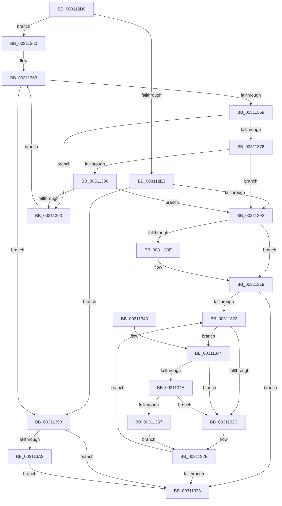

# KiIpiSendRequestEx

- RVA: `0x003112D0`–`0x003113AE` (길이 `222` bytes)
- VA: `0x00000001403112D0`
- 실행 섹션: `.text`
- PDB 이름 있음: `예`; PDB Function 태그: `아니요`
- unwind 정보 RVA: `0x00074148`
- 디코드: `63`개 명령, `222/222` bytes 표시
- 미해석 바이트: `0` (있으면 어셈블리에 `.byte`로 보존)

> 이 문서는 커널 이미지의 기계어와 PDB 기호를 분석해 생성했습니다. 4번과 5번은 함수 원형과 자료형을 바이너리 사용 방식에서 추정한 C 해석이며 원본 소스 복구 결과는 아닙니다.

## 1. Dependencies

- 직접 호출 지점: **5**; 고유 호출 대상: **4**
- 직접 호출자로 확인된 함수: **1**
- RIP 상대 이미지 참조: **3**

### Outgoing calls
- `0x003112FF` → [KiIpiSendRequest](KiIpiSendRequest_function_003113C0.md) (function, `0x003113C0`)
- `0x00311313` → [guard_dispatch_icall](../6B/guard_dispatch_icall_function_006BAAD0.md) (function, `0x006BAAD0`)
- `0x0031134E` → [KiCheckVpBackingLongSpinWaitHypercall](../30/KiCheckVpBackingLongSpinWaitHypercall_function_0030F490.md) (function, `0x0030F490`)
- `0x00311359` → [HvlNotifyLongSpinWait](../30/HvlNotifyLongSpinWait_function_0030F460.md) (function, `0x0030F460`)
- `0x003113A7` → [guard_dispatch_icall](../6B/guard_dispatch_icall_function_006BAAD0.md) (function, `0x006BAAD0`)

### Direct callers
- [KxFlushSingleTb](../5C/KxFlushSingleTb_function_005CAE18.md) at `0x005CAEFF`

### Static image references
- `0x003112E3` → RVA `0x00FC6A80` (`ALMOSTRO`; read)
- `0x00311324` → RVA `0x00FC52AC` (`ALMOSTRO`; reference)
- `0x00311344` → RVA `0x00FC6AB8` (`ALMOSTRO`; read)

## 2. Other-region calls and transfers

- 다른 실행 섹션으로 향하는 call: **0**
- 별도 외부 분기/꼬리 이동을 확인하지 못했습니다.

## 3. Assembly (complete function range)

```asm
003112D0  48 89 5C 24 08                  mov qword ptr [rsp + 8], rbx
003112D5  57                              push rdi
003112D6  48 83 EC 30                     sub rsp, 0x30
003112DA  33 DB                           xor ebx, ebx
003112DC  48 8B F9                        mov rdi, rcx
003112DF  85 D2                           test edx, edx
003112E1  74 7D                           je 0x140311360
003112E3  8B 05 97 57 CB 00               mov eax, dword ptr [rip + 0xcb5797]
003112E9  83 F8 01                        cmp eax, 1
003112EC  0F 86 A6 00 00 00               jbe 0x140311398
003112F2  48 8B 44 24 60                  mov rax, qword ptr [rsp + 0x60]
003112F7  48 8B CF                        mov rcx, rdi
003112FA  48 89 44 24 20                  mov qword ptr [rsp + 0x20], rax
003112FF  E8 BC 00 00 00                  call 0x1403113c0
00311304  48 8B 44 24 68                  mov rax, qword ptr [rsp + 0x68]
00311309  48 85 C0                        test rax, rax
0031130C  74 0A                           je 0x140311318
0031130E  48 8B 4C 24 70                  mov rcx, qword ptr [rsp + 0x70]
00311313  E8 B8 97 3A 00                  call 0x1406baad0
00311318  8B 87 80 2D 00 00               mov eax, dword ptr [rdi + 0x2d80]
0031131E  85 C0                           test eax, eax
00311320  74 16                           je 0x140311338
00311322  FF C3                           inc ebx
00311324  85 1D 82 3F CB 00               test dword ptr [rip + 0xcb3f82], ebx
0031132A  74 18                           je 0x140311344
0031132C  F3 90                           pause
0031132E  8B 87 80 2D 00 00               mov eax, dword ptr [rdi + 0x2d80]
00311334  85 C0                           test eax, eax
00311336  75 EA                           jne 0x140311322
00311338  48 8B 5C 24 40                  mov rbx, qword ptr [rsp + 0x40]
0031133D  48 83 C4 30                     add rsp, 0x30
00311341  5F                              pop rdi
00311342  C3                              ret
00311343  CC                              int3
00311344  8B 05 6E 57 CB 00               mov eax, dword ptr [rip + 0xcb576e]
0031134A  A8 40                           test al, 0x40
0031134C  74 DE                           je 0x14031132c
0031134E  E8 3D E1 FF FF                  call 0x14030f490
00311353  84 C0                           test al, al
00311355  74 D5                           je 0x14031132c
00311357  8B CB                           mov ecx, ebx
00311359  E8 02 E1 FF FF                  call 0x14030f460
0031135E  EB CE                           jmp 0x14031132e
00311360  0F B7 CB                        movzx ecx, bx
00311363  66 41 3B 08                     cmp cx, word ptr [r8]
00311367  73 2F                           jae 0x140311398
00311369  0F B7 C1                        movzx eax, cx
0031136C  4D 8B 54 C0 08                  mov r10, qword ptr [r8 + rax*8 + 8]
00311371  4D 85 D2                        test r10, r10
00311374  74 1D                           je 0x140311393
00311376  0F B6 87 D0 00 00 00            movzx eax, byte ptr [rdi + 0xd0]
0031137D  66 3B C8                        cmp cx, ax
00311380  0F 85 6C FF FF FF               jne 0x1403112f2
00311386  4C 3B 97 C8 00 00 00            cmp r10, qword ptr [rdi + 0xc8]
0031138D  0F 85 5F FF FF FF               jne 0x1403112f2
00311393  66 FF C1                        inc cx
00311396  EB CB                           jmp 0x140311363
00311398  48 8B 44 24 68                  mov rax, qword ptr [rsp + 0x68]
0031139D  48 85 C0                        test rax, rax
003113A0  74 96                           je 0x140311338
003113A2  48 8B 4C 24 70                  mov rcx, qword ptr [rsp + 0x70]
003113A7  E8 24 97 3A 00                  call 0x1406baad0
003113AC  EB 8A                           jmp 0x140311338
```

## 4. C-style interpretation (structured pseudocode)

```c
__int64 __fastcall KiIpiSendRequestEx(__int64 a1, int a2, __int64 a3, __int64 a4, __int64 a5, __int64 a6, __int64 a7)
{
    __int64 result;
    __int64 v_rbx;
    __int64 v_rsp;
    unsigned __int64 v_stack_m18;
    unsigned __int64 v_stack_p8;

    v_stack_p8 = v_rbx;
    v_rsp = (v_rsp) - (48);
    v_rbx = 0;
    if (a2 == 0) goto loc_00311360;
    if (((unsigned int)((unsigned int)(*(unsigned int *)(v_rip + 13326231)))) <= 1) goto loc_00311398;
loc_003112F2:
    v_stack_m18 = a5;
    result = KiIpiSendRequest(a1, a2, a3, a4);
    result = a6;
    if (a6 != 0) {
        a1 = a7;
        result = guard_dispatch_icall(a1, a2, a3, a4);
    }
    if ((unsigned int)((unsigned int)(*(unsigned int *)(a1 + 11648))) == 0) goto loc_00311338;
loc_00311322:
    v_rbx = (unsigned int)((v_rbx) + 1);
    if (((*(unsigned int *)(v_rip + 13320066)) & ((unsigned int)(v_rbx))) == 0) goto loc_00311344;
loc_0031132C:
loc_0031132E:
    if ((unsigned int)((unsigned int)(*(unsigned int *)(a1 + 11648))) != 0) goto loc_00311322;
loc_00311338:
    v_rsp = (v_rsp) + (48);
    return (unsigned int)(*(unsigned int *)(a1 + 11648));
loc_00311344:
    if ((((unsigned __int8)((unsigned int)(*(unsigned int *)(v_rip + 13326190)))) & (64)) == 0) goto loc_0031132C;
    result = KiCheckVpBackingLongSpinWaitHypercall(a1, a2, a3, a4);
    if ((unsigned __int8)(result) == 0) goto loc_0031132C;
    result = HvlNotifyLongSpinWait((unsigned int)((unsigned int)(v_stack_p8)), a2, a3, a4);
    goto loc_0031132E;
loc_00311360:
loc_00311363:
    if (((unsigned __int16)((unsigned __int16)(v_stack_p8))) >= (*(unsigned __int16 *)(a3))) goto loc_00311398;
    if (*(unsigned __int64 *)(a3 + (unsigned __int16)((unsigned __int16)(v_stack_p8)) * 8 + 8) == 0) goto loc_00311393;
    if (((unsigned __int16)((unsigned __int16)(v_stack_p8))) != ((unsigned __int16)(*(unsigned __int8 *)(a1 + 208)))) goto loc_003112F2;
    if ((*(unsigned __int64 *)(a3 + (unsigned __int16)((unsigned __int16)(v_stack_p8)) * 8 + 8)) != (*(unsigned __int64 *)(a1 + 200))) goto loc_003112F2;
loc_00311393:
    a1 = (unsigned __int16)(((unsigned __int16)(v_stack_p8)) + 1);
    goto loc_00311363;
loc_00311398:
    if (a6 == 0) goto loc_00311338;
    result = guard_dispatch_icall(a7, a2, a3, a4);
    goto loc_00311338;
}
```

## 5. (Beta) C Style

```c
int64_t KiIpiSendRequestEx(void *Arg1, int32_t Arg2, void *Arg3, int64_t Arg4, int64_t Arg5, int64_t Arg6, int64_t Arg7)
{
    uint8_t *arg1 = (uint8_t *)Arg1;
    uint8_t *arg3 = (uint8_t *)Arg3;

    int64_t result;
    int64_t local_rbx;
    int64_t local_rsp;
    uint64_t v_stack_m18;
    uint64_t v_stack_p8;

    v_stack_p8 = local_rbx;
    local_rsp = (local_rsp) - (48);
    local_rbx = 0;
    if (Arg2 == 0) goto loc_00311360;
    if (((uint32_t)((uint32_t)(*(uint32_t *)(v_rip + 0xCB5797)))) <= 1) goto loc_00311398;
loc_003112F2:
    v_stack_m18 = Arg5;
    result = KiIpiSendRequest(Arg1, Arg2, Arg3, Arg4);
    result = Arg6;
    if (Arg6 != 0) {
        Arg1 = Arg7;
        result = guard_dispatch_icall(Arg1, Arg2, Arg3, Arg4);
    }
    if ((uint32_t)((uint32_t)(*(uint32_t *)(arg1 + 0x2D80))) == 0) goto loc_00311338;
loc_00311322:
    local_rbx = (uint32_t)((local_rbx) + 1);
    if (((*(uint32_t *)(v_rip + 0xCB3F82)) & ((uint32_t)(local_rbx))) == 0) goto loc_00311344;
loc_0031132C:
loc_0031132E:
    if ((uint32_t)((uint32_t)(*(uint32_t *)(arg1 + 0x2D80))) != 0) goto loc_00311322;
loc_00311338:
    local_rsp = (local_rsp) + (48);
    return (uint32_t)(*(uint32_t *)(arg1 + 0x2D80));
loc_00311344:
    if ((((uint8_t)((uint32_t)(*(uint32_t *)(v_rip + 0xCB576E)))) & (64)) == 0) goto loc_0031132C;
    result = KiCheckVpBackingLongSpinWaitHypercall(Arg1, Arg2, Arg3, Arg4);
    if ((uint8_t)(result) == 0) goto loc_0031132C;
    result = HvlNotifyLongSpinWait((uint32_t)((uint32_t)(v_stack_p8)), Arg2, Arg3, Arg4);
    goto loc_0031132E;
loc_00311360:
loc_00311363:
    if (((uint16_t)((uint16_t)(v_stack_p8))) >= (*(uint16_t *)(arg3))) goto loc_00311398;
    if (*(uint64_t *)(arg3 + (uint16_t)((uint16_t)(v_stack_p8)) * 8 + 0x8) == 0) goto loc_00311393;
    if (((uint16_t)((uint16_t)(v_stack_p8))) != ((uint16_t)(*(uint8_t *)(arg1 + 0xD0)))) goto loc_003112F2;
    if ((*(uint64_t *)(arg3 + (uint16_t)((uint16_t)(v_stack_p8)) * 8 + 0x8)) != (*(uint64_t *)(arg1 + 0xC8))) goto loc_003112F2;
loc_00311393:
    Arg1 = (uint16_t)(((uint16_t)(v_stack_p8)) + 1);
    goto loc_00311363;
loc_00311398:
    if (Arg6 == 0) goto loc_00311338;
    result = guard_dispatch_icall(Arg7, Arg2, Arg3, Arg4);
    goto loc_00311338;
}
```

### 관측된 메모리 오프셋

구조체 형식이 확인되지 않은 접근은 인자 기준의 오프셋으로만 기록했습니다.

| 기준 인자 | 오프셋 표현 | 폭 (bit) | 접근 |
|---|---:|---:|---|
| `Arg1` | `+ 0xC8` | `64` | `R` |
| `Arg1` | `+ 0xD0` | `8` | `R` |
| `Arg1` | `+ 0x2D80` | `32` | `R` |
| `Arg3` | `+ 0x0` | `16` | `R` |
| `Arg3` | `+ 0x8 + rax*8` | `64` | `R` |

## 6. Execution-region graph

[열기: 2D/3D 그래프와 함수 탐색 컨트롤 패널](../../../control-panel.html?section=text&rva=0x003112D0&view=graph)

- 2D 그래프는 위에서 아래로 흐르고, 3D 그래프는 빈 공간을 드래그해 회전합니다. Shift+드래그는 이동, 휠은 확대·축소, 함수 노드 선택은 대상 보고서 이동입니다.

### Static fallback


