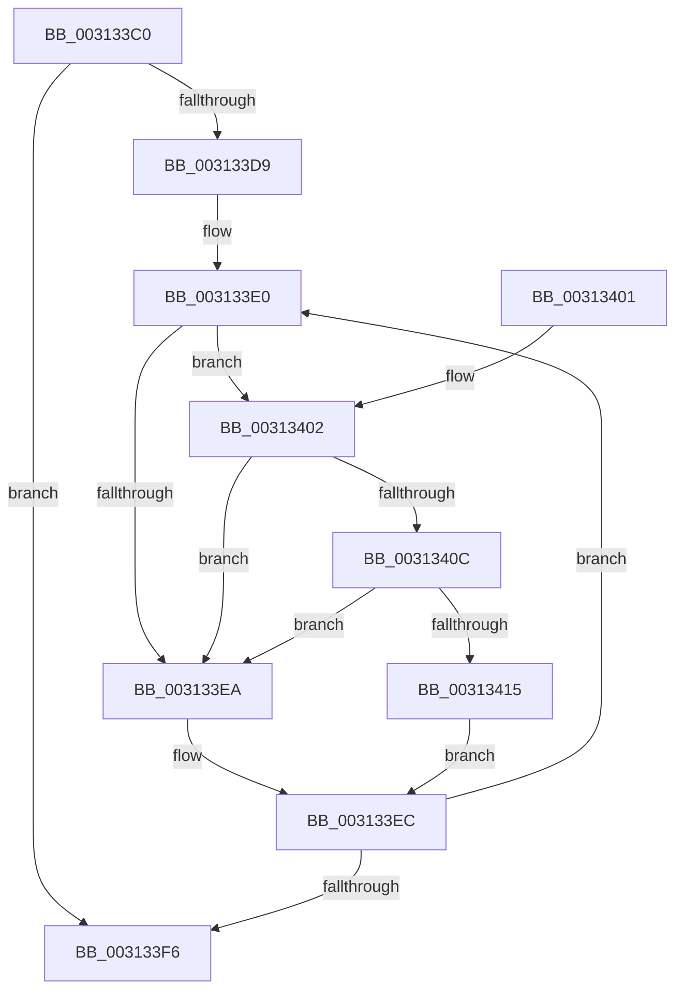

# KiIpiWaitForRequestBarrier

- RVA: `0x003133C0`–`0x0031341E` (길이 `94` bytes)
- VA: `0x00000001403133C0`
- 실행 섹션: `.text`
- PDB 이름 있음: `예`; PDB Function 태그: `아니요`
- unwind 정보 RVA: `0x0005D394`
- 디코드: `30`개 명령, `94/94` bytes 표시
- 미해석 바이트: `0` (있으면 어셈블리에 `.byte`로 보존)

> 이 문서는 커널 이미지의 기계어와 PDB 기호를 분석해 생성했습니다. 4번과 5번은 함수 원형과 자료형을 바이너리 사용 방식에서 추정한 C 해석이며 원본 소스 복구 결과는 아닙니다.

## 1. Dependencies

- 직접 호출 지점: **2**; 고유 호출 대상: **2**
- 직접 호출자로 확인된 함수: **5**
- RIP 상대 이미지 참조: **2**

### Outgoing calls
- `0x0031340C` → [KiCheckVpBackingLongSpinWaitHypercall](../30/KiCheckVpBackingLongSpinWaitHypercall_function_0030F490.md) (function, `0x0030F490`)
- `0x00313417` → [HvlNotifyLongSpinWait](../30/HvlNotifyLongSpinWait_function_0030F460.md) (function, `0x0030F460`)

### Direct callers
- [KeInvalidateRangeAllCaches](../30/KeInvalidateRangeAllCaches_function_00308880.md) at `0x003088ED`
- [KeInvalidateAllCaches](../30/KeInvalidateAllCaches_function_00308CC0.md) at `0x00308D24`
- [KxFlushEntireTb](../30/KxFlushEntireTb_function_00309094.md) at `0x0030915E`
- [KxFlushEntireTb](../30/KxFlushEntireTb_function_00309094.md) at `0x0030926C`
- [sub_003127BF](Unknown_function_003127BF.md) at `0x00312812`
- [KxFlushNonGlobalTb](KxFlushNonGlobalTb_function_00314E50.md) at `0x00314F68`
- [KxFlushNonGlobalTb](KxFlushNonGlobalTb_function_00314E50.md) at `0x00314F9F`

### Static image references
- `0x003133E2` → RVA `0x00FC52AC` (`ALMOSTRO`; reference)
- `0x00313402` → RVA `0x00FC6AB8` (`ALMOSTRO`; read)

## 2. Other-region calls and transfers

- 다른 실행 섹션으로 향하는 call: **0**
- 별도 외부 분기/꼬리 이동을 확인하지 못했습니다.

## 3. Assembly (complete function range)

```asm
003133C0  48 89 5C 24 08                  mov qword ptr [rsp + 8], rbx
003133C5  57                              push rdi
003133C6  48 83 EC 20                     sub rsp, 0x20
003133CA  8B 81 80 2D 00 00               mov eax, dword ptr [rcx + 0x2d80]
003133D0  33 DB                           xor ebx, ebx
003133D2  48 8B F9                        mov rdi, rcx
003133D5  85 C0                           test eax, eax
003133D7  74 1D                           je 0x1403133f6
003133D9  0F 1F 80 00 00 00 00            nop dword ptr [rax]
003133E0  FF C3                           inc ebx
003133E2  85 1D C4 1E CB 00               test dword ptr [rip + 0xcb1ec4], ebx
003133E8  74 18                           je 0x140313402
003133EA  F3 90                           pause
003133EC  8B 87 80 2D 00 00               mov eax, dword ptr [rdi + 0x2d80]
003133F2  85 C0                           test eax, eax
003133F4  75 EA                           jne 0x1403133e0
003133F6  48 8B 5C 24 30                  mov rbx, qword ptr [rsp + 0x30]
003133FB  48 83 C4 20                     add rsp, 0x20
003133FF  5F                              pop rdi
00313400  C3                              ret
00313401  CC                              int3
00313402  8B 05 B0 36 CB 00               mov eax, dword ptr [rip + 0xcb36b0]
00313408  A8 40                           test al, 0x40
0031340A  74 DE                           je 0x1403133ea
0031340C  E8 7F C0 FF FF                  call 0x14030f490
00313411  84 C0                           test al, al
00313413  74 D5                           je 0x1403133ea
00313415  8B CB                           mov ecx, ebx
00313417  E8 44 C0 FF FF                  call 0x14030f460
0031341C  EB CE                           jmp 0x1403133ec
```

## 4. C-style interpretation (structured pseudocode)

```c
__int64 __fastcall KiIpiWaitForRequestBarrier(__int64 a1)
{
    __int64 result;
    __int64 v_rbx;
    __int64 v_rsp;
    unsigned __int64 v_stack_p8;

    v_stack_p8 = v_rbx;
    v_rsp = (v_rsp) - (32);
    v_rbx = 0;
    if ((unsigned int)((unsigned int)(*(unsigned int *)(a1 + 11648))) == 0) goto loc_003133F6;
loc_003133E0:
    v_rbx = (unsigned int)((v_rbx) + 1);
    if (((*(unsigned int *)(v_rip + 13311684)) & ((unsigned int)(v_rbx))) == 0) goto loc_00313402;
loc_003133EA:
loc_003133EC:
    if ((unsigned int)((unsigned int)(*(unsigned int *)(a1 + 11648))) != 0) goto loc_003133E0;
loc_003133F6:
    v_rsp = (v_rsp) + (32);
    return (unsigned int)(*(unsigned int *)(a1 + 11648));
loc_00313402:
    if ((((unsigned __int8)((unsigned int)(*(unsigned int *)(v_rip + 13317808)))) & (64)) == 0) goto loc_003133EA;
    result = KiCheckVpBackingLongSpinWaitHypercall(a1, a2, a3, a4);
    if ((unsigned __int8)(result) == 0) goto loc_003133EA;
    result = HvlNotifyLongSpinWait((unsigned int)((unsigned int)(v_stack_p8)), a2, a3, a4);
    goto loc_003133EC;
}
```

## 5. (Beta) C Style

```c
int64_t KiIpiWaitForRequestBarrier(void *Arg1)
{
    uint8_t *arg1 = (uint8_t *)Arg1;

    int64_t result;
    int64_t local_rbx;
    int64_t local_rsp;
    uint64_t v_stack_p8;

    v_stack_p8 = local_rbx;
    local_rsp = (local_rsp) - (32);
    local_rbx = 0;
    if ((uint32_t)((uint32_t)(*(uint32_t *)(arg1 + 0x2D80))) == 0) goto loc_003133F6;
loc_003133E0:
    local_rbx = (uint32_t)((local_rbx) + 1);
    if (((*(uint32_t *)(v_rip + 0xCB1EC4)) & ((uint32_t)(local_rbx))) == 0) goto loc_00313402;
loc_003133EA:
loc_003133EC:
    if ((uint32_t)((uint32_t)(*(uint32_t *)(arg1 + 0x2D80))) != 0) goto loc_003133E0;
loc_003133F6:
    local_rsp = (local_rsp) + (32);
    return (uint32_t)(*(uint32_t *)(arg1 + 0x2D80));
loc_00313402:
    if ((((uint8_t)((uint32_t)(*(uint32_t *)(v_rip + 0xCB36B0)))) & (64)) == 0) goto loc_003133EA;
    result = KiCheckVpBackingLongSpinWaitHypercall(Arg1, a2, a3, a4);
    if ((uint8_t)(result) == 0) goto loc_003133EA;
    result = HvlNotifyLongSpinWait((uint32_t)((uint32_t)(v_stack_p8)), a2, a3, a4);
    goto loc_003133EC;
}
```

### 관측된 메모리 오프셋

구조체 형식이 확인되지 않은 접근은 인자 기준의 오프셋으로만 기록했습니다.

| 기준 인자 | 오프셋 표현 | 폭 (bit) | 접근 |
|---|---:|---:|---|
| `Arg1` | `+ 0x2D80` | `32` | `R` |

## 6. Execution-region graph

[열기: 2D/3D 그래프와 함수 탐색 컨트롤 패널](../../../control-panel.html?section=text&rva=0x003133C0&view=graph)

- 2D 그래프는 위에서 아래로 흐르고, 3D 그래프는 빈 공간을 드래그해 회전합니다. Shift+드래그는 이동, 휠은 확대·축소, 함수 노드 선택은 대상 보고서 이동입니다.

### Static fallback


