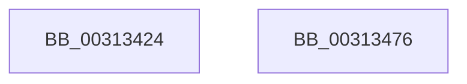

# KiPrepareFlushCurrentAffinity

- RVA: `0x00313424`–`0x00313477` (길이 `83` bytes)
- VA: `0x0000000140313424`
- 실행 섹션: `.text`
- PDB 이름 있음: `예`; PDB Function 태그: `아니요`
- unwind 정보 RVA: `0x0005CAAC`
- 디코드: `20`개 명령, `83/83` bytes 표시
- 미해석 바이트: `0` (있으면 어셈블리에 `.byte`로 보존)

> 이 문서는 커널 이미지의 기계어와 PDB 기호를 분석해 생성했습니다. 4번과 5번은 함수 원형과 자료형을 바이너리 사용 방식에서 추정한 C 해석이며 원본 소스 복구 결과는 아닙니다.

## 1. Dependencies

- 직접 호출 지점: **2**; 고유 호출 대상: **2**
- 직접 호출자로 확인된 함수: **3**
- RIP 상대 이미지 참조: **0**

### Outgoing calls
- `0x00313450` → [memset](../6C/memset_function_006C6C40.md) (function, `0x006C6C40`)
- `0x00313466` → [KeAddGroupAffinityEx](../25/KeAddGroupAffinityEx_function_0025B6C0.md) (function, `0x0025B6C0`)

### Direct callers
- [sub_00312223](Unknown_function_00312223.md) at `0x00312667`
- [KeFlushCurrentTbOnly](KeFlushCurrentTbOnly_function_003134EC.md) at `0x00313584`
- [KeFlushSingleCurrentTb](../5B/KeFlushSingleCurrentTb_function_005BDC9C.md) at `0x005BDD34`

### Static image references
- 디코드된 RIP-relative 메모리 참조가 없습니다.

## 2. Other-region calls and transfers

- 다른 실행 섹션으로 향하는 call: **0**
- 별도 외부 분기/꼬리 이동을 확인하지 못했습니다.

## 3. Assembly (complete function range)

```asm
00313424  48 89 5C 24 08                  mov qword ptr [rsp + 8], rbx
00313429  57                              push rdi
0031342A  48 83 EC 20                     sub rsp, 0x20
0031342E  65 48 8B 1C 25 20 00 00 00      mov rbx, qword ptr gs:[0x20]
00313437  48 8B F9                        mov rdi, rcx
0031343A  83 61 04 00                     and dword ptr [rcx + 4], 0
0031343E  33 D2                           xor edx, edx
00313440  C7 01 01 00 20 00               mov dword ptr [rcx], 0x200001
00313446  41 B8 00 01 00 00               mov r8d, 0x100
0031344C  48 83 C1 08                     add rcx, 8
00313450  E8 EB 37 3B 00                  call 0x1406c6c40
00313455  0F B6 93 D0 00 00 00            movzx edx, byte ptr [rbx + 0xd0]
0031345C  48 8B CF                        mov rcx, rdi
0031345F  4C 8B 83 C8 00 00 00            mov r8, qword ptr [rbx + 0xc8]
00313466  E8 55 82 F4 FF                  call 0x14025b6c0
0031346B  48 8B 5C 24 30                  mov rbx, qword ptr [rsp + 0x30]
00313470  48 83 C4 20                     add rsp, 0x20
00313474  5F                              pop rdi
00313475  C3                              ret
00313476  CC                              int3
```

## 4. C-style interpretation (structured pseudocode)

```c
__int64 __fastcall KiPrepareFlushCurrentAffinity(__int64 a1, int a2)
{
    __int64 result;
    __int64 v_rsp;
    unsigned __int64 v_stack_p8;

    v_stack_p8 = v_rbx;
    v_rsp = (v_rsp) - (32);
    a2 = 0;
    *(unsigned int *)(a1) = 0x200001ULL;
    a1 = (a1) + (8);
    result = memset(a1, a2, 256, a4);
    result = KeAddGroupAffinityEx(a1, *(unsigned __int8 *)(*(unsigned __int64 *)(gs_base + (0 + 32)) + 208), *(unsigned __int64 *)(*(unsigned __int64 *)(gs_base + (0 + 32)) + 200), a4);
    v_rsp = (v_rsp) + (32);
    return result;
}
```

## 5. (Beta) C Style

```c
int64_t KiPrepareFlushCurrentAffinity(void *Arg1, int32_t Arg2)
{
    uint8_t *arg1 = (uint8_t *)Arg1;

    int64_t result;
    int64_t local_rsp;
    uint64_t v_stack_p8;

    v_stack_p8 = local_rbx;
    local_rsp = (local_rsp) - (32);
    Arg2 = 0;
    *(uint32_t *)(arg1) = 0x200001ULL;
    Arg1 = (Arg1) + (8);
    result = memset(Arg1, Arg2, 256, a4);
    result = KeAddGroupAffinityEx(Arg1, *(uint8_t *)(*(uint64_t *)(gs_base + (0 + 0x20)) + 0xD0), *(uint64_t *)(*(uint64_t *)(gs_base + (0 + 0x20)) + 0xC8), a4);
    local_rsp = (local_rsp) + (32);
    return result;
}
```

### 관측된 메모리 오프셋

구조체 형식이 확인되지 않은 접근은 인자 기준의 오프셋으로만 기록했습니다.

| 기준 인자 | 오프셋 표현 | 폭 (bit) | 접근 |
|---|---:|---:|---|
| `Arg1` | `+ 0x0` | `32` | `W` |
| `Arg1` | `+ 0x4` | `32` | `R/W` |

## 6. Execution-region graph

[열기: 2D/3D 그래프와 함수 탐색 컨트롤 패널](../../../control-panel.html?section=text&rva=0x00313424&view=graph)

- 2D 그래프는 위에서 아래로 흐르고, 3D 그래프는 빈 공간을 드래그해 회전합니다. Shift+드래그는 이동, 휠은 확대·축소, 함수 노드 선택은 대상 보고서 이동입니다.

### Static fallback


