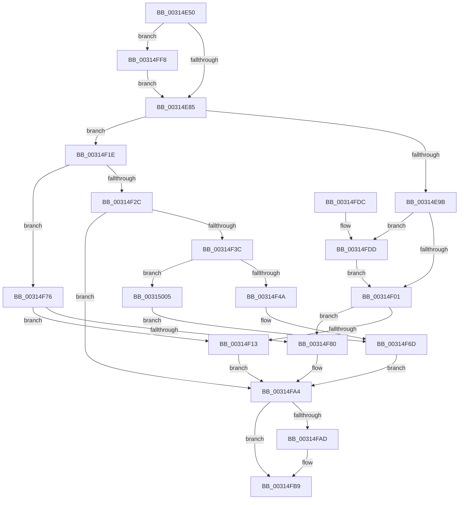

# KxFlushNonGlobalTb

- RVA: `0x00314E50`–`0x00315010` (길이 `448` bytes)
- VA: `0x0000000140314E50`
- 실행 섹션: `.text`
- PDB 이름 있음: `예`; PDB Function 태그: `아니요`
- unwind 정보 RVA: `0x000748D4`
- 디코드: `113`개 명령, `448/448` bytes 표시
- 미해석 바이트: `0` (있으면 어셈블리에 `.byte`로 보존)

> 이 문서는 커널 이미지의 기계어와 PDB 기호를 분석해 생성했습니다. 4번과 5번은 함수 원형과 자료형을 바이너리 사용 방식에서 추정한 C 해석이며 원본 소스 복구 결과는 아닙니다.

## 1. Dependencies

- 직접 호출 지점: **10**; 고유 호출 대상: **8**
- 직접 호출자로 확인된 함수: **3**
- RIP 상대 이미지 참조: **6**

### Outgoing calls
- `0x00314ECE` → [memset](../6C/memset_function_006C6C40.md) (function, `0x006C6C40`)
- `0x00314EDD` → [KiCopyAffinityEx](../2C/KiCopyAffinityEx_function_002CE860.md) (function, `0x002CE860`)
- `0x00314F0A` → [KiAffinityContainsProcessorsOtherThanSelf](../30/KiAffinityContainsProcessorsOtherThanSelf_function_0030B1B0.md) (function, `0x0030B1B0`)
- `0x00314F33` → [KxSetTimeStampBusy](KxSetTimeStampBusy_function_00314CC0.md) (function, `0x00314CC0`)
- `0x00314F5A` → [KiIpiSendRequest](KiIpiSendRequest_function_003113C0.md) (function, `0x003113C0`)
- `0x00314F68` → [KiIpiWaitForRequestBarrier](KiIpiWaitForRequestBarrier_function_003133C0.md) (function, `0x003133C0`)
- `0x00314F91` → [KiIpiSendRequest](KiIpiSendRequest_function_003113C0.md) (function, `0x003113C0`)
- `0x00314F9F` → [KiIpiWaitForRequestBarrier](KiIpiWaitForRequestBarrier_function_003133C0.md) (function, `0x003133C0`)
- `0x00314FB4` → [KiLowerIrqlProcessIrqlFlags](../4F/KiLowerIrqlProcessIrqlFlags_function_004F5698.md) (function, `0x004F5698`)
- `0x00314FFB` → [KiRaiseIrqlProcessIrqlFlags](../4F/KiRaiseIrqlProcessIrqlFlags_function_004F56FC.md) (function, `0x004F56FC`)

### Direct callers
- [MiFlushEntireTbDueToAttributeChange](../30/MiFlushEntireTbDueToAttributeChange_function_00308AE0.md) at `0x00308B89`
- [sub_003143F3](Unknown_function_003143F3.md) at `0x003144C5`
- [sub_006E122E](../6E/Unknown_function_006E122E.md) at `0x006E1230`

### Static image references
- `0x00314E78` → RVA `0x00FC6D20` (`ALMOSTRO`; read)
- `0x00314EE5` → RVA `0x00F231B0` (`.data`; read)
- `0x00314F23` → RVA `0x01201840` (`CFGRO`; read)
- `0x00314F2C` → RVA `0x00FCF080` (`CACHEALI`; read)
- `0x00314F3C` → RVA `0x00FC6A80` (`ALMOSTRO`; read)
- `0x00314F6D` → RVA `0x00FCF080` (`CACHEALI`; read/write)

## 2. Other-region calls and transfers

- 다른 실행 섹션으로 향하는 call: **0**
- 별도 외부 분기/꼬리 이동을 확인하지 못했습니다.

## 3. Assembly (complete function range)

```asm
00314E50  48 8B C4                        mov rax, rsp
00314E53  48 89 58 08                     mov qword ptr [rax + 8], rbx
00314E57  48 89 68 10                     mov qword ptr [rax + 0x10], rbp
00314E5B  48 89 70 18                     mov qword ptr [rax + 0x18], rsi
00314E5F  48 89 78 20                     mov qword ptr [rax + 0x20], rdi
00314E63  41 56                           push r14
00314E65  48 83 EC 30                     sub rsp, 0x30
00314E69  8B D9                           mov ebx, ecx
00314E6B  45 0F 20 C6                     mov r14, cr8
00314E6F  BA 0C 00 00 00                  mov edx, 0xc
00314E74  44 0F 22 C2                     mov cr8, rdx
00314E78  83 3D A1 1E CB 00 00            cmp dword ptr [rip + 0xcb1ea1], 0
00314E7F  0F 85 73 01 00 00               jne 0x140314ff8
00314E85  65 48 8B 2C 25 20 00 00 00      mov rbp, qword ptr gs:[0x20]
00314E8E  BF 01 00 00 00                  mov edi, 1
00314E93  85 DB                           test ebx, ebx
00314E95  0F 85 83 00 00 00               jne 0x140314f1e
00314E9B  F0 09 1C 24                     lock or dword ptr [rsp], ebx
00314E9F  48 8B 45 08                     mov rax, qword ptr [rbp + 8]
00314EA3  48 8D B5 B8 2D 00 00            lea rsi, [rbp + 0x2db8]
00314EAA  33 D2                           xor edx, edx
00314EAC  41 B8 00 01 00 00               mov r8d, 0x100
00314EB2  48 8B 88 B8 00 00 00            mov rcx, qword ptr [rax + 0xb8]
00314EB9  48 8B 99 80 00 00 00            mov rbx, qword ptr [rcx + 0x80]
00314EC0  48 8D 4E 08                     lea rcx, [rsi + 8]
00314EC4  83 66 04 00                     and dword ptr [rsi + 4], 0
00314EC8  C7 06 01 00 20 00               mov dword ptr [rsi], 0x200001
00314ECE  E8 6D 1D 3B 00                  call 0x1406c6c40
00314ED3  0F B7 56 02                     movzx edx, word ptr [rsi + 2]
00314ED7  4C 8B C3                        mov r8, rbx
00314EDA  48 8B CE                        mov rcx, rsi
00314EDD  E8 7E 99 FB FF                  call 0x1402ce860
00314EE2  8B 4D 24                        mov ecx, dword ptr [rbp + 0x24]
00314EE5  48 8B 05 C4 E2 C0 00            mov rax, qword ptr [rip + 0xc0e2c4]
00314EEC  44 8B 04 88                     mov r8d, dword ptr [rax + rcx*4]
00314EF0  41 8B C8                        mov ecx, r8d
00314EF3  0F B7 06                        movzx eax, word ptr [rsi]
00314EF6  C1 E9 06                        shr ecx, 6
00314EF9  3B C1                           cmp eax, ecx
00314EFB  0F 87 DC 00 00 00               ja 0x140314fdd
00314F01  48 8B D6                        mov rdx, rsi
00314F04  48 8B CD                        mov rcx, rbp
00314F07  45 33 DB                        xor r11d, r11d
00314F0A  E8 A1 62 FF FF                  call 0x14030b1b0
00314F0F  85 C0                           test eax, eax
00314F11  75 6D                           jne 0x140314f80
00314F13  0F 20 D8                        mov rax, cr3
00314F16  0F 22 D8                        mov cr3, rax
00314F19  E9 86 00 00 00                  jmp 0x140314fa4
00314F1E  33 F6                           xor esi, esi
00314F20  44 8B DF                        mov r11d, edi
00314F23  40 38 35 16 C9 EE 00            cmp byte ptr [rip + 0xeec916], sil
00314F2A  74 4A                           je 0x140314f76
00314F2C  48 8D 0D 4D A1 CB 00            lea rcx, [rip + 0xcba14d]
00314F33  E8 88 FD FF FF                  call 0x140314cc0
00314F38  84 C0                           test al, al
00314F3A  74 68                           je 0x140314fa4
00314F3C  8B 05 3E 1B CB 00               mov eax, dword ptr [rip + 0xcb1b3e]
00314F42  3B C7                           cmp eax, edi
00314F44  0F 86 BB 00 00 00               jbe 0x140315005
00314F4A  45 33 C9                        xor r9d, r9d
00314F4D  48 89 7C 24 20                  mov qword ptr [rsp + 0x20], rdi
00314F52  45 33 C0                        xor r8d, r8d
00314F55  8B D7                           mov edx, edi
00314F57  48 8B CD                        mov rcx, rbp
00314F5A  E8 61 C4 FF FF                  call 0x1403113c0
00314F5F  0F 20 D8                        mov rax, cr3
00314F62  0F 22 D8                        mov cr3, rax
00314F65  48 8B CD                        mov rcx, rbp
00314F68  E8 53 E4 FF FF                  call 0x1403133c0
00314F6D  F0 01 3D 0C A1 CB 00            lock add dword ptr [rip + 0xcba10c], edi
00314F74  EB 2E                           jmp 0x140314fa4
00314F76  8B 05 04 1B CB 00               mov eax, dword ptr [rip + 0xcb1b04]
00314F7C  3B C7                           cmp eax, edi
00314F7E  76 93                           jbe 0x140314f13
00314F80  45 33 C9                        xor r9d, r9d
00314F83  48 89 7C 24 20                  mov qword ptr [rsp + 0x20], rdi
00314F88  4C 8B C6                        mov r8, rsi
00314F8B  41 8B D3                        mov edx, r11d
00314F8E  48 8B CD                        mov rcx, rbp
00314F91  E8 2A C4 FF FF                  call 0x1403113c0
00314F96  0F 20 D8                        mov rax, cr3
00314F99  0F 22 D8                        mov cr3, rax
00314F9C  48 8B CD                        mov rcx, rbp
00314F9F  E8 1C E4 FF FF                  call 0x1403133c0
00314FA4  83 3D 75 1D CB 00 00            cmp dword ptr [rip + 0xcb1d75], 0
00314FAB  74 0C                           je 0x140314fb9
00314FAD  44 0F 20 C1                     mov rcx, cr8
00314FB1  41 8A D6                        mov dl, r14b
00314FB4  E8 DF 06 1E 00                  call 0x1404f5698
00314FB9  41 0F B6 C6                     movzx eax, r14b
00314FBD  44 0F 22 C0                     mov cr8, rax
00314FC1  48 8B 5C 24 40                  mov rbx, qword ptr [rsp + 0x40]
00314FC6  48 8B 6C 24 48                  mov rbp, qword ptr [rsp + 0x48]
00314FCB  48 8B 74 24 50                  mov rsi, qword ptr [rsp + 0x50]
00314FD0  48 8B 7C 24 58                  mov rdi, qword ptr [rsp + 0x58]
00314FD5  48 83 C4 30                     add rsp, 0x30
00314FD9  41 5E                           pop r14
00314FDB  C3                              ret
00314FDC  CC                              int3
00314FDD  8B D1                           mov edx, ecx
00314FDF  41 8B C8                        mov ecx, r8d
00314FE2  83 E1 3F                        and ecx, 0x3f
00314FE5  48 8B 44 D6 08                  mov rax, qword ptr [rsi + rdx*8 + 8]
00314FEA  48 0F B3 C8                     btr rax, rcx
00314FEE  48 89 44 D6 08                  mov qword ptr [rsi + rdx*8 + 8], rax
00314FF3  E9 09 FF FF FF                  jmp 0x140314f01
00314FF8  41 8A CE                        mov cl, r14b
00314FFB  E8 FC 06 1E 00                  call 0x1404f56fc
00315000  E9 80 FE FF FF                  jmp 0x140314e85
00315005  0F 20 D8                        mov rax, cr3
00315008  0F 22 D8                        mov cr3, rax
0031500B  E9 5D FF FF FF                  jmp 0x140314f6d
```

## 4. C-style interpretation (structured pseudocode)

```c
__int64 __fastcall KxFlushNonGlobalTb(int a1, __int64 a2, __int64 a3, int a4)
{
    __int64 result;
    __int64 v_r11;
    __int64 v_rsi;
    __int64 v_rsp;
    unsigned __int64 v_stack_m18;
    unsigned int v_stack_m38;
    unsigned __int64 v_stack_p10;
    unsigned __int64 v_stack_p18;
    unsigned __int64 v_stack_p20;
    unsigned __int64 v_stack_p8;

    *(unsigned __int64 *)(v_rsp + 8) = v_rbx;
    *(unsigned __int64 *)(v_rsp + 16) = v_rbp;
    *(unsigned __int64 *)(v_rsp + 24) = v_rsi;
    *(unsigned __int64 *)(v_rsp + 32) = v_rdi;
    v_rsp = (v_rsp) - (48);
    if ((*(unsigned int *)(v_rip + 13311649)) != 0) goto loc_00314FF8;
loc_00314E85:
    if ((unsigned int)((unsigned int)(a1)) != 0) goto loc_00314F1E;
    a2 = 0;
    *(unsigned int *)(*(unsigned __int64 *)(gs_base + (0 + 32)) + 11704) = 0x200001ULL;
    result = memset(*(unsigned __int64 *)(gs_base + (0 + 32)) + 11704 + 8, a2, 256, a4);
    result = KiCopyAffinityEx(*(unsigned __int64 *)(gs_base + (0 + 32)) + 11704, *(unsigned __int16 *)(*(unsigned __int64 *)(gs_base + (0 + 32)) + 11704 + 2), *(unsigned __int64 *)(*(unsigned __int64 *)(*(unsigned __int64 *)(*(unsigned __int64 *)(gs_base + (0 + 32)) + 8) + 184) + 128), a4);
    a1 = (unsigned int)(((unsigned int)((unsigned int)((unsigned int)(*(unsigned int *)(*(unsigned __int64 *)(v_rip + 12640964) + (unsigned int)(*(unsigned int *)(*(unsigned __int64 *)(gs_base + (0 + 32)) + 36)) * 4))))) >> (6));
    if (((unsigned int)(*(unsigned __int16 *)(*(unsigned __int64 *)(gs_base + (0 + 32)) + 11704))) > a1) goto loc_00314FDD;
loc_00314F01:
    v_r11 = 0;
    result = KiAffinityContainsProcessorsOtherThanSelf(*(unsigned __int64 *)(gs_base + (0 + 32)), *(unsigned __int64 *)(gs_base + (0 + 32)) + 11704, (unsigned int)(*(unsigned int *)(*(unsigned __int64 *)(v_rip + 12640964) + (unsigned int)(*(unsigned int *)(*(unsigned __int64 *)(gs_base + (0 + 32)) + 36)) * 4)), a4);
    if ((unsigned int)(result) != 0) goto loc_00314F80;
loc_00314F13:
    goto loc_00314FA4;
loc_00314F1E:
    v_rsi = 0;
    if ((*(unsigned __int8 *)(v_rip + 15649046)) == 0) goto loc_00314F76;
    result = KxSetTimeStampBusy(v_rip + 13345101, *(unsigned __int64 *)(gs_base + (0 + 32)) + 11704, (unsigned int)(*(unsigned int *)(*(unsigned __int64 *)(v_rip + 12640964) + (unsigned int)(*(unsigned int *)(*(unsigned __int64 *)(gs_base + (0 + 32)) + 36)) * 4)), a4);
    if ((unsigned __int8)(result) == 0) goto loc_00314FA4;
    if (((unsigned int)((unsigned int)(*(unsigned int *)(v_rip + 13310782)))) <= 1) goto loc_00315005;
    a4 = 0;
    v_stack_m18 = 1;
    a3 = 0;
    result = KiIpiSendRequest(*(unsigned __int64 *)(gs_base + (0 + 32)), 1, a3, a4);
    result = KiIpiWaitForRequestBarrier(*(unsigned __int64 *)(gs_base + (0 + 32)), 1, a3, a4);
loc_00314F6D:
    goto loc_00314FA4;
loc_00314F76:
    if (((unsigned int)((unsigned int)(*(unsigned int *)(v_rip + 13310724)))) <= 1) goto loc_00314F13;
loc_00314F80:
    a4 = 0;
    v_stack_m18 = 1;
    result = KiIpiSendRequest(*(unsigned __int64 *)(gs_base + (0 + 32)), 1, 0, a4);
    result = KiIpiWaitForRequestBarrier(*(unsigned __int64 *)(gs_base + (0 + 32)), 1, 0, a4);
loc_00314FA4:
    if ((*(unsigned int *)(v_rip + 13311349)) != 0) {
        a1 = 12;
        a2 = (unsigned __int8)(v_cr8);
        result = KiLowerIrqlProcessIrqlFlags(a1, a2, 0, a4);
    }
    v_rsp = (v_rsp) + (48);
    return (unsigned __int8)(v_cr8);
loc_00314FDD:
    a1 = (unsigned int)((0) & (63));
    *(unsigned __int64 *)(v_stack_p18 + (unsigned int)(a1) * 8 + 8) = *(unsigned __int64 *)(v_stack_p18 + (unsigned int)(a1) * 8 + 8);
    goto loc_00314F01;
loc_00314FF8:
    result = KiRaiseIrqlProcessIrqlFlags((unsigned __int8)(v_cr8), (unsigned int)(a1), 0, a4);
    goto loc_00314E85;
loc_00315005:
    goto loc_00314F6D;
}
```

## 5. (Beta) C Style

```c
int64_t KxFlushNonGlobalTb(int32_t Arg1, int64_t Arg2, int64_t Arg3, int32_t Arg4)
{
    int64_t result;
    int64_t local_r11;
    int64_t local_rsi;
    int64_t local_rsp;
    uint64_t v_stack_m18;
    uint32_t v_stack_m38;
    uint64_t v_stack_p10;
    uint64_t v_stack_p18;
    uint64_t v_stack_p20;
    uint64_t v_stack_p8;

    *(uint64_t *)(local_rsp + 0x8) = local_rbx;
    *(uint64_t *)(local_rsp + 0x10) = local_rbp;
    *(uint64_t *)(local_rsp + 0x18) = local_rsi;
    *(uint64_t *)(local_rsp + 0x20) = local_rdi;
    local_rsp = (local_rsp) - (48);
    if ((*(uint32_t *)(v_rip + 0xCB1EA1)) != 0) goto loc_00314FF8;
loc_00314E85:
    if ((uint32_t)((uint32_t)(Arg1)) != 0) goto loc_00314F1E;
    Arg2 = 0;
    *(uint32_t *)(*(uint64_t *)(gs_base + (0 + 0x20)) + 0x2DB8) = 0x200001ULL;
    result = memset(*(uint64_t *)(gs_base + (0 + 0x20)) + 11704 + 8, Arg2, 256, Arg4);
    result = KiCopyAffinityEx(*(uint64_t *)(gs_base + (0 + 0x20)) + 11704, *(uint16_t *)(*(uint64_t *)(gs_base + (0 + 0x20)) + 0x2DB8 + 0x2), *(uint64_t *)(*(uint64_t *)(*(uint64_t *)(*(uint64_t *)(gs_base + (0 + 0x20)) + 0x8) + 0xB8) + 0x80), Arg4);
    Arg1 = (uint32_t)(((uint32_t)((uint32_t)((uint32_t)(*(uint32_t *)(*(uint64_t *)(v_rip + 0xC0E2C4) + (uint32_t)(*(uint32_t *)(*(uint64_t *)(gs_base + (0 + 0x20)) + 0x24)) * 4))))) >> (6));
    if (((uint32_t)(*(uint16_t *)(*(uint64_t *)(gs_base + (0 + 0x20)) + 0x2DB8))) > Arg1) goto loc_00314FDD;
loc_00314F01:
    local_r11 = 0;
    result = KiAffinityContainsProcessorsOtherThanSelf(*(uint64_t *)(gs_base + (0 + 0x20)), *(uint64_t *)(gs_base + (0 + 0x20)) + 11704, (uint32_t)(*(uint32_t *)(*(uint64_t *)(v_rip + 0xC0E2C4) + (uint32_t)(*(uint32_t *)(*(uint64_t *)(gs_base + (0 + 0x20)) + 0x24)) * 4)), Arg4);
    if ((uint32_t)(result) != 0) goto loc_00314F80;
loc_00314F13:
    goto loc_00314FA4;
loc_00314F1E:
    local_rsi = 0;
    if ((*(uint8_t *)(v_rip + 0xEEC916)) == 0) goto loc_00314F76;
    result = KxSetTimeStampBusy(v_rip + 13345101, *(uint64_t *)(gs_base + (0 + 0x20)) + 11704, (uint32_t)(*(uint32_t *)(*(uint64_t *)(v_rip + 0xC0E2C4) + (uint32_t)(*(uint32_t *)(*(uint64_t *)(gs_base + (0 + 0x20)) + 0x24)) * 4)), Arg4);
    if ((uint8_t)(result) == 0) goto loc_00314FA4;
    if (((uint32_t)((uint32_t)(*(uint32_t *)(v_rip + 0xCB1B3E)))) <= 1) goto loc_00315005;
    Arg4 = 0;
    v_stack_m18 = 1;
    Arg3 = 0;
    result = KiIpiSendRequest(*(uint64_t *)(gs_base + (0 + 0x20)), 1, Arg3, Arg4);
    result = KiIpiWaitForRequestBarrier(*(uint64_t *)(gs_base + (0 + 0x20)), 1, Arg3, Arg4);
loc_00314F6D:
    goto loc_00314FA4;
loc_00314F76:
    if (((uint32_t)((uint32_t)(*(uint32_t *)(v_rip + 0xCB1B04)))) <= 1) goto loc_00314F13;
loc_00314F80:
    Arg4 = 0;
    v_stack_m18 = 1;
    result = KiIpiSendRequest(*(uint64_t *)(gs_base + (0 + 0x20)), 1, 0, Arg4);
    result = KiIpiWaitForRequestBarrier(*(uint64_t *)(gs_base + (0 + 0x20)), 1, 0, Arg4);
loc_00314FA4:
    if ((*(uint32_t *)(v_rip + 0xCB1D75)) != 0) {
        Arg1 = 12;
        Arg2 = (uint8_t)(v_cr8);
        result = KiLowerIrqlProcessIrqlFlags(Arg1, Arg2, 0, Arg4);
    }
    local_rsp = (local_rsp) + (48);
    return (uint8_t)(v_cr8);
loc_00314FDD:
    Arg1 = (uint32_t)((0) & (63));
    *(uint64_t *)(v_stack_p18 + (uint32_t)(Arg1) * 8 + 0x8) = *(uint64_t *)(v_stack_p18 + (uint32_t)(Arg1) * 8 + 0x8);
    goto loc_00314F01;
loc_00314FF8:
    result = KiRaiseIrqlProcessIrqlFlags((uint8_t)(v_cr8), (uint32_t)(Arg1), 0, Arg4);
    goto loc_00314E85;
loc_00315005:
    goto loc_00314F6D;
}
```

## 6. Execution-region graph

[열기: 2D/3D 그래프와 함수 탐색 컨트롤 패널](../../../control-panel.html?section=text&rva=0x00314E50&view=graph)

- 2D 그래프는 위에서 아래로 흐르고, 3D 그래프는 빈 공간을 드래그해 회전합니다. Shift+드래그는 이동, 휠은 확대·축소, 함수 노드 선택은 대상 보고서 이동입니다.

### Static fallback


