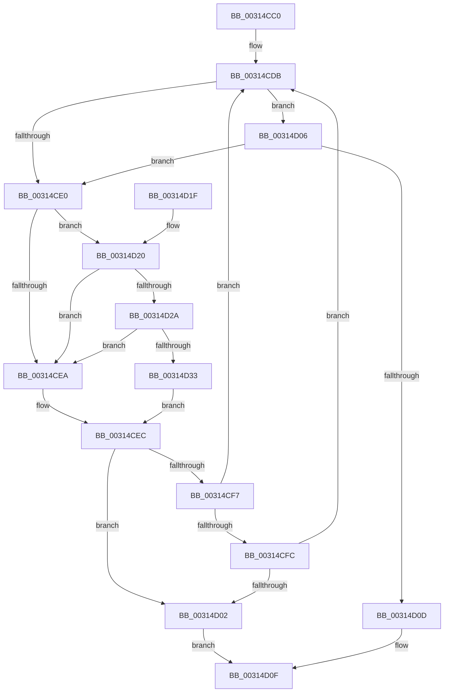

# KxSetTimeStampBusy

- RVA: `0x00314CC0`–`0x00314D3C` (길이 `124` bytes)
- VA: `0x0000000140314CC0`
- 실행 섹션: `.text`
- PDB 이름 있음: `예`; PDB Function 태그: `아니요`
- unwind 정보 RVA: `0x0006F908`
- 디코드: `44`개 명령, `124/124` bytes 표시
- 미해석 바이트: `0` (있으면 어셈블리에 `.byte`로 보존)

> 이 문서는 커널 이미지의 기계어와 PDB 기호를 분석해 생성했습니다. 4번과 5번은 함수 원형과 자료형을 바이너리 사용 방식에서 추정한 C 해석이며 원본 소스 복구 결과는 아닙니다.

## 1. Dependencies

- 직접 호출 지점: **2**; 고유 호출 대상: **2**
- 직접 호출자로 확인된 함수: **5**
- RIP 상대 이미지 참조: **2**

### Outgoing calls
- `0x00314D2A` → [KiCheckVpBackingLongSpinWaitHypercall](../30/KiCheckVpBackingLongSpinWaitHypercall_function_0030F490.md) (function, `0x0030F490`)
- `0x00314D35` → [HvlNotifyLongSpinWait](../30/HvlNotifyLongSpinWait_function_0030F460.md) (function, `0x0030F460`)

### Direct callers
- [KeInvalidateAllCaches](../30/KeInvalidateAllCaches_function_00308CC0.md) at `0x00308CF0`
- [KiFlushAddressSpaceTb](../30/KiFlushAddressSpaceTb_function_00308F50.md) at `0x00308FBF`
- [KxFlushEntireTb](../30/KxFlushEntireTb_function_00309094.md) at `0x003090F9`
- [sub_003143F3](Unknown_function_003143F3.md) at `0x003144F5`
- [KxFlushNonGlobalTb](KxFlushNonGlobalTb_function_00314E50.md) at `0x00314F33`

### Static image references
- `0x00314CE2` → RVA `0x00FC52AC` (`ALMOSTRO`; reference)
- `0x00314D20` → RVA `0x00FC6AB8` (`ALMOSTRO`; read)

## 2. Other-region calls and transfers

- 다른 실행 섹션으로 향하는 call: **0**
- 별도 외부 분기/꼬리 이동을 확인하지 못했습니다.

## 3. Assembly (complete function range)

```asm
00314CC0  48 89 5C 24 08                  mov qword ptr [rsp + 8], rbx
00314CC5  48 89 74 24 10                  mov qword ptr [rsp + 0x10], rsi
00314CCA  57                              push rdi
00314CCB  48 83 EC 20                     sub rsp, 0x20
00314CCF  48 8B F9                        mov rdi, rcx
00314CD2  33 DB                           xor ebx, ebx
00314CD4  0F 0D 09                        prefetchw byte ptr [rcx]
00314CD7  8B 09                           mov ecx, dword ptr [rcx]
00314CD9  8B F1                           mov esi, ecx
00314CDB  F6 C1 01                        test cl, 1
00314CDE  74 26                           je 0x140314d06
00314CE0  FF C3                           inc ebx
00314CE2  85 1D C4 05 CB 00               test dword ptr [rip + 0xcb05c4], ebx
00314CE8  74 36                           je 0x140314d20
00314CEA  F3 90                           pause
00314CEC  8B 0F                           mov ecx, dword ptr [rdi]
00314CEE  8B C1                           mov eax, ecx
00314CF0  2B C6                           sub eax, esi
00314CF2  83 F8 03                        cmp eax, 3
00314CF5  7D 0B                           jge 0x140314d02
00314CF7  83 F8 02                        cmp eax, 2
00314CFA  7C DF                           jl 0x140314cdb
00314CFC  40 F6 C6 01                     test sil, 1
00314D00  75 D9                           jne 0x140314cdb
00314D02  32 C0                           xor al, al
00314D04  EB 09                           jmp 0x140314d0f
00314D06  F0 0F BA 2F 00                  lock bts dword ptr [rdi], 0
00314D0B  72 D3                           jb 0x140314ce0
00314D0D  B0 01                           mov al, 1
00314D0F  48 8B 5C 24 30                  mov rbx, qword ptr [rsp + 0x30]
00314D14  48 8B 74 24 38                  mov rsi, qword ptr [rsp + 0x38]
00314D19  48 83 C4 20                     add rsp, 0x20
00314D1D  5F                              pop rdi
00314D1E  C3                              ret
00314D1F  CC                              int3
00314D20  8B 05 92 1D CB 00               mov eax, dword ptr [rip + 0xcb1d92]
00314D26  A8 40                           test al, 0x40
00314D28  74 C0                           je 0x140314cea
00314D2A  E8 61 A7 FF FF                  call 0x14030f490
00314D2F  84 C0                           test al, al
00314D31  74 B7                           je 0x140314cea
00314D33  8B CB                           mov ecx, ebx
00314D35  E8 26 A7 FF FF                  call 0x14030f460
00314D3A  EB B0                           jmp 0x140314cec
```

## 4. C-style interpretation (structured pseudocode)

```c
__int64 __fastcall KxSetTimeStampBusy(__int64 a1)
{
    __int64 result;
    __int64 v_rbx;
    __int64 v_rsp;
    unsigned __int64 v_stack_p10;
    unsigned __int64 v_stack_p8;

    v_stack_p8 = v_rbx;
    v_stack_p10 = v_rsi;
    v_rsp = (v_rsp) - (32);
    v_rbx = 0;
loc_00314CDB:
    if ((((unsigned __int8)((unsigned int)(*(unsigned int *)(a1)))) & (1)) == 0) goto loc_00314D06;
loc_00314CE0:
    v_rbx = (unsigned int)((v_rbx) + 1);
    if (((*(unsigned int *)(v_rip + 13305284)) & ((unsigned int)(v_rbx))) == 0) goto loc_00314D20;
loc_00314CEA:
loc_00314CEC:
    result = (unsigned int)(((unsigned int)((unsigned int)((unsigned int)(*(unsigned int *)(a1))))) - ((unsigned int)((unsigned int)((unsigned int)((unsigned int)(*(unsigned int *)(a1)))))));
    if (((unsigned int)(result)) >= 3) goto loc_00314D02;
    if (((unsigned int)(result)) < 2) goto loc_00314CDB;
    if ((((unsigned __int8)((unsigned int)((unsigned int)((unsigned int)(*(unsigned int *)(a1)))))) & (1)) != 0) goto loc_00314CDB;
loc_00314D02:
    result = 0;
    goto loc_00314D0F;
loc_00314D06:
    if (condition_is_below) goto loc_00314CE0;
loc_00314D0F:
    v_rsp = (v_rsp) + (32);
    return 1;
loc_00314D20:
    if ((((unsigned __int8)((unsigned int)(*(unsigned int *)(v_rip + 13311378)))) & (64)) == 0) goto loc_00314CEA;
    result = KiCheckVpBackingLongSpinWaitHypercall((unsigned int)(*(unsigned int *)(a1)), a2, a3, a4);
    if ((unsigned __int8)(result) == 0) goto loc_00314CEA;
    result = HvlNotifyLongSpinWait((unsigned int)((unsigned int)(v_stack_p8)), a2, a3, a4);
    goto loc_00314CEC;
}
```

## 5. (Beta) C Style

```c
int64_t KxSetTimeStampBusy(void *Arg1)
{
    uint8_t *arg1 = (uint8_t *)Arg1;

    int64_t result;
    int64_t local_rbx;
    int64_t local_rsp;
    uint64_t v_stack_p10;
    uint64_t v_stack_p8;

    v_stack_p8 = local_rbx;
    v_stack_p10 = local_rsi;
    local_rsp = (local_rsp) - (32);
    local_rbx = 0;
loc_00314CDB:
    if ((((uint8_t)((uint32_t)(*(uint32_t *)(arg1)))) & (1)) == 0) goto loc_00314D06;
loc_00314CE0:
    local_rbx = (uint32_t)((local_rbx) + 1);
    if (((*(uint32_t *)(v_rip + 0xCB05C4)) & ((uint32_t)(local_rbx))) == 0) goto loc_00314D20;
loc_00314CEA:
loc_00314CEC:
    result = (uint32_t)(((uint32_t)((uint32_t)((uint32_t)(*(uint32_t *)(arg1))))) - ((uint32_t)((uint32_t)((uint32_t)((uint32_t)(*(uint32_t *)(arg1)))))));
    if (((uint32_t)(result)) >= 3) goto loc_00314D02;
    if (((uint32_t)(result)) < 2) goto loc_00314CDB;
    if ((((uint8_t)((uint32_t)((uint32_t)((uint32_t)(*(uint32_t *)(arg1)))))) & (1)) != 0) goto loc_00314CDB;
loc_00314D02:
    result = 0;
    goto loc_00314D0F;
loc_00314D06:
    if (condition_is_below) goto loc_00314CE0;
loc_00314D0F:
    local_rsp = (local_rsp) + (32);
    return 1;
loc_00314D20:
    if ((((uint8_t)((uint32_t)(*(uint32_t *)(v_rip + 0xCB1D92)))) & (64)) == 0) goto loc_00314CEA;
    result = KiCheckVpBackingLongSpinWaitHypercall((uint32_t)(*(uint32_t *)(arg1)), a2, a3, a4);
    if ((uint8_t)(result) == 0) goto loc_00314CEA;
    result = HvlNotifyLongSpinWait((uint32_t)((uint32_t)(v_stack_p8)), a2, a3, a4);
    goto loc_00314CEC;
}
```

### 관측된 메모리 오프셋

구조체 형식이 확인되지 않은 접근은 인자 기준의 오프셋으로만 기록했습니다.

| 기준 인자 | 오프셋 표현 | 폭 (bit) | 접근 |
|---|---:|---:|---|
| `Arg1` | `+ 0x0` | `8` | `R` |
| `Arg1` | `+ 0x0` | `32` | `R` |
| `Arg1` | `+ 0x0` | `32` | `R/W` |

## 6. Execution-region graph

[열기: 2D/3D 그래프와 함수 탐색 컨트롤 패널](../../../control-panel.html?section=text&rva=0x00314CC0&view=graph)

- 2D 그래프는 위에서 아래로 흐르고, 3D 그래프는 빈 공간을 드래그해 회전합니다. Shift+드래그는 이동, 휠은 확대·축소, 함수 노드 선택은 대상 보고서 이동입니다.

### Static fallback


