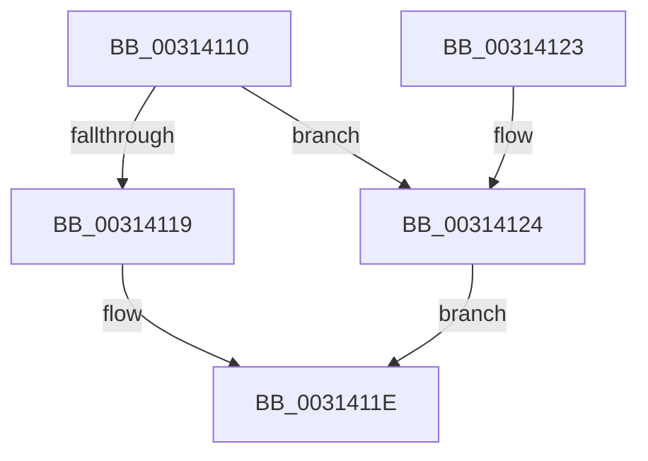

# MI_FLUSH_ENTIRE_TB

- RVA: `0x00314110`–`0x0031412B` (길이 `27` bytes)
- VA: `0x0000000140314110`
- 실행 섹션: `.text`
- PDB 이름 있음: `예`; PDB Function 태그: `아니요`
- unwind 정보 RVA: `0x0005CEE8`
- 디코드: `9`개 명령, `27/27` bytes 표시
- 미해석 바이트: `0` (있으면 어셈블리에 `.byte`로 보존)

> 이 문서는 커널 이미지의 기계어와 PDB 기호를 분석해 생성했습니다. 4번과 5번은 함수 원형과 자료형을 바이너리 사용 방식에서 추정한 C 해석이며 원본 소스 복구 결과는 아닙니다.

## 1. Dependencies

- 직접 호출 지점: **2**; 고유 호출 대상: **2**
- 직접 호출자로 확인된 함수: **14**
- RIP 상대 이미지 참조: **0**

### Outgoing calls
- `0x00314119` → [KeFlushTb](KeFlushTb_function_00314140.md) (function, `0x00314140`)
- `0x00314124` → [KeFlushCurrentTbOnly](KeFlushCurrentTbOnly_function_003134EC.md) (function, `0x003134EC`)

### Direct callers
- [MiDecommitAddToList](../24/MiDecommitAddToList_function_00242264.md) at `0x00242A3F`
- [sub_00247D90](../24/Unknown_function_00247D90.md) at `0x00247D97`
- [MiGetHighestUltraLevel](../29/MiGetHighestUltraLevel_function_002972AC.md) at `0x002973C3`
- [MiGetWsAndMakePageTablesNx](../49/MiGetWsAndMakePageTablesNx_function_00494240.md) at `0x004942DD`
- [MiDeleteUnmappedSystemCacheViews](../67/MiDeleteUnmappedSystemCacheViews_function_0067C9A0.md) at `0x0067CA07`
- [MiApplyLazyStampToAwePtes](../68/MiApplyLazyStampToAwePtes_function_006879C8.md) at `0x00687A46`
- [MiBuildPhysicalPageFreeChain](../68/MiBuildPhysicalPageFreeChain_function_00687C80.md) at `0x00687F08`
- [MiDecrementAweMapCount](../68/MiDecrementAweMapCount_function_00688158.md) at `0x00688392`
- [MiTransformValidPteViaIpi](../68/MiTransformValidPteViaIpi_function_0068A978.md) at `0x0068A9F1`
- [MiConvertHiberPhasePages](../../pagelk/B7/MiConvertHiberPhasePages_function_00B73E24.md) at `0x00B73E9E`
- [MiInitSystem](../../init/C5/MiInitSystem_function_00C5E6C0.md) at `0x00C5E80D`
- [MiInitNucleus](../../init/C5/MiInitNucleus_function_00C5FD38.md) at `0x00C6023A`
- [MiInitializePfnsForValidMappings](../../init/C6/MiInitializePfnsForValidMappings_function_00C6267C.md) at `0x00C62709`
- [MiSwitchToPfns](../../init/C6/MiSwitchToPfns_function_00C62C90.md) at `0x00C62EC9`

### Static image references
- 디코드된 RIP-relative 메모리 참조가 없습니다.

## 2. Other-region calls and transfers

- 다른 실행 섹션으로 향하는 call: **0**
- 별도 외부 분기/꼬리 이동을 확인하지 못했습니다.

## 3. Assembly (complete function range)

```asm
00314110  48 83 EC 28                     sub rsp, 0x28
00314114  83 FA FF                        cmp edx, -1
00314117  74 0B                           je 0x140314124
00314119  E8 22 00 00 00                  call 0x140314140
0031411E  48 83 C4 28                     add rsp, 0x28
00314122  C3                              ret
00314123  CC                              int3
00314124  E8 C3 F3 FF FF                  call 0x1403134ec
00314129  EB F3                           jmp 0x14031411e
```

## 4. C-style interpretation (structured pseudocode)

```c
__int64 __fastcall MI_FLUSH_ENTIRE_TB(__int64 a1, int a2)
{
    __int64 result;
    __int64 v_rsp;

    v_rsp = (v_rsp) - (40);
    if (a2 == -1) goto loc_00314124;
    result = KeFlushTb(a1, a2, a3, a4);
loc_0031411E:
    v_rsp = (v_rsp) + (40);
    return result;
loc_00314124:
    result = KeFlushCurrentTbOnly(a1, a2, a3, a4);
    goto loc_0031411E;
}
```

## 5. (Beta) C Style

```c
int64_t MI_FLUSH_ENTIRE_TB(int64_t Arg1, int32_t Arg2)
{
    int64_t result;
    int64_t local_rsp;

    local_rsp = (local_rsp) - (40);
    if (Arg2 == -1) goto loc_00314124;
    result = KeFlushTb(Arg1, Arg2, a3, a4);
loc_0031411E:
    local_rsp = (local_rsp) + (40);
    return result;
loc_00314124:
    result = KeFlushCurrentTbOnly(Arg1, Arg2, a3, a4);
    goto loc_0031411E;
}
```

## 6. Execution-region graph

[열기: 2D/3D 그래프와 함수 탐색 컨트롤 패널](../../../control-panel.html?section=text&rva=0x00314110&view=graph)

- 2D 그래프는 위에서 아래로 흐르고, 3D 그래프는 빈 공간을 드래그해 회전합니다. Shift+드래그는 이동, 휠은 확대·축소, 함수 노드 선택은 대상 보고서 이동입니다.

### Static fallback


