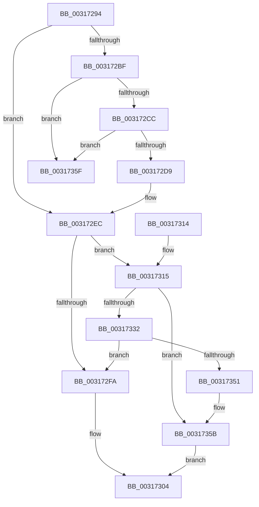

# MiAllocateCombineBlock

- RVA: `0x00317294`–`0x00317366` (길이 `210` bytes)
- VA: `0x0000000140317294`
- 실행 섹션: `.text`
- PDB 이름 있음: `예`; PDB Function 태그: `아니요`
- unwind 정보 RVA: `0x00074A18`
- 디코드: `58`개 명령, `210/210` bytes 표시
- 미해석 바이트: `0` (있으면 어셈블리에 `.byte`로 보존)

> 이 문서는 커널 이미지의 기계어와 PDB 기호를 분석해 생성했습니다. 4번과 5번은 함수 원형과 자료형을 바이너리 사용 방식에서 추정한 C 해석이며 원본 소스 복구 결과는 아닙니다.

## 1. Dependencies

- 직접 호출 지점: **5**; 고유 호출 대상: **5**
- 직접 호출자로 확인된 함수: **2**
- RIP 상대 이미지 참조: **0**

### Outgoing calls
- `0x003172AC` → [ExAcquireSpinLockExclusive](../24/ExAcquireSpinLockExclusive_function_00248690.md) (function, `0x00248690`)
- `0x003172F0` → [MiReleaseSpinLockExclusive](../24/MiReleaseSpinLockExclusive_function_002482C0.md) (function, `0x002482C0`)
- `0x00317325` → [MiAllocatePool](../35/MiAllocatePool_function_0035B540.md) (function, `0x0035B540`)
- `0x00317344` → [MiInsertNewCombineBlocks](../48/MiInsertNewCombineBlocks_function_00485858.md) (function, `0x00485858`)
- `0x00317356` → [ExFreePoolWithTag](../../poolcode/B8/ExFreePoolWithTag_function_00B82870.md) (function, `0x00B82870`)

### Direct callers
- [MiSharePages](MiSharePages_function_00315110.md) at `0x003152C7`
- [MmInitializeImageViewExtensionCfg](../../init/C6/MmInitializeImageViewExtensionCfg_function_00C64FC4.md) at `0x00C65118`

### Static image references
- 디코드된 RIP-relative 메모리 참조가 없습니다.

## 2. Other-region calls and transfers

- 다른 실행 섹션으로 향하는 call: **1**
  - `0x00317356` → [ExFreePoolWithTag](../../poolcode/B8/ExFreePoolWithTag_function_00B82870.md) (`.text` → `POOLCODE`)
- 별도 외부 분기/꼬리 이동을 확인하지 못했습니다.

## 3. Assembly (complete function range)

```asm
00317294  48 89 5C 24 08                  mov qword ptr [rsp + 8], rbx
00317299  48 89 74 24 10                  mov qword ptr [rsp + 0x10], rsi
0031729E  57                              push rdi
0031729F  48 83 EC 20                     sub rsp, 0x20
003172A3  48 8B F1                        mov rsi, rcx
003172A6  33 DB                           xor ebx, ebx
003172A8  48 83 C1 58                     add rcx, 0x58
003172AC  E8 DF 13 F3 FF                  call 0x140248690
003172B1  8A D0                           mov dl, al
003172B3  48 8D 46 48                     lea rax, [rsi + 0x48]
003172B7  48 8B 08                        mov rcx, qword ptr [rax]
003172BA  48 3B C8                        cmp rcx, rax
003172BD  74 2D                           je 0x1403172ec
003172BF  48 8B D9                        mov rbx, rcx
003172C2  48 39 41 08                     cmp qword ptr [rcx + 8], rax
003172C6  0F 85 93 00 00 00               jne 0x14031735f
003172CC  48 8B 09                        mov rcx, qword ptr [rcx]
003172CF  48 39 59 08                     cmp qword ptr [rcx + 8], rbx
003172D3  0F 85 86 00 00 00               jne 0x14031735f
003172D9  48 89 08                        mov qword ptr [rax], rcx
003172DC  48 89 41 08                     mov qword ptr [rcx + 8], rax
003172E0  48 8B C3                        mov rax, rbx
003172E3  48 25 00 F0 FF FF               and rax, 0xfffffffffffff000
003172E9  FF 40 08                        inc dword ptr [rax + 8]
003172EC  48 8D 4E 58                     lea rcx, [rsi + 0x58]
003172F0  E8 CB 0F F3 FF                  call 0x1402482c0
003172F5  48 85 DB                        test rbx, rbx
003172F8  74 1B                           je 0x140317315
003172FA  F0 FF 86 84 01 00 00            lock inc dword ptr [rsi + 0x184]
00317301  48 8B C3                        mov rax, rbx
00317304  48 8B 5C 24 30                  mov rbx, qword ptr [rsp + 0x30]
00317309  48 8B 74 24 38                  mov rsi, qword ptr [rsp + 0x38]
0031730E  48 83 C4 20                     add rsp, 0x20
00317312  5F                              pop rdi
00317313  C3                              ret
00317314  CC                              int3
00317315  BA 00 10 00 00                  mov edx, 0x1000
0031731A  B9 12 01 00 00                  mov ecx, 0x112
0031731F  41 B8 4D 53 75 6D               mov r8d, 0x6d75534d
00317325  E8 16 42 04 00                  call 0x14035b540
0031732A  48 8B F8                        mov rdi, rax
0031732D  48 85 C0                        test rax, rax
00317330  74 29                           je 0x14031735b
00317332  48 8D 50 48                     lea rdx, [rax + 0x48]
00317336  C7 40 08 01 00 00 00            mov dword ptr [rax + 8], 1
0031733D  48 8B CE                        mov rcx, rsi
00317340  48 89 70 10                     mov qword ptr [rax + 0x10], rsi
00317344  E8 0F E5 16 00                  call 0x140485858
00317349  48 8B D8                        mov rbx, rax
0031734C  48 85 C0                        test rax, rax
0031734F  75 A9                           jne 0x1403172fa
00317351  33 D2                           xor edx, edx
00317353  48 8B CF                        mov rcx, rdi
00317356  E8 15 B5 86 00                  call 0x140b82870
0031735B  33 C0                           xor eax, eax
0031735D  EB A5                           jmp 0x140317304
0031735F  B9 03 00 00 00                  mov ecx, 3
00317364  CD 29                           int 0x29
```

## 4. C-style interpretation (structured pseudocode)

```c
__int64 __fastcall MiAllocateCombineBlock(__int64 a1)
{
    __int64 result;
    __int64 v_rbx;
    __int64 v_rsp;
    unsigned __int64 v_stack_p10;
    unsigned __int64 v_stack_p8;

    v_stack_p8 = v_rbx;
    v_stack_p10 = v_rsi;
    v_rsp = (v_rsp) - (32);
    v_rbx = 0;
    a1 = (a1) + (88);
    result = ExAcquireSpinLockExclusive(a1, a2, a3, a4);
    if ((*(unsigned __int64 *)(a1 + 72)) == (a1 + 72)) goto loc_003172EC;
    if ((*(unsigned __int64 *)(*(unsigned __int64 *)(a1 + 72) + 8)) != (a1 + 72)) goto loc_0031735F;
    if ((*(unsigned __int64 *)(*(unsigned __int64 *)(*(unsigned __int64 *)(a1 + 72)) + 8)) != (*(unsigned __int64 *)(a1 + 72))) goto loc_0031735F;
    *(unsigned __int64 *)(a1 + 72) = *(unsigned __int64 *)(*(unsigned __int64 *)(a1 + 72));
    *(unsigned __int64 *)(*(unsigned __int64 *)(*(unsigned __int64 *)(a1 + 72)) + 8) = a1 + 72;
    result = (*(unsigned __int64 *)(a1 + 72)) & (0xFFFFFFFFFFFFF000ULL);
loc_003172EC:
    result = MiReleaseSpinLockExclusive(a1 + 88, (unsigned __int8)(result), a3, a4);
    if (*(unsigned __int64 *)(a1 + 72) == 0) goto loc_00317315;
loc_003172FA:
loc_00317304:
    v_rsp = (v_rsp) + (32);
    return *(unsigned __int64 *)(a1 + 72);
loc_00317315:
    result = MiAllocatePool(274, (unsigned int)(0x1000ULL), (unsigned int)(0x6D75534DULL), a4);
    if (result == 0) goto loc_0031735B;
    *(unsigned int *)(result + 8) = 1;
    *(unsigned __int64 *)(result + 16) = v_stack_p10;
    result = MiInsertNewCombineBlocks(v_stack_p10, result + 72, (unsigned int)(0x6D75534DULL), a4);
    if (result != 0) goto loc_003172FA;
    a2 = 0;
    result = ExFreePoolWithTag(result, a2, (unsigned int)(0x6D75534DULL), a4);
loc_0031735B:
    result = 0;
    goto loc_00317304;
loc_0031735F:
    return result;
}
```

## 5. (Beta) C Style

```c
int64_t MiAllocateCombineBlock(void *Arg1)
{
    uint8_t *arg1 = (uint8_t *)Arg1;

    int64_t result;
    int64_t local_rbx;
    int64_t local_rsp;
    uint64_t v_stack_p10;
    uint64_t v_stack_p8;

    v_stack_p8 = local_rbx;
    v_stack_p10 = local_rsi;
    local_rsp = (local_rsp) - (32);
    local_rbx = 0;
    Arg1 = (Arg1) + (88);
    result = ExAcquireSpinLockExclusive(Arg1, a2, a3, a4);
    if ((*(uint64_t *)(arg1 + 0x48)) == (Arg1 + 72)) goto loc_003172EC;
    if ((*(uint64_t *)(*(uint64_t *)(arg1 + 0x48) + 0x8)) != (Arg1 + 72)) goto loc_0031735F;
    if ((*(uint64_t *)(*(uint64_t *)(*(uint64_t *)(arg1 + 0x48)) + 0x8)) != (*(uint64_t *)(arg1 + 0x48))) goto loc_0031735F;
    *(uint64_t *)(arg1 + 0x48) = *(uint64_t *)(*(uint64_t *)(arg1 + 0x48));
    *(void **)(*(uint64_t *)(*(uint64_t *)(arg1 + 0x48)) + 0x8) = Arg1 + 72;
    result = (*(uint64_t *)(arg1 + 0x48)) & (0xFFFFFFFFFFFFF000ULL);
loc_003172EC:
    result = MiReleaseSpinLockExclusive(Arg1 + 88, (uint8_t)(result), a3, a4);
    if (*(uint64_t *)(arg1 + 0x48) == 0) goto loc_00317315;
loc_003172FA:
loc_00317304:
    local_rsp = (local_rsp) + (32);
    return *(uint64_t *)(arg1 + 0x48);
loc_00317315:
    result = MiAllocatePool(274, (uint32_t)(0x1000ULL), (uint32_t)(0x6D75534DULL), a4);
    if (result == 0) goto loc_0031735B;
    *(uint32_t *)(result + 0x8) = 1;
    *(uint64_t *)(result + 0x10) = v_stack_p10;
    result = MiInsertNewCombineBlocks(v_stack_p10, result + 72, (uint32_t)(0x6D75534DULL), a4);
    if (result != 0) goto loc_003172FA;
    a2 = 0;
    result = ExFreePoolWithTag(result, a2, (uint32_t)(0x6D75534DULL), a4);
loc_0031735B:
    result = 0;
    goto loc_00317304;
loc_0031735F:
    return result;
}
```

### 관측된 메모리 오프셋

구조체 형식이 확인되지 않은 접근은 인자 기준의 오프셋으로만 기록했습니다.

| 기준 인자 | 오프셋 표현 | 폭 (bit) | 접근 |
|---|---:|---:|---|
| `Arg1` | `+ 0x0` | `64` | `R` |
| `Arg1` | `+ 0x0` | `64` | `W` |
| `Arg1` | `+ 0x48` | `64` | `R` |
| `Arg1` | `+ 0x58` | `64` | `R` |
| `Arg1` | `+ 0x184` | `32` | `R/W` |

## 6. Execution-region graph

[열기: 2D/3D 그래프와 함수 탐색 컨트롤 패널](../../../control-panel.html?section=text&rva=0x00317294&view=graph)

- 2D 그래프는 위에서 아래로 흐르고, 3D 그래프는 빈 공간을 드래그해 회전합니다. Shift+드래그는 이동, 휠은 확대·축소, 함수 노드 선택은 대상 보고서 이동입니다.

### Static fallback


