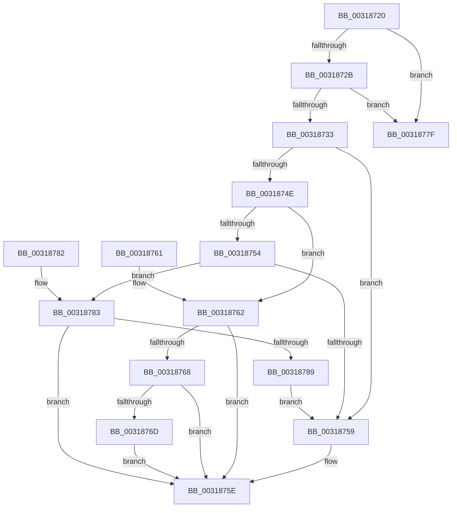

# MiAreChargesNeededToLockPage

- RVA: `0x00318720`–`0x0031878B` (길이 `107` bytes)
- VA: `0x0000000140318720`
- 실행 섹션: `.text`
- PDB 이름 있음: `예`; PDB Function 태그: `아니요`
- unwind 정보 RVA: `0x000DB714`
- 디코드: `36`개 명령, `107/107` bytes 표시
- 미해석 바이트: `0` (있으면 어셈블리에 `.byte`로 보존)

> 이 문서는 커널 이미지의 기계어와 PDB 기호를 분석해 생성했습니다. 4번과 5번은 함수 원형과 자료형을 바이너리 사용 방식에서 추정한 C 해석이며 원본 소스 복구 결과는 아닙니다.

## 1. Dependencies

- 직접 호출 지점: **0**; 고유 호출 대상: **0**
- 직접 호출자로 확인된 함수: **6**
- RIP 상대 이미지 참조: **0**

### Outgoing calls
- 직접 디코드된 call 명령이 없습니다.

### Direct callers
- [MiCanBatchHardFaultPages](../24/MiCanBatchHardFaultPages_function_0024AE00.md) at `0x0024AEC9`
- [MiObtainProtoReference](MiObtainProtoReference_function_00318178.md) at `0x003181AA`
- [MiRelockProtoPoolPage](MiRelockProtoPoolPage_function_0031826C.md) at `0x00318297`
- [MiDoubleLockMdlPage](MiDoubleLockMdlPage_function_00318324.md) at `0x0031835A`
- [MiCheckProtoPtePageState](MiCheckProtoPtePageState_function_003183E0.md) at `0x003184CE`
- [MiStoreDiscardPoisonedPage](../69/MiStoreDiscardPoisonedPage_function_00692858.md) at `0x0069298B`
- [MiStoreDiscardPoisonedPage](../69/MiStoreDiscardPoisonedPage_function_00692858.md) at `0x00692B7D`
- [MiStoreDiscardPoisonedPage](../69/MiStoreDiscardPoisonedPage_function_00692858.md) at `0x00692C4C`

### Static image references
- 디코드된 RIP-relative 메모리 참조가 없습니다.

## 2. Other-region calls and transfers

- 다른 실행 섹션으로 향하는 call: **0**
- 별도 외부 분기/꼬리 이동을 확인하지 못했습니다.

## 3. Assembly (complete function range)

```asm
00318720  48 8B 41 28                     mov rax, qword ptr [rcx + 0x28]
00318724  48 0F BA E0 28                  bt rax, 0x28
00318729  72 54                           jb 0x14031877f
0031872B  48 0F BA 61 28 35               bt qword ptr [rcx + 0x28], 0x35
00318731  72 4C                           jb 0x14031877f
00318733  8B 41 20                        mov eax, dword ptr [rcx + 0x20]
00318736  48 BA FF FF FF FF FF FF FF 3F   movabs rdx, 0x3fffffffffffffff
00318740  4C 8B 41 18                     mov r8, qword ptr [rcx + 0x18]
00318744  4C 23 C2                        and r8, rdx
00318747  33 D2                           xor edx, edx
00318749  66 85 C0                        test ax, ax
0031874C  74 0B                           je 0x140318759
0031874E  66 83 F8 01                     cmp ax, 1
00318752  75 0E                           jne 0x140318762
00318754  4D 85 C0                        test r8, r8
00318757  74 2A                           je 0x140318783
00318759  BA 01 00 00 00                  mov edx, 1
0031875E  8B C2                           mov eax, edx
00318760  C3                              ret
00318761  CC                              int3
00318762  66 83 F8 02                     cmp ax, 2
00318766  75 F6                           jne 0x14031875e
00318768  4D 85 C0                        test r8, r8
0031876B  74 F1                           je 0x14031875e
0031876D  F6 41 22 08                     test byte ptr [rcx + 0x22], 8
00318771  8B CA                           mov ecx, edx
00318773  BA 01 00 00 00                  mov edx, 1
00318778  0F 45 CA                        cmovne ecx, edx
0031877B  8B D1                           mov edx, ecx
0031877D  EB DF                           jmp 0x14031875e
0031877F  33 C0                           xor eax, eax
00318781  C3                              ret
00318782  CC                              int3
00318783  F6 41 22 08                     test byte ptr [rcx + 0x22], 8
00318787  74 D5                           je 0x14031875e
00318789  EB CE                           jmp 0x140318759
```

## 4. C-style interpretation (structured pseudocode)

```c
__int64 __fastcall MiAreChargesNeededToLockPage(__int64 a1)
{
    __int64 result;

    if (condition_is_below) goto loc_0031877F;
    if (condition_is_below) goto loc_0031877F;
    a3 = (*(unsigned __int64 *)(a1 + 24)) & (a2);
    a2 = 0;
    if ((unsigned __int16)((unsigned int)(*(unsigned int *)(a1 + 32))) == 0) goto loc_00318759;
    if (((unsigned __int16)((unsigned int)(*(unsigned int *)(a1 + 32)))) != 1) goto loc_00318762;
    if (a3 == 0) goto loc_00318783;
loc_00318759:
loc_0031875E:
    return 1;
loc_00318762:
    if (1 != 2) goto loc_0031875E;
    if (a3 == 0) goto loc_0031875E;
    a1 = 1;
    if (((*(unsigned __int8 *)(a1 + 34)) & (8)) != 0) { a1 = 1; }
    goto loc_0031875E;
loc_0031877F:
    result = 0;
    return result;
loc_00318783:
    if (((*(unsigned __int8 *)(a1 + 34)) & (8)) == 0) goto loc_0031875E;
    goto loc_00318759;
}
```

## 5. (Beta) C Style

```c
int64_t MiAreChargesNeededToLockPage(void *Arg1)
{
    uint8_t *arg1 = (uint8_t *)Arg1;

    int64_t result;

    if (condition_is_below) goto loc_0031877F;
    if (condition_is_below) goto loc_0031877F;
    a3 = (*(uint64_t *)(arg1 + 0x18)) & (a2);
    a2 = 0;
    if ((uint16_t)((uint32_t)(*(uint32_t *)(arg1 + 0x20))) == 0) goto loc_00318759;
    if (((uint16_t)((uint32_t)(*(uint32_t *)(arg1 + 0x20)))) != 1) goto loc_00318762;
    if (a3 == 0) goto loc_00318783;
loc_00318759:
loc_0031875E:
    return 1;
loc_00318762:
    if (1 != 2) goto loc_0031875E;
    if (a3 == 0) goto loc_0031875E;
    Arg1 = 1;
    if (((*(uint8_t *)(arg1 + 0x22)) & (8)) != 0) { Arg1 = 1; }
    goto loc_0031875E;
loc_0031877F:
    result = 0;
    return result;
loc_00318783:
    if (((*(uint8_t *)(arg1 + 0x22)) & (8)) == 0) goto loc_0031875E;
    goto loc_00318759;
}
```

### 관측된 메모리 오프셋

구조체 형식이 확인되지 않은 접근은 인자 기준의 오프셋으로만 기록했습니다.

| 기준 인자 | 오프셋 표현 | 폭 (bit) | 접근 |
|---|---:|---:|---|
| `Arg1` | `+ 0x18` | `64` | `R` |
| `Arg1` | `+ 0x20` | `32` | `R` |
| `Arg1` | `+ 0x22` | `8` | `R` |
| `Arg1` | `+ 0x28` | `64` | `R` |

## 6. Execution-region graph

[열기: 2D/3D 그래프와 함수 탐색 컨트롤 패널](../../../control-panel.html?section=text&rva=0x00318720&view=graph)

- 2D 그래프는 위에서 아래로 흐르고, 3D 그래프는 빈 공간을 드래그해 회전합니다. Shift+드래그는 이동, 휠은 확대·축소, 함수 노드 선택은 대상 보고서 이동입니다.

### Static fallback


