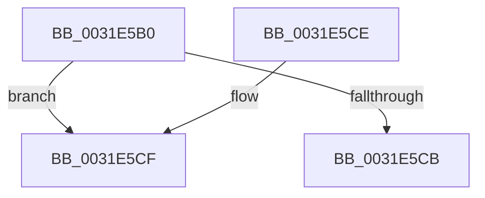

# MiAssignDefaultChannel

- RVA: `0x0031E5B0`–`0x0031E5DD` (길이 `45` bytes)
- VA: `0x000000014031E5B0`
- 실행 섹션: `.text`
- PDB 이름 있음: `예`; PDB Function 태그: `예`
- unwind 정보 RVA: `0x000DB714`
- 디코드: `12`개 명령, `45/45` bytes 표시
- 미해석 바이트: `0` (있으면 어셈블리에 `.byte`로 보존)

> 이 문서는 커널 이미지의 기계어와 PDB 기호를 분석해 생성했습니다. 4번과 5번은 함수 원형과 자료형을 바이너리 사용 방식에서 추정한 C 해석이며 원본 소스 복구 결과는 아닙니다.

## 1. Dependencies

- 직접 호출 지점: **0**; 고유 호출 대상: **0**
- 직접 호출자로 확인된 함수: **10**
- RIP 상대 이미지 참조: **1**

### Outgoing calls
- 직접 디코드된 call 명령이 없습니다.

### Direct callers
- [MiGetPage](../28/MiGetPage_function_002884C0.md) at `0x002895CD`
- [MiGetPage](../28/MiGetPage_function_002884C0.md) at `0x002897D1`
- [MiAllocateKernelStackPages](../2A/MiAllocateKernelStackPages_function_002A1BEC.md) at `0x002A1C8E`
- [MiMakePageAvoidRead](../2B/MiMakePageAvoidRead_function_002B7DE0.md) at `0x002B7F05`
- [MiZeroInParallelWorker](../2C/MiZeroInParallelWorker_function_002C6600.md) at `0x002C6690`
- [MiZeroLargePage](../2C/MiZeroLargePage_function_002C6914.md) at `0x002C6A78`
- [MiGetLargePage](MiGetLargePage_function_0031E210.md) at `0x0031E2E7`
- [MiBackgroundZeroLocalPages](MiBackgroundZeroLocalPages_function_0031EF30.md) at `0x0031F605`
- [MiGetLargePageDemoteAsNeeded](../3B/MiGetLargePageDemoteAsNeeded_function_003B8440.md) at `0x003B8600`
- [MiColorSetChannel](../44/MiColorSetChannel_function_0044F454.md) at `0x0044F484`
- [MiGetSinglePageToZero](../48/MiGetSinglePageToZero_function_00486724.md) at `0x00486867`

### Static image references
- `0x0031E5B9` → RVA `0x00E38D10` (`.data`; read)

## 2. Other-region calls and transfers

- 다른 실행 섹션으로 향하는 call: **0**
- call이 아닌 외부 분기/꼬리 이동: **1**
  - `0x0031E5D8` → `0x006E16FE` (`tail-transfer`)

## 3. Assembly (complete function range)

```asm
0031E5B0  8B C1                           mov eax, ecx
0031E5B2  48 69 C0 80 DF 00 00            imul rax, rax, 0xdf80
0031E5B9  48 03 05 50 A7 B1 00            add rax, qword ptr [rip + 0xb1a750]
0031E5C0  8B 88 50 3B 00 00               mov ecx, dword ptr [rax + 0x3b50]
0031E5C6  F6 C1 01                        test cl, 1
0031E5C9  75 04                           jne 0x14031e5cf
0031E5CB  32 C0                           xor al, al
0031E5CD  C3                              ret
0031E5CE  CC                              int3
0031E5CF  4C 8D 80 85 3B 00 00            lea r8, [rax + 0x3b85]
0031E5D6  32 C9                           xor cl, cl
0031E5D8  E9 21 31 3C 00                  jmp 0x1406e16fe
```

## 4. C-style interpretation (structured pseudocode)

```c
__int64 __fastcall MiAssignDefaultChannel(int a1)
{
    __int64 result;

    result = ((unsigned int)(a1)) * ((unsigned int)(a1));
    result = (result) + (*(unsigned __int64 *)(v_rip + 11642704));
    if ((((unsigned __int8)((unsigned int)(*(unsigned int *)(result + 15184)))) & (1)) != 0) goto loc_0031E5CF;
    result = 0;
    return result;
loc_0031E5CF:
    a1 = 0;
}
```

## 5. (Beta) C Style

```c
int64_t MiAssignDefaultChannel(void *Arg1)
{
    uint8_t *arg1 = (uint8_t *)Arg1;

    int64_t result;

    result = ((uint32_t)(Arg1)) * ((uint32_t)(Arg1));
    result = (result) + (*(uint64_t *)(v_rip + 0xB1A750));
    if ((((uint8_t)((uint32_t)(*(uint32_t *)(result + 0x3B50)))) & (1)) != 0) goto loc_0031E5CF;
    result = 0;
    return result;
loc_0031E5CF:
    Arg1 = 0;
}
```

### 관측된 메모리 오프셋

구조체 형식이 확인되지 않은 접근은 인자 기준의 오프셋으로만 기록했습니다.

| 기준 인자 | 오프셋 표현 | 폭 (bit) | 접근 |
|---|---:|---:|---|
| `Arg1` | `+ 0x3B50` | `32` | `R` |
| `Arg1` | `+ 0x3B85` | `64` | `R` |

## 6. Execution-region graph

[열기: 2D/3D 그래프와 함수 탐색 컨트롤 패널](../../../control-panel.html?section=text&rva=0x0031E5B0&view=graph)

- 2D 그래프는 위에서 아래로 흐르고, 3D 그래프는 빈 공간을 드래그해 회전합니다. Shift+드래그는 이동, 휠은 확대·축소, 함수 노드 선택은 대상 보고서 이동입니다.

### Static fallback


