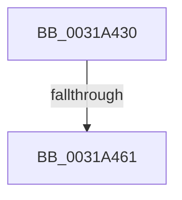

# MiCheckProcessorPteCache

- RVA: `0x0031A430`–`0x0031A46A` (길이 `58` bytes)
- VA: `0x000000014031A430`
- 실행 섹션: `.text`
- PDB 이름 있음: `예`; PDB Function 태그: `아니요`
- unwind 정보 RVA: `0x00074CB4`
- 디코드: `14`개 명령, `58/58` bytes 표시
- 미해석 바이트: `0` (있으면 어셈블리에 `.byte`로 보존)

> 이 문서는 커널 이미지의 기계어와 PDB 기호를 분석해 생성했습니다. 4번과 5번은 함수 원형과 자료형을 바이너리 사용 방식에서 추정한 C 해석이며 원본 소스 복구 결과는 아닙니다.

## 1. Dependencies

- 직접 호출 지점: **0**; 고유 호출 대상: **0**
- 직접 호출자로 확인된 함수: **1**
- RIP 상대 이미지 참조: **1**

### Outgoing calls
- 직접 디코드된 call 명령이 없습니다.

### Direct callers
- [MiReservePtes](MiReservePtes_function_00318D20.md) at `0x00318D8A`

### Static image references
- `0x0031A454` → RVA `0x00FC6D20` (`ALMOSTRO`; read)

## 2. Other-region calls and transfers

- 다른 실행 섹션으로 향하는 call: **0**
- call이 아닌 외부 분기/꼬리 이동: **1**
  - `0x0031A45B` → [sub_0031A6E4](Unknown_function_0031A6E4.md) (`tail-transfer`)

## 3. Assembly (complete function range)

```asm
0031A430  40 53                           push rbx
0031A432  56                              push rsi
0031A433  41 54                           push r12
0031A435  41 56                           push r14
0031A437  48 83 EC 48                     sub rsp, 0x48
0031A43B  0F 57 C0                        xorps xmm0, xmm0
0031A43E  4C 8B F1                        mov r14, rcx
0031A441  0F 11 44 24 20                  movups xmmword ptr [rsp + 0x20], xmm0
0031A446  44 0F 20 C6                     mov rsi, cr8
0031A44A  41 BC 02 00 00 00               mov r12d, 2
0031A450  45 0F 22 C4                     mov cr8, r12
0031A454  83 3D C5 C8 CA 00 00            cmp dword ptr [rip + 0xcac8c5], 0
0031A45B  0F 85 83 02 00 00               jne 0x14031a6e4
0031A461  65 48 8B 1C 25 20 00 00 00      mov rbx, qword ptr gs:[0x20]
```

## 4. C-style interpretation (structured pseudocode)

```c
void __fastcall MiCheckProcessorPteCache(__int64 a1)
{
    __int64 v_rsp;
    unsigned __int64 v_stack_m48;

    v_rsp = (v_rsp) - (72);
    v_stack_m48 = v_xmm0;
    return;
}
```

## 5. (Beta) C Style

```c
void MiCheckProcessorPteCache(int64_t Arg1)
{
    int64_t local_rsp;
    uint64_t v_stack_m48;

    local_rsp = (local_rsp) - (72);
    v_stack_m48 = v_xmm0;
    return;
}
```

## 6. Execution-region graph

[열기: 2D/3D 그래프와 함수 탐색 컨트롤 패널](../../../control-panel.html?section=text&rva=0x0031A430&view=graph)

- 2D 그래프는 위에서 아래로 흐르고, 3D 그래프는 빈 공간을 드래그해 회전합니다. Shift+드래그는 이동, 휠은 확대·축소, 함수 노드 선택은 대상 보고서 이동입니다.

### Static fallback


