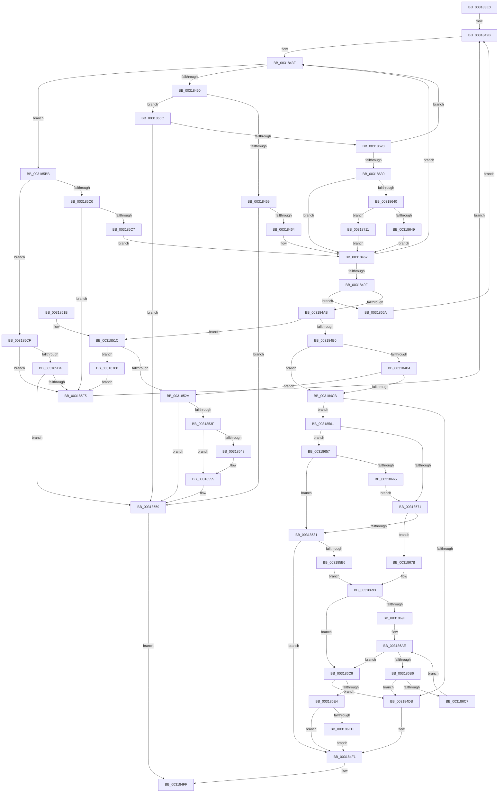

# MiCheckProtoPtePageState

- RVA: `0x003183E0`–`0x0031871A` (길이 `826` bytes)
- VA: `0x00000001403183E0`
- 실행 섹션: `.text`
- PDB 이름 있음: `예`; PDB Function 태그: `아니요`
- unwind 정보 RVA: `0x00074BFC`
- 디코드: `202`개 명령, `826/826` bytes 표시
- 미해석 바이트: `0` (있으면 어셈블리에 `.byte`로 보존)

> 이 문서는 커널 이미지의 기계어와 PDB 기호를 분석해 생성했습니다. 4번과 5번은 함수 원형과 자료형을 바이너리 사용 방식에서 추정한 C 해석이며 원본 소스 복구 결과는 아닙니다.

## 1. Dependencies

- 직접 호출 지점: **12**; 고유 호출 대상: **11**
- 직접 호출자로 확인된 함수: **5**
- RIP 상대 이미지 참조: **4**

### Outgoing calls
- `0x0031847C` → [MiSafeLockPage](../32/MiSafeLockPage_function_00321620.md) (function, `0x00321620`)
- `0x003184CE` → [MiAreChargesNeededToLockPage](MiAreChargesNeededToLockPage_function_00318720.md) (function, `0x00318720`)
- `0x003184F7` → [MiLockOwnedProtoPage](../32/MiLockOwnedProtoPage_function_00322560.md) (function, `0x00322560`)
- `0x00318550` → [KiLowerIrqlProcessIrqlFlags](../4F/KiLowerIrqlProcessIrqlFlags_function_004F5698.md) (function, `0x004F5698`)
- `0x00318574` → [MiIsPfnCommitNotCharged](MiIsPfnCommitNotCharged_function_00317370.md) (function, `0x00317370`)
- `0x003185A9` → [MiChargeCommit](../28/MiChargeCommit_function_00286EB0.md) (function, `0x00286EB0`)
- `0x00318602` → [MmAccessFault](../27/MmAccessFault_function_0027EE80.md) (function, `0x0027EE80`)
- `0x00318623` → [MiInvalidPteConforms](../37/MiInvalidPteConforms_function_00372A10.md) (function, `0x00372A10`)
- `0x00318671` → [MiUnlockPage](MiUnlockPage_function_0031A3E0.md) (function, `0x0031A3E0`)
- `0x003186D7` → [MiChargePartitionResidentAvailable](../28/MiChargePartitionResidentAvailable_function_0028B000.md) (function, `0x0028B000`)
- `0x003186F6` → [MiReturnCommit](../24/MiReturnCommit_function_00248410.md) (function, `0x00248410`)
- `0x00318707` → [MiUnlockPage](MiUnlockPage_function_0031A3E0.md) (function, `0x0031A3E0`)

### Direct callers
- [MiWalkEntireImage](../36/MiWalkEntireImage_function_00365D70.md) at `0x003663A6`
- [MiPurgeSubsection](../37/MiPurgeSubsection_function_003712F0.md) at `0x003718F4`
- [MiFlushSection](../40/MiFlushSection_function_004036B0.md) at `0x00403BC8`
- [MiAnyProtosAreMapped](../46/MiAnyProtosAreMapped_function_00465464.md) at `0x004654B4`
- [MiPurgeFileOnlyPfn](../68/MiPurgeFileOnlyPfn_function_00681CEC.md) at `0x00681D75`

### Static image references
- `0x0031853F` → RVA `0x00FC6D20` (`ALMOSTRO`; read)
- `0x0031858A` → RVA `0x00E30088` (`.data`; read)
- `0x00318630` → RVA `0x00E2DC80` (`.data`; read)
- `0x00318693` → RVA `0x00E38D00` (`.data`; read)

## 2. Other-region calls and transfers

- 다른 실행 섹션으로 향하는 call: **0**
- 별도 외부 분기/꼬리 이동을 확인하지 못했습니다.

## 3. Assembly (complete function range)

```asm
003183E0  48 89 5C 24 20                  mov qword ptr [rsp + 0x20], rbx
003183E5  55                              push rbp
003183E6  56                              push rsi
003183E7  41 54                           push r12
003183E9  41 55                           push r13
003183EB  41 57                           push r15
003183ED  48 83 EC 20                     sub rsp, 0x20
003183F1  48 8B F2                        mov rsi, rdx
003183F4  48 B8 F8 FF FF FF 7F 00 00 00   movabs rax, 0x7ffffffff8
003183FE  48 C1 EE 09                     shr rsi, 9
00318402  4D 8B F9                        mov r15, r9
00318405  48 23 F0                        and rsi, rax
00318408  41 8B E8                        mov ebp, r8d
0031840B  4C 8B E2                        mov r12, rdx
0031840E  4C 8B E9                        mov r13, rcx
00318411  48 B8 00 00 00 00 80 F6 FF FF   movabs rax, 0xfffff68000000000
0031841B  48 03 F0                        add rsi, rax
0031841E  48 89 7C 24 50                  mov qword ptr [rsp + 0x50], rdi
00318423  83 E5 01                        and ebp, 1
00318426  4C 89 74 24 58                  mov qword ptr [rsp + 0x58], r14
0031842B  48 BA 00 00 00 00 00 DE FF FF   movabs rdx, 0xffffde0000000000
00318435  49 B8 FF FF FF FF FF 00 00 00   movabs r8, 0xffffffffff
0031843F  48 8B 1E                        mov rbx, qword ptr [rsi]
00318442  48 8B C3                        mov rax, rbx
00318445  83 E0 01                        and eax, 1
00318448  85 ED                           test ebp, ebp
0031844A  0F 85 6B 01 00 00               jne 0x1403185bb
00318450  48 85 C0                        test rax, rax
00318453  0F 84 B3 01 00 00               je 0x14031860c
00318459  48 0F BA E3 09                  bt rbx, 9
0031845E  0F 82 F5 00 00 00               jb 0x140318559
00318464  48 8B CB                        mov rcx, rbx
00318467  48 C1 E9 0C                     shr rcx, 0xc
0031846B  49 23 C8                        and rcx, r8
0031846E  48 8D 3C 49                     lea rdi, [rcx + rcx*2]
00318472  48 C1 E7 04                     shl rdi, 4
00318476  48 8B C2                        mov rax, rdx
00318479  48 03 F8                        add rdi, rax
0031847C  E8 9F 91 00 00                  call 0x140321620
00318481  44 0F B6 F0                     movzx r14d, al
00318485  49 B8 FF FF FF FF FF 00 00 00   movabs r8, 0xffffffffff
0031848F  48 BA 00 00 00 00 00 DE FF FF   movabs rdx, 0xffffde0000000000
00318499  41 80 FE 11                     cmp r14b, 0x11
0031849D  74 A0                           je 0x14031843f
0031849F  48 8B 16                        mov rdx, qword ptr [rsi]
003184A2  48 3B D3                        cmp rdx, rbx
003184A5  0F 85 BF 01 00 00               jne 0x14031866a
003184AB  F6 C2 01                        test dl, 1
003184AE  74 6C                           je 0x14031851c
003184B0  85 ED                           test ebp, ebp
003184B2  75 17                           jne 0x1403184cb
003184B4  48 8B 47 18                     mov rax, qword ptr [rdi + 0x18]
003184B8  48 B9 FF FF FF FF FF FF FF 3F   movabs rcx, 0x3fffffffffffffff
003184C2  48 23 C1                        and rax, rcx
003184C5  48 83 F8 01                     cmp rax, 1
003184C9  74 5F                           je 0x14031852a
003184CB  48 8B CF                        mov rcx, rdi
003184CE  E8 4D 02 00 00                  call 0x140318720
003184D3  85 C0                           test eax, eax
003184D5  0F 85 86 00 00 00               jne 0x140318561
003184DB  8B 47 20                        mov eax, dword ptr [rdi + 0x20]
003184DE  89 44 24 60                     mov dword ptr [rsp + 0x60], eax
003184E2  66 FF C0                        inc ax
003184E5  66 89 44 24 60                  mov word ptr [rsp + 0x60], ax
003184EA  8B 44 24 60                     mov eax, dword ptr [rsp + 0x60]
003184EE  89 47 20                        mov dword ptr [rdi + 0x20], eax
003184F1  48 8B CF                        mov rcx, rdi
003184F4  45 88 37                        mov byte ptr [r15], r14b
003184F7  E8 64 A0 00 00                  call 0x140322560
003184FC  48 8B C7                        mov rax, rdi
003184FF  4C 8B 74 24 58                  mov r14, qword ptr [rsp + 0x58]
00318504  48 8B 7C 24 50                  mov rdi, qword ptr [rsp + 0x50]
00318509  48 8B 5C 24 68                  mov rbx, qword ptr [rsp + 0x68]
0031850E  48 83 C4 20                     add rsp, 0x20
00318512  41 5F                           pop r15
00318514  41 5D                           pop r13
00318516  41 5C                           pop r12
00318518  5E                              pop rsi
00318519  5D                              pop rbp
0031851A  C3                              ret
0031851B  CC                              int3
0031851C  0F B6 47 22                     movzx eax, byte ptr [rdi + 0x22]
00318520  24 07                           and al, 7
00318522  3C 06                           cmp al, 6
00318524  0F 83 D6 01 00 00               jae 0x140318700
0031852A  48 B8 FF FF FF FF FF FF FF 7F   movabs rax, 0x7fffffffffffffff
00318534  F0 48 21 47 18                  lock and qword ptr [rdi + 0x18], rax
00318539  41 80 FE 02                     cmp r14b, 2
0031853D  73 1A                           jae 0x140318559
0031853F  83 3D DA E7 CA 00 00            cmp dword ptr [rip + 0xcae7da], 0
00318546  74 0D                           je 0x140318555
00318548  44 0F 20 C1                     mov rcx, cr8
0031854C  41 0F B6 D6                     movzx edx, r14b
00318550  E8 43 D1 1D 00                  call 0x1404f5698
00318555  45 0F 22 C6                     mov cr8, r14
00318559  41 C6 07 11                     mov byte ptr [r15], 0x11
0031855D  33 C0                           xor eax, eax
0031855F  EB 9E                           jmp 0x1403184ff
00318561  48 8B 47 28                     mov rax, qword ptr [rdi + 0x28]
00318565  40 32 F6                        xor sil, sil
00318568  48 85 C0                        test rax, rax
0031856B  0F 88 E6 00 00 00               js 0x140318657
00318571  48 8B CF                        mov rcx, rdi
00318574  E8 F7 ED FF FF                  call 0x140317370
00318579  85 C0                           test eax, eax
0031857B  0F 84 FA 00 00 00               je 0x14031867b
00318581  48 8B 4F 28                     mov rcx, qword ptr [rdi + 0x28]
00318585  BA 01 00 00 00                  mov edx, 1
0031858A  48 8B 05 F7 7A B1 00            mov rax, qword ptr [rip + 0xb17af7]
00318591  40 B6 01                        mov sil, 1
00318594  48 C1 E9 2B                     shr rcx, 0x2b
00318598  81 E1 FF 03 00 00               and ecx, 0x3ff
0031859E  44 8D 42 03                     lea r8d, [rdx + 3]
003185A2  48 8B 1C C8                     mov rbx, qword ptr [rax + rcx*8]
003185A6  48 8B CB                        mov rcx, rbx
003185A9  E8 02 E9 F6 FF                  call 0x140286eb0
003185AE  85 C0                           test eax, eax
003185B0  0F 84 3B FF FF FF               je 0x1403184f1
003185B6  E9 D8 00 00 00                  jmp 0x140318693
003185BB  48 85 C0                        test rax, rax
003185BE  74 0F                           je 0x1403185cf
003185C0  48 0F BA E3 09                  bt rbx, 9
003185C5  72 2E                           jb 0x1403185f5
003185C7  48 8B CB                        mov rcx, rbx
003185CA  E9 98 FE FF FF                  jmp 0x140318467
003185CF  4D 85 ED                        test r13, r13
003185D2  74 21                           je 0x1403185f5
003185D4  41 8B 45 38                     mov eax, dword ptr [r13 + 0x38]
003185D8  81 E3 02 04 00 00               and ebx, 0x402
003185DE  48 81 FB 02 04 00 00            cmp rbx, 0x402
003185E5  0F 94 C1                        sete cl
003185E8  A8 20                           test al, 0x20
003185EA  0F 94 C0                        sete al
003185ED  84 C8                           test al, cl
003185EF  0F 85 64 FF FF FF               jne 0x140318559
003185F5  45 33 C9                        xor r9d, r9d
003185F8  45 33 C0                        xor r8d, r8d
003185FB  49 8B D4                        mov rdx, r12
003185FE  41 8D 49 02                     lea ecx, [r9 + 2]
00318602  E8 79 68 F6 FF                  call 0x14027ee80
00318607  E9 1F FE FF FF                  jmp 0x14031842b
0031860C  48 8B C3                        mov rax, rbx
0031860F  25 00 0C 00 00                  and eax, 0xc00
00318614  48 3D 00 08 00 00               cmp rax, 0x800
0031861A  0F 85 39 FF FF FF               jne 0x140318559
00318620  48 8B CB                        mov rcx, rbx
00318623  E8 E8 A3 05 00                  call 0x140372a10
00318628  85 C0                           test eax, eax
0031862A  0F 84 0F FE FF FF               je 0x14031843f
00318630  48 8B 05 49 56 B1 00            mov rax, qword ptr [rip + 0xb15649]
00318637  48 85 C0                        test rax, rax
0031863A  0F 84 27 FE FF FF               je 0x140318467
00318640  F6 C3 10                        test bl, 0x10
00318643  0F 85 C8 00 00 00               jne 0x140318711
00318649  48 8B C8                        mov rcx, rax
0031864C  48 F7 D1                        not rcx
0031864F  48 23 CB                        and rcx, rbx
00318652  E9 10 FE FF FF                  jmp 0x140318467
00318657  8B 47 10                        mov eax, dword ptr [rdi + 0x10]
0031865A  48 0F BA E0 0A                  bt rax, 0xa
0031865F  0F 82 1C FF FF FF               jb 0x140318581
00318665  E9 07 FF FF FF                  jmp 0x140318571
0031866A  41 0F B6 D6                     movzx edx, r14b
0031866E  48 8B CF                        mov rcx, rdi
00318671  E8 6A 1D 00 00                  call 0x14031a3e0
00318676  E9 B0 FD FF FF                  jmp 0x14031842b
0031867B  48 8B 47 28                     mov rax, qword ptr [rdi + 0x28]
0031867F  48 8B 0D 02 7A B1 00            mov rcx, qword ptr [rip + 0xb17a02]
00318686  48 C1 E8 2B                     shr rax, 0x2b
0031868A  25 FF 03 00 00                  and eax, 0x3ff
0031868F  48 8B 1C C1                     mov rbx, qword ptr [rcx + rax*8]
00318693  48 8D 05 66 06 B2 00            lea rax, [rip + 0xb20666]
0031869A  48 3B D8                        cmp rbx, rax
0031869D  75 2A                           jne 0x1403186c9
0031869F  65 48 8B 14 25 20 00 00 00      mov rdx, qword ptr gs:[0x20]
003186A8  8B 82 9C 8B 00 00               mov eax, dword ptr [rdx + 0x8b9c]
003186AE  8D 48 FF                        lea ecx, [rax - 1]
003186B1  83 F9 FD                        cmp ecx, -3
003186B4  77 13                           ja 0x1403186c9
003186B6  8D 48 FF                        lea ecx, [rax - 1]
003186B9  F0 0F B1 8A 9C 8B 00 00         lock cmpxchg dword ptr [rdx + 0x8b9c], ecx
003186C1  0F 84 14 FE FF FF               je 0x1403184db
003186C7  EB E5                           jmp 0x1403186ae
003186C9  BA 01 00 00 00                  mov edx, 1
003186CE  41 B8 FF FF FF FF               mov r8d, 0xffffffff
003186D4  48 8B CB                        mov rcx, rbx
003186D7  E8 24 29 F7 FF                  call 0x14028b000
003186DC  85 C0                           test eax, eax
003186DE  0F 85 F7 FD FF FF               jne 0x1403184db
003186E4  40 84 F6                        test sil, sil
003186E7  0F 84 04 FE FF FF               je 0x1403184f1
003186ED  45 33 C0                        xor r8d, r8d
003186F0  8D 50 01                        lea edx, [rax + 1]
003186F3  48 8B CB                        mov rcx, rbx
003186F6  E8 15 FD F2 FF                  call 0x140248410
003186FB  E9 F1 FD FF FF                  jmp 0x1403184f1
00318700  41 0F B6 D6                     movzx edx, r14b
00318704  48 8B CF                        mov rcx, rdi
00318707  E8 D4 1C 00 00                  call 0x14031a3e0
0031870C  E9 E4 FE FF FF                  jmp 0x1403185f5
00318711  48 83 E1 EF                     and rcx, 0xffffffffffffffef
00318715  E9 4D FD FF FF                  jmp 0x140318467
```

## 4. C-style interpretation (structured pseudocode)

```c
__int64 __fastcall MiCheckProtoPtePageState(__int64 a1, __int64 a2, int a3, __int64 a4)
{
    __int64 result;
    __int64 v_rbp;
    __int64 v_rbx;
    __int64 v_rdi;
    __int64 v_rsi;
    __int64 v_rsp;
    unsigned __int64 v_stack_p10;
    unsigned int v_stack_p18;
    unsigned __int64 v_stack_p20;
    unsigned __int64 v_stack_p8;

    v_stack_p20 = v_rbx;
    v_rsp = (v_rsp) - (32);
    v_rsi = (a2) >> (9);
    v_rsi = (v_rsi) & (result);
    v_rsi = (v_rsi) + (result);
    v_stack_p8 = v_rdi;
    v_rbp = (unsigned int)(((unsigned int)(a3)) & (1));
    v_stack_p10 = v_r14;
loc_0031842B:
loc_0031843F:
    result = (unsigned int)((*(unsigned __int64 *)(v_rsi)) & (1));
    if ((unsigned int)(v_rbp) != 0) goto loc_003185BB;
    if (result == 0) goto loc_0031860C;
    if (condition_is_below) goto loc_00318559;
loc_00318467:
    a1 = (*(unsigned __int64 *)(v_rsi)) >> (12);
    a1 = (a1) & (a3);
    v_rdi = (a1 + a1 * 2) << (4);
    v_rdi = (v_rdi) + (a2);
    result = MiSafeLockPage(a1, a2, a3, a4);
    if (((unsigned __int8)((unsigned __int8)(result))) == 17) goto loc_0031843F;
    if ((*(unsigned __int64 *)(v_rsi)) != (*(unsigned __int64 *)(v_rsi))) goto loc_0031866A;
    if ((((unsigned __int8)(*(unsigned __int64 *)(v_rsi))) & (1)) == 0) goto loc_0031851C;
    if ((unsigned int)(v_rbp) != 0) goto loc_003184CB;
    result = (*(unsigned __int64 *)(v_rdi + 24)) & (a1);
    if (result == 1) goto loc_0031852A;
loc_003184CB:
    result = MiAreChargesNeededToLockPage(v_rdi, *(unsigned __int64 *)(v_rsi), a3, a4);
    if ((unsigned int)(result) != 0) goto loc_00318561;
loc_003184DB:
    v_stack_p18 = (unsigned int)((unsigned int)(*(unsigned int *)(v_rdi + 32)));
    result = (unsigned __int16)(((unsigned int)(*(unsigned int *)(v_rdi + 32))) + 1);
    v_stack_p18 = (unsigned __int16)(result);
    *(unsigned int *)(v_rdi + 32) = (unsigned int)((unsigned int)(v_stack_p18));
loc_003184F1:
    *(unsigned __int8 *)(a4) = (unsigned __int8)((unsigned __int8)(result));
    result = MiLockOwnedProtoPage(v_rdi, *(unsigned __int64 *)(v_rsi), a3, a4);
loc_003184FF:
    v_rsp = (v_rsp) + (32);
    return v_rdi;
loc_0031851C:
    result = (unsigned __int8)((*(unsigned __int8 *)(v_stack_p8 + 34)) & (7));
    if (((unsigned __int8)(result)) >= 6) goto loc_00318700;
loc_0031852A:
    if (((unsigned __int8)(v_stack_p10)) >= 2) goto loc_00318559;
    if ((*(unsigned int *)(v_rip + 13297626)) != 0) {
        a1 = v_cr8;
        a2 = (unsigned __int8)(v_stack_p10);
        result = KiLowerIrqlProcessIrqlFlags(a1, a2, a3, a4);
    }
loc_00318559:
    *(unsigned __int8 *)(a4) = 17;
    result = 0;
    goto loc_003184FF;
loc_00318561:
    v_rsi = 0;
    if (sign_flag) goto loc_00318657;
loc_00318571:
    result = MiIsPfnCommitNotCharged(v_stack_p8, a2, a3, a4);
    if ((unsigned int)(result) == 0) goto loc_0031867B;
loc_00318581:
    a1 = (*(unsigned __int64 *)(v_stack_p8 + 40)) >> (43);
    a1 = (unsigned int)((a1) & (0x3FFULL));
    result = MiChargeCommit(*(unsigned __int64 *)(*(unsigned __int64 *)(v_rip + 11631351) + a1 * 8), 1, 1 + 3, a4);
    if ((unsigned int)(result) == 0) goto loc_003184F1;
    goto loc_00318693;
loc_003185BB:
    if (result == 0) goto loc_003185CF;
    if (condition_is_below) goto loc_003185F5;
    goto loc_00318467;
loc_003185CF:
    if (a1 == 0) goto loc_003185F5;
    v_rbx = (unsigned int)((*(unsigned __int64 *)(*(unsigned __int64 *)(v_rip + 11631351) + a1 * 8)) & (0x402ULL));
    a1 = (v_rbx == 0x402ULL) ? 1 : 0;
    result = ((((unsigned __int8)((unsigned int)(*(unsigned int *)(a1 + 56)))) & (32)) == 0) ? 1 : 0;
    if ((((unsigned __int8)(result)) & ((unsigned __int8)(a1))) != 0) goto loc_00318559;
loc_003185F5:
    a4 = 0;
    a3 = 0;
    result = MmAccessFault(a4 + 2, a2, a3, a4);
    goto loc_0031842B;
loc_0031860C:
    result = (unsigned int)((v_rbx) & (0xC00ULL));
    if (result != 0x800ULL) goto loc_00318559;
    result = MiInvalidPteConforms(v_rbx, a2, a3, a4);
    if ((unsigned int)(result) == 0) goto loc_0031843F;
    if (*(unsigned __int64 *)(v_rip + 11621961) == 0) goto loc_00318467;
    if ((((unsigned __int8)(v_rbx)) & (16)) != 0) goto loc_00318711;
    a1 = ~(*(unsigned __int64 *)(v_rip + 11621961));
    a1 = (a1) & (v_rbx);
    goto loc_00318467;
loc_00318657:
    if (condition_is_below) goto loc_00318581;
    goto loc_00318571;
loc_0031866A:
    result = MiUnlockPage(v_stack_p8, (unsigned __int8)(v_stack_p10), a3, a4);
    goto loc_0031842B;
loc_0031867B:
    result = (*(unsigned __int64 *)(v_stack_p8 + 40)) >> (43);
    result = (unsigned int)((result) & (0x3FFULL));
loc_00318693:
    if ((*(unsigned __int64 *)(*(unsigned __int64 *)(v_rip + 11631106) + result * 8)) != (v_rip + 11667046)) goto loc_003186C9;
loc_003186AE:
    if (((unsigned int)((unsigned int)(*(unsigned int *)(*(unsigned __int64 *)(gs_base + (0 + 32)) + 35740)) - 1)) > -3) goto loc_003186C9;
    if (((unsigned int)((unsigned int)(*(unsigned int *)(*(unsigned __int64 *)(gs_base + (0 + 32)) + 35740)) - 1)) == -3) goto loc_003184DB;
    goto loc_003186AE;
loc_003186C9:
    result = MiChargePartitionResidentAvailable(*(unsigned __int64 *)(*(unsigned __int64 *)(v_rip + 11631106) + result * 8), 1, (unsigned int)(0xFFFFFFFFULL), a4);
    if ((unsigned int)(result) != 0) goto loc_003184DB;
    if (1 == 0) goto loc_003184F1;
    a3 = 0;
    result = MiReturnCommit(*(unsigned __int64 *)(*(unsigned __int64 *)(v_rip + 11631106) + result * 8), result + 1, a3, a4);
    goto loc_003184F1;
loc_00318700:
    result = MiUnlockPage(v_stack_p8, (unsigned __int8)(v_stack_p10), a3, a4);
    goto loc_003185F5;
loc_00318711:
    a1 = (v_stack_p8) & (-17);
    goto loc_00318467;
}
```

## 5. (Beta) C Style

```c
int64_t MiCheckProtoPtePageState(int64_t Arg1, int64_t Arg2, int32_t Arg3, void *Arg4)
{
    uint8_t *arg4 = (uint8_t *)Arg4;

    int64_t result;
    int64_t local_rbp;
    int64_t local_rbx;
    int64_t local_rdi;
    int64_t local_rsi;
    int64_t local_rsp;
    uint64_t v_stack_p10;
    uint32_t v_stack_p18;
    uint64_t v_stack_p20;
    uint64_t v_stack_p8;

    v_stack_p20 = local_rbx;
    local_rsp = (local_rsp) - (32);
    local_rsi = (Arg2) >> (9);
    local_rsi = (local_rsi) & (result);
    local_rsi = (local_rsi) + (result);
    v_stack_p8 = local_rdi;
    local_rbp = (uint32_t)(((uint32_t)(Arg3)) & (1));
    v_stack_p10 = local_r14;
loc_0031842B:
loc_0031843F:
    result = (uint32_t)((*(uint64_t *)(local_rsi)) & (1));
    if ((uint32_t)(local_rbp) != 0) goto loc_003185BB;
    if (result == 0) goto loc_0031860C;
    if (condition_is_below) goto loc_00318559;
loc_00318467:
    Arg1 = (*(uint64_t *)(local_rsi)) >> (12);
    Arg1 = (Arg1) & (Arg3);
    local_rdi = (Arg1 + Arg1 * 2) << (4);
    local_rdi = (local_rdi) + (Arg2);
    result = MiSafeLockPage(Arg1, Arg2, Arg3, Arg4);
    if (((uint8_t)((uint8_t)(result))) == 17) goto loc_0031843F;
    if ((*(uint64_t *)(local_rsi)) != (*(uint64_t *)(local_rsi))) goto loc_0031866A;
    if ((((uint8_t)(*(uint64_t *)(local_rsi))) & (1)) == 0) goto loc_0031851C;
    if ((uint32_t)(local_rbp) != 0) goto loc_003184CB;
    result = (*(uint64_t *)(local_rdi + 0x18)) & (Arg1);
    if (result == 1) goto loc_0031852A;
loc_003184CB:
    result = MiAreChargesNeededToLockPage(local_rdi, *(uint64_t *)(local_rsi), Arg3, Arg4);
    if ((uint32_t)(result) != 0) goto loc_00318561;
loc_003184DB:
    v_stack_p18 = (uint32_t)((uint32_t)(*(uint32_t *)(local_rdi + 0x20)));
    result = (uint16_t)(((uint32_t)(*(uint32_t *)(local_rdi + 0x20))) + 1);
    v_stack_p18 = (uint16_t)(result);
    *(uint32_t *)(local_rdi + 0x20) = (uint32_t)((uint32_t)(v_stack_p18));
loc_003184F1:
    *(uint8_t *)(arg4) = (uint8_t)((uint8_t)(result));
    result = MiLockOwnedProtoPage(local_rdi, *(uint64_t *)(local_rsi), Arg3, Arg4);
loc_003184FF:
    local_rsp = (local_rsp) + (32);
    return local_rdi;
loc_0031851C:
    result = (uint8_t)((*(uint8_t *)(v_stack_p8 + 0x22)) & (7));
    if (((uint8_t)(result)) >= 6) goto loc_00318700;
loc_0031852A:
    if (((uint8_t)(v_stack_p10)) >= 2) goto loc_00318559;
    if ((*(uint32_t *)(v_rip + 0xCAE7DA)) != 0) {
        Arg1 = v_cr8;
        Arg2 = (uint8_t)(v_stack_p10);
        result = KiLowerIrqlProcessIrqlFlags(Arg1, Arg2, Arg3, Arg4);
    }
loc_00318559:
    *(uint8_t *)(arg4) = 17;
    result = 0;
    goto loc_003184FF;
loc_00318561:
    local_rsi = 0;
    if (sign_flag) goto loc_00318657;
loc_00318571:
    result = MiIsPfnCommitNotCharged(v_stack_p8, Arg2, Arg3, Arg4);
    if ((uint32_t)(result) == 0) goto loc_0031867B;
loc_00318581:
    Arg1 = (*(uint64_t *)(v_stack_p8 + 0x28)) >> (43);
    Arg1 = (uint32_t)((Arg1) & (0x3FFULL));
    result = MiChargeCommit(*(uint64_t *)(*(uint64_t *)(v_rip + 0xB17AF7) + Arg1 * 8), 1, 1 + 3, Arg4);
    if ((uint32_t)(result) == 0) goto loc_003184F1;
    goto loc_00318693;
loc_003185BB:
    if (result == 0) goto loc_003185CF;
    if (condition_is_below) goto loc_003185F5;
    goto loc_00318467;
loc_003185CF:
    if (Arg1 == 0) goto loc_003185F5;
    local_rbx = (uint32_t)((*(uint64_t *)(*(uint64_t *)(v_rip + 0xB17AF7) + Arg1 * 8)) & (0x402ULL));
    Arg1 = (local_rbx == 0x402ULL) ? 1 : 0;
    result = ((((uint8_t)((uint32_t)(*(uint32_t *)(Arg1 + 0x38)))) & (32)) == 0) ? 1 : 0;
    if ((((uint8_t)(result)) & ((uint8_t)(Arg1))) != 0) goto loc_00318559;
loc_003185F5:
    Arg4 = 0;
    Arg3 = 0;
    result = MmAccessFault(Arg4 + 2, Arg2, Arg3, Arg4);
    goto loc_0031842B;
loc_0031860C:
    result = (uint32_t)((local_rbx) & (0xC00ULL));
    if (result != 0x800ULL) goto loc_00318559;
    result = MiInvalidPteConforms(local_rbx, Arg2, Arg3, Arg4);
    if ((uint32_t)(result) == 0) goto loc_0031843F;
    if (*(uint64_t *)(v_rip + 0xB15649) == 0) goto loc_00318467;
    if ((((uint8_t)(local_rbx)) & (16)) != 0) goto loc_00318711;
    Arg1 = ~(*(uint64_t *)(v_rip + 0xB15649));
    Arg1 = (Arg1) & (local_rbx);
    goto loc_00318467;
loc_00318657:
    if (condition_is_below) goto loc_00318581;
    goto loc_00318571;
loc_0031866A:
    result = MiUnlockPage(v_stack_p8, (uint8_t)(v_stack_p10), Arg3, Arg4);
    goto loc_0031842B;
loc_0031867B:
    result = (*(uint64_t *)(v_stack_p8 + 0x28)) >> (43);
    result = (uint32_t)((result) & (0x3FFULL));
loc_00318693:
    if ((*(uint64_t *)(*(uint64_t *)(v_rip + 0xB17A02) + result * 8)) != (v_rip + 11667046)) goto loc_003186C9;
loc_003186AE:
    if (((uint32_t)((uint32_t)(*(uint32_t *)(*(uint64_t *)(gs_base + (0 + 0x20)) + 0x8B9C)) - 1)) > -3) goto loc_003186C9;
    if (((uint32_t)((uint32_t)(*(uint32_t *)(*(uint64_t *)(gs_base + (0 + 0x20)) + 0x8B9C)) - 1)) == -3) goto loc_003184DB;
    goto loc_003186AE;
loc_003186C9:
    result = MiChargePartitionResidentAvailable(*(uint64_t *)(*(uint64_t *)(v_rip + 0xB17A02) + result * 8), 1, (uint32_t)(0xFFFFFFFFULL), Arg4);
    if ((uint32_t)(result) != 0) goto loc_003184DB;
    if (1 == 0) goto loc_003184F1;
    Arg3 = 0;
    result = MiReturnCommit(*(uint64_t *)(*(uint64_t *)(v_rip + 0xB17A02) + result * 8), result + 1, Arg3, Arg4);
    goto loc_003184F1;
loc_00318700:
    result = MiUnlockPage(v_stack_p8, (uint8_t)(v_stack_p10), Arg3, Arg4);
    goto loc_003185F5;
loc_00318711:
    Arg1 = (v_stack_p8) & (-17);
    goto loc_00318467;
}
```

### 관측된 메모리 오프셋

구조체 형식이 확인되지 않은 접근은 인자 기준의 오프셋으로만 기록했습니다.

| 기준 인자 | 오프셋 표현 | 폭 (bit) | 접근 |
|---|---:|---:|---|
| `Arg4` | `+ 0x0` | `8` | `W` |

## 6. Execution-region graph

[열기: 2D/3D 그래프와 함수 탐색 컨트롤 패널](../../../control-panel.html?section=text&rva=0x003183E0&view=graph)

- 2D 그래프는 위에서 아래로 흐르고, 3D 그래프는 빈 공간을 드래그해 회전합니다. Shift+드래그는 이동, 휠은 확대·축소, 함수 노드 선택은 대상 보고서 이동입니다.

### Static fallback


