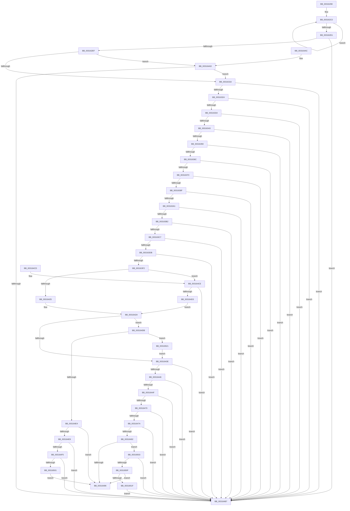

# MiCombineCandidate

- RVA: `0x00316290`–`0x0031652B` (길이 `667` bytes)
- VA: `0x0000000140316290`
- 실행 섹션: `.text`
- PDB 이름 있음: `예`; PDB Function 태그: `아니요`
- unwind 정보 RVA: `0x0007495C`
- 디코드: `167`개 명령, `667/667` bytes 표시
- 미해석 바이트: `0` (있으면 어셈블리에 `.byte`로 보존)

> 이 문서는 커널 이미지의 기계어와 PDB 기호를 분석해 생성했습니다. 4번과 5번은 함수 원형과 자료형을 바이너리 사용 방식에서 추정한 C 해석이며 원본 소스 복구 결과는 아닙니다.

## 1. Dependencies

- 직접 호출 지점: **10**; 고유 호출 대상: **8**
- 직접 호출자로 확인된 함수: **8**
- RIP 상대 이미지 참조: **1**

### Outgoing calls
- `0x00316394` → [MiIsPfnCommitNotCharged](MiIsPfnCommitNotCharged_function_00317370.md) (function, `0x00317370`)
- `0x003163A4` → [MiGetPfnSlabType](../28/MiGetPfnSlabType_function_0028E2D0.md) (function, `0x0028E2D0`)
- `0x003163BA` → [MiInvalidPteConforms](../37/MiInvalidPteConforms_function_00372A10.md) (function, `0x00372A10`)
- `0x003163CE` → [MiValidCombineProtection](../42/MiValidCombineProtection_function_0042EA70.md) (function, `0x0042EA70`)
- `0x003163E5` → [MiGetPagePrivilege](../28/MiGetPagePrivilege_function_00285420.md) (function, `0x00285420`)
- `0x00316407` → [MiGetSystemRegionType](../28/MiGetSystemRegionType_function_0028EC80.md) (function, `0x0028EC80`)
- `0x003164EC` → [MI_IS_RESET_PTE](../38/MI_IS_RESET_PTE_function_00383E80.md) (function, `0x00383E80`)
- `0x003164F8` → [MI_IS_SOFTWARE_PTE_SHADOW_STACK](../38/MI_IS_SOFTWARE_PTE_SHADOW_STACK_function_003815D0.md) (function, `0x003815D0`)
- `0x00316506` → [MI_IS_RESET_PTE](../38/MI_IS_RESET_PTE_function_00383E80.md) (function, `0x00383E80`)
- `0x00316512` → [MI_IS_SOFTWARE_PTE_SHADOW_STACK](../38/MI_IS_SOFTWARE_PTE_SHADOW_STACK_function_003815D0.md) (function, `0x003815D0`)

### Direct callers
- [MiRecheckCombineVm](../22/MiRecheckCombineVm_function_0022A1FC.md) at `0x0022A211`
- [MiMapArbitraryPage](../22/MiMapArbitraryPage_function_0022A44C.md) at `0x0022A4B9`
- [MiSharePages](MiSharePages_function_00315110.md) at `0x00315477`
- [MiCrcStillIntact](MiCrcStillIntact_function_00317028.md) at `0x003170DD`
- [MiComputeCombineHash](../32/MiComputeCombineHash_function_003227C0.md) at `0x00322884`
- [MiCapturePfnVm](../46/MiCapturePfnVm_function_00465570.md) at `0x0046560B`
- [MiCombinePte](../68/MiCombinePte_function_0068B9A0.md) at `0x0068BA6D`
- [MiCombineAllPhysicalMemory](../../page/9F/MiCombineAllPhysicalMemory_function_009F6B6C.md) at `0x009F6E43`

### Static image references
- `0x003162FC` → RVA `0x00E30088` (`.data`; read)

## 2. Other-region calls and transfers

- 다른 실행 섹션으로 향하는 call: **0**
- 별도 외부 분기/꼬리 이동을 확인하지 못했습니다.

## 3. Assembly (complete function range)

```asm
00316290  48 83 EC 58                     sub rsp, 0x58
00316294  4D 8B D8                        mov r11, r8
00316297  4C 8D 54 24 20                  lea r10, [rsp + 0x20]
0031629C  0F 57 C0                        xorps xmm0, xmm0
0031629F  49 8B C3                        mov rax, r11
003162A2  0F 11 44 24 20                  movups xmmword ptr [rsp + 0x20], xmm0
003162A7  4D 2B D3                        sub r10, r11
003162AA  44 8B C2                        mov r8d, edx
003162AD  0F 11 44 24 30                  movups xmmword ptr [rsp + 0x30], xmm0
003162B2  41 B9 06 00 00 00               mov r9d, 6
003162B8  0F 11 44 24 40                  movups xmmword ptr [rsp + 0x40], xmm0
003162BD  0F 1F 00                        nop dword ptr [rax]
003162C0  48 8B 10                        mov rdx, qword ptr [rax]
003162C3  49 89 14 02                     mov qword ptr [r10 + rax], rdx
003162C7  48 8D 40 08                     lea rax, [rax + 8]
003162CB  49 83 E9 01                     sub r9, 1
003162CF  75 EF                           jne 0x1403162c0
003162D1  0F B6 44 24 42                  movzx eax, byte ptr [rsp + 0x42]
003162D6  48 89 5C 24 60                  mov qword ptr [rsp + 0x60], rbx
003162DB  24 07                           and al, 7
003162DD  48 89 74 24 68                  mov qword ptr [rsp + 0x68], rsi
003162E2  48 89 7C 24 50                  mov qword ptr [rsp + 0x50], rdi
003162E7  3C 01                           cmp al, 1
003162E9  0F 86 C8 01 00 00               jbe 0x1403164b7
003162EF  48 8B 7C 24 28                  mov rdi, qword ptr [rsp + 0x28]
003162F4  48 8B 44 24 48                  mov rax, qword ptr [rsp + 0x48]
003162F9  48 8B 11                        mov rdx, qword ptr [rcx]
003162FC  48 8B 0D 85 9D B1 00            mov rcx, qword ptr [rip + 0xb19d85]
00316303  48 C1 E8 2B                     shr rax, 0x2b
00316307  25 FF 03 00 00                  and eax, 0x3ff
0031630C  48 39 14 C1                     cmp qword ptr [rcx + rax*8], rdx
00316310  0F 85 97 01 00 00               jne 0x1403164ad
00316316  48 8B 44 24 48                  mov rax, qword ptr [rsp + 0x48]
0031631B  48 85 C0                        test rax, rax
0031631E  0F 88 93 01 00 00               js 0x1403164b7
00316324  48 8B 44 24 48                  mov rax, qword ptr [rsp + 0x48]
00316329  48 0F BA E0 28                  bt rax, 0x28
0031632E  0F 82 83 01 00 00               jb 0x1403164b7
00316334  8B 44 24 40                     mov eax, dword ptr [rsp + 0x40]
00316338  C1 E8 18                        shr eax, 0x18
0031633B  A8 08                           test al, 8
0031633D  0F 85 74 01 00 00               jne 0x1403164b7
00316343  48 BE 00 00 00 00 80 F6 FF FF   movabs rsi, 0xfffff68000000000
0031634D  48 8B C6                        mov rax, rsi
00316350  48 3B F8                        cmp rdi, rax
00316353  0F 82 5E 01 00 00               jb 0x1403164b7
00316359  48 B8 FF FF FF FF FF F6 FF FF   movabs rax, 0xfffff6ffffffffff
00316363  48 3B F8                        cmp rdi, rax
00316366  0F 87 4B 01 00 00               ja 0x1403164b7
0031636C  48 8B 44 24 38                  mov rax, qword ptr [rsp + 0x38]
00316371  48 0F BA E0 3E                  bt rax, 0x3e
00316376  0F 82 3B 01 00 00               jb 0x1403164b7
0031637C  48 8B 44 24 48                  mov rax, qword ptr [rsp + 0x48]
00316381  48 C1 E8 3C                     shr rax, 0x3c
00316385  24 07                           and al, 7
00316387  3C 04                           cmp al, 4
00316389  0F 84 28 01 00 00               je 0x1403164b7
0031638F  48 8D 4C 24 20                  lea rcx, [rsp + 0x20]
00316394  E8 D7 0F 00 00                  call 0x140317370
00316399  85 C0                           test eax, eax
0031639B  0F 85 16 01 00 00               jne 0x1403164b7
003163A1  49 8B CB                        mov rcx, r11
003163A4  E8 27 7F F7 FF                  call 0x14028e2d0
003163A9  83 F8 09                        cmp eax, 9
003163AC  0F 85 05 01 00 00               jne 0x1403164b7
003163B2  48 8B 5C 24 30                  mov rbx, qword ptr [rsp + 0x30]
003163B7  48 8B CB                        mov rcx, rbx
003163BA  E8 51 C6 05 00                  call 0x140372a10
003163BF  85 C0                           test eax, eax
003163C1  0F 84 F0 00 00 00               je 0x1403164b7
003163C7  48 C1 E9 05                     shr rcx, 5
003163CB  83 E1 1F                        and ecx, 0x1f
003163CE  E8 9D 86 11 00                  call 0x14042ea70
003163D3  85 C0                           test eax, eax
003163D5  0F 84 DC 00 00 00               je 0x1403164b7
003163DB  45 33 C0                        xor r8d, r8d
003163DE  48 8D 4C 24 20                  lea rcx, [rsp + 0x20]
003163E3  33 D2                           xor edx, edx
003163E5  E8 36 F0 F6 FF                  call 0x140285420
003163EA  85 C0                           test eax, eax
003163EC  0F 85 C5 00 00 00               jne 0x1403164b7
003163F2  48 8B CF                        mov rcx, rdi
003163F5  48 C1 E1 19                     shl rcx, 0x19
003163F9  48 8B C6                        mov rax, rsi
003163FC  48 C1 E0 19                     shl rax, 0x19
00316400  48 2B C8                        sub rcx, rax
00316403  48 C1 F9 10                     sar rcx, 0x10
00316407  E8 74 88 F7 FF                  call 0x14028ec80
0031640C  48 8B CE                        mov rcx, rsi
0031640F  48 BA 78 FF FF FF 3F 00 00 00   movabs rdx, 0x3fffffff78
00316419  48 03 CA                        add rcx, rdx
0031641C  48 3B F9                        cmp rdi, rcx
0031641F  0F 87 A9 00 00 00               ja 0x1403164ce
00316425  BA 01 00 00 00                  mov edx, 1
0031642A  48 8B 4C 24 42                  mov rcx, qword ptr [rsp + 0x42]
0031642F  0F B6 C1                        movzx eax, cl
00316432  24 07                           and al, 7
00316434  2C 02                           sub al, 2
00316436  3C 01                           cmp al, 1
00316438  0F 86 9D 00 00 00               jbe 0x1403164db
0031643E  80 E1 07                        and cl, 7
00316441  80 F9 06                        cmp cl, 6
00316444  75 71                           jne 0x1403164b7
00316446  48 8B 44 24 20                  mov rax, qword ptr [rsp + 0x20]
0031644B  A8 01                           test al, 1
0031644D  74 68                           je 0x1403164b7
0031644F  48 8B 44 24 48                  mov rax, qword ptr [rsp + 0x48]
00316454  48 B9 FF FF FF FF FF 00 00 00   movabs rcx, 0xffffffffff
0031645E  48 23 C1                        and rax, rcx
00316461  48 B9 FE FF FF FF 3F 00 00 00   movabs rcx, 0x3ffffffffe
0031646B  48 3B C1                        cmp rax, rcx
0031646E  74 47                           je 0x1403164b7
00316470  8B 44 24 40                     mov eax, dword ptr [rsp + 0x40]
00316474  66 83 F8 01                     cmp ax, 1
00316478  75 3D                           jne 0x1403164b7
0031647A  48 8B 44 24 38                  mov rax, qword ptr [rsp + 0x38]
0031647F  48 B9 FF FF FF FF FF FF FF 3F   movabs rcx, 0x3fffffffffffffff
00316489  48 23 C1                        and rax, rcx
0031648C  48 83 F8 01                     cmp rax, 1
00316490  75 25                           jne 0x1403164b7
00316492  3B D0                           cmp edx, eax
00316494  74 6D                           je 0x140316503
00316496  8B C2                           mov eax, edx
00316498  48 8B 7C 24 50                  mov rdi, qword ptr [rsp + 0x50]
0031649D  48 8B 74 24 68                  mov rsi, qword ptr [rsp + 0x68]
003164A2  48 8B 5C 24 60                  mov rbx, qword ptr [rsp + 0x60]
003164A7  48 83 C4 58                     add rsp, 0x58
003164AB  C3                              ret
003164AC  CC                              int3
003164AD  41 F6 C0 01                     test r8b, 1
003164B1  0F 85 5F FE FF FF               jne 0x140316316
003164B7  48 8B 7C 24 50                  mov rdi, qword ptr [rsp + 0x50]
003164BC  33 C0                           xor eax, eax
003164BE  48 8B 74 24 68                  mov rsi, qword ptr [rsp + 0x68]
003164C3  48 8B 5C 24 60                  mov rbx, qword ptr [rsp + 0x60]
003164C8  48 83 C4 58                     add rsp, 0x58
003164CC  C3                              ret
003164CD  CC                              int3
003164CE  83 F8 05                        cmp eax, 5
003164D1  75 E4                           jne 0x1403164b7
003164D3  8D 50 FD                        lea edx, [rax - 3]
003164D6  E9 4F FF FF FF                  jmp 0x14031642a
003164DB  8B 44 24 40                     mov eax, dword ptr [rsp + 0x40]
003164DF  66 85 C0                        test ax, ax
003164E2  75 3D                           jne 0x140316521
003164E4  83 FA 01                        cmp edx, 1
003164E7  75 AD                           jne 0x140316496
003164E9  48 8B CB                        mov rcx, rbx
003164EC  E8 8F D9 06 00                  call 0x140383e80
003164F1  85 C0                           test eax, eax
003164F3  75 C2                           jne 0x1403164b7
003164F5  48 8B CB                        mov rcx, rbx
003164F8  E8 D3 B0 06 00                  call 0x1403815d0
003164FD  85 C0                           test eax, eax
003164FF  75 B6                           jne 0x1403164b7
00316501  EB 93                           jmp 0x140316496
00316503  48 8B CB                        mov rcx, rbx
00316506  E8 75 D9 06 00                  call 0x140383e80
0031650B  85 C0                           test eax, eax
0031650D  75 A8                           jne 0x1403164b7
0031650F  48 8B CB                        mov rcx, rbx
00316512  E8 B9 B0 06 00                  call 0x1403815d0
00316517  85 C0                           test eax, eax
00316519  0F 84 77 FF FF FF               je 0x140316496
0031651F  EB 96                           jmp 0x1403164b7
00316521  48 8B 4C 24 42                  mov rcx, qword ptr [rsp + 0x42]
00316526  E9 13 FF FF FF                  jmp 0x14031643e
```

## 4. C-style interpretation (structured pseudocode)

```c
__int64 __fastcall MiCombineCandidate(__int64 a1, int a2, __int64 a3)
{
    __int64 result;
    __int64 v_r10;
    __int64 v_rsp;
    unsigned __int64 v_stack_m10;
    unsigned __int8 v_stack_m16;
    unsigned __int64 v_stack_m18;
    unsigned __int64 v_stack_m20;
    unsigned __int64 v_stack_m28;
    unsigned __int64 v_stack_m30;
    unsigned __int64 v_stack_m38;
    unsigned __int64 v_stack_m8;
    unsigned __int64 v_stack_p10;
    unsigned __int64 v_stack_p50;
    unsigned __int64 v_stack_p60;
    unsigned __int64 v_stack_p68;
    unsigned __int64 v_stack_p8;
    unsigned int v_stack_p98;
    unsigned __int64 v_stack_p9A;

    v_rsp = (v_rsp) - (88);
    v_stack_m38 = v_xmm0;
    v_r10 = (v_stack_m38) - (a3);
    v_stack_m28 = v_xmm0;
    v_stack_m18 = v_xmm0;
loc_003162C0:
    *(unsigned __int64 *)(v_r10 + a3 * 1) = *(unsigned __int64 *)(a3);
    a4 = (6) - (1);
    if (condition_is_not_equal) goto loc_003162C0;
    v_stack_p8 = v_rbx;
    result = (unsigned __int8)((v_stack_m16) & (7));
    v_stack_p10 = v_rsi;
    v_stack_m8 = v_rdi;
    if (((unsigned __int8)(result)) <= 1) goto loc_003164B7;
    result = (v_stack_m10) >> (43);
    result = (unsigned int)((result) & (0x3FFULL));
    if ((*(unsigned __int64 *)(*(unsigned __int64 *)(v_rip + 11640197) + result * 8)) != (*(unsigned __int64 *)(a1))) goto loc_003164AD;
loc_00316316:
    if (sign_flag) goto loc_003164B7;
    if (condition_is_below) goto loc_003164B7;
    result = (unsigned int)(((unsigned int)(v_stack_m18)) >> (24));
    if ((((unsigned __int8)(result)) & (8)) != 0) goto loc_003164B7;
    if (v_stack_m30 < v_rsi) goto loc_003164B7;
    if (v_stack_m30 > v_rsi) goto loc_003164B7;
    if (v_stack_m30 < v_rsi) goto loc_003164B7;
    result = (v_stack_m10) >> (60);
    result = (unsigned __int8)((result) & (7));
    if (((unsigned __int8)(result)) == 4) goto loc_003164B7;
    result = MiIsPfnCommitNotCharged(v_stack_m38, *(unsigned __int64 *)(a1), (unsigned int)(a2), a4);
    if ((unsigned int)(result) != 0) goto loc_003164B7;
    result = MiGetPfnSlabType(a3, *(unsigned __int64 *)(a1), (unsigned int)(a2), a4);
    if (((unsigned int)(result)) != 9) goto loc_003164B7;
    result = MiInvalidPteConforms(v_stack_m28, *(unsigned __int64 *)(a1), (unsigned int)(a2), a4);
    if ((unsigned int)(result) == 0) goto loc_003164B7;
    a1 = (v_stack_m28) >> (5);
    a1 = (unsigned int)((a1) & (31));
    result = MiValidCombineProtection(a1, *(unsigned __int64 *)(a1), (unsigned int)(a2), a4);
    if ((unsigned int)(result) == 0) goto loc_003164B7;
    a3 = 0;
    a2 = 0;
    result = MiGetPagePrivilege(v_stack_m38, a2, a3, a4);
    if ((unsigned int)(result) != 0) goto loc_003164B7;
    a1 = (v_stack_m30) << (25);
    result = (v_rsi) << (25);
    a1 = (a1) - (result);
    a1 = (a1) >> (16);
    result = MiGetSystemRegionType(a1, a2, a3, a4);
    a1 = (v_rsi) + (0);
    if (v_stack_m30 > a1) goto loc_003164CE;
loc_0031642A:
    result = (unsigned __int8)(((unsigned __int8)(v_stack_m16)) & (7));
    result = (unsigned __int8)((result) - (2));
    if (((unsigned __int8)(result)) <= 1) goto loc_003164DB;
loc_0031643E:
    a1 = (unsigned __int8)((v_stack_m16) & (7));
    if (((unsigned __int8)(a1)) != 6) goto loc_003164B7;
    if ((((unsigned __int8)(v_stack_m38)) & (1)) == 0) goto loc_003164B7;
    result = (v_stack_m10) & (a1);
    if (result == a1) goto loc_003164B7;
    if (((unsigned __int16)((unsigned int)(v_stack_m18))) != 1) goto loc_003164B7;
    result = (v_stack_m20) & (a1);
    if (result != 1) goto loc_003164B7;
    if (1 == ((unsigned int)(result))) goto loc_00316503;
loc_00316496:
    v_rsp = (v_rsp) + (88);
    return 1;
loc_003164AD:
    if (((0) & (1)) != 0) goto loc_00316316;
loc_003164B7:
    result = 0;
    v_rsp = (v_rsp) + (88);
    return result;
loc_003164CE:
    if (0 != 5) goto loc_003164B7;
    goto loc_0031642A;
loc_003164DB:
    if ((unsigned __int16)((unsigned int)(v_stack_p98)) != 0) goto loc_00316521;
    if (((unsigned int)(result - 3)) != 1) goto loc_00316496;
    result = MI_IS_RESET_PTE(v_stack_p60, result - 3, a3, a4);
    if ((unsigned int)(result) != 0) goto loc_003164B7;
    result = MI_IS_SOFTWARE_PTE_SHADOW_STACK(v_stack_p60, result - 3, a3, a4);
    if ((unsigned int)(result) != 0) goto loc_003164B7;
    goto loc_00316496;
loc_00316503:
    result = MI_IS_RESET_PTE(v_stack_p60, result - 3, a3, a4);
    if ((unsigned int)(result) != 0) goto loc_003164B7;
    result = MI_IS_SOFTWARE_PTE_SHADOW_STACK(v_stack_p60, result - 3, a3, a4);
    if ((unsigned int)(result) == 0) goto loc_00316496;
    goto loc_003164B7;
loc_00316521:
    goto loc_0031643E;
}
```

## 5. (Beta) C Style

```c
int64_t MiCombineCandidate(void *Arg1, int32_t Arg2, void *Arg3)
{
    uint8_t *arg1 = (uint8_t *)Arg1;
    uint8_t *arg3 = (uint8_t *)Arg3;

    int64_t result;
    int64_t local_r10;
    int64_t local_rsp;
    uint64_t v_stack_m10;
    uint8_t v_stack_m16;
    uint64_t v_stack_m18;
    uint64_t v_stack_m20;
    uint64_t v_stack_m28;
    uint64_t v_stack_m30;
    uint64_t v_stack_m38;
    uint64_t v_stack_m8;
    uint64_t v_stack_p10;
    uint64_t v_stack_p50;
    uint64_t v_stack_p60;
    uint64_t v_stack_p68;
    uint64_t v_stack_p8;
    uint32_t v_stack_p98;
    uint64_t v_stack_p9A;

    local_rsp = (local_rsp) - (88);
    v_stack_m38 = v_xmm0;
    local_r10 = (v_stack_m38) - (Arg3);
    v_stack_m28 = v_xmm0;
    v_stack_m18 = v_xmm0;
loc_003162C0:
    *(uint64_t *)(local_r10 + arg3 * 1) = *(uint64_t *)(arg3);
    a4 = (6) - (1);
    if (condition_is_not_equal) goto loc_003162C0;
    v_stack_p8 = local_rbx;
    result = (uint8_t)((v_stack_m16) & (7));
    v_stack_p10 = local_rsi;
    v_stack_m8 = local_rdi;
    if (((uint8_t)(result)) <= 1) goto loc_003164B7;
    result = (v_stack_m10) >> (43);
    result = (uint32_t)((result) & (0x3FFULL));
    if ((*(uint64_t *)(*(uint64_t *)(v_rip + 0xB19D85) + result * 8)) != (*(uint64_t *)(arg1))) goto loc_003164AD;
loc_00316316:
    if (sign_flag) goto loc_003164B7;
    if (condition_is_below) goto loc_003164B7;
    result = (uint32_t)(((uint32_t)(v_stack_m18)) >> (24));
    if ((((uint8_t)(result)) & (8)) != 0) goto loc_003164B7;
    if (v_stack_m30 < local_rsi) goto loc_003164B7;
    if (v_stack_m30 > local_rsi) goto loc_003164B7;
    if (v_stack_m30 < local_rsi) goto loc_003164B7;
    result = (v_stack_m10) >> (60);
    result = (uint8_t)((result) & (7));
    if (((uint8_t)(result)) == 4) goto loc_003164B7;
    result = MiIsPfnCommitNotCharged(v_stack_m38, *(uint64_t *)(arg1), (uint32_t)(Arg2), a4);
    if ((uint32_t)(result) != 0) goto loc_003164B7;
    result = MiGetPfnSlabType(Arg3, *(uint64_t *)(arg1), (uint32_t)(Arg2), a4);
    if (((uint32_t)(result)) != 9) goto loc_003164B7;
    result = MiInvalidPteConforms(v_stack_m28, *(uint64_t *)(arg1), (uint32_t)(Arg2), a4);
    if ((uint32_t)(result) == 0) goto loc_003164B7;
    Arg1 = (v_stack_m28) >> (5);
    Arg1 = (uint32_t)((Arg1) & (31));
    result = MiValidCombineProtection(Arg1, *(uint64_t *)(arg1), (uint32_t)(Arg2), a4);
    if ((uint32_t)(result) == 0) goto loc_003164B7;
    Arg3 = 0;
    Arg2 = 0;
    result = MiGetPagePrivilege(v_stack_m38, Arg2, Arg3, a4);
    if ((uint32_t)(result) != 0) goto loc_003164B7;
    Arg1 = (v_stack_m30) << (25);
    result = (local_rsi) << (25);
    Arg1 = (Arg1) - (result);
    Arg1 = (Arg1) >> (16);
    result = MiGetSystemRegionType(Arg1, Arg2, Arg3, a4);
    Arg1 = (local_rsi) + (0);
    if (v_stack_m30 > Arg1) goto loc_003164CE;
loc_0031642A:
    result = (uint8_t)(((uint8_t)(v_stack_m16)) & (7));
    result = (uint8_t)((result) - (2));
    if (((uint8_t)(result)) <= 1) goto loc_003164DB;
loc_0031643E:
    Arg1 = (uint8_t)((v_stack_m16) & (7));
    if (((uint8_t)(Arg1)) != 6) goto loc_003164B7;
    if ((((uint8_t)(v_stack_m38)) & (1)) == 0) goto loc_003164B7;
    result = (v_stack_m10) & (Arg1);
    if (result == Arg1) goto loc_003164B7;
    if (((uint16_t)((uint32_t)(v_stack_m18))) != 1) goto loc_003164B7;
    result = (v_stack_m20) & (Arg1);
    if (result != 1) goto loc_003164B7;
    if (1 == ((uint32_t)(result))) goto loc_00316503;
loc_00316496:
    local_rsp = (local_rsp) + (88);
    return 1;
loc_003164AD:
    if (((0) & (1)) != 0) goto loc_00316316;
loc_003164B7:
    result = 0;
    local_rsp = (local_rsp) + (88);
    return result;
loc_003164CE:
    if (0 != 5) goto loc_003164B7;
    goto loc_0031642A;
loc_003164DB:
    if ((uint16_t)((uint32_t)(v_stack_p98)) != 0) goto loc_00316521;
    if (((uint32_t)(result - 3)) != 1) goto loc_00316496;
    result = MI_IS_RESET_PTE(v_stack_p60, result - 3, Arg3, a4);
    if ((uint32_t)(result) != 0) goto loc_003164B7;
    result = MI_IS_SOFTWARE_PTE_SHADOW_STACK(v_stack_p60, result - 3, Arg3, a4);
    if ((uint32_t)(result) != 0) goto loc_003164B7;
    goto loc_00316496;
loc_00316503:
    result = MI_IS_RESET_PTE(v_stack_p60, result - 3, Arg3, a4);
    if ((uint32_t)(result) != 0) goto loc_003164B7;
    result = MI_IS_SOFTWARE_PTE_SHADOW_STACK(v_stack_p60, result - 3, Arg3, a4);
    if ((uint32_t)(result) == 0) goto loc_00316496;
    goto loc_003164B7;
loc_00316521:
    goto loc_0031643E;
}
```

### 관측된 메모리 오프셋

구조체 형식이 확인되지 않은 접근은 인자 기준의 오프셋으로만 기록했습니다.

| 기준 인자 | 오프셋 표현 | 폭 (bit) | 접근 |
|---|---:|---:|---|
| `Arg1` | `+ 0x0` | `64` | `R` |
| `Arg3` | `+ 0x0` | `32` | `R` |
| `Arg3` | `+ 0x0` | `64` | `R` |
| `Arg3` | `+ 0x8` | `64` | `R` |

## 6. Execution-region graph

[열기: 2D/3D 그래프와 함수 탐색 컨트롤 패널](../../../control-panel.html?section=text&rva=0x00316290&view=graph)

- 2D 그래프는 위에서 아래로 흐르고, 3D 그래프는 빈 공간을 드래그해 회전합니다. Shift+드래그는 이동, 휠은 확대·축소, 함수 노드 선택은 대상 보고서 이동입니다.

### Static fallback


