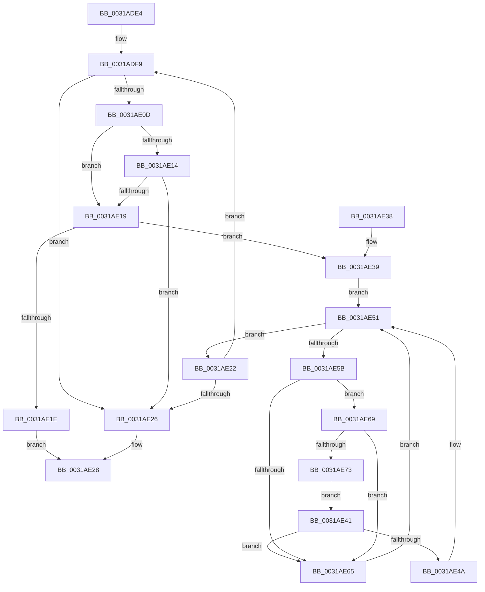

# MiCompareTbFlushTimeStamp

- RVA: `0x0031ADE4`–`0x0031AE75` (길이 `145` bytes)
- VA: `0x000000014031ADE4`
- 실행 섹션: `.text`
- PDB 이름 있음: `예`; PDB Function 태그: `아니요`
- unwind 정보 RVA: `0x00074D34`
- 디코드: `49`개 명령, `145/145` bytes 표시
- 미해석 바이트: `0` (있으면 어셈블리에 `.byte`로 보존)

> 이 문서는 커널 이미지의 기계어와 PDB 기호를 분석해 생성했습니다. 4번과 5번은 함수 원형과 자료형을 바이너리 사용 방식에서 추정한 C 해석이며 원본 소스 복구 결과는 아닙니다.

## 1. Dependencies

- 직접 호출 지점: **2**; 고유 호출 대상: **2**
- 직접 호출자로 확인된 함수: **7**
- RIP 상대 이미지 참조: **3**

### Outgoing calls
- `0x0031AE41` → [KiCheckVpBackingLongSpinWaitHypercall](../30/KiCheckVpBackingLongSpinWaitHypercall_function_0030F490.md) (function, `0x0030F490`)
- `0x0031AE4C` → [HvlNotifyLongSpinWait](../30/HvlNotifyLongSpinWait_function_0030F460.md) (function, `0x0030F460`)

### Direct callers
- [MiFlushTbAsNeeded](MiFlushTbAsNeeded_function_00313730.md) at `0x00313A48`
- [MiReservePtes](MiReservePtes_function_00318D20.md) at `0x003190C4`
- [MiDeleteVadAwePtes](../4C/MiDeleteVadAwePtes_function_004C4F3C.md) at `0x004C4FF7`
- [MiWriteAwePtes](../4C/MiWriteAwePtes_function_004C51E0.md) at `0x004C5813`
- [MiReadyReservedView](../4C/MiReadyReservedView_function_004CC0D8.md) at `0x004CC147`
- [MiDecrementAweMapCount](../68/MiDecrementAweMapCount_function_00688158.md) at `0x00688304`
- [MiZeroAndFlushAweLazyPtes](../68/MiZeroAndFlushAweLazyPtes_function_00689B1C.md) at `0x00689BC7`

### Static image references
- `0x0031ADFE` → RVA `0x00FCF080` (`CACHEALI`; read)
- `0x0031AE5D` → RVA `0x00FC52AC` (`ALMOSTRO`; reference)
- `0x0031AE69` → RVA `0x00FC6AB8` (`ALMOSTRO`; read)

## 2. Other-region calls and transfers

- 다른 실행 섹션으로 향하는 call: **0**
- 별도 외부 분기/꼬리 이동을 확인하지 못했습니다.

## 3. Assembly (complete function range)

```asm
0031ADE4  48 89 5C 24 08                  mov qword ptr [rsp + 8], rbx
0031ADE9  48 89 74 24 18                  mov qword ptr [rsp + 0x18], rsi
0031ADEE  89 54 24 10                     mov dword ptr [rsp + 0x10], edx
0031ADF2  57                              push rdi
0031ADF3  48 83 EC 20                     sub rsp, 0x20
0031ADF7  8B F1                           mov esi, ecx
0031ADF9  F0 83 0C 24 00                  lock or dword ptr [rsp], 0
0031ADFE  8B 15 7C 42 CB 00               mov edx, dword ptr [rip + 0xcb427c]
0031AE04  8B C2                           mov eax, edx
0031AE06  2B C6                           sub eax, esi
0031AE08  83 F8 02                        cmp eax, 2
0031AE0B  77 19                           ja 0x14031ae26
0031AE0D  8B FE                           mov edi, esi
0031AE0F  83 E7 01                        and edi, 1
0031AE12  75 05                           jne 0x14031ae19
0031AE14  83 F8 02                        cmp eax, 2
0031AE17  73 0D                           jae 0x14031ae26
0031AE19  F6 C2 01                        test dl, 1
0031AE1C  75 1B                           jne 0x14031ae39
0031AE1E  B0 01                           mov al, 1
0031AE20  EB 06                           jmp 0x14031ae28
0031AE22  85 FF                           test edi, edi
0031AE24  75 D3                           jne 0x14031adf9
0031AE26  32 C0                           xor al, al
0031AE28  48 8B 5C 24 30                  mov rbx, qword ptr [rsp + 0x30]
0031AE2D  48 8B 74 24 40                  mov rsi, qword ptr [rsp + 0x40]
0031AE32  48 83 C4 20                     add rsp, 0x20
0031AE36  5F                              pop rdi
0031AE37  C3                              ret
0031AE38  CC                              int3
0031AE39  33 DB                           xor ebx, ebx
0031AE3B  F0 09 1C 24                     lock or dword ptr [rsp], ebx
0031AE3F  EB 10                           jmp 0x14031ae51
0031AE41  E8 4A 46 FF FF                  call 0x14030f490
0031AE46  84 C0                           test al, al
0031AE48  74 1B                           je 0x14031ae65
0031AE4A  8B CB                           mov ecx, ebx
0031AE4C  E8 0F 46 FF FF                  call 0x14030f460
0031AE51  0F BA 25 27 42 CB 00 00         bt dword ptr [rip + 0xcb4227], 0
0031AE59  73 C7                           jae 0x14031ae22
0031AE5B  FF C3                           inc ebx
0031AE5D  85 1D 49 A4 CA 00               test dword ptr [rip + 0xcaa449], ebx
0031AE63  74 04                           je 0x14031ae69
0031AE65  F3 90                           pause
0031AE67  EB E8                           jmp 0x14031ae51
0031AE69  8B 05 49 BC CA 00               mov eax, dword ptr [rip + 0xcabc49]
0031AE6F  A8 40                           test al, 0x40
0031AE71  74 F2                           je 0x14031ae65
0031AE73  EB CC                           jmp 0x14031ae41
```

## 4. C-style interpretation (structured pseudocode)

```c
__int64 __fastcall MiCompareTbFlushTimeStamp(int a1, int a2)
{
    __int64 result;
    __int64 v_rbx;
    __int64 v_rdi;
    __int64 v_rsp;
    unsigned int v_stack_m28;
    unsigned int v_stack_p0;
    unsigned int v_stack_p10;
    unsigned __int64 v_stack_p18;
    unsigned __int64 v_stack_p8;

    v_stack_p8 = v_rbx;
    v_stack_p18 = v_rsi;
    v_stack_p10 = a2;
    v_rsp = (v_rsp) - (32);
loc_0031ADF9:
    result = (unsigned int)(((unsigned int)((unsigned int)((unsigned int)(*(unsigned int *)(v_rip + 13320828))))) - ((unsigned int)((unsigned int)(a1))));
    if (((unsigned int)(result)) > 2) goto loc_0031AE26;
    v_rdi = (unsigned int)(((unsigned int)((unsigned int)((unsigned int)(a1)))) & (1));
    if (condition_is_not_equal) goto loc_0031AE19;
    if (((unsigned int)(result)) >= 2) goto loc_0031AE26;
loc_0031AE19:
    if ((((unsigned __int8)((unsigned int)(*(unsigned int *)(v_rip + 13320828)))) & (1)) != 0) goto loc_0031AE39;
    goto loc_0031AE28;
loc_0031AE22:
    if ((unsigned int)(v_rdi) != 0) goto loc_0031ADF9;
loc_0031AE26:
    result = 0;
loc_0031AE28:
    v_rsp = (v_rsp) + (32);
    return result;
loc_0031AE39:
    v_rbx = 0;
    goto loc_0031AE51;
loc_0031AE41:
    result = KiCheckVpBackingLongSpinWaitHypercall(a1, (unsigned int)(*(unsigned int *)(v_rip + 13320828)), a3, a4);
    if ((unsigned __int8)(result) == 0) goto loc_0031AE65;
    result = HvlNotifyLongSpinWait(0, (unsigned int)(*(unsigned int *)(v_rip + 13320828)), a3, a4);
loc_0031AE51:
    if (condition_is_above_or_equal) goto loc_0031AE22;
    v_rbx = (unsigned int)((v_rbx) + 1);
    if (((*(unsigned int *)(v_rip + 13280329)) & ((unsigned int)(v_rbx))) == 0) goto loc_0031AE69;
loc_0031AE65:
    goto loc_0031AE51;
loc_0031AE69:
    if ((((unsigned __int8)((unsigned int)(*(unsigned int *)(v_rip + 13286473)))) & (64)) == 0) goto loc_0031AE65;
    goto loc_0031AE41;
}
```

## 5. (Beta) C Style

```c
int64_t MiCompareTbFlushTimeStamp(int32_t Arg1, int32_t Arg2)
{
    int64_t result;
    int64_t local_rbx;
    int64_t local_rdi;
    int64_t local_rsp;
    uint32_t v_stack_m28;
    uint32_t v_stack_p0;
    uint32_t v_stack_p10;
    uint64_t v_stack_p18;
    uint64_t v_stack_p8;

    v_stack_p8 = local_rbx;
    v_stack_p18 = local_rsi;
    v_stack_p10 = Arg2;
    local_rsp = (local_rsp) - (32);
loc_0031ADF9:
    result = (uint32_t)(((uint32_t)((uint32_t)((uint32_t)(*(uint32_t *)(v_rip + 0xCB427C))))) - ((uint32_t)((uint32_t)(Arg1))));
    if (((uint32_t)(result)) > 2) goto loc_0031AE26;
    local_rdi = (uint32_t)(((uint32_t)((uint32_t)((uint32_t)(Arg1)))) & (1));
    if (condition_is_not_equal) goto loc_0031AE19;
    if (((uint32_t)(result)) >= 2) goto loc_0031AE26;
loc_0031AE19:
    if ((((uint8_t)((uint32_t)(*(uint32_t *)(v_rip + 0xCB427C)))) & (1)) != 0) goto loc_0031AE39;
    goto loc_0031AE28;
loc_0031AE22:
    if ((uint32_t)(local_rdi) != 0) goto loc_0031ADF9;
loc_0031AE26:
    result = 0;
loc_0031AE28:
    local_rsp = (local_rsp) + (32);
    return result;
loc_0031AE39:
    local_rbx = 0;
    goto loc_0031AE51;
loc_0031AE41:
    result = KiCheckVpBackingLongSpinWaitHypercall(Arg1, (uint32_t)(*(uint32_t *)(v_rip + 0xCB427C)), a3, a4);
    if ((uint8_t)(result) == 0) goto loc_0031AE65;
    result = HvlNotifyLongSpinWait(0, (uint32_t)(*(uint32_t *)(v_rip + 0xCB427C)), a3, a4);
loc_0031AE51:
    if (condition_is_above_or_equal) goto loc_0031AE22;
    local_rbx = (uint32_t)((local_rbx) + 1);
    if (((*(uint32_t *)(v_rip + 0xCAA449)) & ((uint32_t)(local_rbx))) == 0) goto loc_0031AE69;
loc_0031AE65:
    goto loc_0031AE51;
loc_0031AE69:
    if ((((uint8_t)((uint32_t)(*(uint32_t *)(v_rip + 0xCABC49)))) & (64)) == 0) goto loc_0031AE65;
    goto loc_0031AE41;
}
```

## 6. Execution-region graph

[열기: 2D/3D 그래프와 함수 탐색 컨트롤 패널](../../../control-panel.html?section=text&rva=0x0031ADE4&view=graph)

- 2D 그래프는 위에서 아래로 흐르고, 3D 그래프는 빈 공간을 드래그해 회전합니다. Shift+드래그는 이동, 휠은 확대·축소, 함수 노드 선택은 대상 보고서 이동입니다.

### Static fallback


