# MiConvertLargeActivePageToChain

- RVA: `0x0031D980`–`0x0031DCCC` (길이 `844` bytes)
- VA: `0x000000014031D980`
- 실행 섹션: `.text`
- PDB 이름 있음: `예`; PDB Function 태그: `아니요`
- unwind 정보 RVA: `0x0007515C`
- 디코드: `203`개 명령, `844/844` bytes 표시
- 미해석 바이트: `0` (있으면 어셈블리에 `.byte`로 보존)

> 이 문서는 커널 이미지의 기계어와 PDB 기호를 분석해 생성했습니다. 4번과 5번은 함수 원형과 자료형을 바이너리 사용 방식에서 추정한 C 해석이며 원본 소스 복구 결과는 아닙니다.

## 1. Dependencies

- 직접 호출 지점: **10**; 고유 호출 대상: **8**
- 직접 호출자로 확인된 함수: **5**
- RIP 상대 이미지 참조: **8**

### Outgoing calls
- `0x0031D99F` → [MiGetPfnPageSizeIndex](MiGetPfnPageSizeIndex_function_0031C710.md) (function, `0x0031C710`)
- `0x0031DB43` → [KiLowerIrqlProcessIrqlFlags](../4F/KiLowerIrqlProcessIrqlFlags_function_004F5698.md) (function, `0x004F5698`)
- `0x0031DBBF` → [KiRaiseIrqlProcessIrqlFlags](../4F/KiRaiseIrqlProcessIrqlFlags_function_004F56FC.md) (function, `0x004F56FC`)
- `0x0031DBD3` → [KeShouldYieldProcessor](../27/KeShouldYieldProcessor_function_002773E0.md) (function, `0x002773E0`)
- `0x0031DBF1` → [KiLowerIrqlProcessIrqlFlags](../4F/KiLowerIrqlProcessIrqlFlags_function_004F5698.md) (function, `0x004F5698`)
- `0x0031DC2B` → [KiCheckVpBackingLongSpinWaitHypercall](../30/KiCheckVpBackingLongSpinWaitHypercall_function_0030F490.md) (function, `0x0030F490`)
- `0x0031DC3A` → [HvlNotifyLongSpinWait](../30/HvlNotifyLongSpinWait_function_0030F460.md) (function, `0x0030F460`)
- `0x0031DC47` → [MiCanPfnOriginalPteBeLost](../37/MiCanPfnOriginalPteBeLost_function_00373D3C.md) (function, `0x00373D3C`)
- `0x0031DC89` → [KiRaiseIrqlProcessIrqlFlags](../4F/KiRaiseIrqlProcessIrqlFlags_function_004F56FC.md) (function, `0x004F56FC`)
- `0x0031DCC2` → [MiArePageContentsZero](../4D/MiArePageContentsZero_function_004D4278.md) (function, `0x004D4278`)

### Direct callers
- [MiGetLargePagesForChain](MiGetLargePagesForChain_function_0031DF88.md) at `0x0031E09E`
- [MiPrefetchPreallocatePages](../36/MiPrefetchPreallocatePages_function_0036B1F0.md) at `0x0036B44B`
- [MiIdealClusterPage](../4D/MiIdealClusterPage_function_004DB964.md) at `0x004DBE31`
- [MiGetClusterPage](../4D/MiGetClusterPage_function_004DC57C.md) at `0x004DC8DF`
- [MiProcessVaContiguityInformation](../69/MiProcessVaContiguityInformation_function_006939C0.md) at `0x00693C42`

### Static image references
- `0x0031D9A6` → RVA `0x00011C60` (`.rdata`; read)
- `0x0031D9F4` → RVA `0x00FC6D20` (`ALMOSTRO`; read)
- `0x0031DAFB` → RVA `0x00FC6A88` (`ALMOSTRO`; read)
- `0x0031DB72` → RVA `0x00FC52AC` (`ALMOSTRO`; reference)
- `0x0031DC1D` → RVA `0x00FC6AB8` (`ALMOSTRO`; read)
- `0x0031DCA0` → RVA `0x00E30270` (`.data`; read)
- `0x0031DCA8` → RVA `0x00FC5054` (`ALMOSTRO`; reference)
- `0x0031DCAE` → RVA `0x00E30270` (`.data`; write)

## 2. Other-region calls and transfers

- 다른 실행 섹션으로 향하는 call: **0**
- 별도 외부 분기/꼬리 이동을 확인하지 못했습니다.

## 3. Assembly (complete function range)

```asm
0031D980  48 89 5C 24 10                  mov qword ptr [rsp + 0x10], rbx
0031D985  48 89 6C 24 18                  mov qword ptr [rsp + 0x18], rbp
0031D98A  48 89 74 24 20                  mov qword ptr [rsp + 0x20], rsi
0031D98F  57                              push rdi
0031D990  41 54                           push r12
0031D992  41 55                           push r13
0031D994  41 56                           push r14
0031D996  41 57                           push r15
0031D998  48 83 EC 20                     sub rsp, 0x20
0031D99C  48 8B F1                        mov rsi, rcx
0031D99F  E8 6C ED FF FF                  call 0x14031c710
0031D9A4  8B D0                           mov edx, eax
0031D9A6  48 8D 05 B3 42 CF FF            lea rax, [rip - 0x30bd4d]
0031D9AD  48 8B 04 D0                     mov rax, qword ptr [rax + rdx*8]
0031D9B1  48 B9 00 00 00 00 00 DE FF FF   movabs rcx, 0xffffde0000000000
0031D9BB  48 8B EE                        mov rbp, rsi
0031D9BE  48 8D 1C 40                     lea rbx, [rax + rax*2]
0031D9C2  48 2B E9                        sub rbp, rcx
0031D9C5  48 C1 E3 04                     shl rbx, 4
0031D9C9  48 C1 FD 04                     sar rbp, 4
0031D9CD  48 B9 AB AA AA AA AA AA AA AA   movabs rcx, 0xaaaaaaaaaaaaaaab
0031D9D7  48 0F AF E9                     imul rbp, rcx
0031D9DB  48 03 DE                        add rbx, rsi
0031D9DE  48 03 E8                        add rbp, rax
0031D9E1  45 33 E4                        xor r12d, r12d
0031D9E4  45 8B F4                        mov r14d, r12d
0031D9E7  45 0F 20 C7                     mov r15, cr8
0031D9EB  B8 02 00 00 00                  mov eax, 2
0031D9F0  44 0F 22 C0                     mov cr8, rax
0031D9F4  44 39 25 25 93 CA 00            cmp dword ptr [rip + 0xca9325], r12d
0031D9FB  0F 85 B7 01 00 00               jne 0x14031dbb8
0031DA01  48 83 EB 30                     sub rbx, 0x30
0031DA05  41 8B FC                        mov edi, r12d
0031DA08  48 FF CD                        dec rbp
0031DA0B  F0 48 0F BA 6B 18 3F            lock bts qword ptr [rbx + 0x18], 0x3f
0031DA12  0F 82 58 01 00 00               jb 0x14031db70
0031DA18  8B 43 20                        mov eax, dword ptr [rbx + 0x20]
0031DA1B  89 44 24 50                     mov dword ptr [rsp + 0x50], eax
0031DA1F  C1 E8 18                        shr eax, 0x18
0031DA22  24 F8                           and al, 0xf8
0031DA24  88 44 24 53                     mov byte ptr [rsp + 0x53], al
0031DA28  8B 44 24 50                     mov eax, dword ptr [rsp + 0x50]
0031DA2C  89 43 20                        mov dword ptr [rbx + 0x20], eax
0031DA2F  44 8B 5B 20                     mov r11d, dword ptr [rbx + 0x20]
0031DA33  44 89 5C 24 50                  mov dword ptr [rsp + 0x50], r11d
0031DA38  41 C1 EB 10                     shr r11d, 0x10
0031DA3C  41 F6 C3 08                     test r11b, 8
0031DA40  0F 85 FE 01 00 00               jne 0x14031dc44
0031DA46  41 80 E3 EF                     and r11b, 0xef
0031DA4A  44 88 5C 24 52                  mov byte ptr [rsp + 0x52], r11b
0031DA4F  8B 44 24 50                     mov eax, dword ptr [rsp + 0x50]
0031DA53  89 43 20                        mov dword ptr [rbx + 0x20], eax
0031DA56  48 3B DE                        cmp rbx, rsi
0031DA59  0F 84 30 01 00 00               je 0x14031db8f
0031DA5F  8B 43 20                        mov eax, dword ptr [rbx + 0x20]
0031DA62  0F B6 4E 22                     movzx ecx, byte ptr [rsi + 0x22]
0031DA66  89 44 24 50                     mov dword ptr [rsp + 0x50], eax
0031DA6A  C1 E8 10                        shr eax, 0x10
0031DA6D  32 C8                           xor cl, al
0031DA6F  80 E1 07                        and cl, 7
0031DA72  32 C8                           xor cl, al
0031DA74  88 4C 24 52                     mov byte ptr [rsp + 0x52], cl
0031DA78  8B 44 24 50                     mov eax, dword ptr [rsp + 0x50]
0031DA7C  89 43 20                        mov dword ptr [rbx + 0x20], eax
0031DA7F  48 8B 46 10                     mov rax, qword ptr [rsi + 0x10]
0031DA83  48 89 43 10                     mov qword ptr [rbx + 0x10], rax
0031DA87  48 BA FF FF FF FF FF FD FF FF   movabs rdx, 0xfffffdffffffffff
0031DA91  48 8B 43 28                     mov rax, qword ptr [rbx + 0x28]
0031DA95  48 0F BA E0 29                  bt rax, 0x29
0031DA9A  0F 82 F0 01 00 00               jb 0x14031dc90
0031DAA0  48 8B 43 28                     mov rax, qword ptr [rbx + 0x28]
0031DAA4  48 BA FF FF FF FF FF FE FF FF   movabs rdx, 0xfffffeffffffffff
0031DAAE  48 23 C2                        and rax, rdx
0031DAB1  49 B8 00 00 00 00 00 00 00 C0   movabs r8, 0xc000000000000000
0031DABB  48 89 43 28                     mov qword ptr [rbx + 0x28], rax
0031DABF  8B 43 24                        mov eax, dword ptr [rbx + 0x24]
0031DAC2  25 FF FF FF E7                  and eax, 0xe7ffffff
0031DAC7  89 43 24                        mov dword ptr [rbx + 0x24], eax
0031DACA  48 8B 43 18                     mov rax, qword ptr [rbx + 0x18]
0031DACE  49 23 C0                        and rax, r8
0031DAD1  48 89 43 18                     mov qword ptr [rbx + 0x18], rax
0031DAD5  8B 43 20                        mov eax, dword ptr [rbx + 0x20]
0031DAD8  89 44 24 50                     mov dword ptr [rsp + 0x50], eax
0031DADC  66 83 E8 02                     sub ax, 2
0031DAE0  66 89 44 24 50                  mov word ptr [rsp + 0x50], ax
0031DAE5  8B 44 24 50                     mov eax, dword ptr [rsp + 0x50]
0031DAE9  89 43 20                        mov dword ptr [rbx + 0x20], eax
0031DAEC  4C 89 23                        mov qword ptr [rbx], r12
0031DAEF  48 8B 43 10                     mov rax, qword ptr [rbx + 0x10]
0031DAF3  48 A9 E0 03 00 00               test rax, 0x3e0
0031DAF9  75 0F                           jne 0x14031db0a
0031DAFB  0F B6 05 86 8F CA 00            movzx eax, byte ptr [rip + 0xca8f86]
0031DB02  84 C0                           test al, al
0031DB04  0F 88 96 01 00 00               js 0x14031dca0
0031DB0A  4C 89 33                        mov qword ptr [rbx], r14
0031DB0D  48 B8 FF FF FF FF FF FF FF 7F   movabs rax, 0x7fffffffffffffff
0031DB17  4C 8B F3                        mov r14, rbx
0031DB1A  F0 48 21 43 18                  lock and qword ptr [rbx + 0x18], rax
0031DB1F  40 F6 C5 3F                     test bpl, 0x3f
0031DB23  0F 84 A0 00 00 00               je 0x14031dbc9
0031DB29  48 3B DE                        cmp rbx, rsi
0031DB2C  0F 85 CF FE FF FF               jne 0x14031da01
0031DB32  44 39 25 E7 91 CA 00            cmp dword ptr [rip + 0xca91e7], r12d
0031DB39  74 0D                           je 0x14031db48
0031DB3B  44 0F 20 C1                     mov rcx, cr8
0031DB3F  41 0F B6 D7                     movzx edx, r15b
0031DB43  E8 50 7B 1D 00                  call 0x1404f5698
0031DB48  41 0F B6 C7                     movzx eax, r15b
0031DB4C  44 0F 22 C0                     mov cr8, rax
0031DB50  48 8B 5C 24 58                  mov rbx, qword ptr [rsp + 0x58]
0031DB55  48 8B 6C 24 60                  mov rbp, qword ptr [rsp + 0x60]
0031DB5A  48 8B 74 24 68                  mov rsi, qword ptr [rsp + 0x68]
0031DB5F  48 83 C4 20                     add rsp, 0x20
0031DB63  41 5F                           pop r15
0031DB65  41 5E                           pop r14
0031DB67  41 5D                           pop r13
0031DB69  41 5C                           pop r12
0031DB6B  5F                              pop rdi
0031DB6C  C3                              ret
0031DB6D  CC                              int3
0031DB6E  66 90                           nop
0031DB70  FF C7                           inc edi
0031DB72  85 3D 34 77 CA 00               test dword ptr [rip + 0xca7734], edi
0031DB78  0F 84 9F 00 00 00               je 0x14031dc1d
0031DB7E  F3 90                           pause
0031DB80  48 8B 43 18                     mov rax, qword ptr [rbx + 0x18]
0031DB84  48 85 C0                        test rax, rax
0031DB87  0F 89 7E FE FF FF               jns 0x14031da0b
0031DB8D  EB E1                           jmp 0x14031db70
0031DB8F  48 8B 43 28                     mov rax, qword ptr [rbx + 0x28]
0031DB93  48 0F BA E0 29                  bt rax, 0x29
0031DB98  0F 83 E9 FE FF FF               jae 0x14031da87
0031DB9E  48 8B 43 28                     mov rax, qword ptr [rbx + 0x28]
0031DBA2  48 BA FF FF FF FF FF FD FF FF   movabs rdx, 0xfffffdffffffffff
0031DBAC  48 23 C2                        and rax, rdx
0031DBAF  48 89 43 28                     mov qword ptr [rbx + 0x28], rax
0031DBB3  E9 D9 FE FF FF                  jmp 0x14031da91
0031DBB8  0F B6 D0                        movzx edx, al
0031DBBB  41 0F B6 CF                     movzx ecx, r15b
0031DBBF  E8 38 7B 1D 00                  call 0x1404f56fc
0031DBC4  E9 38 FE FF FF                  jmp 0x14031da01
0031DBC9  41 80 FF 02                     cmp r15b, 2
0031DBCD  0F 83 56 FF FF FF               jae 0x14031db29
0031DBD3  E8 08 98 F5 FF                  call 0x1402773e0
0031DBD8  85 C0                           test eax, eax
0031DBDA  0F 84 49 FF FF FF               je 0x14031db29
0031DBE0  44 39 25 39 91 CA 00            cmp dword ptr [rip + 0xca9139], r12d
0031DBE7  74 0D                           je 0x14031dbf6
0031DBE9  44 0F 20 C1                     mov rcx, cr8
0031DBED  41 0F B6 D7                     movzx edx, r15b
0031DBF1  E8 A2 7A 1D 00                  call 0x1404f5698
0031DBF6  41 0F B6 C7                     movzx eax, r15b
0031DBFA  44 0F 22 C0                     mov cr8, rax
0031DBFE  44 0F 20 C7                     mov rdi, cr8
0031DC02  B8 02 00 00 00                  mov eax, 2
0031DC07  44 0F 22 C0                     mov cr8, rax
0031DC0B  44 39 25 0E 91 CA 00            cmp dword ptr [rip + 0xca910e], r12d
0031DC12  75 6E                           jne 0x14031dc82
0031DC14  44 0F B6 FF                     movzx r15d, dil
0031DC18  E9 0C FF FF FF                  jmp 0x14031db29
0031DC1D  8B 05 95 8E CA 00               mov eax, dword ptr [rip + 0xca8e95]
0031DC23  A8 40                           test al, 0x40
0031DC25  0F 84 53 FF FF FF               je 0x14031db7e
0031DC2B  E8 60 18 FF FF                  call 0x14030f490
0031DC30  84 C0                           test al, al
0031DC32  0F 84 46 FF FF FF               je 0x14031db7e
0031DC38  8B CF                           mov ecx, edi
0031DC3A  E8 21 18 FF FF                  call 0x14030f460
0031DC3F  E9 3C FF FF FF                  jmp 0x14031db80
0031DC44  48 8B CB                        mov rcx, rbx
0031DC47  E8 F0 60 05 00                  call 0x140373d3c
0031DC4C  85 C0                           test eax, eax
0031DC4E  0F 84 F2 FD FF FF               je 0x14031da46
0031DC54  48 8B 43 10                     mov rax, qword ptr [rbx + 0x10]
0031DC58  0F B6 4B 22                     movzx ecx, byte ptr [rbx + 0x22]
0031DC5C  C0 E9 04                        shr cl, 4
0031DC5F  A8 04                           test al, 4
0031DC61  F6 D1                           not cl
0031DC63  0F 95 C0                        setne al
0031DC66  22 C8                           and cl, al
0031DC68  F6 C1 01                        test cl, 1
0031DC6B  0F 84 D5 FD FF FF               je 0x14031da46
0031DC71  48 8B 43 10                     mov rax, qword ptr [rbx + 0x10]
0031DC75  48 83 E0 FB                     and rax, 0xfffffffffffffffb
0031DC79  48 89 43 10                     mov qword ptr [rbx + 0x10], rax
0031DC7D  E9 C4 FD FF FF                  jmp 0x14031da46
0031DC82  0F B6 D0                        movzx edx, al
0031DC85  40 0F B6 CF                     movzx ecx, dil
0031DC89  E8 6E 7A 1D 00                  call 0x1404f56fc
0031DC8E  EB 84                           jmp 0x14031dc14
0031DC90  48 8B 43 28                     mov rax, qword ptr [rbx + 0x28]
0031DC94  48 23 C2                        and rax, rdx
0031DC97  48 89 43 28                     mov qword ptr [rbx + 0x28], rax
0031DC9B  E9 00 FE FF FF                  jmp 0x14031daa0
0031DCA0  8B 05 CA 25 B1 00               mov eax, dword ptr [rip + 0xb125ca]
0031DCA6  FF C0                           inc eax
0031DCA8  85 05 A6 73 CA 00               test dword ptr [rip + 0xca73a6], eax
0031DCAE  89 05 BC 25 B1 00               mov dword ptr [rip + 0xb125bc], eax
0031DCB4  0F 85 50 FE FF FF               jne 0x14031db0a
0031DCBA  BA 01 00 00 00                  mov edx, 1
0031DCBF  48 8B CD                        mov rcx, rbp
0031DCC2  E8 B1 65 1B 00                  call 0x1404d4278
0031DCC7  E9 3E FE FF FF                  jmp 0x14031db0a
```

## 4. C-style interpretation (structured pseudocode)

```c
__int64 __fastcall MiConvertLargeActivePageToChain(__int64 a1)
{
    __int64 result;
    __int64 v_r11;
    __int64 v_r12;
    __int64 v_rbp;
    __int64 v_rbx;
    __int64 v_rdi;
    __int64 v_rsp;
    unsigned __int64 v_stack_p10;
    unsigned __int64 v_stack_p18;
    unsigned __int64 v_stack_p20;
    unsigned int v_stack_p8;
    unsigned __int8 v_stack_pA;
    unsigned __int8 v_stack_pB;

    v_stack_p10 = v_rbx;
    v_stack_p18 = v_rbp;
    v_stack_p20 = v_rsi;
    v_rsp = (v_rsp) - (32);
    result = MiGetPfnPageSizeIndex(a1, a2, a3, a4);
    v_rbp = (a1) - (a1);
    v_rbx = (*(unsigned __int64 *)(v_rip - 3194189 + (unsigned int)((unsigned int)(result)) * 8) + *(unsigned __int64 *)(v_rip - 3194189 + (unsigned int)((unsigned int)(result)) * 8) * 2) << (4);
    v_rbp = (v_rbp) >> (4);
    v_rbp = (v_rbp) * (a1);
    v_rbx = (v_rbx) + (a1);
    v_rbp = (v_rbp) + (*(unsigned __int64 *)(v_rip - 3194189 + (unsigned int)((unsigned int)(result)) * 8));
    v_r12 = 0;
    if ((*(unsigned int *)(v_rip + 13275941)) != 0) goto loc_0031DBB8;
loc_0031DA01:
    v_rbx = (v_rbx) - (48);
    v_rbp = (v_rbp) - 1;
loc_0031DA0B:
    if (condition_is_below) goto loc_0031DB70;
    v_stack_p8 = (unsigned int)((unsigned int)(*(unsigned int *)(v_rbx + 32)));
    result = (unsigned int)(((unsigned int)(*(unsigned int *)(v_rbx + 32))) >> (24));
    result = (unsigned __int8)((result) & (248));
    v_stack_pB = (unsigned __int8)(result);
    *(unsigned int *)(v_rbx + 32) = (unsigned int)((unsigned int)(v_stack_p8));
    v_stack_p8 = (unsigned int)((unsigned int)(*(unsigned int *)(v_rbx + 32)));
    v_r11 = (unsigned int)(((unsigned int)(*(unsigned int *)(v_rbx + 32))) >> (16));
    if ((((unsigned __int8)(v_r11)) & (8)) != 0) goto loc_0031DC44;
loc_0031DA46:
    v_r11 = (unsigned __int8)((v_r11) & (239));
    v_stack_pA = (unsigned __int8)(v_r11);
    *(unsigned int *)(v_rbx + 32) = (unsigned int)((unsigned int)(v_stack_p8));
    if (v_rbx == a1) goto loc_0031DB8F;
    v_stack_p8 = (unsigned int)((unsigned int)(*(unsigned int *)(v_rbx + 32)));
    result = (unsigned int)(((unsigned int)(*(unsigned int *)(v_rbx + 32))) >> (16));
    a1 = (unsigned __int8)((*(unsigned __int8 *)(a1 + 34)) ^ ((unsigned __int8)(result)));
    a1 = (unsigned __int8)((a1) & (7));
    a1 = (unsigned __int8)((a1) ^ ((unsigned __int8)(result)));
    v_stack_pA = (unsigned __int8)(a1);
    *(unsigned int *)(v_rbx + 32) = (unsigned int)((unsigned int)(v_stack_p8));
    *(unsigned __int64 *)(v_rbx + 16) = *(unsigned __int64 *)(a1 + 16);
loc_0031DA87:
loc_0031DA91:
    if (condition_is_below) goto loc_0031DC90;
loc_0031DAA0:
    result = (*(unsigned __int64 *)(v_rbx + 40)) & ((unsigned int)((unsigned int)(result)));
    *(unsigned __int64 *)(v_rbx + 40) = result;
    result = (unsigned int)(((unsigned int)(*(unsigned int *)(v_rbx + 36))) & (0xE7FFFFFFULL));
    *(unsigned int *)(v_rbx + 36) = (unsigned int)(result);
    result = (*(unsigned __int64 *)(v_rbx + 24)) & (a3);
    *(unsigned __int64 *)(v_rbx + 24) = result;
    v_stack_p8 = (unsigned int)((unsigned int)(*(unsigned int *)(v_rbx + 32)));
    result = (unsigned __int16)(((unsigned int)(*(unsigned int *)(v_rbx + 32))) - (2));
    v_stack_p8 = (unsigned __int16)(result);
    *(unsigned int *)(v_rbx + 32) = (unsigned int)((unsigned int)(v_stack_p8));
    *(unsigned __int64 *)(v_rbx) = 0;
    if (((*(unsigned __int64 *)(v_rbx + 16)) & (992)) != 0) goto loc_0031DB0A;
    if (sign_flag) goto loc_0031DCA0;
loc_0031DB0A:
    *(unsigned __int64 *)(v_rbx) = 0;
    if ((((unsigned __int8)(v_rbp)) & (63)) == 0) goto loc_0031DBC9;
loc_0031DB29:
    if (v_rbx != a1) goto loc_0031DA01;
    result = *(unsigned __int8 *)(v_rip + 13275014);
    if ((*(unsigned int *)(v_rip + 13275623)) != 0) {
        a1 = 2;
        a2 = (unsigned __int8)(v_cr8);
        result = KiLowerIrqlProcessIrqlFlags(a1, a2, a3, a4);
    }
    v_rsp = (v_rsp) + (32);
    return (unsigned __int8)(v_cr8);
loc_0031DB70:
    v_rdi = (unsigned int)((0) + 1);
    if (((*(unsigned int *)(v_rip + 13268788)) & ((unsigned int)(v_rdi))) == 0) goto loc_0031DC1D;
loc_0031DB7E:
loc_0031DB80:
    if (!sign_flag) goto loc_0031DA0B;
    goto loc_0031DB70;
loc_0031DB8F:
    if (condition_is_above_or_equal) goto loc_0031DA87;
    result = (*(unsigned __int64 *)(v_stack_p10 + 40)) & (a2);
    *(unsigned __int64 *)(v_stack_p10 + 40) = result;
    goto loc_0031DA91;
loc_0031DBB8:
    result = KiRaiseIrqlProcessIrqlFlags((unsigned __int8)(v_cr8), (unsigned __int8)(result), a3, a4);
    goto loc_0031DA01;
loc_0031DBC9:
    if (((unsigned __int8)(v_cr8)) >= 2) goto loc_0031DB29;
    result = KeShouldYieldProcessor((unsigned __int8)(v_cr8), (unsigned __int8)(result), a3, a4);
    if ((unsigned int)(result) == 0) goto loc_0031DB29;
    if ((*(unsigned int *)(v_rip + 13275449)) != 0) {
        a1 = (unsigned __int8)(v_cr8);
        a2 = (unsigned __int8)(v_cr8);
        result = KiLowerIrqlProcessIrqlFlags(a1, a2, a3, a4);
    }
    if ((*(unsigned int *)(v_rip + 13275406)) != 0) goto loc_0031DC82;
loc_0031DC14:
    goto loc_0031DB29;
loc_0031DC1D:
    if ((((unsigned __int8)((unsigned int)(*(unsigned int *)(v_rip + 13274773)))) & (64)) == 0) goto loc_0031DB7E;
    result = KiCheckVpBackingLongSpinWaitHypercall(a1, a2, a3, a4);
    if ((unsigned __int8)(result) == 0) goto loc_0031DB7E;
    result = HvlNotifyLongSpinWait((unsigned int)((unsigned int)((unsigned __int8)(v_cr8))), a2, a3, a4);
    goto loc_0031DB80;
loc_0031DC44:
    result = MiCanPfnOriginalPteBeLost(v_stack_p10, a2, a3, a4);
    if ((unsigned int)(result) == 0) goto loc_0031DA46;
    a1 = (unsigned __int8)((*(unsigned __int8 *)(v_stack_p10 + 34)) >> (4));
    a1 = (unsigned __int8)(~(a1));
    result = ((((unsigned __int8)(*(unsigned __int64 *)(v_stack_p10 + 16))) & (4)) != 0) ? 1 : 0;
    a1 = (unsigned __int8)((a1) & ((unsigned __int8)(result)));
    if ((((unsigned __int8)(a1)) & (1)) == 0) goto loc_0031DA46;
    result = (*(unsigned __int64 *)(v_stack_p10 + 16)) & (-5);
    *(unsigned __int64 *)(v_stack_p10 + 16) = result;
    goto loc_0031DA46;
loc_0031DC82:
    result = KiRaiseIrqlProcessIrqlFlags((unsigned __int8)((unsigned __int8)(v_cr8)), (unsigned __int8)(result), a3, a4);
    goto loc_0031DC14;
loc_0031DC90:
    result = (*(unsigned __int64 *)(v_stack_p10 + 40)) & ((unsigned __int8)(result));
    *(unsigned __int64 *)(v_stack_p10 + 40) = result;
    goto loc_0031DAA0;
loc_0031DCA0:
    result = (unsigned int)(((unsigned int)(*(unsigned int *)(v_rip + 11609546))) + 1);
    *(unsigned int *)(v_rip + 11609532) = (unsigned int)(result);
    if (((*(unsigned int *)(v_rip + 13267878)) & ((unsigned int)(result))) != 0) goto loc_0031DB0A;
    result = MiArePageContentsZero(v_stack_p18, 1, a3, a4);
    goto loc_0031DB0A;
}
```

## 5. (Beta) C Style

```c
int64_t MiConvertLargeActivePageToChain(void *Arg1)
{
    uint8_t *arg1 = (uint8_t *)Arg1;

    int64_t result;
    int64_t local_r11;
    int64_t local_r12;
    int64_t local_rbp;
    int64_t local_rbx;
    int64_t local_rdi;
    int64_t local_rsp;
    uint64_t v_stack_p10;
    uint64_t v_stack_p18;
    uint64_t v_stack_p20;
    uint32_t v_stack_p8;
    uint8_t v_stack_pA;
    uint8_t v_stack_pB;

    v_stack_p10 = local_rbx;
    v_stack_p18 = local_rbp;
    v_stack_p20 = local_rsi;
    local_rsp = (local_rsp) - (32);
    result = MiGetPfnPageSizeIndex(Arg1, a2, a3, a4);
    local_rbp = (Arg1) - (Arg1);
    local_rbx = (*(uint64_t *)(v_rip - 0x30BD4D + (uint32_t)((uint32_t)(result)) * 8) + *(uint64_t *)(v_rip - 0x30BD4D + (uint32_t)((uint32_t)(result)) * 8) * 2) << (4);
    local_rbp = (local_rbp) >> (4);
    local_rbp = (local_rbp) * (Arg1);
    local_rbx = (local_rbx) + (Arg1);
    local_rbp = (local_rbp) + (*(uint64_t *)(v_rip - 0x30BD4D + (uint32_t)((uint32_t)(result)) * 8));
    local_r12 = 0;
    if ((*(uint32_t *)(v_rip + 0xCA9325)) != 0) goto loc_0031DBB8;
loc_0031DA01:
    local_rbx = (local_rbx) - (48);
    local_rbp = (local_rbp) - 1;
loc_0031DA0B:
    if (condition_is_below) goto loc_0031DB70;
    v_stack_p8 = (uint32_t)((uint32_t)(*(uint32_t *)(local_rbx + 0x20)));
    result = (uint32_t)(((uint32_t)(*(uint32_t *)(local_rbx + 0x20))) >> (24));
    result = (uint8_t)((result) & (248));
    v_stack_pB = (uint8_t)(result);
    *(uint32_t *)(local_rbx + 0x20) = (uint32_t)((uint32_t)(v_stack_p8));
    v_stack_p8 = (uint32_t)((uint32_t)(*(uint32_t *)(local_rbx + 0x20)));
    local_r11 = (uint32_t)(((uint32_t)(*(uint32_t *)(local_rbx + 0x20))) >> (16));
    if ((((uint8_t)(local_r11)) & (8)) != 0) goto loc_0031DC44;
loc_0031DA46:
    local_r11 = (uint8_t)((local_r11) & (239));
    v_stack_pA = (uint8_t)(local_r11);
    *(uint32_t *)(local_rbx + 0x20) = (uint32_t)((uint32_t)(v_stack_p8));
    if (local_rbx == Arg1) goto loc_0031DB8F;
    v_stack_p8 = (uint32_t)((uint32_t)(*(uint32_t *)(local_rbx + 0x20)));
    result = (uint32_t)(((uint32_t)(*(uint32_t *)(local_rbx + 0x20))) >> (16));
    Arg1 = (uint8_t)((*(uint8_t *)(arg1 + 0x22)) ^ ((uint8_t)(result)));
    Arg1 = (uint8_t)((Arg1) & (7));
    Arg1 = (uint8_t)((Arg1) ^ ((uint8_t)(result)));
    v_stack_pA = (uint8_t)(Arg1);
    *(uint32_t *)(local_rbx + 0x20) = (uint32_t)((uint32_t)(v_stack_p8));
    *(uint64_t *)(local_rbx + 0x10) = *(uint64_t *)(arg1 + 0x10);
loc_0031DA87:
loc_0031DA91:
    if (condition_is_below) goto loc_0031DC90;
loc_0031DAA0:
    result = (*(uint64_t *)(local_rbx + 0x28)) & ((uint32_t)((uint32_t)(result)));
    *(uint64_t *)(local_rbx + 0x28) = result;
    result = (uint32_t)(((uint32_t)(*(uint32_t *)(local_rbx + 0x24))) & (0xE7FFFFFFULL));
    *(uint32_t *)(local_rbx + 0x24) = (uint32_t)(result);
    result = (*(uint64_t *)(local_rbx + 0x18)) & (a3);
    *(uint64_t *)(local_rbx + 0x18) = result;
    v_stack_p8 = (uint32_t)((uint32_t)(*(uint32_t *)(local_rbx + 0x20)));
    result = (uint16_t)(((uint32_t)(*(uint32_t *)(local_rbx + 0x20))) - (2));
    v_stack_p8 = (uint16_t)(result);
    *(uint32_t *)(local_rbx + 0x20) = (uint32_t)((uint32_t)(v_stack_p8));
    *(uint64_t *)(local_rbx) = 0;
    if (((*(uint64_t *)(local_rbx + 0x10)) & (992)) != 0) goto loc_0031DB0A;
    if (sign_flag) goto loc_0031DCA0;
loc_0031DB0A:
    *(uint64_t *)(local_rbx) = 0;
    if ((((uint8_t)(local_rbp)) & (63)) == 0) goto loc_0031DBC9;
loc_0031DB29:
    if (local_rbx != Arg1) goto loc_0031DA01;
    result = *(uint8_t *)(v_rip + 0xCA8F86);
    if ((*(uint32_t *)(v_rip + 0xCA91E7)) != 0) {
        Arg1 = 2;
        a2 = (uint8_t)(v_cr8);
        result = KiLowerIrqlProcessIrqlFlags(Arg1, a2, a3, a4);
    }
    local_rsp = (local_rsp) + (32);
    return (uint8_t)(v_cr8);
loc_0031DB70:
    local_rdi = (uint32_t)((0) + 1);
    if (((*(uint32_t *)(v_rip + 0xCA7734)) & ((uint32_t)(local_rdi))) == 0) goto loc_0031DC1D;
loc_0031DB7E:
loc_0031DB80:
    if (!sign_flag) goto loc_0031DA0B;
    goto loc_0031DB70;
loc_0031DB8F:
    if (condition_is_above_or_equal) goto loc_0031DA87;
    result = (*(uint64_t *)(v_stack_p10 + 0x28)) & (a2);
    *(uint64_t *)(v_stack_p10 + 0x28) = result;
    goto loc_0031DA91;
loc_0031DBB8:
    result = KiRaiseIrqlProcessIrqlFlags((uint8_t)(v_cr8), (uint8_t)(result), a3, a4);
    goto loc_0031DA01;
loc_0031DBC9:
    if (((uint8_t)(v_cr8)) >= 2) goto loc_0031DB29;
    result = KeShouldYieldProcessor((uint8_t)(v_cr8), (uint8_t)(result), a3, a4);
    if ((uint32_t)(result) == 0) goto loc_0031DB29;
    if ((*(uint32_t *)(v_rip + 0xCA9139)) != 0) {
        Arg1 = (uint8_t)(v_cr8);
        a2 = (uint8_t)(v_cr8);
        result = KiLowerIrqlProcessIrqlFlags(Arg1, a2, a3, a4);
    }
    if ((*(uint32_t *)(v_rip + 0xCA910E)) != 0) goto loc_0031DC82;
loc_0031DC14:
    goto loc_0031DB29;
loc_0031DC1D:
    if ((((uint8_t)((uint32_t)(*(uint32_t *)(v_rip + 0xCA8E95)))) & (64)) == 0) goto loc_0031DB7E;
    result = KiCheckVpBackingLongSpinWaitHypercall(Arg1, a2, a3, a4);
    if ((uint8_t)(result) == 0) goto loc_0031DB7E;
    result = HvlNotifyLongSpinWait((uint32_t)((uint32_t)((uint8_t)(v_cr8))), a2, a3, a4);
    goto loc_0031DB80;
loc_0031DC44:
    result = MiCanPfnOriginalPteBeLost(v_stack_p10, a2, a3, a4);
    if ((uint32_t)(result) == 0) goto loc_0031DA46;
    Arg1 = (uint8_t)((*(uint8_t *)(v_stack_p10 + 0x22)) >> (4));
    Arg1 = (uint8_t)(~(Arg1));
    result = ((((uint8_t)(*(uint64_t *)(v_stack_p10 + 0x10))) & (4)) != 0) ? 1 : 0;
    Arg1 = (uint8_t)((Arg1) & ((uint8_t)(result)));
    if ((((uint8_t)(Arg1)) & (1)) == 0) goto loc_0031DA46;
    result = (*(uint64_t *)(v_stack_p10 + 0x10)) & (-5);
    *(uint64_t *)(v_stack_p10 + 0x10) = result;
    goto loc_0031DA46;
loc_0031DC82:
    result = KiRaiseIrqlProcessIrqlFlags((uint8_t)((uint8_t)(v_cr8)), (uint8_t)(result), a3, a4);
    goto loc_0031DC14;
loc_0031DC90:
    result = (*(uint64_t *)(v_stack_p10 + 0x28)) & ((uint8_t)(result));
    *(uint64_t *)(v_stack_p10 + 0x28) = result;
    goto loc_0031DAA0;
loc_0031DCA0:
    result = (uint32_t)(((uint32_t)(*(uint32_t *)(v_rip + 0xB125CA))) + 1);
    *(uint32_t *)(v_rip + 0xB125BC) = (uint32_t)(result);
    if (((*(uint32_t *)(v_rip + 0xCA73A6)) & ((uint32_t)(result))) != 0) goto loc_0031DB0A;
    result = MiArePageContentsZero(v_stack_p18, 1, a3, a4);
    goto loc_0031DB0A;
}
```

### 관측된 메모리 오프셋

구조체 형식이 확인되지 않은 접근은 인자 기준의 오프셋으로만 기록했습니다.

| 기준 인자 | 오프셋 표현 | 폭 (bit) | 접근 |
|---|---:|---:|---|
| `Arg1` | `+ 0x10` | `64` | `R` |
| `Arg1` | `+ 0x22` | `8` | `R` |

## 6. Execution-region graph

[열기: 2D/3D 그래프와 함수 탐색 컨트롤 패널](../../../control-panel.html?section=text&rva=0x0031D980&view=graph)

- 2D 그래프는 위에서 아래로 흐르고, 3D 그래프는 빈 공간을 드래그해 회전합니다. Shift+드래그는 이동, 휠은 확대·축소, 함수 노드 선택은 대상 보고서 이동입니다.

### Static fallback

```mermaid
flowchart TD
  bb_0031D980[BB_0031D980]
  bb_0031DA01[BB_0031DA01]
  bb_0031DA0B[BB_0031DA0B]
  bb_0031DA18[BB_0031DA18]
  bb_0031DA46[BB_0031DA46]
  bb_0031DA5F[BB_0031DA5F]
  bb_0031DA87[BB_0031DA87]
  bb_0031DA91[BB_0031DA91]
  bb_0031DAA0[BB_0031DAA0]
  bb_0031DAFB[BB_0031DAFB]
  bb_0031DB0A[BB_0031DB0A]
  bb_0031DB29[BB_0031DB29]
  bb_0031DB32[BB_0031DB32]
  bb_0031DB3B[BB_0031DB3B]
  bb_0031DB48[BB_0031DB48]
  bb_0031DB6D[BB_0031DB6D]
  bb_0031DB70[BB_0031DB70]
  bb_0031DB7E[BB_0031DB7E]
  bb_0031DB80[BB_0031DB80]
  bb_0031DB8D[BB_0031DB8D]
  bb_0031DB8F[BB_0031DB8F]
  bb_0031DB9E[BB_0031DB9E]
  bb_0031DBB8[BB_0031DBB8]
  bb_0031DBC9[BB_0031DBC9]
  bb_0031DBD3[BB_0031DBD3]
  bb_0031DBE0[BB_0031DBE0]
  bb_0031DBE9[BB_0031DBE9]
  bb_0031DBF6[BB_0031DBF6]
  bb_0031DC14[BB_0031DC14]
  bb_0031DC1D[BB_0031DC1D]
  bb_0031DC2B[BB_0031DC2B]
  bb_0031DC38[BB_0031DC38]
  bb_0031DC44[BB_0031DC44]
  bb_0031DC54[BB_0031DC54]
  bb_0031DC71[BB_0031DC71]
  bb_0031DC82[BB_0031DC82]
  bb_0031DC90[BB_0031DC90]
  bb_0031DCA0[BB_0031DCA0]
  bb_0031DCBA[BB_0031DCBA]
  bb_0031D980 -->|branch| bb_0031DBB8
  bb_0031D980 -->|fallthrough| bb_0031DA01
  bb_0031DA01 -->|flow| bb_0031DA0B
  bb_0031DA0B -->|branch| bb_0031DB70
  bb_0031DA0B -->|fallthrough| bb_0031DA18
  bb_0031DA18 -->|branch| bb_0031DC44
  bb_0031DA18 -->|fallthrough| bb_0031DA46
  bb_0031DA46 -->|branch| bb_0031DB8F
  bb_0031DA46 -->|fallthrough| bb_0031DA5F
  bb_0031DA5F -->|flow| bb_0031DA87
  bb_0031DA87 -->|flow| bb_0031DA91
  bb_0031DA91 -->|branch| bb_0031DC90
  bb_0031DA91 -->|fallthrough| bb_0031DAA0
  bb_0031DAA0 -->|branch| bb_0031DB0A
  bb_0031DAA0 -->|fallthrough| bb_0031DAFB
  bb_0031DAFB -->|branch| bb_0031DCA0
  bb_0031DAFB -->|fallthrough| bb_0031DB0A
  bb_0031DB0A -->|branch| bb_0031DBC9
  bb_0031DB0A -->|fallthrough| bb_0031DB29
  bb_0031DB29 -->|branch| bb_0031DA01
  bb_0031DB29 -->|fallthrough| bb_0031DB32
  bb_0031DB32 -->|branch| bb_0031DB48
  bb_0031DB32 -->|fallthrough| bb_0031DB3B
  bb_0031DB3B -->|flow| bb_0031DB48
  bb_0031DB6D -->|flow| bb_0031DB70
  bb_0031DB70 -->|branch| bb_0031DC1D
  bb_0031DB70 -->|fallthrough| bb_0031DB7E
  bb_0031DB7E -->|flow| bb_0031DB80
  bb_0031DB80 -->|branch| bb_0031DA0B
  bb_0031DB80 -->|fallthrough| bb_0031DB8D
  bb_0031DB8D -->|branch| bb_0031DB70
  bb_0031DB8F -->|branch| bb_0031DA87
  bb_0031DB8F -->|fallthrough| bb_0031DB9E
  bb_0031DB9E -->|branch| bb_0031DA91
  bb_0031DBB8 -->|branch| bb_0031DA01
  bb_0031DBC9 -->|branch| bb_0031DB29
  bb_0031DBC9 -->|fallthrough| bb_0031DBD3
  bb_0031DBD3 -->|branch| bb_0031DB29
  bb_0031DBD3 -->|fallthrough| bb_0031DBE0
  bb_0031DBE0 -->|branch| bb_0031DBF6
  bb_0031DBE0 -->|fallthrough| bb_0031DBE9
  bb_0031DBE9 -->|flow| bb_0031DBF6
  bb_0031DBF6 -->|branch| bb_0031DC82
  bb_0031DBF6 -->|fallthrough| bb_0031DC14
  bb_0031DC14 -->|branch| bb_0031DB29
  bb_0031DC1D -->|branch| bb_0031DB7E
  bb_0031DC1D -->|fallthrough| bb_0031DC2B
  bb_0031DC2B -->|branch| bb_0031DB7E
  bb_0031DC2B -->|fallthrough| bb_0031DC38
  bb_0031DC38 -->|branch| bb_0031DB80
  bb_0031DC44 -->|branch| bb_0031DA46
  bb_0031DC44 -->|fallthrough| bb_0031DC54
  bb_0031DC54 -->|branch| bb_0031DA46
  bb_0031DC54 -->|fallthrough| bb_0031DC71
  bb_0031DC71 -->|branch| bb_0031DA46
  bb_0031DC82 -->|branch| bb_0031DC14
  bb_0031DC90 -->|branch| bb_0031DAA0
  bb_0031DCA0 -->|branch| bb_0031DB0A
  bb_0031DCA0 -->|fallthrough| bb_0031DCBA
  bb_0031DCBA -->|branch| bb_0031DB0A
```


