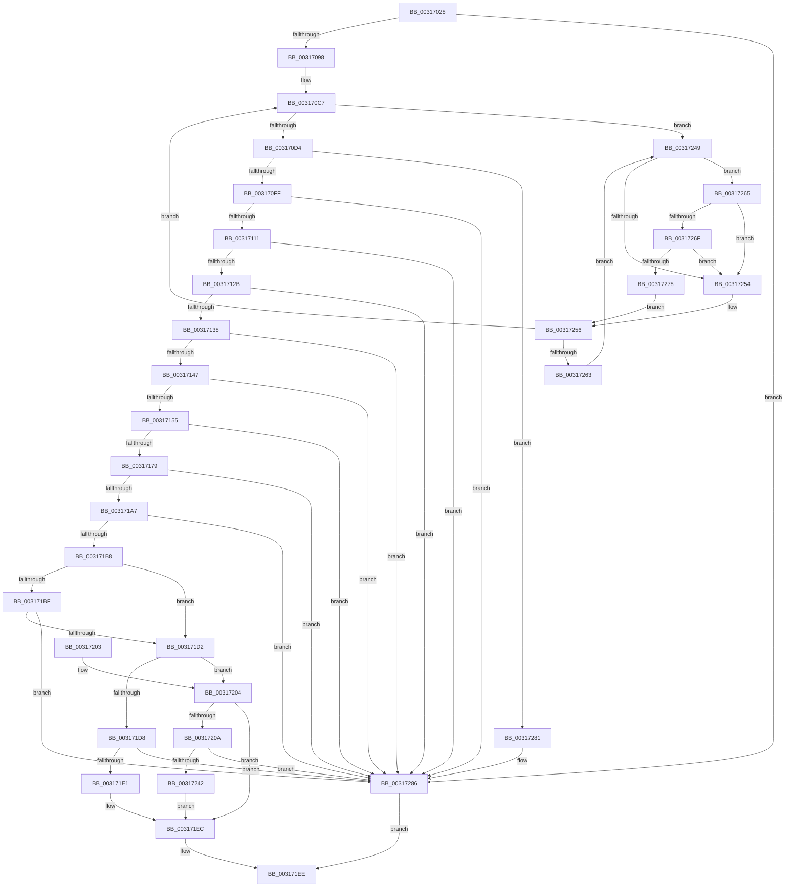

# MiCrcStillIntact

- RVA: `0x00317028`–`0x0031728D` (길이 `613` bytes)
- VA: `0x0000000140317028`
- 실행 섹션: `.text`
- PDB 이름 있음: `예`; PDB Function 태그: `아니요`
- unwind 정보 RVA: `0x000749FC`
- 디코드: `154`개 명령, `613/613` bytes 표시
- 미해석 바이트: `0` (있으면 어셈블리에 `.byte`로 보존)

> 이 문서는 커널 이미지의 기계어와 PDB 기호를 분석해 생성했습니다. 4번과 5번은 함수 원형과 자료형을 바이너리 사용 방식에서 추정한 C 해석이며 원본 소스 복구 결과는 아닙니다.

## 1. Dependencies

- 직접 호출 지점: **8**; 고유 호출 대상: **8**
- 직접 호출자로 확인된 함수: **1**
- RIP 상대 이미지 참조: **2**

### Outgoing calls
- `0x003170DD` → [MiCombineCandidate](MiCombineCandidate_function_00316290.md) (function, `0x00316290`)
- `0x00317198` → [MiGetWsleContents](MiGetWsleContents_function_00316540.md) (function, `0x00316540`)
- `0x003171C4` → [MiVadSupportsCombine](MiVadSupportsCombine_function_00316610.md) (function, `0x00316610`)
- `0x003171E7` → [MiMakeCombineCandidateClean](../46/MiMakeCombineCandidateClean_function_00465170.md) (function, `0x00465170`)
- `0x00317212` → [MiVmAccessLoggingEnabled](../36/MiVmAccessLoggingEnabled_function_003629D4.md) (function, `0x003629D4`)
- `0x00317239` → [MiClearPteAccessed](../29/MiClearPteAccessed_function_00290630.md) (function, `0x00290630`)
- `0x0031726F` → [KiCheckVpBackingLongSpinWaitHypercall](../30/KiCheckVpBackingLongSpinWaitHypercall_function_0030F490.md) (function, `0x0030F490`)
- `0x0031727A` → [HvlNotifyLongSpinWait](../30/HvlNotifyLongSpinWait_function_0030F460.md) (function, `0x0030F460`)

### Direct callers
- [MiSharePages](MiSharePages_function_00315110.md) at `0x0031568F`
- [MiSharePages](MiSharePages_function_00315110.md) at `0x003156D1`

### Static image references
- `0x0031724C` → RVA `0x00FC52AC` (`ALMOSTRO`; reference)
- `0x00317265` → RVA `0x00FC6AB8` (`ALMOSTRO`; read)

## 2. Other-region calls and transfers

- 다른 실행 섹션으로 향하는 call: **0**
- 별도 외부 분기/꼬리 이동을 확인하지 못했습니다.

## 3. Assembly (complete function range)

```asm
00317028  48 89 5C 24 10                  mov qword ptr [rsp + 0x10], rbx
0031702D  44 89 4C 24 20                  mov dword ptr [rsp + 0x20], r9d
00317032  55                              push rbp
00317033  56                              push rsi
00317034  57                              push rdi
00317035  41 54                           push r12
00317037  41 55                           push r13
00317039  41 56                           push r14
0031703B  41 57                           push r15
0031703D  48 83 EC 30                     sub rsp, 0x30
00317041  48 8B 41 70                     mov rax, qword ptr [rcx + 0x70]
00317045  4C 8B F2                        mov r14, rdx
00317048  4C 8B 21                        mov r12, qword ptr [rcx]
0031704B  44 8B A9 8C 00 00 00            mov r13d, dword ptr [rcx + 0x8c]
00317052  48 89 84 24 80 00 00 00         mov qword ptr [rsp + 0x80], rax
0031705A  49 8B 40 10                     mov rax, qword ptr [r8 + 0x10]
0031705E  48 8B F0                        mov rsi, rax
00317061  48 89 44 24 70                  mov qword ptr [rsp + 0x70], rax
00317066  48 B8 F8 FF FF FF 7F 00 00 00   movabs rax, 0x7ffffffff8
00317070  48 C1 EE 09                     shr rsi, 9
00317074  48 23 F0                        and rsi, rax
00317077  48 B8 00 00 00 00 80 F6 FF FF   movabs rax, 0xfffff68000000000
00317081  48 8B C0                        mov rax, rax
00317084  48 03 F0                        add rsi, rax
00317087  BD 01 00 00 00                  mov ebp, 1
0031708C  48 8B 1E                        mov rbx, qword ptr [rsi]
0031708F  40 84 DD                        test bpl, bl
00317092  0F 84 EE 01 00 00               je 0x140317286
00317098  48 8B C3                        mov rax, rbx
0031709B  48 B9 FF FF FF FF FF 00 00 00   movabs rcx, 0xffffffffff
003170A5  48 C1 E8 0C                     shr rax, 0xc
003170A9  48 23 C1                        and rax, rcx
003170AC  48 8D 3C 40                     lea rdi, [rax + rax*2]
003170B0  48 C1 E7 04                     shl rdi, 4
003170B4  48 B8 00 00 00 00 00 DE FF FF   movabs rax, 0xffffde0000000000
003170BE  48 03 F8                        add rdi, rax
003170C1  33 ED                           xor ebp, ebp
003170C3  44 8D 7D 01                     lea r15d, [rbp + 1]
003170C7  F0 48 0F BA 6F 18 3F            lock bts qword ptr [rdi + 0x18], 0x3f
003170CE  0F 82 75 01 00 00               jb 0x140317249
003170D4  4C 8B C7                        mov r8, rdi
003170D7  41 8B D5                        mov edx, r13d
003170DA  49 8B CC                        mov rcx, r12
003170DD  E8 AE F1 FF FF                  call 0x140316290
003170E2  44 8B BC 24 88 00 00 00         mov r15d, dword ptr [rsp + 0x88]
003170EA  44 8B D0                        mov r10d, eax
003170ED  48 B9 FF FF FF FF FF FF FF 7F   movabs rcx, 0x7fffffffffffffff
003170F7  85 C0                           test eax, eax
003170F9  0F 84 82 01 00 00               je 0x140317281
003170FF  8A 47 22                        mov al, byte ptr [rdi + 0x22]
00317102  24 07                           and al, 7
00317104  F0 48 21 4F 18                  lock and qword ptr [rdi + 0x18], rcx
00317109  3C 06                           cmp al, 6
0031710B  0F 85 75 01 00 00               jne 0x140317286
00317111  48 8B 47 08                     mov rax, qword ptr [rdi + 8]
00317115  48 B9 00 00 00 00 00 00 00 80   movabs rcx, 0x8000000000000000
0031711F  48 0B C1                        or rax, rcx
00317122  48 3B F0                        cmp rsi, rax
00317125  0F 85 5B 01 00 00               jne 0x140317286
0031712B  48 8B 47 28                     mov rax, qword ptr [rdi + 0x28]
0031712F  48 85 C0                        test rax, rax
00317132  0F 88 4E 01 00 00               js 0x140317286
00317138  48 8B 47 28                     mov rax, qword ptr [rdi + 0x28]
0031713C  48 0F BA E0 28                  bt rax, 0x28
00317141  0F 82 3F 01 00 00               jb 0x140317286
00317147  8B 47 20                        mov eax, dword ptr [rdi + 0x20]
0031714A  C1 E8 18                        shr eax, 0x18
0031714D  A8 08                           test al, 8
0031714F  0F 85 31 01 00 00               jne 0x140317286
00317155  48 8B 47 28                     mov rax, qword ptr [rdi + 0x28]
00317159  48 B9 FF FF FF FF FF 00 00 00   movabs rcx, 0xffffffffff
00317163  48 23 C1                        and rax, rcx
00317166  48 B9 FE FF FF FF 3F 00 00 00   movabs rcx, 0x3ffffffffe
00317170  48 3B C1                        cmp rax, rcx
00317173  0F 84 0D 01 00 00               je 0x140317286
00317179  48 8B D6                        mov rdx, rsi
0031717C  48 B8 00 00 00 00 80 F6 FF FF   movabs rax, 0xfffff68000000000
00317186  48 C1 E2 19                     shl rdx, 0x19
0031718A  48 8B C0                        mov rax, rax
0031718D  48 C1 E0 19                     shl rax, 0x19
00317191  48 2B D0                        sub rdx, rax
00317194  48 C1 FA 10                     sar rdx, 0x10
00317198  E8 A3 F3 FF FF                  call 0x140316540
0031719D  24 0F                           and al, 0xf
0031719F  3C 08                           cmp al, 8
003171A1  0F 84 DF 00 00 00               je 0x140317286
003171A7  8B 47 20                        mov eax, dword ptr [rdi + 0x20]
003171AA  BD 01 00 00 00                  mov ebp, 1
003171AF  66 3B C5                        cmp ax, bp
003171B2  0F 85 CE 00 00 00               jne 0x140317286
003171B8  33 C0                           xor eax, eax
003171BA  44 3B D5                        cmp r10d, ebp
003171BD  75 13                           jne 0x1403171d2
003171BF  48 8B 54 24 70                  mov rdx, qword ptr [rsp + 0x70]
003171C4  E8 47 F4 FF FF                  call 0x140316610
003171C9  48 85 C0                        test rax, rax
003171CC  0F 84 B4 00 00 00               je 0x140317286
003171D2  41 83 FF 02                     cmp r15d, 2
003171D6  75 2C                           jne 0x140317204
003171D8  F6 C3 42                        test bl, 0x42
003171DB  0F 84 A5 00 00 00               je 0x140317286
003171E1  48 8B D0                        mov rdx, rax
003171E4  48 8B CE                        mov rcx, rsi
003171E7  E8 84 DF 14 00                  call 0x140465170
003171EC  8B C5                           mov eax, ebp
003171EE  48 8B 5C 24 78                  mov rbx, qword ptr [rsp + 0x78]
003171F3  48 83 C4 30                     add rsp, 0x30
003171F7  41 5F                           pop r15
003171F9  41 5E                           pop r14
003171FB  41 5D                           pop r13
003171FD  41 5C                           pop r12
003171FF  5F                              pop rdi
00317200  5E                              pop rsi
00317201  5D                              pop rbp
00317202  C3                              ret
00317203  CC                              int3
00317204  41 83 FF 03                     cmp r15d, 3
00317208  75 E2                           jne 0x1403171ec
0031720A  48 8B 8C 24 80 00 00 00         mov rcx, qword ptr [rsp + 0x80]
00317212  E8 BD B7 04 00                  call 0x1403629d4
00317217  48 8B 8C 24 80 00 00 00         mov rcx, qword ptr [rsp + 0x80]
0031721F  F7 D8                           neg eax
00317221  48 8B D7                        mov rdx, rdi
00317224  45 1B C0                        sbb r8d, r8d
00317227  45 33 C9                        xor r9d, r9d
0031722A  41 F7 D8                        neg r8d
0031722D  41 83 C0 04                     add r8d, 4
00317231  44 89 44 24 20                  mov dword ptr [rsp + 0x20], r8d
00317236  4C 8B C6                        mov r8, rsi
00317239  E8 F2 93 F7 FF                  call 0x140290630
0031723E  85 C0                           test eax, eax
00317240  74 44                           je 0x140317286
00317242  41 83 66 14 FD                  and dword ptr [r14 + 0x14], 0xfffffffd
00317247  EB A3                           jmp 0x1403171ec
00317249  41 03 EF                        add ebp, r15d
0031724C  85 2D 5A E0 CA 00               test dword ptr [rip + 0xcae05a], ebp
00317252  74 11                           je 0x140317265
00317254  F3 90                           pause
00317256  48 8B 47 18                     mov rax, qword ptr [rdi + 0x18]
0031725A  48 85 C0                        test rax, rax
0031725D  0F 89 64 FE FF FF               jns 0x1403170c7
00317263  EB E4                           jmp 0x140317249
00317265  8B 05 4D F8 CA 00               mov eax, dword ptr [rip + 0xcaf84d]
0031726B  A8 40                           test al, 0x40
0031726D  74 E5                           je 0x140317254
0031726F  E8 1C 82 FF FF                  call 0x14030f490
00317274  84 C0                           test al, al
00317276  74 DC                           je 0x140317254
00317278  8B CD                           mov ecx, ebp
0031727A  E8 E1 81 FF FF                  call 0x14030f460
0031727F  EB D5                           jmp 0x140317256
00317281  F0 48 21 4F 18                  lock and qword ptr [rdi + 0x18], rcx
00317286  33 C0                           xor eax, eax
00317288  E9 61 FF FF FF                  jmp 0x1403171ee
```

## 4. C-style interpretation (structured pseudocode)

```c
__int64 __fastcall MiCrcStillIntact(__int64 a1, __int64 a2, __int64 a3, int a4)
{
    __int64 result;
    __int64 v_rbp;
    __int64 v_rdi;
    __int64 v_rsi;
    __int64 v_rsp;
    unsigned __int64 v_stack_p10;
    unsigned __int64 v_stack_p18;
    unsigned int v_stack_p20;
    unsigned __int64 v_stack_p8;
    unsigned __int64 v_stack_p80;

    v_stack_p10 = v_rbx;
    v_stack_p20 = a4;
    v_rsp = (v_rsp) - (48);
    v_stack_p18 = *(unsigned __int64 *)(a1 + 112);
    v_stack_p8 = *(unsigned __int64 *)(a3 + 16);
    v_rsi = (*(unsigned __int64 *)(a3 + 16)) >> (9);
    v_rsi = (v_rsi) & (*(unsigned __int64 *)(a3 + 16));
    v_rsi = (v_rsi) + (*(unsigned __int64 *)(a3 + 16));
    if (((1) & ((unsigned __int8)(*(unsigned __int64 *)(v_rsi)))) == 0) goto loc_00317286;
    result = (*(unsigned __int64 *)(v_rsi)) >> (12);
    result = (result) & (a1);
    v_rdi = (result + result * 2) << (4);
    v_rdi = (v_rdi) + (result);
    v_rbp = 0;
loc_003170C7:
    if (condition_is_below) goto loc_00317249;
    result = MiCombineCandidate(*(unsigned __int64 *)(a1), (unsigned int)((unsigned int)((unsigned int)(*(unsigned int *)(a1 + 140)))), v_rdi, a4);
    if ((unsigned int)(result) == 0) goto loc_00317281;
    result = (unsigned __int8)((*(unsigned __int8 *)(v_rdi + 34)) & (7));
    if (((unsigned __int8)(result)) != 6) goto loc_00317286;
    result = (*(unsigned __int64 *)(v_rdi + 8)) | (*(unsigned __int64 *)(a1));
    if (v_rsi != result) goto loc_00317286;
    if (sign_flag) goto loc_00317286;
    if (condition_is_below) goto loc_00317286;
    result = (unsigned int)(((unsigned int)(*(unsigned int *)(v_rdi + 32))) >> (24));
    if ((((unsigned __int8)(result)) & (8)) != 0) goto loc_00317286;
    result = (*(unsigned __int64 *)(v_rdi + 40)) & (*(unsigned __int64 *)(a1));
    if (result == (*(unsigned __int64 *)(a1))) goto loc_00317286;
    a2 = (v_rsi) << (25);
    result = (result) << (25);
    a2 = (a2) - (result);
    a2 = (a2) >> (16);
    result = MiGetWsleContents(*(unsigned __int64 *)(a1), a2, v_rdi, a4);
    result = (unsigned __int8)((result) & (15));
    if (((unsigned __int8)(result)) == 8) goto loc_00317286;
    if (((unsigned __int16)((unsigned int)(*(unsigned int *)(v_rdi + 32)))) != 1) goto loc_00317286;
    result = 0;
    if (((unsigned int)((unsigned int)((unsigned int)(result)))) != 1) goto loc_003171D2;
    result = MiVadSupportsCombine(*(unsigned __int64 *)(a1), v_stack_p8, v_rdi, a4);
    if (result == 0) goto loc_00317286;
loc_003171D2:
    if (((unsigned int)((unsigned int)(v_stack_p20))) != 2) goto loc_00317204;
    if ((((unsigned __int8)(*(unsigned __int64 *)(v_rsi))) & (66)) == 0) goto loc_00317286;
    result = MiMakeCombineCandidateClean(v_rsi, result, v_rdi, a4);
loc_003171EC:
loc_003171EE:
    v_rsp = (v_rsp) + (48);
    return 1;
loc_00317204:
    if (((unsigned int)((unsigned int)(v_stack_p20))) != 3) goto loc_003171EC;
    result = MiVmAccessLoggingEnabled(v_stack_p80, result, v_rdi, a4);
    result = (unsigned int)(-(result));
    a4 = 0;
    a3 = (unsigned int)(-(v_rdi));
    a3 = (unsigned int)((a3) + (4));
    v_stack_p20 = (unsigned int)(a3);
    result = MiClearPteAccessed(v_stack_p80, v_rdi, v_rsi, a4);
    if ((unsigned int)(result) == 0) goto loc_00317286;
    goto loc_003171EC;
loc_00317249:
    v_rbp = (unsigned int)((1) + ((unsigned int)((unsigned int)(v_stack_p20))));
    if (((*(unsigned int *)(v_rip + 13295706)) & ((unsigned int)(v_rbp))) == 0) goto loc_00317265;
loc_00317254:
loc_00317256:
    if (!sign_flag) goto loc_003170C7;
    goto loc_00317249;
loc_00317265:
    if ((((unsigned __int8)((unsigned int)(*(unsigned int *)(v_rip + 13301837)))) & (64)) == 0) goto loc_00317254;
    result = KiCheckVpBackingLongSpinWaitHypercall(v_stack_p80, v_rdi, v_rsi, a4);
    if ((unsigned __int8)(result) == 0) goto loc_00317254;
    result = HvlNotifyLongSpinWait((unsigned int)((unsigned int)(v_rbp)), v_rdi, v_rsi, a4);
    goto loc_00317256;
loc_00317281:
loc_00317286:
    result = 0;
    goto loc_003171EE;
}
```

## 5. (Beta) C Style

```c
int64_t MiCrcStillIntact(void *Arg1, void *Arg2, void *Arg3, int32_t Arg4)
{
    uint8_t *arg1 = (uint8_t *)Arg1;
    uint8_t *arg2 = (uint8_t *)Arg2;
    uint8_t *arg3 = (uint8_t *)Arg3;

    int64_t result;
    int64_t local_rbp;
    int64_t local_rdi;
    int64_t local_rsi;
    int64_t local_rsp;
    uint64_t v_stack_p10;
    uint64_t v_stack_p18;
    uint32_t v_stack_p20;
    uint64_t v_stack_p8;
    uint64_t v_stack_p80;

    v_stack_p10 = local_rbx;
    v_stack_p20 = Arg4;
    local_rsp = (local_rsp) - (48);
    v_stack_p18 = *(uint64_t *)(arg1 + 0x70);
    v_stack_p8 = *(uint64_t *)(arg3 + 0x10);
    local_rsi = (*(uint64_t *)(arg3 + 0x10)) >> (9);
    local_rsi = (local_rsi) & (*(uint64_t *)(arg3 + 0x10));
    local_rsi = (local_rsi) + (*(uint64_t *)(arg3 + 0x10));
    if (((1) & ((uint8_t)(*(uint64_t *)(local_rsi)))) == 0) goto loc_00317286;
    result = (*(uint64_t *)(local_rsi)) >> (12);
    result = (result) & (Arg1);
    local_rdi = (result + result * 2) << (4);
    local_rdi = (local_rdi) + (result);
    local_rbp = 0;
loc_003170C7:
    if (condition_is_below) goto loc_00317249;
    result = MiCombineCandidate(*(uint64_t *)(arg1), (uint32_t)((uint32_t)((uint32_t)(*(uint32_t *)(arg1 + 0x8C)))), local_rdi, Arg4);
    if ((uint32_t)(result) == 0) goto loc_00317281;
    result = (uint8_t)((*(uint8_t *)(local_rdi + 0x22)) & (7));
    if (((uint8_t)(result)) != 6) goto loc_00317286;
    result = (*(uint64_t *)(local_rdi + 0x8)) | (*(uint64_t *)(arg1));
    if (local_rsi != result) goto loc_00317286;
    if (sign_flag) goto loc_00317286;
    if (condition_is_below) goto loc_00317286;
    result = (uint32_t)(((uint32_t)(*(uint32_t *)(local_rdi + 0x20))) >> (24));
    if ((((uint8_t)(result)) & (8)) != 0) goto loc_00317286;
    result = (*(uint64_t *)(local_rdi + 0x28)) & (*(uint64_t *)(arg1));
    if (result == (*(uint64_t *)(arg1))) goto loc_00317286;
    Arg2 = (local_rsi) << (25);
    result = (result) << (25);
    Arg2 = (Arg2) - (result);
    Arg2 = (Arg2) >> (16);
    result = MiGetWsleContents(*(uint64_t *)(arg1), Arg2, local_rdi, Arg4);
    result = (uint8_t)((result) & (15));
    if (((uint8_t)(result)) == 8) goto loc_00317286;
    if (((uint16_t)((uint32_t)(*(uint32_t *)(local_rdi + 0x20)))) != 1) goto loc_00317286;
    result = 0;
    if (((uint32_t)((uint32_t)((uint32_t)(result)))) != 1) goto loc_003171D2;
    result = MiVadSupportsCombine(*(uint64_t *)(arg1), v_stack_p8, local_rdi, Arg4);
    if (result == 0) goto loc_00317286;
loc_003171D2:
    if (((uint32_t)((uint32_t)(v_stack_p20))) != 2) goto loc_00317204;
    if ((((uint8_t)(*(uint64_t *)(local_rsi))) & (66)) == 0) goto loc_00317286;
    result = MiMakeCombineCandidateClean(local_rsi, result, local_rdi, Arg4);
loc_003171EC:
loc_003171EE:
    local_rsp = (local_rsp) + (48);
    return 1;
loc_00317204:
    if (((uint32_t)((uint32_t)(v_stack_p20))) != 3) goto loc_003171EC;
    result = MiVmAccessLoggingEnabled(v_stack_p80, result, local_rdi, Arg4);
    result = (uint32_t)(-(result));
    Arg4 = 0;
    Arg3 = (uint32_t)(-(local_rdi));
    Arg3 = (uint32_t)((Arg3) + (4));
    v_stack_p20 = (uint32_t)(Arg3);
    result = MiClearPteAccessed(v_stack_p80, local_rdi, local_rsi, Arg4);
    if ((uint32_t)(result) == 0) goto loc_00317286;
    goto loc_003171EC;
loc_00317249:
    local_rbp = (uint32_t)((1) + ((uint32_t)((uint32_t)(v_stack_p20))));
    if (((*(uint32_t *)(v_rip + 0xCAE05A)) & ((uint32_t)(local_rbp))) == 0) goto loc_00317265;
loc_00317254:
loc_00317256:
    if (!sign_flag) goto loc_003170C7;
    goto loc_00317249;
loc_00317265:
    if ((((uint8_t)((uint32_t)(*(uint32_t *)(v_rip + 0xCAF84D)))) & (64)) == 0) goto loc_00317254;
    result = KiCheckVpBackingLongSpinWaitHypercall(v_stack_p80, local_rdi, local_rsi, Arg4);
    if ((uint8_t)(result) == 0) goto loc_00317254;
    result = HvlNotifyLongSpinWait((uint32_t)((uint32_t)(local_rbp)), local_rdi, local_rsi, Arg4);
    goto loc_00317256;
loc_00317281:
loc_00317286:
    result = 0;
    goto loc_003171EE;
}
```

### 관측된 메모리 오프셋

구조체 형식이 확인되지 않은 접근은 인자 기준의 오프셋으로만 기록했습니다.

| 기준 인자 | 오프셋 표현 | 폭 (bit) | 접근 |
|---|---:|---:|---|
| `Arg1` | `+ 0x0` | `64` | `R` |
| `Arg1` | `+ 0x70` | `64` | `R` |
| `Arg1` | `+ 0x8C` | `32` | `R` |
| `Arg2` | `+ 0x14` | `32` | `R/W` |
| `Arg3` | `+ 0x10` | `64` | `R` |

## 6. Execution-region graph

[열기: 2D/3D 그래프와 함수 탐색 컨트롤 패널](../../../control-panel.html?section=text&rva=0x00317028&view=graph)

- 2D 그래프는 위에서 아래로 흐르고, 3D 그래프는 빈 공간을 드래그해 회전합니다. Shift+드래그는 이동, 휠은 확대·축소, 함수 노드 선택은 대상 보고서 이동입니다.

### Static fallback


