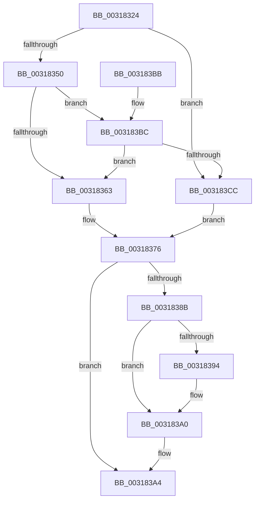

# MiDoubleLockMdlPage

- RVA: `0x00318324`–`0x003183D0` (길이 `172` bytes)
- VA: `0x0000000140318324`
- 실행 섹션: `.text`
- PDB 이름 있음: `예`; PDB Function 태그: `아니요`
- unwind 정보 RVA: `0x00074BE4`
- 디코드: `49`개 명령, `172/172` bytes 표시
- 미해석 바이트: `0` (있으면 어셈블리에 `.byte`로 보존)

> 이 문서는 커널 이미지의 기계어와 PDB 기호를 분석해 생성했습니다. 4번과 5번은 함수 원형과 자료형을 바이너리 사용 방식에서 추정한 C 해석이며 원본 소스 복구 결과는 아닙니다.

## 1. Dependencies

- 직접 호출 지점: **4**; 고유 호출 대상: **4**
- 직접 호출자로 확인된 함수: **1**
- RIP 상대 이미지 참조: **1**

### Outgoing calls
- `0x0031833B` → [MiLockPageInline](MiLockPageInline_function_0031A340.md) (function, `0x0031A340`)
- `0x0031835A` → [MiAreChargesNeededToLockPage](MiAreChargesNeededToLockPage_function_00318720.md) (function, `0x00318720`)
- `0x0031839B` → [KiLowerIrqlProcessIrqlFlags](../4F/KiLowerIrqlProcessIrqlFlags_function_004F5698.md) (function, `0x004F5698`)
- `0x003183C1` → [MiChargeForLockedPage](../28/MiChargeForLockedPage_function_00285AA0.md) (function, `0x00285AA0`)

### Direct callers
- [MiMapLockedPagesInUserSpace](../../page/97/MiMapLockedPagesInUserSpace_function_0097FE04.md) at `0x00980022`

### Static image references
- `0x0031838B` → RVA `0x00FC6D20` (`ALMOSTRO`; read)

## 2. Other-region calls and transfers

- 다른 실행 섹션으로 향하는 call: **0**
- 별도 외부 분기/꼬리 이동을 확인하지 못했습니다.

## 3. Assembly (complete function range)

```asm
00318324  48 89 5C 24 10                  mov qword ptr [rsp + 0x10], rbx
00318329  48 89 6C 24 18                  mov qword ptr [rsp + 0x18], rbp
0031832E  48 89 74 24 20                  mov qword ptr [rsp + 0x20], rsi
00318333  57                              push rdi
00318334  48 83 EC 20                     sub rsp, 0x20
00318338  48 8B D9                        mov rbx, rcx
0031833B  E8 00 20 00 00                  call 0x14031a340
00318340  8B 53 20                        mov edx, dword ptr [rbx + 0x20]
00318343  0F B6 F0                        movzx esi, al
00318346  B8 FF 7F 00 00                  mov eax, 0x7fff
0031834B  66 3B D0                        cmp dx, ax
0031834E  73 7C                           jae 0x1403183cc
00318350  BD 01 00 00 00                  mov ebp, 1
00318355  48 8B CB                        mov rcx, rbx
00318358  8B FD                           mov edi, ebp
0031835A  E8 C1 03 00 00                  call 0x140318720
0031835F  85 C0                           test eax, eax
00318361  75 59                           jne 0x1403183bc
00318363  8B 43 20                        mov eax, dword ptr [rbx + 0x20]
00318366  89 44 24 30                     mov dword ptr [rsp + 0x30], eax
0031836A  66 01 6C 24 30                  add word ptr [rsp + 0x30], bp
0031836F  8B 44 24 30                     mov eax, dword ptr [rsp + 0x30]
00318373  89 43 20                        mov dword ptr [rbx + 0x20], eax
00318376  48 B8 FF FF FF FF FF FF FF 7F   movabs rax, 0x7fffffffffffffff
00318380  F0 48 21 43 18                  lock and qword ptr [rbx + 0x18], rax
00318385  40 80 FE 02                     cmp sil, 2
00318389  73 19                           jae 0x1403183a4
0031838B  83 3D 8E E9 CA 00 00            cmp dword ptr [rip + 0xcae98e], 0
00318392  74 0C                           je 0x1403183a0
00318394  44 0F 20 C1                     mov rcx, cr8
00318398  40 8A D6                        mov dl, sil
0031839B  E8 F8 D2 1D 00                  call 0x1404f5698
003183A0  44 0F 22 C6                     mov cr8, rsi
003183A4  48 8B 5C 24 38                  mov rbx, qword ptr [rsp + 0x38]
003183A9  8B C7                           mov eax, edi
003183AB  48 8B 6C 24 40                  mov rbp, qword ptr [rsp + 0x40]
003183B0  48 8B 74 24 48                  mov rsi, qword ptr [rsp + 0x48]
003183B5  48 83 C4 20                     add rsp, 0x20
003183B9  5F                              pop rdi
003183BA  C3                              ret
003183BB  CC                              int3
003183BC  33 D2                           xor edx, edx
003183BE  48 8B CB                        mov rcx, rbx
003183C1  E8 DA D6 F6 FF                  call 0x140285aa0
003183C6  8B F8                           mov edi, eax
003183C8  85 C0                           test eax, eax
003183CA  75 97                           jne 0x140318363
003183CC  33 FF                           xor edi, edi
003183CE  EB A6                           jmp 0x140318376
```

## 4. C-style interpretation (structured pseudocode)

```c
__int64 __fastcall MiDoubleLockMdlPage(__int64 a1)
{
    __int64 result;
    __int64 v_rdi;
    __int64 v_rsp;
    unsigned __int64 v_stack_p10;
    unsigned __int64 v_stack_p18;
    unsigned __int64 v_stack_p20;
    unsigned int v_stack_p8;

    v_stack_p10 = v_rbx;
    v_stack_p18 = v_rbp;
    v_stack_p20 = v_rsi;
    v_rsp = (v_rsp) - (32);
    result = MiLockPageInline(a1, a2, a3, a4);
    if (((unsigned __int16)((unsigned int)(*(unsigned int *)(a1 + 32)))) >= ((unsigned __int16)((unsigned int)(0x7FFFULL)))) goto loc_003183CC;
    result = MiAreChargesNeededToLockPage(a1, (unsigned int)(*(unsigned int *)(a1 + 32)), a3, a4);
    if ((unsigned int)(result) != 0) goto loc_003183BC;
loc_00318363:
    v_stack_p8 = (unsigned int)((unsigned int)(*(unsigned int *)(a1 + 32)));
    *(unsigned int *)(a1 + 32) = (unsigned int)((unsigned int)(v_stack_p8));
loc_00318376:
    if (((unsigned __int8)((unsigned __int8)(result))) >= 2) goto loc_003183A4;
    result = (unsigned int)(v_stack_p8);
    if ((*(unsigned int *)(v_rip + 13298062)) != 0) {
        a1 = v_cr8;
        a2 = (unsigned __int8)((unsigned __int8)(result));
        result = KiLowerIrqlProcessIrqlFlags(a1, a2, a3, a4);
    }
loc_003183A4:
    v_rsp = (v_rsp) + (32);
    return 1;
loc_003183BC:
    a2 = 0;
    result = MiChargeForLockedPage(v_stack_p10, a2, a3, a4);
    if ((unsigned int)(result) != 0) goto loc_00318363;
loc_003183CC:
    v_rdi = 0;
    goto loc_00318376;
}
```

## 5. (Beta) C Style

```c
int64_t MiDoubleLockMdlPage(void *Arg1)
{
    uint8_t *arg1 = (uint8_t *)Arg1;

    int64_t result;
    int64_t local_rdi;
    int64_t local_rsp;
    uint64_t v_stack_p10;
    uint64_t v_stack_p18;
    uint64_t v_stack_p20;
    uint32_t v_stack_p8;

    v_stack_p10 = local_rbx;
    v_stack_p18 = local_rbp;
    v_stack_p20 = local_rsi;
    local_rsp = (local_rsp) - (32);
    result = MiLockPageInline(Arg1, a2, a3, a4);
    if (((uint16_t)((uint32_t)(*(uint32_t *)(arg1 + 0x20)))) >= ((uint16_t)((uint32_t)(0x7FFFULL)))) goto loc_003183CC;
    result = MiAreChargesNeededToLockPage(Arg1, (uint32_t)(*(uint32_t *)(arg1 + 0x20)), a3, a4);
    if ((uint32_t)(result) != 0) goto loc_003183BC;
loc_00318363:
    v_stack_p8 = (uint32_t)((uint32_t)(*(uint32_t *)(arg1 + 0x20)));
    *(uint32_t *)(arg1 + 0x20) = (uint32_t)((uint32_t)(v_stack_p8));
loc_00318376:
    if (((uint8_t)((uint8_t)(result))) >= 2) goto loc_003183A4;
    result = (uint32_t)(v_stack_p8);
    if ((*(uint32_t *)(v_rip + 0xCAE98E)) != 0) {
        Arg1 = v_cr8;
        a2 = (uint8_t)((uint8_t)(result));
        result = KiLowerIrqlProcessIrqlFlags(Arg1, a2, a3, a4);
    }
loc_003183A4:
    local_rsp = (local_rsp) + (32);
    return 1;
loc_003183BC:
    a2 = 0;
    result = MiChargeForLockedPage(v_stack_p10, a2, a3, a4);
    if ((uint32_t)(result) != 0) goto loc_00318363;
loc_003183CC:
    local_rdi = 0;
    goto loc_00318376;
}
```

### 관측된 메모리 오프셋

구조체 형식이 확인되지 않은 접근은 인자 기준의 오프셋으로만 기록했습니다.

| 기준 인자 | 오프셋 표현 | 폭 (bit) | 접근 |
|---|---:|---:|---|
| `Arg1` | `+ 0x18` | `64` | `R/W` |
| `Arg1` | `+ 0x20` | `32` | `R` |
| `Arg1` | `+ 0x20` | `32` | `W` |

## 6. Execution-region graph

[열기: 2D/3D 그래프와 함수 탐색 컨트롤 패널](../../../control-panel.html?section=text&rva=0x00318324&view=graph)

- 2D 그래프는 위에서 아래로 흐르고, 3D 그래프는 빈 공간을 드래그해 회전합니다. Shift+드래그는 이동, 휠은 확대·축소, 함수 노드 선택은 대상 보고서 이동입니다.

### Static fallback


