# MiEmptyPteBins

- RVA: `0x0031AAE4`–`0x0031AD7E` (길이 `666` bytes)
- VA: `0x000000014031AAE4`
- 실행 섹션: `.text`
- PDB 이름 있음: `예`; PDB Function 태그: `아니요`
- unwind 정보 RVA: `0x00074D18`
- 디코드: `172`개 명령, `666/666` bytes 표시
- 미해석 바이트: `0` (있으면 어셈블리에 `.byte`로 보존)

> 이 문서는 커널 이미지의 기계어와 PDB 기호를 분석해 생성했습니다. 4번과 5번은 함수 원형과 자료형을 바이너리 사용 방식에서 추정한 C 해석이며 원본 소스 복구 결과는 아닙니다.

## 1. Dependencies

- 직접 호출 지점: **2**; 고유 호출 대상: **2**
- 직접 호출자로 확인된 함수: **6**
- RIP 상대 이미지 참조: **4**

### Outgoing calls
- `0x0031AC01` → [KeLeaveCriticalRegionThread](../25/KeLeaveCriticalRegionThread_function_0025EFF0.md) (function, `0x0025EFF0`)
- `0x0031ACF3` → [MiReleasePteMappings](../23/MiReleasePteMappings_function_00237CE0.md) (function, `0x00237CE0`)

### Direct callers
- [sub_00247C30](../24/Unknown_function_00247C30.md) at `0x00247CCA`
- [MiReservePtes](MiReservePtes_function_00318D20.md) at `0x0031913D`
- [MiReservePtes](MiReservePtes_function_00318D20.md) at `0x00319435`
- [sub_0031A46A](Unknown_function_0031A46A.md) at `0x0031A670`
- [MiMakeSystemPtesAppear](../46/MiMakeSystemPtesAppear_function_00463FB4.md) at `0x00463FE8`
- [MiMakeSystemPtesAppear](../46/MiMakeSystemPtesAppear_function_00463FB4.md) at `0x00464063`
- [MiMakeSystemPtesAppear](../46/MiMakeSystemPtesAppear_function_00463FB4.md) at `0x00464086`
- [MiMakeSystemPtesAppear](../46/MiMakeSystemPtesAppear_function_00463FB4.md) at `0x004640B7`
- [MiAdjustPteBins](../46/MiAdjustPteBins_function_0046410C.md) at `0x0046417E`
- [MiAdjustPteBins](../46/MiAdjustPteBins_function_0046410C.md) at `0x0046419C`
- [MiOkToBinMoreLargePtes](../4A/MiOkToBinMoreLargePtes_function_004A3B5C.md) at `0x004A3B87`
- [MiOkToBinMoreLargePtes](../4A/MiOkToBinMoreLargePtes_function_004A3B5C.md) at `0x004A3B9D`

### Static image references
- `0x0031AB14` → RVA `0x00FCF080` (`CACHEALI`; read)
- `0x0031AB51` → RVA `0x00E37668` (`.data`; read)
- `0x0031AB5B` → RVA `0x00E35E80` (`.data`; read)
- `0x0031ABA4` → RVA `0x00FC5000` (`ALMOSTRO`; read)

## 2. Other-region calls and transfers

- 다른 실행 섹션으로 향하는 call: **0**
- 별도 외부 분기/꼬리 이동을 확인하지 못했습니다.

## 3. Assembly (complete function range)

```asm
0031AAE4  44 89 44 24 18                  mov dword ptr [rsp + 0x18], r8d
0031AAE9  48 89 54 24 10                  mov qword ptr [rsp + 0x10], rdx
0031AAEE  53                              push rbx
0031AAEF  55                              push rbp
0031AAF0  56                              push rsi
0031AAF1  57                              push rdi
0031AAF2  41 54                           push r12
0031AAF4  41 55                           push r13
0031AAF6  41 56                           push r14
0031AAF8  41 57                           push r15
0031AAFA  48 83 EC 48                     sub rsp, 0x48
0031AAFE  33 D2                           xor edx, edx
0031AB00  45 8B D0                        mov r10d, r8d
0031AB03  8B DA                           mov ebx, edx
0031AB05  48 89 94 24 A8 00 00 00         mov qword ptr [rsp + 0xa8], rdx
0031AB0D  4C 8B F9                        mov r15, rcx
0031AB10  F0 09 14 24                     lock or dword ptr [rsp], edx
0031AB14  44 8B 05 65 45 CB 00            mov r8d, dword ptr [rip + 0xcb4565]
0031AB1B  44 89 84 24 90 00 00 00         mov dword ptr [rsp + 0x90], r8d
0031AB23  45 0F 20 C3                     mov r11, cr8
0031AB27  4C 89 5C 24 30                  mov qword ptr [rsp + 0x30], r11
0031AB2C  45 84 DB                        test r11b, r11b
0031AB2F  0F 85 0B 02 00 00               jne 0x14031ad40
0031AB35  65 48 8B 2C 25 88 01 00 00      mov rbp, qword ptr gs:[0x188]
0031AB3E  66 FF 8D E4 01 00 00            dec word ptr [rbp + 0x1e4]
0031AB45  90                              nop
0031AB46  41 8B F2                        mov esi, r10d
0031AB49  48 89 6C 24 28                  mov qword ptr [rsp + 0x28], rbp
0031AB4E  C1 EE 02                        shr esi, 2
0031AB51  48 8D 0D 10 CB B1 00            lea rcx, [rip + 0xb1cb10]
0031AB58  83 E6 01                        and esi, 1
0031AB5B  48 8D 05 1E B3 B1 00            lea rax, [rip + 0xb1b31e]
0031AB62  41 BD 01 00 00 00               mov r13d, 1
0031AB68  4C 3B F9                        cmp r15, rcx
0031AB6B  0F 85 2D 01 00 00               jne 0x14031ac9e
0031AB71  41 BD 03 00 00 00               mov r13d, 3
0031AB77  41 3B F5                        cmp esi, r13d
0031AB7A  73 7D                           jae 0x14031abf9
0031AB7C  41 8B EA                        mov ebp, r10d
0031AB7F  83 E5 02                        and ebp, 2
0031AB82  85 ED                           test ebp, ebp
0031AB84  0F 84 06 01 00 00               je 0x14031ac90
0031AB8A  65 48 8B 04 25 20 00 00 00      mov rax, qword ptr gs:[0x20]
0031AB93  48 8B 88 C0 00 00 00            mov rcx, qword ptr [rax + 0xc0]
0031AB9A  0F B7 99 8A 00 00 00            movzx ebx, word ptr [rcx + 0x8a]
0031ABA1  8D 7B 01                        lea edi, [rbx + 1]
0031ABA4  0F B7 05 55 A4 CA 00            movzx eax, word ptr [rip + 0xcaa455]
0031ABAB  0F AF C6                        imul eax, esi
0031ABAE  48 63 C8                        movsxd rcx, eax
0031ABB1  8B C3                           mov eax, ebx
0031ABB3  48 03 C8                        add rcx, rax
0031ABB6  49 8B 47 50                     mov rax, qword ptr [r15 + 0x50]
0031ABBA  48 8D 0C C9                     lea rcx, [rcx + rcx*8]
0031ABBE  4C 8D 24 C8                     lea r12, [rax + rcx*8]
0031ABC2  3B DF                           cmp ebx, edi
0031ABC4  73 1F                           jae 0x14031abe5
0031ABC6  44 8B F2                        mov r14d, edx
0031ABC9  41 83 FE 08                     cmp r14d, 8
0031ABCD  73 4C                           jae 0x14031ac1b
0031ABCF  45 8B CE                        mov r9d, r14d
0031ABD2  4B 8B 04 CC                     mov rax, qword ptr [r12 + r9*8]
0031ABD6  48 89 44 24 20                  mov qword ptr [rsp + 0x20], rax
0031ABDB  66 85 C0                        test ax, ax
0031ABDE  75 43                           jne 0x14031ac23
0031ABE0  41 FF C6                        inc r14d
0031ABE3  EB E4                           jmp 0x14031abc9
0031ABE5  FF C6                           inc esi
0031ABE7  41 3B F5                        cmp esi, r13d
0031ABEA  7C 96                           jl 0x14031ab82
0031ABEC  48 8B 6C 24 28                  mov rbp, qword ptr [rsp + 0x28]
0031ABF1  48 8B 9C 24 A8 00 00 00         mov rbx, qword ptr [rsp + 0xa8]
0031ABF9  48 85 ED                        test rbp, rbp
0031ABFC  74 08                           je 0x14031ac06
0031ABFE  48 8B CD                        mov rcx, rbp
0031AC01  E8 EA 43 F4 FF                  call 0x14025eff0
0031AC06  48 8B C3                        mov rax, rbx
0031AC09  48 83 C4 48                     add rsp, 0x48
0031AC0D  41 5F                           pop r15
0031AC0F  41 5E                           pop r14
0031AC11  41 5D                           pop r13
0031AC13  41 5C                           pop r12
0031AC15  5F                              pop rdi
0031AC16  5E                              pop rsi
0031AC17  5D                              pop rbp
0031AC18  5B                              pop rbx
0031AC19  C3                              ret
0031AC1A  CC                              int3
0031AC1B  49 83 C4 48                     add r12, 0x48
0031AC1F  FF C3                           inc ebx
0031AC21  EB 9F                           jmp 0x14031abc2
0031AC23  41 8B C8                        mov ecx, r8d
0031AC26  0F B7 D0                        movzx edx, ax
0031AC29  2B CA                           sub ecx, edx
0031AC2B  44 0F B7 C1                     movzx r8d, cx
0031AC2F  41 83 F8 02                     cmp r8d, 2
0031AC33  77 15                           ja 0x14031ac4a
0031AC35  F6 C2 01                        test dl, 1
0031AC38  75 06                           jne 0x14031ac40
0031AC3A  41 83 F8 02                     cmp r8d, 2
0031AC3E  73 0A                           jae 0x14031ac4a
0031AC40  41 F6 C2 01                     test r10b, 1
0031AC44  0F 84 EF 00 00 00               je 0x14031ad39
0031AC4A  33 D2                           xor edx, edx
0031AC4C  41 80 FB 02                     cmp r11b, 2
0031AC50  0F 84 F7 00 00 00               je 0x14031ad4d
0031AC56  F0 4B 0F B1 14 CC               lock cmpxchg qword ptr [r12 + r9*8], rdx
0031AC5C  74 61                           je 0x14031acbf
0031AC5E  48 8B 8C 24 A8 00 00 00         mov rcx, qword ptr [rsp + 0xa8]
0031AC66  41 FF CE                        dec r14d
0031AC69  48 8B 84 24 98 00 00 00         mov rax, qword ptr [rsp + 0x98]
0031AC71  48 85 C9                        test rcx, rcx
0031AC74  0F 85 B1 00 00 00               jne 0x14031ad2b
0031AC7A  48 3B C8                        cmp rcx, rax
0031AC7D  0F 83 69 FF FF FF               jae 0x14031abec
0031AC83  44 8B 84 24 90 00 00 00         mov r8d, dword ptr [rsp + 0x90]
0031AC8B  E9 50 FF FF FF                  jmp 0x14031abe0
0031AC90  0F B7 3D 69 A3 CA 00            movzx edi, word ptr [rip + 0xcaa369]
0031AC97  8B DA                           mov ebx, edx
0031AC99  E9 06 FF FF FF                  jmp 0x14031aba4
0031AC9E  4C 3B F8                        cmp r15, rax
0031ACA1  0F 84 CA FE FF FF               je 0x14031ab71
0031ACA7  41 8B 47 28                     mov eax, dword ptr [r15 + 0x28]
0031ACAB  41 84 C5                        test r13b, al
0031ACAE  0F 84 C3 FE FF FF               je 0x14031ab77
0031ACB4  41 BD 02 00 00 00               mov r13d, 2
0031ACBA  E9 B8 FE FF FF                  jmp 0x14031ab77
0031ACBF  F0 09 14 24                     lock or dword ptr [rsp], edx
0031ACC3  8B 05 B7 43 CB 00               mov eax, dword ptr [rip + 0xcb43b7]
0031ACC9  0F B7 4C 24 20                  movzx ecx, word ptr [rsp + 0x20]
0031ACCE  2B C1                           sub eax, ecx
0031ACD0  0F B7 D0                        movzx edx, ax
0031ACD3  83 FA 02                        cmp edx, 2
0031ACD6  77 70                           ja 0x14031ad48
0031ACD8  F6 C1 01                        test cl, 1
0031ACDB  75 05                           jne 0x14031ace2
0031ACDD  83 FA 02                        cmp edx, 2
0031ACE0  73 66                           jae 0x14031ad48
0031ACE2  41 B8 01 00 00 00               mov r8d, 1
0031ACE8  44 8B CE                        mov r9d, esi
0031ACEB  48 8D 54 24 20                  lea rdx, [rsp + 0x20]
0031ACF0  49 8B CF                        mov rcx, r15
0031ACF3  E8 E8 CF F1 FF                  call 0x140237ce0
0031ACF8  48 8B C8                        mov rcx, rax
0031ACFB  48 F7 D9                        neg rcx
0031ACFE  F0 49 01 4C 24 40               lock add qword ptr [r12 + 0x40], rcx
0031AD04  48 8B 8C 24 A8 00 00 00         mov rcx, qword ptr [rsp + 0xa8]
0031AD0C  44 8B 94 24 A0 00 00 00         mov r10d, dword ptr [rsp + 0xa0]
0031AD14  48 03 C8                        add rcx, rax
0031AD17  4C 8B 5C 24 30                  mov r11, qword ptr [rsp + 0x30]
0031AD1C  33 D2                           xor edx, edx
0031AD1E  48 89 8C 24 A8 00 00 00         mov qword ptr [rsp + 0xa8], rcx
0031AD26  E9 3E FF FF FF                  jmp 0x14031ac69
0031AD2B  48 85 C0                        test rax, rax
0031AD2E  0F 85 46 FF FF FF               jne 0x14031ac7a
0031AD34  E9 B3 FE FF FF                  jmp 0x14031abec
0031AD39  33 D2                           xor edx, edx
0031AD3B  E9 43 FF FF FF                  jmp 0x14031ac83
0031AD40  48 8B EA                        mov rbp, rdx
0031AD43  E9 FE FD FF FF                  jmp 0x14031ab46
0031AD48  45 33 C0                        xor r8d, r8d
0031AD4B  EB 9B                           jmp 0x14031ace8
0031AD4D  48 8D 0D 14 C9 B1 00            lea rcx, [rip + 0xb1c914]
0031AD54  4C 3B F9                        cmp r15, rcx
0031AD57  75 08                           jne 0x14031ad61
0031AD59  85 F6                           test esi, esi
0031AD5B  0F 85 8B FE FF FF               jne 0x14031abec
0031AD61  48 8D 0D 18 B1 B1 00            lea rcx, [rip + 0xb1b118]
0031AD68  4C 3B F9                        cmp r15, rcx
0031AD6B  0F 85 E5 FE FF FF               jne 0x14031ac56
0031AD71  85 F6                           test esi, esi
0031AD73  0F 85 73 FE FF FF               jne 0x14031abec
0031AD79  E9 D8 FE FF FF                  jmp 0x14031ac56
```

## 4. C-style interpretation (structured pseudocode)

```c
__int64 __fastcall MiEmptyPteBins(__int64 a1, __int64 a2, int a3)
{
    __int64 result;
    __int64 v_r12;
    __int64 v_r14;
    __int64 v_rbp;
    __int64 v_rbx;
    __int64 v_rsi;
    __int64 v_rsp;
    unsigned __int64 v_stack_m58;
    unsigned __int64 v_stack_m60;
    unsigned __int64 v_stack_m68;
    unsigned int v_stack_m88;
    unsigned int v_stack_p0;
    unsigned __int64 v_stack_p10;
    unsigned int v_stack_p18;
    unsigned __int64 v_stack_p20;
    unsigned __int64 v_stack_p30;
    unsigned int v_stack_p8;
    unsigned int v_stack_p90;
    unsigned __int64 v_stack_p98;
    unsigned int v_stack_pA0;
    unsigned __int64 v_stack_pA8;

    v_stack_p18 = a3;
    v_stack_p10 = a2;
    v_rsp = (v_rsp) - (72);
    a2 = 0;
    v_stack_p20 = 0;
    v_stack_p8 = (unsigned int)((unsigned int)(*(unsigned int *)(v_rip + 13321573)));
    v_stack_m58 = v_cr8;
    if ((unsigned __int8)(v_cr8) != 0) goto loc_0031AD40;
loc_0031AB46:
    v_stack_m60 = *(unsigned __int64 *)(gs_base + (0 + 392));
    v_rsi = (unsigned int)(((unsigned int)((unsigned int)((unsigned int)(a3)))) >> (2));
    v_rsi = (unsigned int)((v_rsi) & (1));
    if (a1 != (v_rip + 11651856)) goto loc_0031AC9E;
loc_0031AB71:
loc_0031AB77:
    if (((unsigned int)(v_rsi)) >= 3) goto loc_0031ABF9;
    v_rbp = (unsigned int)(((unsigned int)((unsigned int)((unsigned int)(a3)))) & (2));
loc_0031AB82:
    if ((unsigned int)(v_rbp) == 0) goto loc_0031AC90;
loc_0031ABA4:
    result = (unsigned int)((*(unsigned __int16 *)(v_rip + 13280341)) * ((unsigned int)(v_rsi)));
    a1 = ((int)((unsigned int)(result))) + ((unsigned int)((unsigned int)(*(unsigned __int16 *)(*(unsigned __int64 *)(*(unsigned __int64 *)(gs_base + (0 + 32)) + 192) + 138))));
loc_0031ABC2:
    if (((unsigned int)(*(unsigned __int16 *)(*(unsigned __int64 *)(*(unsigned __int64 *)(gs_base + (0 + 32)) + 192) + 138))) >= ((unsigned int)(*(unsigned __int16 *)(*(unsigned __int64 *)(*(unsigned __int64 *)(gs_base + (0 + 32)) + 192) + 138) + 1))) goto loc_0031ABE5;
loc_0031ABC9:
    if (0 >= 8) goto loc_0031AC1B;
    v_stack_m68 = *(unsigned __int64 *)(*(unsigned __int64 *)(a1 + 80) + a1 + a1 * 8 * 8 + 0 * 8);
    if ((unsigned __int16)(*(unsigned __int64 *)(*(unsigned __int64 *)(a1 + 80) + a1 + a1 * 8 * 8 + 0 * 8)) != 0) goto loc_0031AC23;
loc_0031ABE0:
    v_r14 = (unsigned int)((0) + 1);
    goto loc_0031ABC9;
loc_0031ABE5:
    v_rsi = (unsigned int)((v_rsi) + 1);
    if (((unsigned int)(v_rsi)) < 3) goto loc_0031AB82;
loc_0031ABEC:
loc_0031ABF9:
    result = *(unsigned __int64 *)(*(unsigned __int64 *)(a1 + 80) + a1 + a1 * 8 * 8 + 0 * 8);
    if (v_stack_m60 != 0) {
        a1 = v_stack_m60;
        result = KeLeaveCriticalRegionThread(a1, a2, (unsigned int)(*(unsigned int *)(v_rip + 13321573)), 0);
    }
    v_rsp = (v_rsp) + (72);
    return v_stack_p20;
loc_0031AC1B:
    v_r12 = (*(unsigned __int64 *)(a1 + 80) + a1 + a1 * 8 * 8) + (72);
    v_rbx = (unsigned int)((v_stack_p20) + 1);
    goto loc_0031ABC2;
loc_0031AC23:
    a1 = (unsigned int)(((unsigned int)((unsigned int)((unsigned int)(*(unsigned int *)(v_rip + 13321573))))) - ((unsigned int)((unsigned __int16)(v_stack_p20))));
    if (((unsigned int)((unsigned __int16)(a1))) > 2) goto loc_0031AC4A;
    if ((((unsigned __int8)((unsigned __int16)(v_stack_p20))) & (1)) != 0) goto loc_0031AC40;
    if (((unsigned int)((unsigned __int16)(a1))) >= 2) goto loc_0031AC4A;
loc_0031AC40:
    if ((((unsigned __int8)((unsigned int)(a3))) & (1)) == 0) goto loc_0031AD39;
loc_0031AC4A:
    a2 = 0;
    if (((unsigned __int8)(v_cr8)) == 2) goto loc_0031AD4D;
loc_0031AC56:
    if (((unsigned __int8)(v_cr8)) == 2) goto loc_0031ACBF;
    v_r14 = (unsigned int)((v_r14) - 1);
loc_0031AC69:
    if (v_stack_pA8 != 0) goto loc_0031AD2B;
loc_0031AC7A:
    if (v_stack_pA8 >= v_stack_p98) goto loc_0031ABEC;
loc_0031AC83:
    goto loc_0031ABE0;
loc_0031AC90:
    goto loc_0031ABA4;
loc_0031AC9E:
    if (a1 == v_stack_p98) goto loc_0031AB71;
    if (((3) & ((unsigned __int8)((unsigned int)(*(unsigned int *)(a1 + 40))))) == 0) goto loc_0031AB77;
    goto loc_0031AB77;
loc_0031ACBF:
    result = (unsigned int)(((unsigned int)(*(unsigned int *)(v_rip + 13321143))) - ((unsigned int)(v_stack_p20)));
    if (((unsigned int)((unsigned __int16)(result))) > 2) goto loc_0031AD48;
    if ((((unsigned __int8)(v_stack_p20)) & (1)) != 0) goto loc_0031ACE2;
    if (((unsigned int)((unsigned __int16)(result))) >= 2) goto loc_0031AD48;
loc_0031ACE2:
loc_0031ACE8:
    result = MiReleasePteMappings(a1, v_stack_p20, 1, (unsigned int)((unsigned int)(v_rsi)));
    a1 = -(result);
    a1 = (v_stack_pA8) + (result);
    a2 = 0;
    v_stack_pA8 = a1;
    goto loc_0031AC69;
loc_0031AD2B:
    if (result != 0) goto loc_0031AC7A;
    goto loc_0031ABEC;
loc_0031AD39:
    a2 = 0;
    goto loc_0031AC83;
loc_0031AD40:
    goto loc_0031AB46;
loc_0031AD48:
    a3 = 0;
    goto loc_0031ACE8;
loc_0031AD4D:
    if (a1 != (v_rip + 11651348)) goto loc_0031AD61;
    if ((unsigned int)(v_rsi) != 0) goto loc_0031ABEC;
loc_0031AD61:
    if (a1 != (v_rip + 11645208)) goto loc_0031AC56;
    if ((unsigned int)(v_rsi) != 0) goto loc_0031ABEC;
    goto loc_0031AC56;
}
```

## 5. (Beta) C Style

```c
int64_t MiEmptyPteBins(int64_t Arg1, int64_t Arg2, int32_t Arg3)
{
    int64_t result;
    int64_t local_r12;
    int64_t local_r14;
    int64_t local_rbp;
    int64_t local_rbx;
    int64_t local_rsi;
    int64_t local_rsp;
    uint64_t v_stack_m58;
    uint64_t v_stack_m60;
    uint64_t v_stack_m68;
    uint32_t v_stack_m88;
    uint32_t v_stack_p0;
    uint64_t v_stack_p10;
    uint32_t v_stack_p18;
    uint64_t v_stack_p20;
    uint64_t v_stack_p30;
    uint32_t v_stack_p8;
    uint32_t v_stack_p90;
    uint64_t v_stack_p98;
    uint32_t v_stack_pA0;
    uint64_t v_stack_pA8;

    v_stack_p18 = Arg3;
    v_stack_p10 = Arg2;
    local_rsp = (local_rsp) - (72);
    Arg2 = 0;
    v_stack_p20 = 0;
    v_stack_p8 = (uint32_t)((uint32_t)(*(uint32_t *)(v_rip + 0xCB4565)));
    v_stack_m58 = v_cr8;
    if ((uint8_t)(v_cr8) != 0) goto loc_0031AD40;
loc_0031AB46:
    v_stack_m60 = *(uint64_t *)(gs_base + (0 + 0x188));
    local_rsi = (uint32_t)(((uint32_t)((uint32_t)((uint32_t)(Arg3)))) >> (2));
    local_rsi = (uint32_t)((local_rsi) & (1));
    if (Arg1 != (v_rip + 11651856)) goto loc_0031AC9E;
loc_0031AB71:
loc_0031AB77:
    if (((uint32_t)(local_rsi)) >= 3) goto loc_0031ABF9;
    local_rbp = (uint32_t)(((uint32_t)((uint32_t)((uint32_t)(Arg3)))) & (2));
loc_0031AB82:
    if ((uint32_t)(local_rbp) == 0) goto loc_0031AC90;
loc_0031ABA4:
    result = (uint32_t)((*(uint16_t *)(v_rip + 0xCAA455)) * ((uint32_t)(local_rsi)));
    Arg1 = ((int32_t)((uint32_t)(result))) + ((uint32_t)((uint32_t)(*(uint16_t *)(*(uint64_t *)(*(uint64_t *)(gs_base + (0 + 0x20)) + 0xC0) + 0x8A))));
loc_0031ABC2:
    if (((uint32_t)(*(uint16_t *)(*(uint64_t *)(*(uint64_t *)(gs_base + (0 + 0x20)) + 0xC0) + 0x8A))) >= ((uint32_t)(*(uint16_t *)(*(uint64_t *)(*(uint64_t *)(gs_base + (0 + 0x20)) + 0xC0) + 0x8A) + 1))) goto loc_0031ABE5;
loc_0031ABC9:
    if (0 >= 8) goto loc_0031AC1B;
    v_stack_m68 = *(uint64_t *)(*(uint64_t *)(Arg1 + 0x50) + Arg1 + Arg1 * 8 * 8 + 0x0 * 8);
    if ((uint16_t)(*(uint64_t *)(*(uint64_t *)(Arg1 + 0x50) + Arg1 + Arg1 * 8 * 8 + 0x0 * 8)) != 0) goto loc_0031AC23;
loc_0031ABE0:
    local_r14 = (uint32_t)((0) + 1);
    goto loc_0031ABC9;
loc_0031ABE5:
    local_rsi = (uint32_t)((local_rsi) + 1);
    if (((uint32_t)(local_rsi)) < 3) goto loc_0031AB82;
loc_0031ABEC:
loc_0031ABF9:
    result = *(uint64_t *)(*(uint64_t *)(Arg1 + 0x50) + Arg1 + Arg1 * 8 * 8 + 0x0 * 8);
    if (v_stack_m60 != 0) {
        Arg1 = v_stack_m60;
        result = KeLeaveCriticalRegionThread(Arg1, Arg2, (uint32_t)(*(uint32_t *)(v_rip + 0xCB4565)), 0);
    }
    local_rsp = (local_rsp) + (72);
    return v_stack_p20;
loc_0031AC1B:
    local_r12 = (*(uint64_t *)(Arg1 + 0x50) + Arg1 + Arg1 * 8 * 8) + (72);
    local_rbx = (uint32_t)((v_stack_p20) + 1);
    goto loc_0031ABC2;
loc_0031AC23:
    Arg1 = (uint32_t)(((uint32_t)((uint32_t)((uint32_t)(*(uint32_t *)(v_rip + 0xCB4565))))) - ((uint32_t)((uint16_t)(v_stack_p20))));
    if (((uint32_t)((uint16_t)(Arg1))) > 2) goto loc_0031AC4A;
    if ((((uint8_t)((uint16_t)(v_stack_p20))) & (1)) != 0) goto loc_0031AC40;
    if (((uint32_t)((uint16_t)(Arg1))) >= 2) goto loc_0031AC4A;
loc_0031AC40:
    if ((((uint8_t)((uint32_t)(Arg3))) & (1)) == 0) goto loc_0031AD39;
loc_0031AC4A:
    Arg2 = 0;
    if (((uint8_t)(v_cr8)) == 2) goto loc_0031AD4D;
loc_0031AC56:
    if (((uint8_t)(v_cr8)) == 2) goto loc_0031ACBF;
    local_r14 = (uint32_t)((local_r14) - 1);
loc_0031AC69:
    if (v_stack_pA8 != 0) goto loc_0031AD2B;
loc_0031AC7A:
    if (v_stack_pA8 >= v_stack_p98) goto loc_0031ABEC;
loc_0031AC83:
    goto loc_0031ABE0;
loc_0031AC90:
    goto loc_0031ABA4;
loc_0031AC9E:
    if (Arg1 == v_stack_p98) goto loc_0031AB71;
    if (((3) & ((uint8_t)((uint32_t)(*(uint32_t *)(Arg1 + 0x28))))) == 0) goto loc_0031AB77;
    goto loc_0031AB77;
loc_0031ACBF:
    result = (uint32_t)(((uint32_t)(*(uint32_t *)(v_rip + 0xCB43B7))) - ((uint32_t)(v_stack_p20)));
    if (((uint32_t)((uint16_t)(result))) > 2) goto loc_0031AD48;
    if ((((uint8_t)(v_stack_p20)) & (1)) != 0) goto loc_0031ACE2;
    if (((uint32_t)((uint16_t)(result))) >= 2) goto loc_0031AD48;
loc_0031ACE2:
loc_0031ACE8:
    result = MiReleasePteMappings(Arg1, v_stack_p20, 1, (uint32_t)((uint32_t)(local_rsi)));
    Arg1 = -(result);
    Arg1 = (v_stack_pA8) + (result);
    Arg2 = 0;
    v_stack_pA8 = Arg1;
    goto loc_0031AC69;
loc_0031AD2B:
    if (result != 0) goto loc_0031AC7A;
    goto loc_0031ABEC;
loc_0031AD39:
    Arg2 = 0;
    goto loc_0031AC83;
loc_0031AD40:
    goto loc_0031AB46;
loc_0031AD48:
    Arg3 = 0;
    goto loc_0031ACE8;
loc_0031AD4D:
    if (Arg1 != (v_rip + 11651348)) goto loc_0031AD61;
    if ((uint32_t)(local_rsi) != 0) goto loc_0031ABEC;
loc_0031AD61:
    if (Arg1 != (v_rip + 11645208)) goto loc_0031AC56;
    if ((uint32_t)(local_rsi) != 0) goto loc_0031ABEC;
    goto loc_0031AC56;
}
```

## 6. Execution-region graph

[열기: 2D/3D 그래프와 함수 탐색 컨트롤 패널](../../../control-panel.html?section=text&rva=0x0031AAE4&view=graph)

- 2D 그래프는 위에서 아래로 흐르고, 3D 그래프는 빈 공간을 드래그해 회전합니다. Shift+드래그는 이동, 휠은 확대·축소, 함수 노드 선택은 대상 보고서 이동입니다.

### Static fallback

```mermaid
flowchart TD
  bb_0031AAE4[BB_0031AAE4]
  bb_0031AB35[BB_0031AB35]
  bb_0031AB46[BB_0031AB46]
  bb_0031AB71[BB_0031AB71]
  bb_0031AB77[BB_0031AB77]
  bb_0031AB7C[BB_0031AB7C]
  bb_0031AB82[BB_0031AB82]
  bb_0031AB8A[BB_0031AB8A]
  bb_0031ABA4[BB_0031ABA4]
  bb_0031ABC2[BB_0031ABC2]
  bb_0031ABC6[BB_0031ABC6]
  bb_0031ABC9[BB_0031ABC9]
  bb_0031ABCF[BB_0031ABCF]
  bb_0031ABE0[BB_0031ABE0]
  bb_0031ABE5[BB_0031ABE5]
  bb_0031ABEC[BB_0031ABEC]
  bb_0031ABF9[BB_0031ABF9]
  bb_0031ABFE[BB_0031ABFE]
  bb_0031AC06[BB_0031AC06]
  bb_0031AC1A[BB_0031AC1A]
  bb_0031AC1B[BB_0031AC1B]
  bb_0031AC23[BB_0031AC23]
  bb_0031AC35[BB_0031AC35]
  bb_0031AC3A[BB_0031AC3A]
  bb_0031AC40[BB_0031AC40]
  bb_0031AC4A[BB_0031AC4A]
  bb_0031AC56[BB_0031AC56]
  bb_0031AC5E[BB_0031AC5E]
  bb_0031AC69[BB_0031AC69]
  bb_0031AC7A[BB_0031AC7A]
  bb_0031AC83[BB_0031AC83]
  bb_0031AC90[BB_0031AC90]
  bb_0031AC9E[BB_0031AC9E]
  bb_0031ACA7[BB_0031ACA7]
  bb_0031ACB4[BB_0031ACB4]
  bb_0031ACBF[BB_0031ACBF]
  bb_0031ACD8[BB_0031ACD8]
  bb_0031ACDD[BB_0031ACDD]
  bb_0031ACE2[BB_0031ACE2]
  bb_0031ACE8[BB_0031ACE8]
  bb_0031AD2B[BB_0031AD2B]
  bb_0031AD34[BB_0031AD34]
  bb_0031AD39[BB_0031AD39]
  bb_0031AD40[BB_0031AD40]
  bb_0031AD48[BB_0031AD48]
  bb_0031AD4D[BB_0031AD4D]
  bb_0031AD59[BB_0031AD59]
  bb_0031AD61[BB_0031AD61]
  bb_0031AD71[BB_0031AD71]
  bb_0031AD79[BB_0031AD79]
  bb_0031AAE4 -->|branch| bb_0031AD40
  bb_0031AAE4 -->|fallthrough| bb_0031AB35
  bb_0031AB35 -->|flow| bb_0031AB46
  bb_0031AB46 -->|branch| bb_0031AC9E
  bb_0031AB46 -->|fallthrough| bb_0031AB71
  bb_0031AB71 -->|flow| bb_0031AB77
  bb_0031AB77 -->|branch| bb_0031ABF9
  bb_0031AB77 -->|fallthrough| bb_0031AB7C
  bb_0031AB7C -->|flow| bb_0031AB82
  bb_0031AB82 -->|branch| bb_0031AC90
  bb_0031AB82 -->|fallthrough| bb_0031AB8A
  bb_0031AB8A -->|flow| bb_0031ABA4
  bb_0031ABA4 -->|flow| bb_0031ABC2
  bb_0031ABC2 -->|branch| bb_0031ABE5
  bb_0031ABC2 -->|fallthrough| bb_0031ABC6
  bb_0031ABC6 -->|flow| bb_0031ABC9
  bb_0031ABC9 -->|branch| bb_0031AC1B
  bb_0031ABC9 -->|fallthrough| bb_0031ABCF
  bb_0031ABCF -->|branch| bb_0031AC23
  bb_0031ABCF -->|fallthrough| bb_0031ABE0
  bb_0031ABE0 -->|branch| bb_0031ABC9
  bb_0031ABE5 -->|branch| bb_0031AB82
  bb_0031ABE5 -->|fallthrough| bb_0031ABEC
  bb_0031ABEC -->|flow| bb_0031ABF9
  bb_0031ABF9 -->|branch| bb_0031AC06
  bb_0031ABF9 -->|fallthrough| bb_0031ABFE
  bb_0031ABFE -->|flow| bb_0031AC06
  bb_0031AC1A -->|flow| bb_0031AC1B
  bb_0031AC1B -->|branch| bb_0031ABC2
  bb_0031AC23 -->|branch| bb_0031AC4A
  bb_0031AC23 -->|fallthrough| bb_0031AC35
  bb_0031AC35 -->|branch| bb_0031AC40
  bb_0031AC35 -->|fallthrough| bb_0031AC3A
  bb_0031AC3A -->|branch| bb_0031AC4A
  bb_0031AC3A -->|fallthrough| bb_0031AC40
  bb_0031AC40 -->|branch| bb_0031AD39
  bb_0031AC40 -->|fallthrough| bb_0031AC4A
  bb_0031AC4A -->|branch| bb_0031AD4D
  bb_0031AC4A -->|fallthrough| bb_0031AC56
  bb_0031AC56 -->|branch| bb_0031ACBF
  bb_0031AC56 -->|fallthrough| bb_0031AC5E
  bb_0031AC5E -->|flow| bb_0031AC69
  bb_0031AC69 -->|branch| bb_0031AD2B
  bb_0031AC69 -->|fallthrough| bb_0031AC7A
  bb_0031AC7A -->|branch| bb_0031ABEC
  bb_0031AC7A -->|fallthrough| bb_0031AC83
  bb_0031AC83 -->|branch| bb_0031ABE0
  bb_0031AC90 -->|branch| bb_0031ABA4
  bb_0031AC9E -->|branch| bb_0031AB71
  bb_0031AC9E -->|fallthrough| bb_0031ACA7
  bb_0031ACA7 -->|branch| bb_0031AB77
  bb_0031ACA7 -->|fallthrough| bb_0031ACB4
  bb_0031ACB4 -->|branch| bb_0031AB77
  bb_0031ACBF -->|branch| bb_0031AD48
  bb_0031ACBF -->|fallthrough| bb_0031ACD8
  bb_0031ACD8 -->|branch| bb_0031ACE2
  bb_0031ACD8 -->|fallthrough| bb_0031ACDD
  bb_0031ACDD -->|branch| bb_0031AD48
  bb_0031ACDD -->|fallthrough| bb_0031ACE2
  bb_0031ACE2 -->|flow| bb_0031ACE8
  bb_0031ACE8 -->|branch| bb_0031AC69
  bb_0031AD2B -->|branch| bb_0031AC7A
  bb_0031AD2B -->|fallthrough| bb_0031AD34
  bb_0031AD34 -->|branch| bb_0031ABEC
  bb_0031AD39 -->|branch| bb_0031AC83
  bb_0031AD40 -->|branch| bb_0031AB46
  bb_0031AD48 -->|branch| bb_0031ACE8
  bb_0031AD4D -->|branch| bb_0031AD61
  bb_0031AD4D -->|fallthrough| bb_0031AD59
  bb_0031AD59 -->|branch| bb_0031ABEC
  bb_0031AD59 -->|fallthrough| bb_0031AD61
  bb_0031AD61 -->|branch| bb_0031AC56
  bb_0031AD61 -->|fallthrough| bb_0031AD71
  bb_0031AD71 -->|branch| bb_0031ABEC
  bb_0031AD71 -->|fallthrough| bb_0031AD79
  bb_0031AD79 -->|branch| bb_0031AC56
```


