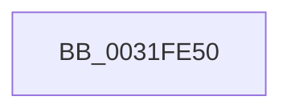

# MiExamineZeroChunks

- RVA: `0x0031FE50`–`0x0031FE95` (길이 `69` bytes)
- VA: `0x000000014031FE50`
- 실행 섹션: `.text`
- PDB 이름 있음: `예`; PDB Function 태그: `아니요`
- unwind 정보 RVA: `0x000754DC`
- 디코드: `17`개 명령, `69/69` bytes 표시
- 미해석 바이트: `0` (있으면 어셈블리에 `.byte`로 보존)

> 이 문서는 커널 이미지의 기계어와 PDB 기호를 분석해 생성했습니다. 4번과 5번은 함수 원형과 자료형을 바이너리 사용 방식에서 추정한 C 해석이며 원본 소스 복구 결과는 아닙니다.

## 1. Dependencies

- 직접 호출 지점: **0**; 고유 호출 대상: **0**
- 직접 호출자로 확인된 함수: **1**
- RIP 상대 이미지 참조: **1**

### Outgoing calls
- 직접 디코드된 call 명령이 없습니다.

### Direct callers
- [MiBackgroundZeroLocalPages](MiBackgroundZeroLocalPages_function_0031EF30.md) at `0x0031F384`

### Static image references
- `0x0031FE60` → RVA `0x00E0A740` (`.data`; read)

## 2. Other-region calls and transfers

- 다른 실행 섹션으로 향하는 call: **0**
- call이 아닌 외부 분기/꼬리 이동: **1**
  - `0x0031FE8F` → [sub_0032000E](../32/Unknown_function_0032000E.md) (`tail-transfer`)

## 3. Assembly (complete function range)

```asm
0031FE50  4C 8B DC                        mov r11, rsp
0031FE53  55                              push rbp
0031FE54  56                              push rsi
0031FE55  41 55                           push r13
0031FE57  41 57                           push r15
0031FE59  48 81 EC 28 01 00 00            sub rsp, 0x128
0031FE60  48 8B 05 D9 A8 AE 00            mov rax, qword ptr [rip + 0xaea8d9]
0031FE67  48 33 C4                        xor rax, rsp
0031FE6A  48 89 84 24 10 01 00 00         mov qword ptr [rsp + 0x110], rax
0031FE72  4C 8B 79 40                     mov r15, qword ptr [rcx + 0x40]
0031FE76  33 F6                           xor esi, esi
0031FE78  48 8B 51 38                     mov rdx, qword ptr [rcx + 0x38]
0031FE7C  48 8B E9                        mov rbp, rcx
0031FE7F  44 8B 69 0C                     mov r13d, dword ptr [rcx + 0xc]
0031FE83  48 89 54 24 28                  mov qword ptr [rsp + 0x28], rdx
0031FE88  41 39 B7 18 01 00 00            cmp dword ptr [r15 + 0x118], esi
0031FE8F  0F 86 79 01 00 00               jbe 0x14032000e
```

## 4. C-style interpretation (structured pseudocode)

```c
__int64 __fastcall MiExamineZeroChunks(__int64 a1)
{
    __int64 result;
    __int64 v_rsi;
    __int64 v_rsp;
    unsigned __int64 v_stack_m120;
    unsigned __int64 v_stack_m38;

    v_rsp = (v_rsp) - (296);
    result = (*(unsigned __int64 *)(v_rip + 11446489)) ^ (v_rsp);
    v_stack_m38 = result;
    v_rsi = 0;
    v_stack_m120 = *(unsigned __int64 *)(a1 + 56);
}
```

## 5. (Beta) C Style

```c
int64_t MiExamineZeroChunks(void *Arg1)
{
    uint8_t *arg1 = (uint8_t *)Arg1;

    int64_t result;
    int64_t local_rsi;
    int64_t local_rsp;
    uint64_t v_stack_m120;
    uint64_t v_stack_m38;

    local_rsp = (local_rsp) - (296);
    result = (*(uint64_t *)(v_rip + 0xAEA8D9)) ^ (local_rsp);
    v_stack_m38 = result;
    local_rsi = 0;
    v_stack_m120 = *(uint64_t *)(arg1 + 0x38);
}
```

### 관측된 메모리 오프셋

구조체 형식이 확인되지 않은 접근은 인자 기준의 오프셋으로만 기록했습니다.

| 기준 인자 | 오프셋 표현 | 폭 (bit) | 접근 |
|---|---:|---:|---|
| `Arg1` | `+ 0xC` | `32` | `R` |
| `Arg1` | `+ 0x38` | `64` | `R` |
| `Arg1` | `+ 0x40` | `64` | `R` |

## 6. Execution-region graph

[열기: 2D/3D 그래프와 함수 탐색 컨트롤 패널](../../../control-panel.html?section=text&rva=0x0031FE50&view=graph)

- 2D 그래프는 위에서 아래로 흐르고, 3D 그래프는 빈 공간을 드래그해 회전합니다. Shift+드래그는 이동, 휠은 확대·축소, 함수 노드 선택은 대상 보고서 이동입니다.

### Static fallback


