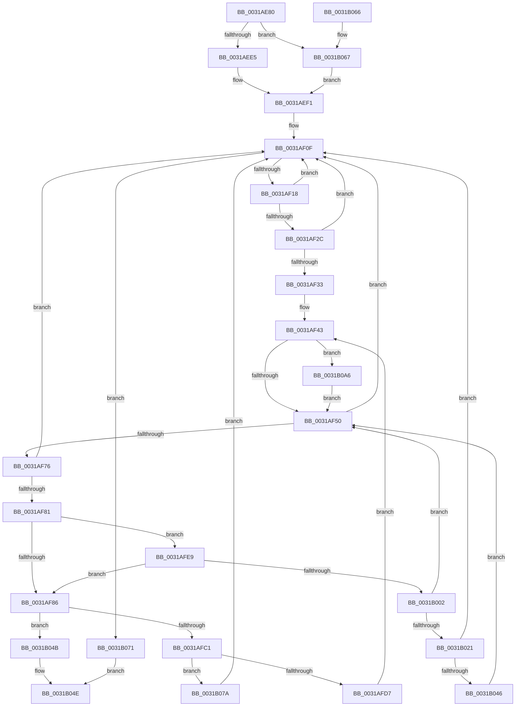

# MiFindRebuildCandidate

- RVA: `0x0031AE80`–`0x0031B0AF` (길이 `559` bytes)
- VA: `0x000000014031AE80`
- 실행 섹션: `.text`
- PDB 이름 있음: `예`; PDB Function 태그: `아니요`
- unwind 정보 RVA: `0x00074D48`
- 디코드: `137`개 명령, `559/559` bytes 표시
- 미해석 바이트: `0` (있으면 어셈블리에 `.byte`로 보존)

> 이 문서는 커널 이미지의 기계어와 PDB 기호를 분석해 생성했습니다. 4번과 5번은 함수 원형과 자료형을 바이너리 사용 방식에서 추정한 C 해석이며 원본 소스 복구 결과는 아닙니다.

## 1. Dependencies

- 직접 호출 지점: **1**; 고유 호출 대상: **1**
- 직접 호출자로 확인된 함수: **1**
- RIP 상대 이미지 참조: **0**

### Outgoing calls
- `0x0031AFB0` → [MiPfnsWorthTrying](MiPfnsWorthTrying_function_0031B0C0.md) (function, `0x0031B0C0`)

### Direct callers
- [MiRebuildLargePage](../3B/MiRebuildLargePage_function_003BBAEC.md) at `0x003BBBED`

### Static image references
- 디코드된 RIP-relative 메모리 참조가 없습니다.

## 2. Other-region calls and transfers

- 다른 실행 섹션으로 향하는 call: **0**
- 별도 외부 분기/꼬리 이동을 확인하지 못했습니다.

## 3. Assembly (complete function range)

```asm
0031AE80  48 89 5C 24 08                  mov qword ptr [rsp + 8], rbx
0031AE85  44 88 44 24 18                  mov byte ptr [rsp + 0x18], r8b
0031AE8A  55                              push rbp
0031AE8B  56                              push rsi
0031AE8C  57                              push rdi
0031AE8D  41 54                           push r12
0031AE8F  41 55                           push r13
0031AE91  41 56                           push r14
0031AE93  41 57                           push r15
0031AE95  48 83 EC 40                     sub rsp, 0x40
0031AE99  4C 8B BC 24 A0 00 00 00         mov r15, qword ptr [rsp + 0xa0]
0031AEA1  4C 8B E9                        mov r13, rcx
0031AEA4  49 8B E9                        mov rbp, r9
0031AEA7  C7 84 24 98 00 00 00 00 00 00 00  mov dword ptr [rsp + 0x98], 0
0031AEB2  4C 8B 8C 24 A8 00 00 00         mov r9, qword ptr [rsp + 0xa8]
0031AEBA  45 0F B6 D0                     movzx r10d, r8b
0031AEBE  8B DA                           mov ebx, edx
0031AEC0  B8 00 00 80 00                  mov eax, 0x800000
0031AEC5  45 8B 01                        mov r8d, dword ptr [r9]
0031AEC8  49 8D 48 01                     lea rcx, [r8 + 1]
0031AECC  48 C1 E1 04                     shl rcx, 4
0031AED0  49 03 C9                        add rcx, r9
0031AED3  48 89 4C 24 30                  mov qword ptr [rsp + 0x30], rcx
0031AED8  48 81 FD 00 02 00 00            cmp rbp, 0x200
0031AEDF  0F 84 82 01 00 00               je 0x14031b067
0031AEE5  48 83 FD 10                     cmp rbp, 0x10
0031AEE9  BA 00 00 80 01                  mov edx, 0x1800000
0031AEEE  0F 44 C2                        cmove eax, edx
0031AEF1  44 8B E0                        mov r12d, eax
0031AEF4  49 BB 00 00 00 00 00 DE FF FF   movabs r11, 0xffffde0000000000
0031AEFE  41 0F BA EC 1B                  bts r12d, 0x1b
0031AF03  83 BC 24 B0 00 00 00 00         cmp dword ptr [rsp + 0xb0], 0
0031AF0B  44 0F 44 E0                     cmove r12d, eax
0031AF0F  45 85 C0                        test r8d, r8d
0031AF12  0F 84 59 01 00 00               je 0x14031b071
0031AF18  41 FF C8                        dec r8d
0031AF1B  4C 89 84 24 A0 00 00 00         mov qword ptr [rsp + 0xa0], r8
0031AF23  41 8B C0                        mov eax, r8d
0031AF26  42 39 1C C1                     cmp dword ptr [rcx + r8*8], ebx
0031AF2A  75 E3                           jne 0x14031af0f
0031AF2C  46 38 54 C1 04                  cmp byte ptr [rcx + r8*8 + 4], r10b
0031AF31  75 DC                           jne 0x14031af0f
0031AF33  48 03 C0                        add rax, rax
0031AF36  4D 8B 74 C1 10                  mov r14, qword ptr [r9 + rax*8 + 0x10]
0031AF3B  49 8B 7C C1 18                  mov rdi, qword ptr [r9 + rax*8 + 0x18]
0031AF40  49 03 FE                        add rdi, r14
0031AF43  48 8D 47 FF                     lea rax, [rdi - 1]
0031AF47  49 3B C7                        cmp rax, r15
0031AF4A  0F 87 56 01 00 00               ja 0x14031b0a6
0031AF50  48 8B 4C 24 30                  mov rcx, qword ptr [rsp + 0x30]
0031AF55  48 8B D7                        mov rdx, rdi
0031AF58  4C 8B 84 24 A0 00 00 00         mov r8, qword ptr [rsp + 0xa0]
0031AF60  4C 8B 8C 24 A8 00 00 00         mov r9, qword ptr [rsp + 0xa8]
0031AF68  44 0F B6 94 24 90 00 00 00      movzx r10d, byte ptr [rsp + 0x90]
0031AF71  4C 3B F7                        cmp r14, rdi
0031AF74  73 99                           jae 0x14031af0f
0031AF76  48 8B C7                        mov rax, rdi
0031AF79  49 2B C6                        sub rax, r14
0031AF7C  48 3B E8                        cmp rbp, rax
0031AF7F  77 8E                           ja 0x14031af0f
0031AF81  48 85 ED                        test rbp, rbp
0031AF84  75 63                           jne 0x14031afe9
0031AF86  48 8B F7                        mov rsi, rdi
0031AF89  48 2B F5                        sub rsi, rbp
0031AF8C  48 8D 14 76                     lea rdx, [rsi + rsi*2]
0031AF90  48 C1 E2 04                     shl rdx, 4
0031AF94  49 8B C3                        mov rax, r11
0031AF97  48 03 D0                        add rdx, rax
0031AF9A  45 8B CC                        mov r9d, r12d
0031AF9D  48 8D 84 24 98 00 00 00         lea rax, [rsp + 0x98]
0031AFA5  4C 8B C5                        mov r8, rbp
0031AFA8  49 8B CD                        mov rcx, r13
0031AFAB  48 89 44 24 20                  mov qword ptr [rsp + 0x20], rax
0031AFB0  E8 0B 01 00 00                  call 0x14031b0c0
0031AFB5  48 8B C8                        mov rcx, rax
0031AFB8  48 85 C0                        test rax, rax
0031AFBB  0F 84 8A 00 00 00               je 0x14031b04b
0031AFC1  49 2B F6                        sub rsi, r14
0031AFC4  49 BB 00 00 00 00 00 DE FF FF   movabs r11, 0xffffde0000000000
0031AFCE  48 3B C6                        cmp rax, rsi
0031AFD1  0F 87 A3 00 00 00               ja 0x14031b07a
0031AFD7  48 3B CD                        cmp rcx, rbp
0031AFDA  48 8B C5                        mov rax, rbp
0031AFDD  48 0F 47 C1                     cmova rax, rcx
0031AFE1  48 2B F8                        sub rdi, rax
0031AFE4  E9 5A FF FF FF                  jmp 0x14031af43
0031AFE9  48 8B CF                        mov rcx, rdi
0031AFEC  4C 8D 45 FF                     lea r8, [rbp - 1]
0031AFF0  48 2B CD                        sub rcx, rbp
0031AFF3  48 8D 47 FF                     lea rax, [rdi - 1]
0031AFF7  48 33 C8                        xor rcx, rax
0031AFFA  49 F7 D0                        not r8
0031AFFD  49 85 C8                        test r8, rcx
0031B000  74 84                           je 0x14031af86
0031B002  49 8B C0                        mov rax, r8
0031B005  48 23 C7                        and rax, rdi
0031B008  48 3B C2                        cmp rax, rdx
0031B00B  48 8B F8                        mov rdi, rax
0031B00E  49 8B C0                        mov rax, r8
0031B011  48 0F 44 FA                     cmove rdi, rdx
0031B015  49 23 C6                        and rax, r14
0031B018  49 3B C6                        cmp rax, r14
0031B01B  0F 84 2F FF FF FF               je 0x14031af50
0031B021  48 8B 4C 24 30                  mov rcx, qword ptr [rsp + 0x30]
0031B026  49 FF CE                        dec r14
0031B029  44 0F B6 94 24 90 00 00 00      movzx r10d, byte ptr [rsp + 0x90]
0031B032  4C 03 F5                        add r14, rbp
0031B035  4D 23 F0                        and r14, r8
0031B038  4C 8B 84 24 A0 00 00 00         mov r8, qword ptr [rsp + 0xa0]
0031B040  0F 84 C9 FE FF FF               je 0x14031af0f
0031B046  E9 05 FF FF FF                  jmp 0x14031af50
0031B04B  48 8B C6                        mov rax, rsi
0031B04E  48 8B 9C 24 80 00 00 00         mov rbx, qword ptr [rsp + 0x80]
0031B056  48 83 C4 40                     add rsp, 0x40
0031B05A  41 5F                           pop r15
0031B05C  41 5E                           pop r14
0031B05E  41 5D                           pop r13
0031B060  41 5C                           pop r12
0031B062  5F                              pop rdi
0031B063  5E                              pop rsi
0031B064  5D                              pop rbp
0031B065  C3                              ret
0031B066  CC                              int3
0031B067  B8 00 00 80 02                  mov eax, 0x2800000
0031B06C  E9 80 FE FF FF                  jmp 0x14031aef1
0031B071  48 C7 C0 FF FF FF FF            mov rax, 0xffffffffffffffff
0031B078  EB D4                           jmp 0x14031b04e
0031B07A  4C 8B 84 24 A0 00 00 00         mov r8, qword ptr [rsp + 0xa0]
0031B082  4C 8B FF                        mov r15, rdi
0031B085  4C 8B 8C 24 A8 00 00 00         mov r9, qword ptr [rsp + 0xa8]
0031B08D  4C 2B F9                        sub r15, rcx
0031B090  48 8B 4C 24 30                  mov rcx, qword ptr [rsp + 0x30]
0031B095  49 FF CF                        dec r15
0031B098  44 0F B6 94 24 90 00 00 00      movzx r10d, byte ptr [rsp + 0x90]
0031B0A1  E9 69 FE FF FF                  jmp 0x14031af0f
0031B0A6  49 8D 7F 01                     lea rdi, [r15 + 1]
0031B0AA  E9 A1 FE FF FF                  jmp 0x14031af50
```

## 4. C-style interpretation (structured pseudocode)

```c
__int64 __fastcall MiFindRebuildCandidate(__int64 a1, int a2, unsigned __int8 a3, __int64 a4, __int64 a5, __int64 a6, unsigned int a7)
{
    __int64 result;
    __int64 v_r12;
    __int64 v_r14;
    __int64 v_r15;
    __int64 v_rdi;
    __int64 v_rsi;
    __int64 v_rsp;
    unsigned __int64 v_stack_m48;
    unsigned __int64 v_stack_m58;
    unsigned __int8 v_stack_p18;
    unsigned int v_stack_p20;
    unsigned __int64 v_stack_p28;
    unsigned __int64 v_stack_p30;
    unsigned __int64 v_stack_p8;
    unsigned __int8 v_stack_p90;

    v_stack_p8 = v_rbx;
    v_stack_p18 = a3;
    v_rsp = (v_rsp) - (64);
    v_stack_p20 = 0;
    a1 = ((unsigned int)(*(unsigned int *)(a6)) + 1) << (4);
    a1 = (a1) + (a6);
    v_stack_m48 = a1;
    if (a4 == 512) goto loc_0031B067;
    result = (unsigned int)(0x800000ULL);
    if (a4 == 16) { result = (unsigned int)((unsigned int)(0x1800000ULL)); }
loc_0031AEF1:
    v_r12 = (unsigned int)((unsigned int)(result));
    if (a7 == 0) { v_r12 = (unsigned int)(result); }
loc_0031AF0F:
    if ((unsigned int)((unsigned int)(*(unsigned int *)(a6))) == 0) goto loc_0031B071;
    a3 = (unsigned int)(((unsigned int)(*(unsigned int *)(a6))) - 1);
    v_stack_p28 = a3;
    if ((*(unsigned int *)(a1 + a3 * 8)) != ((unsigned int)((unsigned int)(a2)))) goto loc_0031AF0F;
    if ((*(unsigned __int8 *)(a1 + a3 * 8 + 4)) != a3) goto loc_0031AF0F;
    result = ((unsigned int)(a3)) + ((unsigned int)(a3));
    v_rdi = (*(unsigned __int64 *)(a6 + result * 8 + 24)) + (*(unsigned __int64 *)(a6 + result * 8 + 16));
loc_0031AF43:
    if ((v_rdi - 1) > a5) goto loc_0031B0A6;
loc_0031AF50:
    if ((*(unsigned __int64 *)(a6 + result * 8 + 16)) >= v_rdi) goto loc_0031AF0F;
    result = (v_rdi) - (*(unsigned __int64 *)(a6 + result * 8 + 16));
    if (a4 > result) goto loc_0031AF0F;
    if (a4 != 0) goto loc_0031AFE9;
loc_0031AF86:
    v_rsi = (v_rdi) - (a4);
    a2 = (v_rsi + v_rsi * 2) << (4);
    a2 = (a2) + (v_r11);
    v_stack_m58 = v_stack_p20;
    result = MiPfnsWorthTrying(a1, a2, a4, (unsigned int)((unsigned int)(v_r12)));
    if (result == 0) goto loc_0031B04B;
    v_rsi = (v_rsi) - (*(unsigned __int64 *)(a6 + result * 8 + 16));
    if (result > v_rsi) goto loc_0031B07A;
    if (result > a4) { a4 = result; }
    v_rdi = (v_rdi) - (a4);
    goto loc_0031AF43;
loc_0031AFE9:
    a1 = (v_rdi) - (a4);
    a1 = (a1) ^ (v_rdi - 1);
    a3 = ~(a4 - 1);
    if (((a3) & (a1)) == 0) goto loc_0031AF86;
    result = (a3) & (v_rdi);
    v_rdi = result;
    if (result == a2) { v_rdi = a2; }
    result = (a3) & (*(unsigned __int64 *)(a6 + result * 8 + 16));
    if (result == (*(unsigned __int64 *)(a6 + result * 8 + 16))) goto loc_0031AF50;
    v_r14 = (*(unsigned __int64 *)(a6 + result * 8 + 16)) - 1;
    v_r14 = (v_r14) + (a4);
    v_r14 = (v_r14) & (a3);
    if (condition_is_equal) goto loc_0031AF0F;
    goto loc_0031AF50;
loc_0031B04B:
loc_0031B04E:
    v_rsp = (v_rsp) + (64);
    return v_rsi;
loc_0031B067:
    goto loc_0031AEF1;
loc_0031B071:
    goto loc_0031B04E;
loc_0031B07A:
    v_r15 = (v_rdi) - (v_stack_m48);
    v_r15 = (v_r15) - 1;
    goto loc_0031AF0F;
loc_0031B0A6:
    goto loc_0031AF50;
}
```

## 5. (Beta) C Style

```c
int64_t MiFindRebuildCandidate(int64_t Arg1, int32_t Arg2, uint8_t Arg3, int64_t Arg4, int64_t Arg5, void *Arg6, uint32_t Arg7)
{
    uint8_t *arg6 = (uint8_t *)Arg6;

    int64_t result;
    int64_t local_r12;
    int64_t local_r14;
    int64_t local_r15;
    int64_t local_rdi;
    int64_t local_rsi;
    int64_t local_rsp;
    uint64_t v_stack_m48;
    uint64_t v_stack_m58;
    uint8_t v_stack_p18;
    uint32_t v_stack_p20;
    uint64_t v_stack_p28;
    uint64_t v_stack_p30;
    uint64_t v_stack_p8;
    uint8_t v_stack_p90;

    v_stack_p8 = local_rbx;
    v_stack_p18 = Arg3;
    local_rsp = (local_rsp) - (64);
    v_stack_p20 = 0;
    Arg1 = ((uint32_t)(*(uint32_t *)(arg6)) + 1) << (4);
    Arg1 = (Arg1) + (Arg6);
    v_stack_m48 = Arg1;
    if (Arg4 == 512) goto loc_0031B067;
    result = (uint32_t)(0x800000ULL);
    if (Arg4 == 16) { result = (uint32_t)((uint32_t)(0x1800000ULL)); }
loc_0031AEF1:
    local_r12 = (uint32_t)((uint32_t)(result));
    if (Arg7 == 0) { local_r12 = (uint32_t)(result); }
loc_0031AF0F:
    if ((uint32_t)((uint32_t)(*(uint32_t *)(arg6))) == 0) goto loc_0031B071;
    Arg3 = (uint32_t)(((uint32_t)(*(uint32_t *)(arg6))) - 1);
    v_stack_p28 = Arg3;
    if ((*(uint32_t *)(Arg1 + Arg3 * 8)) != ((uint32_t)((uint32_t)(Arg2)))) goto loc_0031AF0F;
    if ((*(uint8_t *)(Arg1 + Arg3 * 8 + 0x4)) != Arg3) goto loc_0031AF0F;
    result = ((uint32_t)(Arg3)) + ((uint32_t)(Arg3));
    local_rdi = (*(uint64_t *)(arg6 + result * 8 + 0x18)) + (*(uint64_t *)(arg6 + result * 8 + 0x10));
loc_0031AF43:
    if ((local_rdi - 1) > Arg5) goto loc_0031B0A6;
loc_0031AF50:
    if ((*(uint64_t *)(arg6 + result * 8 + 0x10)) >= local_rdi) goto loc_0031AF0F;
    result = (local_rdi) - (*(uint64_t *)(arg6 + result * 8 + 0x10));
    if (Arg4 > result) goto loc_0031AF0F;
    if (Arg4 != 0) goto loc_0031AFE9;
loc_0031AF86:
    local_rsi = (local_rdi) - (Arg4);
    Arg2 = (local_rsi + local_rsi * 2) << (4);
    Arg2 = (Arg2) + (local_r11);
    v_stack_m58 = v_stack_p20;
    result = MiPfnsWorthTrying(Arg1, Arg2, Arg4, (uint32_t)((uint32_t)(local_r12)));
    if (result == 0) goto loc_0031B04B;
    local_rsi = (local_rsi) - (*(uint64_t *)(arg6 + result * 8 + 0x10));
    if (result > local_rsi) goto loc_0031B07A;
    if (result > Arg4) { Arg4 = result; }
    local_rdi = (local_rdi) - (Arg4);
    goto loc_0031AF43;
loc_0031AFE9:
    Arg1 = (local_rdi) - (Arg4);
    Arg1 = (Arg1) ^ (local_rdi - 1);
    Arg3 = ~(Arg4 - 1);
    if (((Arg3) & (Arg1)) == 0) goto loc_0031AF86;
    result = (Arg3) & (local_rdi);
    local_rdi = result;
    if (result == Arg2) { local_rdi = Arg2; }
    result = (Arg3) & (*(uint64_t *)(arg6 + result * 8 + 0x10));
    if (result == (*(uint64_t *)(arg6 + result * 8 + 0x10))) goto loc_0031AF50;
    local_r14 = (*(uint64_t *)(arg6 + result * 8 + 0x10)) - 1;
    local_r14 = (local_r14) + (Arg4);
    local_r14 = (local_r14) & (Arg3);
    if (condition_is_equal) goto loc_0031AF0F;
    goto loc_0031AF50;
loc_0031B04B:
loc_0031B04E:
    local_rsp = (local_rsp) + (64);
    return local_rsi;
loc_0031B067:
    goto loc_0031AEF1;
loc_0031B071:
    goto loc_0031B04E;
loc_0031B07A:
    local_r15 = (local_rdi) - (v_stack_m48);
    local_r15 = (local_r15) - 1;
    goto loc_0031AF0F;
loc_0031B0A6:
    goto loc_0031AF50;
}
```

### 관측된 메모리 오프셋

구조체 형식이 확인되지 않은 접근은 인자 기준의 오프셋으로만 기록했습니다.

| 기준 인자 | 오프셋 표현 | 폭 (bit) | 접근 |
|---|---:|---:|---|
| `Arg6` | `+ 0x0` | `32` | `R` |
| `Arg6` | `+ 0x10 + rax*8` | `64` | `R` |
| `Arg6` | `+ 0x18 + rax*8` | `64` | `R` |

## 6. Execution-region graph

[열기: 2D/3D 그래프와 함수 탐색 컨트롤 패널](../../../control-panel.html?section=text&rva=0x0031AE80&view=graph)

- 2D 그래프는 위에서 아래로 흐르고, 3D 그래프는 빈 공간을 드래그해 회전합니다. Shift+드래그는 이동, 휠은 확대·축소, 함수 노드 선택은 대상 보고서 이동입니다.

### Static fallback


