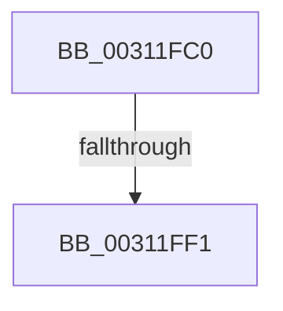

# MiFlushTbList

- RVA: `0x00311FC0`–`0x00311FF5` (길이 `53` bytes)
- VA: `0x0000000140311FC0`
- 실행 섹션: `.text`
- PDB 이름 있음: `예`; PDB Function 태그: `아니요`
- unwind 정보 RVA: `0x000741D8`
- 디코드: `13`개 명령, `53/53` bytes 표시
- 미해석 바이트: `0` (있으면 어셈블리에 `.byte`로 보존)

> 이 문서는 커널 이미지의 기계어와 PDB 기호를 분석해 생성했습니다. 4번과 5번은 함수 원형과 자료형을 바이너리 사용 방식에서 추정한 C 해석이며 원본 소스 복구 결과는 아닙니다.

## 1. Dependencies

- 직접 호출 지점: **0**; 고유 호출 대상: **0**
- 직접 호출자로 확인된 함수: **78**
- RIP 상대 이미지 참조: **1**

### Outgoing calls
- 직접 디코드된 call 명령이 없습니다.

### Direct callers
- [MmProtectMdlSystemAddress](../22/MmProtectMdlSystemAddress_function_00227B50.md) at `0x00227C68`
- [MiHandleForkTransitionPte](../22/MiHandleForkTransitionPte_function_0022D34C.md) at `0x0022DB78`
- [MiHandleForkTransitionPte](../22/MiHandleForkTransitionPte_function_0022D34C.md) at `0x0022DBF8`
- [MiCloneVads](../22/MiCloneVads_function_0022DC1C.md) at `0x0022E05E`
- [MiCloneVads](../22/MiCloneVads_function_0022DC1C.md) at `0x0022E2B2`
- [MiBuildForkPte](../22/MiBuildForkPte_function_0022E32C.md) at `0x0022F185`
- [MiBuildForkPte](../22/MiBuildForkPte_function_0022E32C.md) at `0x0022F26A`
- [MmSetAddressRangeModifiedEx](../23/MmSetAddressRangeModifiedEx_function_00236F20.md) at `0x002372D2`
- [sub_00237DE0](../23/Unknown_function_00237DE0.md) at `0x002384BC`
- [sub_00237DE0](../23/Unknown_function_00237DE0.md) at `0x002384F4`
- [MiAgeTrimListsTail](../23/MiAgeTrimListsTail_function_00239E90.md) at `0x00239F01`
- [MiFreeWsleList](../24/MiFreeWsleList_function_00241168.md) at `0x002412B4`
- [MiWalkVaRange](../24/MiWalkVaRange_function_00243BF0.md) at `0x00244220`
- [MiWalkVaRange](../24/MiWalkVaRange_function_00243BF0.md) at `0x00244A01`
- [MiWalkVaRange](../24/MiWalkVaRange_function_00243BF0.md) at `0x00244AAC`
- [MiReleasePtes](../24/MiReleasePtes_function_00247240.md) at `0x002476D9`
- [MmProtectPool](../26/MmProtectPool_function_002697AC.md) at `0x00269A63`
- [MmProtectPool](../26/MmProtectPool_function_002697AC.md) at `0x00269DFD`
- [MmProtectPool](../26/MmProtectPool_function_002697AC.md) at `0x00269F3E`
- [MmProtectPool](../26/MmProtectPool_function_002697AC.md) at `0x00269FC2`
- [MiDecommitPagesTail](../27/MiDecommitPagesTail_function_002790FC.md) at `0x00279150`
- [sub_0027BB85](../27/Unknown_function_0027BB85.md) at `0x0027BBCC`
- [MiFlushSingleTbEntry](../28/MiFlushSingleTbEntry_function_0028E730.md) at `0x0028EA13`
- [MiSetReadOnlyOnSectionView](../29/MiSetReadOnlyOnSectionView_function_00294538.md) at `0x00294748`
- [MiSetReadOnlyOnSectionView](../29/MiSetReadOnlyOnSectionView_function_00294538.md) at `0x00294885`
- [MiSetReadOnlyOnSectionView](../29/MiSetReadOnlyOnSectionView_function_00294538.md) at `0x00294952`
- [MmOutPageKernelStack](../29/MmOutPageKernelStack_function_0029FB40.md) at `0x0029FC22`
- [NtGetWriteWatch](../2A/NtGetWriteWatch_function_002A7CE0.md) at `0x002A8425`
- [NtGetWriteWatch](../2A/NtGetWriteWatch_function_002A7CE0.md) at `0x002A8522`
- [MiMoveDirtyBitsToPfns](../2A/MiMoveDirtyBitsToPfns_function_002A8624.md) at `0x002A89DA`
- [MiMoveDirtyBitsToPfns](../2A/MiMoveDirtyBitsToPfns_function_002A8624.md) at `0x002A8A35`
- [MiReplaceRotateWithDemandZeroNoCopy](../2A/MiReplaceRotateWithDemandZeroNoCopy_function_002AAB04.md) at `0x002AAD00`
- [MiDeleteNonPagedPoolTail](../2C/MiDeleteNonPagedPoolTail_function_002C20F0.md) at `0x002C2188`
- [sub_002C3A7C](../2C/Unknown_function_002C3A7C.md) at `0x002C3DC7`
- [sub_002C3A7C](../2C/Unknown_function_002C3A7C.md) at `0x002C42EE`
- [sub_002C3A7C](../2C/Unknown_function_002C3A7C.md) at `0x002C43B9`
- [sub_002C3A7C](../2C/Unknown_function_002C3A7C.md) at `0x002C449A`
- [MiProtectPrivateMemory](../2C/MiProtectPrivateMemory_function_002C45B0.md) at `0x002C4ACA`
- [MiProtectPrivateMemory](../2C/MiProtectPrivateMemory_function_002C45B0.md) at `0x002C4B52`
- [MiProtectPrivateMemory](../2C/MiProtectPrivateMemory_function_002C45B0.md) at `0x002C4CDA`
- [MiProtectPrivateMemory](../2C/MiProtectPrivateMemory_function_002C45B0.md) at `0x002C4EE8`
- [MiTrimSharedPageFromViews](../2E/MiTrimSharedPageFromViews_function_002E16F8.md) at `0x002E1A7D`
- [MiTrimSharedPageFromViews](../2E/MiTrimSharedPageFromViews_function_002E16F8.md) at `0x002E2152`
- [MiGetNextPageTableTail](MiGetNextPageTableTail_function_00313710.md) at `0x0031371D`
- [MiFlushTbAsNeeded](MiFlushTbAsNeeded_function_00313730.md) at `0x00313971`
- [MiSharePages](MiSharePages_function_00315110.md) at `0x00315702`
- [MiReservePtes](MiReservePtes_function_00318D20.md) at `0x0031908D`
- [MiFillSystemPtes](MiFillSystemPtes_function_00319850.md) at `0x0031A1AA`
- [MiCleanupLazyStampedPageTable](../32/MiCleanupLazyStampedPageTable_function_0032A43C.md) at `0x0032A50E`
- [MiDeleteSystemPageTableTail](../36/MiDeleteSystemPageTableTail_function_00367830.md) at `0x00367866`
- [MiDecommitHardwareEnclavePages](../36/MiDecommitHardwareEnclavePages_function_003688D4.md) at `0x00368B25`
- [MiDecommitHardwareEnclavePages](../36/MiDecommitHardwareEnclavePages_function_003688D4.md) at `0x00368B4C`
- [MiDecommitHardwareEnclavePages](../36/MiDecommitHardwareEnclavePages_function_003688D4.md) at `0x00368C27`
- [MiLockCode](../36/MiLockCode_function_0036F91C.md) at `0x00370084`
- [MiLockCode](../36/MiLockCode_function_0036F91C.md) at `0x00370098`
- [MiLockCode](../36/MiLockCode_function_0036F91C.md) at `0x003700DE`
- [MiLockCode](../36/MiLockCode_function_0036F91C.md) at `0x00370108`
- [MiLockCode](../36/MiLockCode_function_0036F91C.md) at `0x0037014C`
- [MiLockCode](../36/MiLockCode_function_0036F91C.md) at `0x00370160`
- [MiFlushValidPteFromTb](../37/MiFlushValidPteFromTb_function_00376878.md) at `0x003768DF`
- [MiDecommitLargePoolVa](../37/MiDecommitLargePoolVa_function_00377DD4.md) at `0x00377EA3`
- [MiSetSystemCodeProtection](../38/MiSetSystemCodeProtection_function_00384420.md) at `0x003846E5`
- [MiSetSystemCodeProtection](../38/MiSetSystemCodeProtection_function_00384420.md) at `0x00384B4E`
- [MiSetSystemCodeProtection](../38/MiSetSystemCodeProtection_function_00384420.md) at `0x00384B63`
- [MiUnmapMdlCommon](../3E/MiUnmapMdlCommon_function_003E7DF0.md) at `0x003E7FC9`
- [MiUnmapMdlCommon](../3E/MiUnmapMdlCommon_function_003E7DF0.md) at `0x003E8013`
- [MiUnmapMdlCommon](../3E/MiUnmapMdlCommon_function_003E7DF0.md) at `0x003E81B5`
- [MiLargePageFault](../3F/MiLargePageFault_function_003F01C4.md) at `0x003F02F7`
- [MiUnmapContiguousMemory](../3F/MiUnmapContiguousMemory_function_003F7908.md) at `0x003F7AC1`
- [MiConsumeSystemCacheTbFlushNeededView](../41/MiConsumeSystemCacheTbFlushNeededView_function_004193B4.md) at `0x0041952F`
- [MiUpdateOldWorkingSetPagesTail](../42/MiUpdateOldWorkingSetPagesTail_function_00428C00.md) at `0x00428C4A`
- [sub_00428D7A](../42/Unknown_function_00428D7A.md) at `0x00428D80`
- [MiQueryVpabAccessedState](../42/MiQueryVpabAccessedState_function_00428E70.md) at `0x00428F7F`
- [sub_00436E60](../43/Unknown_function_00436E60.md) at `0x00436EAA`
- [sub_00436E60](../43/Unknown_function_00436E60.md) at `0x00436ECC`
- [sub_0044565B](../44/Unknown_function_0044565B.md) at `0x004457D5`
- [MiCreateSystemPageTable](../45/MiCreateSystemPageTable_function_004518D0.md) at `0x00451BF9`
- [MiClearPteAccessedBitRange](../45/MiClearPteAccessedBitRange_function_004520B8.md) at `0x004521A0`
- [MiCreateSystemPageTableTail](../47/MiCreateSystemPageTableTail_function_0047F890.md) at `0x0047F8B2`
- [MiRevokeExecuteTail](../49/MiRevokeExecuteTail_function_004949A0.md) at `0x004949BE`
- [MiReleaseLargePdeMappings](../49/MiReleaseLargePdeMappings_function_0049D0B0.md) at `0x0049D3AE`
- [MiMapMemoryDumpMdl](../4A/MiMapMemoryDumpMdl_function_004A619C.md) at `0x004A6288`
- [MiMapMemoryDumpMdl](../4A/MiMapMemoryDumpMdl_function_004A619C.md) at `0x004A63FE`
- [MiSetPagingOfDriver](../4A/MiSetPagingOfDriver_function_004A76C4.md) at `0x004A7960`
- [MiSetPagingOfDriver](../4A/MiSetPagingOfDriver_function_004A76C4.md) at `0x004A799A`
- [MiSetPagingOfDriver](../4A/MiSetPagingOfDriver_function_004A76C4.md) at `0x004A79B7`
- [MiUnmapKernelScp](../4A/MiUnmapKernelScp_function_004A82E8.md) at `0x004A84BA`
- [MiUnmapKernelScp](../4A/MiUnmapKernelScp_function_004A82E8.md) at `0x004A8525`
- [MiAdjustSecureDriverStateForIatCapture](../4B/MiAdjustSecureDriverStateForIatCapture_function_004BE864.md) at `0x004BE97F`
- [MiAdjustSecureDriverStateForIatCapture](../4B/MiAdjustSecureDriverStateForIatCapture_function_004BE864.md) at `0x004BEA82`
- [MiSwitchToTransition](../4C/MiSwitchToTransition_function_004C0F5C.md) at `0x004C169C`
- [MiWritePteHighLevelIsr](../4C/MiWritePteHighLevelIsr_function_004C2FC0.md) at `0x004C3409`
- [MiWritePteHighLevelIsr](../4C/MiWritePteHighLevelIsr_function_004C2FC0.md) at `0x004C36EF`
- [MiReadyReservedView](../4C/MiReadyReservedView_function_004CC0D8.md) at `0x004CC19E`
- [MiProtectAweRegion](../4C/MiProtectAweRegion_function_004CE62C.md) at `0x004CE98F`
- [MiProtectAweRegion](../4C/MiProtectAweRegion_function_004CE62C.md) at `0x004CEDB7`
- [MiMapMdlWithLargePages](../4D/MiMapMdlWithLargePages_function_004D10B8.md) at `0x004D1304`
- [MiFinishPteChangesInPageTable](../4E/MiFinishPteChangesInPageTable_function_004EE660.md) at `0x004EE682`
- [MiPageBootRegistry](../66/MiPageBootRegistry_function_0066E82C.md) at `0x0066E99A`
- [MiPageBootRegistry](../66/MiPageBootRegistry_function_0066E82C.md) at `0x0066EAB7`
- [MiSetPageProtection](../67/MiSetPageProtection_function_00674BDC.md) at `0x00674CBA`
- [MiSetPageProtection](../67/MiSetPageProtection_function_00674BDC.md) at `0x00674DFA`
- [MiClearDriverTablePtes](../68/MiClearDriverTablePtes_function_00683024.md) at `0x006830F0`
- [MiClearDriverTablePtes](../68/MiClearDriverTablePtes_function_00683024.md) at `0x006833E8`
- [MiFlushEnclaveTb](../68/MiFlushEnclaveTb_function_00686E10.md) at `0x00686E8B`
- [MiBuildPhysicalPageFreeChain](../68/MiBuildPhysicalPageFreeChain_function_00687C80.md) at `0x00687E7F`
- [MiBuildPhysicalPageFreeChain](../68/MiBuildPhysicalPageFreeChain_function_00687C80.md) at `0x00687F2E`
- [MiZeroAndFlushAweLazyPtes](../68/MiZeroAndFlushAweLazyPtes_function_00689B1C.md) at `0x00689C4B`
- [MiClearSystemAccessBits](../68/MiClearSystemAccessBits_function_0068A2A0.md) at `0x0068A3C1`
- [MiDemoteValidLargePageOneLevel](../68/MiDemoteValidLargePageOneLevel_function_0068A3F4.md) at `0x0068A932`
- [MiScrubLargeMappedPage](../69/MiScrubLargeMappedPage_function_00693E2C.md) at `0x006940DD`
- [MiCalibrateTbFlush](../69/MiCalibrateTbFlush_function_006955EC.md) at `0x006956A3`
- [sub_006D9212](../6D/Unknown_function_006D9212.md) at `0x006D947B`
- [sub_006DB6A6](../6D/Unknown_function_006DB6A6.md) at `0x006DB6F9`
- [sub_006E362E](../6E/Unknown_function_006E362E.md) at `0x006E3697`
- [sub_006E362E](../6E/Unknown_function_006E362E.md) at `0x006E37D6`
- [sub_006E3CBA](../6E/Unknown_function_006E3CBA.md) at `0x006E3CBD`
- [MiProtectLargeKernelHalRange](../../page/7F/MiProtectLargeKernelHalRange_function_007F8D20.md) at `0x007F8DA9`
- [MiProtectLargeKernelHalRange](../../page/7F/MiProtectLargeKernelHalRange_function_007F8D20.md) at `0x007F8E70`
- [MmDeleteShadowMapping](../../page/80/MmDeleteShadowMapping_function_00807D00.md) at `0x00807E42`
- [MmUnmapProtectedKernelPageRange](../../page/AA/MmUnmapProtectedKernelPageRange_function_00AA36DC.md) at `0x00AA3799`
- [MiMarkBootKernelStack](../../init/C6/MiMarkBootKernelStack_function_00C68244.md) at `0x00C682A2`
- [MiMarkBootKernelStack](../../init/C6/MiMarkBootKernelStack_function_00C68244.md) at `0x00C683DD`
- [MiFreeBootDriverPages](../../init/C7/MiFreeBootDriverPages_function_00C7695C.md) at `0x00C76ABC`

### Static image references
- `0x00311FCC` → RVA `0x00E0A740` (`.data`; read)

## 2. Other-region calls and transfers

- 다른 실행 섹션으로 향하는 call: **0**
- call이 아닌 외부 분기/꼬리 이동: **1**
  - `0x00311FEB` → [sub_00312208](Unknown_function_00312208.md) (`tail-transfer`)

## 3. Assembly (complete function range)

```asm
00311FC0  4C 8B DC                        mov r11, rsp
00311FC3  53                              push rbx
00311FC4  55                              push rbp
00311FC5  48 81 EC F8 01 00 00            sub rsp, 0x1f8
00311FCC  48 8B 05 6D 87 AF 00            mov rax, qword ptr [rip + 0xaf876d]
00311FD3  48 33 C4                        xor rax, rsp
00311FD6  48 89 84 24 D0 01 00 00         mov qword ptr [rsp + 0x1d0], rax
00311FDE  8B 69 1C                        mov ebp, dword ptr [rcx + 0x1c]
00311FE1  48 8B D9                        mov rbx, rcx
00311FE4  48 89 4C 24 70                  mov qword ptr [rsp + 0x70], rcx
00311FE9  85 ED                           test ebp, ebp
00311FEB  0F 84 17 02 00 00               je 0x140312208
00311FF1  0F B6 51 18                     movzx edx, byte ptr [rcx + 0x18]
```

## 4. C-style interpretation (structured pseudocode)

```c
__int64 __fastcall MiFlushTbList(__int64 a1)
{
    __int64 result;
    __int64 v_rsp;
    unsigned __int64 v_stack_m198;
    unsigned __int64 v_stack_m38;

    v_rsp = (v_rsp) - (504);
    result = (*(unsigned __int64 *)(v_rip + 11503469)) ^ (v_rsp);
    v_stack_m38 = result;
    v_stack_m198 = a1;
    return result;
}
```

## 5. (Beta) C Style

```c
int64_t MiFlushTbList(void *Arg1)
{
    uint8_t *arg1 = (uint8_t *)Arg1;

    int64_t result;
    int64_t local_rsp;
    uint64_t v_stack_m198;
    uint64_t v_stack_m38;

    local_rsp = (local_rsp) - (504);
    result = (*(uint64_t *)(v_rip + 0xAF876D)) ^ (local_rsp);
    v_stack_m38 = result;
    v_stack_m198 = Arg1;
    return result;
}
```

### 관측된 메모리 오프셋

구조체 형식이 확인되지 않은 접근은 인자 기준의 오프셋으로만 기록했습니다.

| 기준 인자 | 오프셋 표현 | 폭 (bit) | 접근 |
|---|---:|---:|---|
| `Arg1` | `+ 0x18` | `8` | `R` |
| `Arg1` | `+ 0x1C` | `32` | `R` |

## 6. Execution-region graph

[열기: 2D/3D 그래프와 함수 탐색 컨트롤 패널](../../../control-panel.html?section=text&rva=0x00311FC0&view=graph)

- 2D 그래프는 위에서 아래로 흐르고, 3D 그래프는 빈 공간을 드래그해 회전합니다. Shift+드래그는 이동, 휠은 확대·축소, 함수 노드 선택은 대상 보고서 이동입니다.

### Static fallback


