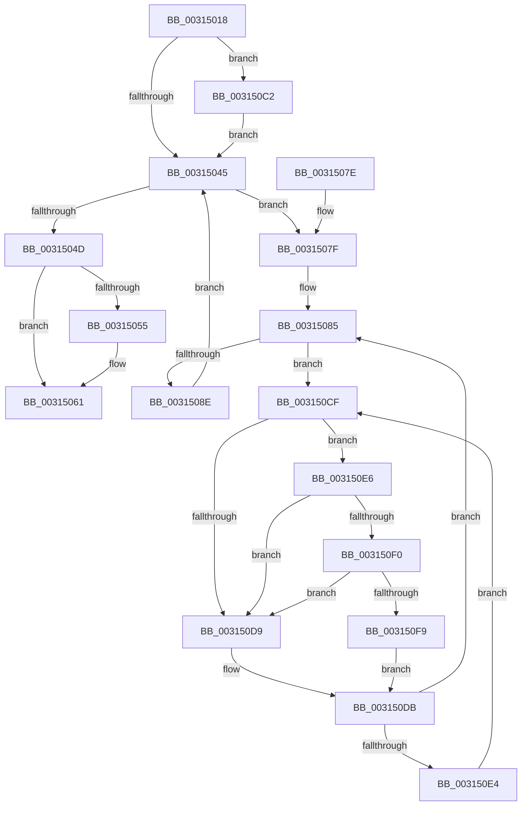

# MiFreeDeferredCrcPages

- RVA: `0x00315018`–`0x00315102` (길이 `234` bytes)
- VA: `0x0000000140315018`
- 실행 섹션: `.text`
- PDB 이름 있음: `예`; PDB Function 태그: `아니요`
- unwind 정보 RVA: `0x000748F0`
- 디코드: `66`개 명령, `234/234` bytes 표시
- 미해석 바이트: `0` (있으면 어셈블리에 `.byte`로 보존)

> 이 문서는 커널 이미지의 기계어와 PDB 기호를 분석해 생성했습니다. 4번과 5번은 함수 원형과 자료형을 바이너리 사용 방식에서 추정한 C 해석이며 원본 소스 복구 결과는 아닙니다.

## 1. Dependencies

- 직접 호출 지점: **5**; 고유 호출 대상: **5**
- 직접 호출자로 확인된 함수: **1**
- RIP 상대 이미지 참조: **3**

### Outgoing calls
- `0x0031505C` → [KiLowerIrqlProcessIrqlFlags](../4F/KiLowerIrqlProcessIrqlFlags_function_004F5698.md) (function, `0x004F5698`)
- `0x003150AC` → [MiDecrementShareCountEx](../33/MiDecrementShareCountEx_function_00333F70.md) (function, `0x00333F70`)
- `0x003150C5` → [KiRaiseIrqlProcessIrqlFlags](../4F/KiRaiseIrqlProcessIrqlFlags_function_004F56FC.md) (function, `0x004F56FC`)
- `0x003150F0` → [KiCheckVpBackingLongSpinWaitHypercall](../30/KiCheckVpBackingLongSpinWaitHypercall_function_0030F490.md) (function, `0x0030F490`)
- `0x003150FB` → [HvlNotifyLongSpinWait](../30/HvlNotifyLongSpinWait_function_0030F460.md) (function, `0x0030F460`)

### Direct callers
- [MiSharePages](MiSharePages_function_00315110.md) at `0x00315743`

### Static image references
- `0x0031503C` → RVA `0x00FC6D20` (`ALMOSTRO`; read)
- `0x003150D1` → RVA `0x00FC52AC` (`ALMOSTRO`; reference)
- `0x003150E6` → RVA `0x00FC6AB8` (`ALMOSTRO`; read)

## 2. Other-region calls and transfers

- 다른 실행 섹션으로 향하는 call: **0**
- 별도 외부 분기/꼬리 이동을 확인하지 못했습니다.

## 3. Assembly (complete function range)

```asm
00315018  48 89 5C 24 10                  mov qword ptr [rsp + 0x10], rbx
0031501D  48 89 6C 24 18                  mov qword ptr [rsp + 0x18], rbp
00315022  48 89 74 24 20                  mov qword ptr [rsp + 0x20], rsi
00315027  57                              push rdi
00315028  48 83 EC 20                     sub rsp, 0x20
0031502C  48 8B F1                        mov rsi, rcx
0031502F  44 0F 20 C5                     mov rbp, cr8
00315033  BA 02 00 00 00                  mov edx, 2
00315038  44 0F 22 C2                     mov cr8, rdx
0031503C  83 3D DD 1C CB 00 00            cmp dword ptr [rip + 0xcb1cdd], 0
00315043  75 7D                           jne 0x1403150c2
00315045  48 8B 36                        mov rsi, qword ptr [rsi]
00315048  48 85 F6                        test rsi, rsi
0031504B  75 32                           jne 0x14031507f
0031504D  39 35 CD 1C CB 00               cmp dword ptr [rip + 0xcb1ccd], esi
00315053  74 0C                           je 0x140315061
00315055  44 0F 20 C1                     mov rcx, cr8
00315059  40 8A D5                        mov dl, bpl
0031505C  E8 37 06 1E 00                  call 0x1404f5698
00315061  40 0F B6 C5                     movzx eax, bpl
00315065  44 0F 22 C0                     mov cr8, rax
00315069  48 8B 5C 24 38                  mov rbx, qword ptr [rsp + 0x38]
0031506E  48 8B 6C 24 40                  mov rbp, qword ptr [rsp + 0x40]
00315073  48 8B 74 24 48                  mov rsi, qword ptr [rsp + 0x48]
00315078  48 83 C4 20                     add rsp, 0x20
0031507C  5F                              pop rdi
0031507D  C3                              ret
0031507E  CC                              int3
0031507F  48 8B 5E 10                     mov rbx, qword ptr [rsi + 0x10]
00315083  33 FF                           xor edi, edi
00315085  F0 48 0F BA 6B 18 3F            lock bts qword ptr [rbx + 0x18], 0x3f
0031508C  72 41                           jb 0x1403150cf
0031508E  8B 43 20                        mov eax, dword ptr [rbx + 0x20]
00315091  33 D2                           xor edx, edx
00315093  89 44 24 30                     mov dword ptr [rsp + 0x30], eax
00315097  48 8B CB                        mov rcx, rbx
0031509A  C1 E8 10                        shr eax, 0x10
0031509D  24 FE                           and al, 0xfe
0031509F  0C 06                           or al, 6
003150A1  88 44 24 32                     mov byte ptr [rsp + 0x32], al
003150A5  8B 44 24 30                     mov eax, dword ptr [rsp + 0x30]
003150A9  89 43 20                        mov dword ptr [rbx + 0x20], eax
003150AC  E8 BF EE 01 00                  call 0x140333f70
003150B1  48 B8 FF FF FF FF FF FF FF 7F   movabs rax, 0x7fffffffffffffff
003150BB  F0 48 21 43 18                  lock and qword ptr [rbx + 0x18], rax
003150C0  EB 83                           jmp 0x140315045
003150C2  40 8A CD                        mov cl, bpl
003150C5  E8 32 06 1E 00                  call 0x1404f56fc
003150CA  E9 76 FF FF FF                  jmp 0x140315045
003150CF  FF C7                           inc edi
003150D1  85 3D D5 01 CB 00               test dword ptr [rip + 0xcb01d5], edi
003150D7  74 0D                           je 0x1403150e6
003150D9  F3 90                           pause
003150DB  48 8B 43 18                     mov rax, qword ptr [rbx + 0x18]
003150DF  48 85 C0                        test rax, rax
003150E2  79 A1                           jns 0x140315085
003150E4  EB E9                           jmp 0x1403150cf
003150E6  8B 05 CC 19 CB 00               mov eax, dword ptr [rip + 0xcb19cc]
003150EC  A8 40                           test al, 0x40
003150EE  74 E9                           je 0x1403150d9
003150F0  E8 9B A3 FF FF                  call 0x14030f490
003150F5  84 C0                           test al, al
003150F7  74 E0                           je 0x1403150d9
003150F9  8B CF                           mov ecx, edi
003150FB  E8 60 A3 FF FF                  call 0x14030f460
00315100  EB D9                           jmp 0x1403150db
```

## 4. C-style interpretation (structured pseudocode)

```c
__int64 __fastcall MiFreeDeferredCrcPages(__int64 a1)
{
    __int64 result;
    __int64 v_rdi;
    __int64 v_rsp;
    unsigned __int64 v_stack_p10;
    unsigned __int64 v_stack_p18;
    unsigned __int64 v_stack_p20;
    unsigned int v_stack_p30;
    unsigned __int8 v_stack_p32;

    v_stack_p10 = v_rbx;
    v_stack_p18 = v_rbp;
    v_stack_p20 = v_rsi;
    v_rsp = (v_rsp) - (32);
    if ((*(unsigned int *)(v_rip + 13311197)) != 0) goto loc_003150C2;
loc_00315045:
    if (*(unsigned __int64 *)(a1) != 0) goto loc_0031507F;
    if ((*(unsigned int *)(v_rip + 13311181)) != ((unsigned int)(*(unsigned __int64 *)(a1)))) {
        a1 = 2;
        a2 = (unsigned __int8)(v_cr8);
        result = KiLowerIrqlProcessIrqlFlags(a1, a2, a3, a4);
    }
    v_rsp = (v_rsp) + (32);
    return (unsigned __int8)(v_cr8);
loc_0031507F:
    v_rdi = 0;
loc_00315085:
    if (condition_is_below) goto loc_003150CF;
    a2 = 0;
    v_stack_p30 = (unsigned int)((unsigned int)(*(unsigned int *)(*(unsigned __int64 *)(v_stack_p20 + 16) + 32)));
    result = (unsigned int)(((unsigned int)(*(unsigned int *)(*(unsigned __int64 *)(v_stack_p20 + 16) + 32))) >> (16));
    result = (unsigned __int8)((result) & (254));
    result = (unsigned __int8)((result) | (6));
    v_stack_p32 = (unsigned __int8)(result);
    *(unsigned int *)(*(unsigned __int64 *)(v_stack_p20 + 16) + 32) = (unsigned int)((unsigned int)(v_stack_p30));
    result = MiDecrementShareCountEx(*(unsigned __int64 *)(v_stack_p20 + 16), a2, a3, a4);
    goto loc_00315045;
loc_003150C2:
    result = KiRaiseIrqlProcessIrqlFlags((unsigned __int8)(v_stack_p18), a2, a3, a4);
    goto loc_00315045;
loc_003150CF:
    v_rdi = (unsigned int)((v_rdi) + 1);
    if (((*(unsigned int *)(v_rip + 13304277)) & ((unsigned int)(v_rdi))) == 0) goto loc_003150E6;
loc_003150D9:
loc_003150DB:
    if (!sign_flag) goto loc_00315085;
    goto loc_003150CF;
loc_003150E6:
    if ((((unsigned __int8)((unsigned int)(*(unsigned int *)(v_rip + 13310412)))) & (64)) == 0) goto loc_003150D9;
    result = KiCheckVpBackingLongSpinWaitHypercall((unsigned __int8)(v_stack_p18), a2, a3, a4);
    if ((unsigned __int8)(result) == 0) goto loc_003150D9;
    result = HvlNotifyLongSpinWait((unsigned int)((unsigned int)(v_rdi)), a2, a3, a4);
    goto loc_003150DB;
}
```

## 5. (Beta) C Style

```c
int64_t MiFreeDeferredCrcPages(int64_t Arg1)
{
    int64_t result;
    int64_t local_rdi;
    int64_t local_rsp;
    uint64_t v_stack_p10;
    uint64_t v_stack_p18;
    uint64_t v_stack_p20;
    uint32_t v_stack_p30;
    uint8_t v_stack_p32;

    v_stack_p10 = local_rbx;
    v_stack_p18 = local_rbp;
    v_stack_p20 = local_rsi;
    local_rsp = (local_rsp) - (32);
    if ((*(uint32_t *)(v_rip + 0xCB1CDD)) != 0) goto loc_003150C2;
loc_00315045:
    if (*(uint64_t *)(Arg1) != 0) goto loc_0031507F;
    if ((*(uint32_t *)(v_rip + 0xCB1CCD)) != ((uint32_t)(*(uint64_t *)(Arg1)))) {
        Arg1 = 2;
        a2 = (uint8_t)(v_cr8);
        result = KiLowerIrqlProcessIrqlFlags(Arg1, a2, a3, a4);
    }
    local_rsp = (local_rsp) + (32);
    return (uint8_t)(v_cr8);
loc_0031507F:
    local_rdi = 0;
loc_00315085:
    if (condition_is_below) goto loc_003150CF;
    a2 = 0;
    v_stack_p30 = (uint32_t)((uint32_t)(*(uint32_t *)(*(uint64_t *)(v_stack_p20 + 0x10) + 0x20)));
    result = (uint32_t)(((uint32_t)(*(uint32_t *)(*(uint64_t *)(v_stack_p20 + 0x10) + 0x20))) >> (16));
    result = (uint8_t)((result) & (254));
    result = (uint8_t)((result) | (6));
    v_stack_p32 = (uint8_t)(result);
    *(uint32_t *)(*(uint64_t *)(v_stack_p20 + 0x10) + 0x20) = (uint32_t)((uint32_t)(v_stack_p30));
    result = MiDecrementShareCountEx(*(uint64_t *)(v_stack_p20 + 0x10), a2, a3, a4);
    goto loc_00315045;
loc_003150C2:
    result = KiRaiseIrqlProcessIrqlFlags((uint8_t)(v_stack_p18), a2, a3, a4);
    goto loc_00315045;
loc_003150CF:
    local_rdi = (uint32_t)((local_rdi) + 1);
    if (((*(uint32_t *)(v_rip + 0xCB01D5)) & ((uint32_t)(local_rdi))) == 0) goto loc_003150E6;
loc_003150D9:
loc_003150DB:
    if (!sign_flag) goto loc_00315085;
    goto loc_003150CF;
loc_003150E6:
    if ((((uint8_t)((uint32_t)(*(uint32_t *)(v_rip + 0xCB19CC)))) & (64)) == 0) goto loc_003150D9;
    result = KiCheckVpBackingLongSpinWaitHypercall((uint8_t)(v_stack_p18), a2, a3, a4);
    if ((uint8_t)(result) == 0) goto loc_003150D9;
    result = HvlNotifyLongSpinWait((uint32_t)((uint32_t)(local_rdi)), a2, a3, a4);
    goto loc_003150DB;
}
```

## 6. Execution-region graph

[열기: 2D/3D 그래프와 함수 탐색 컨트롤 패널](../../../control-panel.html?section=text&rva=0x00315018&view=graph)

- 2D 그래프는 위에서 아래로 흐르고, 3D 그래프는 빈 공간을 드래그해 회전합니다. Shift+드래그는 이동, 휠은 확대·축소, 함수 노드 선택은 대상 보고서 이동입니다.

### Static fallback


