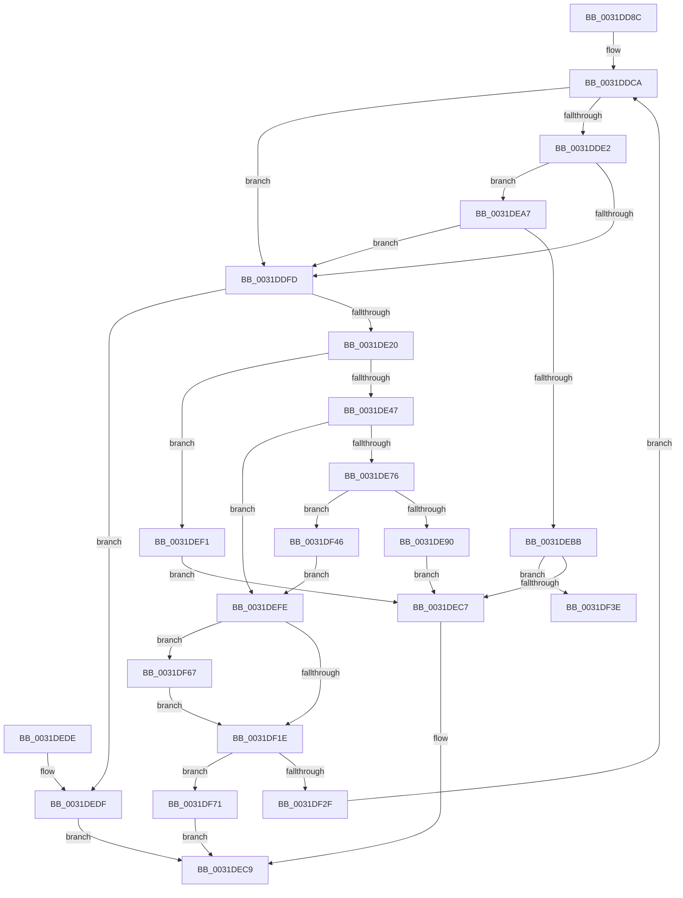

# MiGetBackgroundHugePageToZero

- RVA: `0x0031DD8C`–`0x0031DF80` (길이 `500` bytes)
- VA: `0x000000014031DD8C`
- 실행 섹션: `.text`
- PDB 이름 있음: `예`; PDB Function 태그: `예`
- unwind 정보 RVA: `0x00075188`
- 디코드: `129`개 명령, `500/500` bytes 표시
- 미해석 바이트: `0` (있으면 어셈블리에 `.byte`로 보존)

> 이 문서는 커널 이미지의 기계어와 PDB 기호를 분석해 생성했습니다. 4번과 5번은 함수 원형과 자료형을 바이너리 사용 방식에서 추정한 C 해석이며 원본 소스 복구 결과는 아닙니다.

## 1. Dependencies

- 직접 호출 지점: **14**; 고유 호출 대상: **11**
- 직접 호출자로 확인된 함수: **1**
- RIP 상대 이미지 참조: **0**

### Outgoing calls
- `0x0031DDCD` → [MiPreparePageAccessor](../43/MiPreparePageAccessor_function_00438EC0.md) (function, `0x00438EC0`)
- `0x0031DE07` → [ExAcquireSpinLockExclusive](../24/ExAcquireSpinLockExclusive_function_00248690.md) (function, `0x00248690`)
- `0x0031DE12` → [MiGetUltraHugeAlreadyActive](../3E/MiGetUltraHugeAlreadyActive_function_003E269C.md) (function, `0x003E269C`)
- `0x0031DE36` → [ExAllocatePoolMm](../35/ExAllocatePoolMm_function_0035B690.md) (function, `0x0035B690`)
- `0x0031DE53` → [ExGenRandom](../41/ExGenRandom_function_0041B010.md) (function, `0x0041B010`)
- `0x0031DE65` → [MiGetSingleHugeRangeToZero](../4D/MiGetSingleHugeRangeToZero_function_004DD034.md) (function, `0x004DD034`)
- `0x0031DE82` → [MiGetSinglePageToZero](../48/MiGetSinglePageToZero_function_00486724.md) (function, `0x00486724`)
- `0x0031DE96` → [MiReleaseSpinLockExclusive](../24/MiReleaseSpinLockExclusive_function_002482C0.md) (function, `0x002482C0`)
- `0x0031DEA0` → [ExFreePoolWithTag](../../poolcode/B8/ExFreePoolWithTag_function_00B82870.md) (function, `0x00B82870`)
- `0x0031DEE5` → [MiReleaseSpinLockExclusive](../24/MiReleaseSpinLockExclusive_function_002482C0.md) (function, `0x002482C0`)
- `0x0031DEF7` → [MiReleaseSpinLockExclusive](../24/MiReleaseSpinLockExclusive_function_002482C0.md) (function, `0x002482C0`)
- `0x0031DF12` → [MiInitializeNewUltraHugeContext](../3F/MiInitializeNewUltraHugeContext_function_003FB974.md) (function, `0x003FB974`)
- `0x0031DF24` → [MiReleaseSpinLockExclusive](../24/MiReleaseSpinLockExclusive_function_002482C0.md) (function, `0x002482C0`)
- `0x0031DF6A` → [MiDereferenceHugeContext](../4D/MiDereferenceHugeContext_function_004D9664.md) (function, `0x004D9664`)

### Direct callers
- [MiBackgroundZeroLocalPages](MiBackgroundZeroLocalPages_function_0031EF30.md) at `0x0031F669`

### Static image references
- 디코드된 RIP-relative 메모리 참조가 없습니다.

## 2. Other-region calls and transfers

- 다른 실행 섹션으로 향하는 call: **1**
  - `0x0031DEA0` → [ExFreePoolWithTag](../../poolcode/B8/ExFreePoolWithTag_function_00B82870.md) (`.text` → `POOLCODE`)
- call이 아닌 외부 분기/꼬리 이동: **1**
  - `0x0031DF41` → [sub_006E167A](../6E/Unknown_function_006E167A.md) (`tail-transfer`)

## 3. Assembly (complete function range)

```asm
0031DD8C  48 89 5C 24 18                  mov qword ptr [rsp + 0x18], rbx
0031DD91  48 89 4C 24 08                  mov qword ptr [rsp + 8], rcx
0031DD96  55                              push rbp
0031DD97  56                              push rsi
0031DD98  57                              push rdi
0031DD99  41 54                           push r12
0031DD9B  41 55                           push r13
0031DD9D  41 56                           push r14
0031DD9F  41 57                           push r15
0031DDA1  48 83 EC 20                     sub rsp, 0x20
0031DDA5  48 8B 82 50 01 00 00            mov rax, qword ptr [rdx + 0x150]
0031DDAC  48 8B EA                        mov rbp, rdx
0031DDAF  4C 8B C9                        mov r9, rcx
0031DDB2  48 8B 98 B0 00 00 00            mov rbx, qword ptr [rax + 0xb0]
0031DDB9  8B 5B 38                        mov ebx, dword ptr [rbx + 0x38]
0031DDBC  4C 69 D3 80 DF 00 00            imul r10, rbx, 0xdf80
0031DDC3  33 FF                           xor edi, edi
0031DDC5  4C 89 54 24 68                  mov qword ptr [rsp + 0x68], r10
0031DDCA  48 8B CD                        mov rcx, rbp
0031DDCD  E8 EE B0 11 00                  call 0x140438ec0
0031DDD2  4D 8B 69 10                     mov r13, qword ptr [r9 + 0x10]
0031DDD6  4D 03 EA                        add r13, r10
0031DDD9  48 39 BD 48 02 00 00            cmp qword ptr [rbp + 0x248], rdi
0031DDE0  75 1B                           jne 0x14031ddfd
0031DDE2  48 8B 8D 50 01 00 00            mov rcx, qword ptr [rbp + 0x150]
0031DDE9  48 8B 81 B0 00 00 00            mov rax, qword ptr [rcx + 0xb0]
0031DDF0  48 83 C0 20                     add rax, 0x20
0031DDF4  48 39 00                        cmp qword ptr [rax], rax
0031DDF7  0F 84 AA 00 00 00               je 0x14031dea7
0031DDFD  49 8D B5 78 3B 00 00            lea rsi, [r13 + 0x3b78]
0031DE04  48 8B CE                        mov rcx, rsi
0031DE07  E8 84 A8 F2 FF                  call 0x140248690
0031DE0C  48 8B CD                        mov rcx, rbp
0031DE0F  44 8A F0                        mov r14b, al
0031DE12  E8 85 48 0C 00                  call 0x1403e269c
0031DE17  48 85 C0                        test rax, rax
0031DE1A  0F 85 BF 00 00 00               jne 0x14031dedf
0031DE20  44 8B CB                        mov r9d, ebx
0031DE23  8D 48 40                        lea ecx, [rax + 0x40]
0031DE26  41 0F BA E9 1F                  bts r9d, 0x1f
0031DE2B  BA 48 02 00 00                  mov edx, 0x248
0031DE30  41 B8 4D 69 48 75               mov r8d, 0x7548694d
0031DE36  E8 55 D8 03 00                  call 0x14035b690
0031DE3B  4C 8B F8                        mov r15, rax
0031DE3E  48 85 C0                        test rax, rax
0031DE41  0F 84 AA 00 00 00               je 0x14031def1
0031DE47  B9 01 00 00 00                  mov ecx, 1
0031DE4C  4C 8D A0 44 02 00 00            lea r12, [rax + 0x244]
0031DE53  E8 B8 D1 0F 00                  call 0x14041b010
0031DE58  4D 8B C4                        mov r8, r12
0031DE5B  41 89 04 24                     mov dword ptr [r12], eax
0031DE5F  49 8B D5                        mov rdx, r13
0031DE62  49 8B CF                        mov rcx, r15
0031DE65  E8 CA F1 1B 00                  call 0x1404dd034
0031DE6A  48 A9 FF FF 3F 00               test rax, 0x3fffff
0031DE70  0F 85 88 00 00 00               jne 0x14031defe
0031DE76  45 33 C9                        xor r9d, r9d
0031DE79  4D 8B C4                        mov r8, r12
0031DE7C  49 8B D5                        mov rdx, r13
0031DE7F  49 8B CF                        mov rcx, r15
0031DE82  E8 9D 88 16 00                  call 0x140486724
0031DE87  48 85 C0                        test rax, rax
0031DE8A  0F 85 B6 00 00 00               jne 0x14031df46
0031DE90  41 8A D6                        mov dl, r14b
0031DE93  48 8B CE                        mov rcx, rsi
0031DE96  E8 25 A4 F2 FF                  call 0x1402482c0
0031DE9B  33 D2                           xor edx, edx
0031DE9D  49 8B CF                        mov rcx, r15
0031DEA0  E8 CB 49 86 00                  call 0x140b82870
0031DEA5  EB 20                           jmp 0x14031dec7
0031DEA7  4C 8B 81 D0 00 00 00            mov r8, qword ptr [rcx + 0xd0]
0031DEAE  49 8B 40 10                     mov rax, qword ptr [r8 + 0x10]
0031DEB2  48 85 C0                        test rax, rax
0031DEB5  0F 85 42 FF FF FF               jne 0x14031ddfd
0031DEBB  49 8B 81 18 41 00 00            mov rax, qword ptr [r9 + 0x4118]
0031DEC2  48 85 C0                        test rax, rax
0031DEC5  75 77                           jne 0x14031df3e
0031DEC7  33 C0                           xor eax, eax
0031DEC9  48 8B 5C 24 70                  mov rbx, qword ptr [rsp + 0x70]
0031DECE  48 83 C4 20                     add rsp, 0x20
0031DED2  41 5F                           pop r15
0031DED4  41 5E                           pop r14
0031DED6  41 5D                           pop r13
0031DED8  41 5C                           pop r12
0031DEDA  5F                              pop rdi
0031DEDB  5E                              pop rsi
0031DEDC  5D                              pop rbp
0031DEDD  C3                              ret
0031DEDE  CC                              int3
0031DEDF  41 8A D6                        mov dl, r14b
0031DEE2  48 8B CE                        mov rcx, rsi
0031DEE5  E8 D6 A3 F2 FF                  call 0x1402482c0
0031DEEA  B8 01 00 00 00                  mov eax, 1
0031DEEF  EB D8                           jmp 0x14031dec9
0031DEF1  41 8A D6                        mov dl, r14b
0031DEF4  48 8B CE                        mov rcx, rsi
0031DEF7  E8 C4 A3 F2 FF                  call 0x1402482c0
0031DEFC  EB C9                           jmp 0x14031dec7
0031DEFE  49 89 87 A8 01 00 00            mov qword ptr [r15 + 0x1a8], rax
0031DF05  49 8B D7                        mov rdx, r15
0031DF08  48 8B CD                        mov rcx, rbp
0031DF0B  41 89 9F 38 02 00 00            mov dword ptr [r15 + 0x238], ebx
0031DF12  E8 5D DA 0D 00                  call 0x1403fb974
0031DF17  44 8B F8                        mov r15d, eax
0031DF1A  85 C0                           test eax, eax
0031DF1C  75 49                           jne 0x14031df67
0031DF1E  41 8A D6                        mov dl, r14b
0031DF21  48 8B CE                        mov rcx, rsi
0031DF24  E8 97 A3 F2 FF                  call 0x1402482c0
0031DF29  41 83 FF 01                     cmp r15d, 1
0031DF2D  75 42                           jne 0x14031df71
0031DF2F  4C 8B 4C 24 60                  mov r9, qword ptr [rsp + 0x60]
0031DF34  4C 8B 54 24 68                  mov r10, qword ptr [rsp + 0x68]
0031DF39  E9 8C FE FF FF                  jmp 0x14031ddca
0031DF3E  40 8A D7                        mov dl, dil
0031DF41  E9 34 37 3C 00                  jmp 0x1406e167a
0031DF46  48 B9 00 00 00 00 00 DE FF FF   movabs rcx, 0xffffde0000000000
0031DF50  48 2B C1                        sub rax, rcx
0031DF53  48 B9 AB AA AA AA AA AA AA AA   movabs rcx, 0xaaaaaaaaaaaaaaab
0031DF5D  48 C1 F8 04                     sar rax, 4
0031DF61  48 0F AF C1                     imul rax, rcx
0031DF65  EB 97                           jmp 0x14031defe
0031DF67  48 8B CD                        mov rcx, rbp
0031DF6A  E8 F5 B6 1B 00                  call 0x1404d9664
0031DF6F  EB AD                           jmp 0x14031df1e
0031DF71  41 83 FF 02                     cmp r15d, 2
0031DF75  40 0F 95 C7                     setne dil
0031DF79  8B C7                           mov eax, edi
0031DF7B  E9 49 FF FF FF                  jmp 0x14031dec9
```

## 4. C-style interpretation (structured pseudocode)

```c
__int64 __fastcall MiGetBackgroundHugePageToZero(__int64 a1, __int64 a2)
{
    __int64 result;
    __int64 v_r10;
    __int64 v_r13;
    __int64 v_rdi;
    __int64 v_rsp;
    unsigned __int64 v_stack_p10;
    unsigned __int64 v_stack_p18;
    unsigned __int64 v_stack_p60;
    unsigned __int64 v_stack_p68;
    unsigned __int64 v_stack_p8;

    v_stack_p18 = v_rbx;
    v_stack_p8 = a1;
    v_rsp = (v_rsp) - (32);
    v_r10 = (v_r10) * ((unsigned int)(*(unsigned int *)(*(unsigned __int64 *)(*(unsigned __int64 *)(a2 + 336) + 176) + 56)));
    v_rdi = 0;
    v_stack_p10 = v_r10;
loc_0031DDCA:
    result = MiPreparePageAccessor(a2, a2, a3, a1);
    v_r13 = (*(unsigned __int64 *)(a1 + 16)) + (v_r10);
    if ((*(unsigned __int64 *)(a2 + 584)) != 0) goto loc_0031DDFD;
    result = (*(unsigned __int64 *)(*(unsigned __int64 *)(a2 + 336) + 176)) + (32);
    if ((*(unsigned __int64 *)(result)) == result) goto loc_0031DEA7;
loc_0031DDFD:
    result = ExAcquireSpinLockExclusive(v_r13 + 15224, a2, a3, a1);
    result = MiGetUltraHugeAlreadyActive(a2, a2, a3, a1);
    if (result != 0) goto loc_0031DEDF;
    result = ExAllocatePoolMm(result + 64, 584, (unsigned int)(0x7548694DULL), (unsigned int)((unsigned int)((unsigned int)(*(unsigned int *)(*(unsigned __int64 *)(*(unsigned __int64 *)(a2 + 336) + 176) + 56)))));
    if (result == 0) goto loc_0031DEF1;
    result = ExGenRandom(1, 584, (unsigned int)(0x7548694DULL), (unsigned int)((unsigned int)((unsigned int)(*(unsigned int *)(*(unsigned __int64 *)(*(unsigned __int64 *)(a2 + 336) + 176) + 56)))));
    *(unsigned int *)(result + 580) = (unsigned int)(result);
    result = MiGetSingleHugeRangeToZero(result, v_r13, result + 580, (unsigned int)((unsigned int)((unsigned int)(*(unsigned int *)(*(unsigned __int64 *)(*(unsigned __int64 *)(a2 + 336) + 176) + 56)))));
    if (((result) & (0x3FFFFFULL)) != 0) goto loc_0031DEFE;
    a4 = 0;
    result = MiGetSinglePageToZero(result, v_r13, result + 580, a4);
    if (result != 0) goto loc_0031DF46;
    result = MiReleaseSpinLockExclusive(v_r13 + 15224, (unsigned __int8)((unsigned __int8)(result)), result + 580, a4);
    a2 = 0;
    result = ExFreePoolWithTag(result, a2, result + 580, a4);
    goto loc_0031DEC7;
loc_0031DEA7:
    if (*(unsigned __int64 *)(*(unsigned __int64 *)(result + 208) + 16) != 0) goto loc_0031DDFD;
    if (*(unsigned __int64 *)(a4 + 16664) != 0) goto loc_0031DF3E;
loc_0031DEC7:
    result = 0;
loc_0031DEC9:
    v_rsp = (v_rsp) + (32);
    return result;
loc_0031DEDF:
    result = MiReleaseSpinLockExclusive(v_r13 + 15224, (unsigned __int8)((unsigned __int8)(result)), *(unsigned __int64 *)(result + 208), a4);
    goto loc_0031DEC9;
loc_0031DEF1:
    result = MiReleaseSpinLockExclusive(v_r13 + 15224, (unsigned __int8)((unsigned __int8)(result)), *(unsigned __int64 *)(result + 208), a4);
    goto loc_0031DEC7;
loc_0031DEFE:
    *(unsigned __int64 *)(result + 424) = result;
    *(unsigned int *)(result + 568) = (unsigned int)(v_stack_p18);
    result = MiInitializeNewUltraHugeContext(0, result, *(unsigned __int64 *)(result + 208), a4);
    if ((unsigned int)(result) != 0) goto loc_0031DF67;
loc_0031DF1E:
    result = MiReleaseSpinLockExclusive(v_r13 + 15224, (unsigned __int8)((unsigned __int8)(result)), *(unsigned __int64 *)(result + 208), a4);
    if (((unsigned int)((unsigned int)((unsigned int)(result)))) != 1) goto loc_0031DF71;
    goto loc_0031DDCA;
loc_0031DF3E:
loc_0031DF46:
    result = (result) - (v_r13 + 15224);
    result = (result) >> (4);
    result = (result) * (v_r13 + 15224);
    goto loc_0031DEFE;
loc_0031DF67:
    result = MiDereferenceHugeContext(0, 0, *(unsigned __int64 *)(result + 208), v_stack_p60);
    goto loc_0031DF1E;
loc_0031DF71:
    v_rdi = (((unsigned int)((unsigned int)((unsigned int)(result)))) != 2) ? 1 : 0;
    goto loc_0031DEC9;
}
```

## 5. (Beta) C Style

```c
int64_t MiGetBackgroundHugePageToZero(int64_t Arg1, void *Arg2)
{
    uint8_t *arg2 = (uint8_t *)Arg2;

    int64_t result;
    int64_t local_r10;
    int64_t local_r13;
    int64_t local_rdi;
    int64_t local_rsp;
    uint64_t v_stack_p10;
    uint64_t v_stack_p18;
    uint64_t v_stack_p60;
    uint64_t v_stack_p68;
    uint64_t v_stack_p8;

    v_stack_p18 = local_rbx;
    v_stack_p8 = Arg1;
    local_rsp = (local_rsp) - (32);
    local_r10 = (local_r10) * ((uint32_t)(*(uint32_t *)(*(uint64_t *)(*(uint64_t *)(arg2 + 0x150) + 0xB0) + 0x38)));
    local_rdi = 0;
    v_stack_p10 = local_r10;
loc_0031DDCA:
    result = MiPreparePageAccessor(Arg2, Arg2, a3, Arg1);
    local_r13 = (*(uint64_t *)(Arg1 + 0x10)) + (local_r10);
    if ((*(uint64_t *)(arg2 + 0x248)) != 0) goto loc_0031DDFD;
    result = (*(uint64_t *)(*(uint64_t *)(arg2 + 0x150) + 0xB0)) + (32);
    if ((*(uint64_t *)(result)) == result) goto loc_0031DEA7;
loc_0031DDFD:
    result = ExAcquireSpinLockExclusive(local_r13 + 15224, Arg2, a3, Arg1);
    result = MiGetUltraHugeAlreadyActive(Arg2, Arg2, a3, Arg1);
    if (result != 0) goto loc_0031DEDF;
    result = ExAllocatePoolMm(result + 64, 584, (uint32_t)(0x7548694DULL), (uint32_t)((uint32_t)((uint32_t)(*(uint32_t *)(*(uint64_t *)(*(uint64_t *)(arg2 + 0x150) + 0xB0) + 0x38)))));
    if (result == 0) goto loc_0031DEF1;
    result = ExGenRandom(1, 584, (uint32_t)(0x7548694DULL), (uint32_t)((uint32_t)((uint32_t)(*(uint32_t *)(*(uint64_t *)(*(uint64_t *)(arg2 + 0x150) + 0xB0) + 0x38)))));
    *(uint32_t *)(result + 0x244) = (uint32_t)(result);
    result = MiGetSingleHugeRangeToZero(result, local_r13, result + 580, (uint32_t)((uint32_t)((uint32_t)(*(uint32_t *)(*(uint64_t *)(*(uint64_t *)(arg2 + 0x150) + 0xB0) + 0x38)))));
    if (((result) & (0x3FFFFFULL)) != 0) goto loc_0031DEFE;
    a4 = 0;
    result = MiGetSinglePageToZero(result, local_r13, result + 580, a4);
    if (result != 0) goto loc_0031DF46;
    result = MiReleaseSpinLockExclusive(local_r13 + 15224, (uint8_t)((uint8_t)(result)), result + 580, a4);
    Arg2 = 0;
    result = ExFreePoolWithTag(result, Arg2, result + 580, a4);
    goto loc_0031DEC7;
loc_0031DEA7:
    if (*(uint64_t *)(*(uint64_t *)(result + 0xD0) + 0x10) != 0) goto loc_0031DDFD;
    if (*(uint64_t *)(a4 + 0x4118) != 0) goto loc_0031DF3E;
loc_0031DEC7:
    result = 0;
loc_0031DEC9:
    local_rsp = (local_rsp) + (32);
    return result;
loc_0031DEDF:
    result = MiReleaseSpinLockExclusive(local_r13 + 15224, (uint8_t)((uint8_t)(result)), *(uint64_t *)(result + 0xD0), a4);
    goto loc_0031DEC9;
loc_0031DEF1:
    result = MiReleaseSpinLockExclusive(local_r13 + 15224, (uint8_t)((uint8_t)(result)), *(uint64_t *)(result + 0xD0), a4);
    goto loc_0031DEC7;
loc_0031DEFE:
    *(uint64_t *)(result + 0x1A8) = result;
    *(uint32_t *)(result + 0x238) = (uint32_t)(v_stack_p18);
    result = MiInitializeNewUltraHugeContext(0, result, *(uint64_t *)(result + 0xD0), a4);
    if ((uint32_t)(result) != 0) goto loc_0031DF67;
loc_0031DF1E:
    result = MiReleaseSpinLockExclusive(local_r13 + 15224, (uint8_t)((uint8_t)(result)), *(uint64_t *)(result + 0xD0), a4);
    if (((uint32_t)((uint32_t)((uint32_t)(result)))) != 1) goto loc_0031DF71;
    goto loc_0031DDCA;
loc_0031DF3E:
loc_0031DF46:
    result = (result) - (local_r13 + 15224);
    result = (result) >> (4);
    result = (result) * (local_r13 + 15224);
    goto loc_0031DEFE;
loc_0031DF67:
    result = MiDereferenceHugeContext(0, 0, *(uint64_t *)(result + 0xD0), v_stack_p60);
    goto loc_0031DF1E;
loc_0031DF71:
    local_rdi = (((uint32_t)((uint32_t)((uint32_t)(result)))) != 2) ? 1 : 0;
    goto loc_0031DEC9;
}
```

### 관측된 메모리 오프셋

구조체 형식이 확인되지 않은 접근은 인자 기준의 오프셋으로만 기록했습니다.

| 기준 인자 | 오프셋 표현 | 폭 (bit) | 접근 |
|---|---:|---:|---|
| `Arg2` | `+ 0x150` | `64` | `R` |
| `Arg2` | `+ 0x248` | `64` | `R` |

## 6. Execution-region graph

[열기: 2D/3D 그래프와 함수 탐색 컨트롤 패널](../../../control-panel.html?section=text&rva=0x0031DD8C&view=graph)

- 2D 그래프는 위에서 아래로 흐르고, 3D 그래프는 빈 공간을 드래그해 회전합니다. Shift+드래그는 이동, 휠은 확대·축소, 함수 노드 선택은 대상 보고서 이동입니다.

### Static fallback


