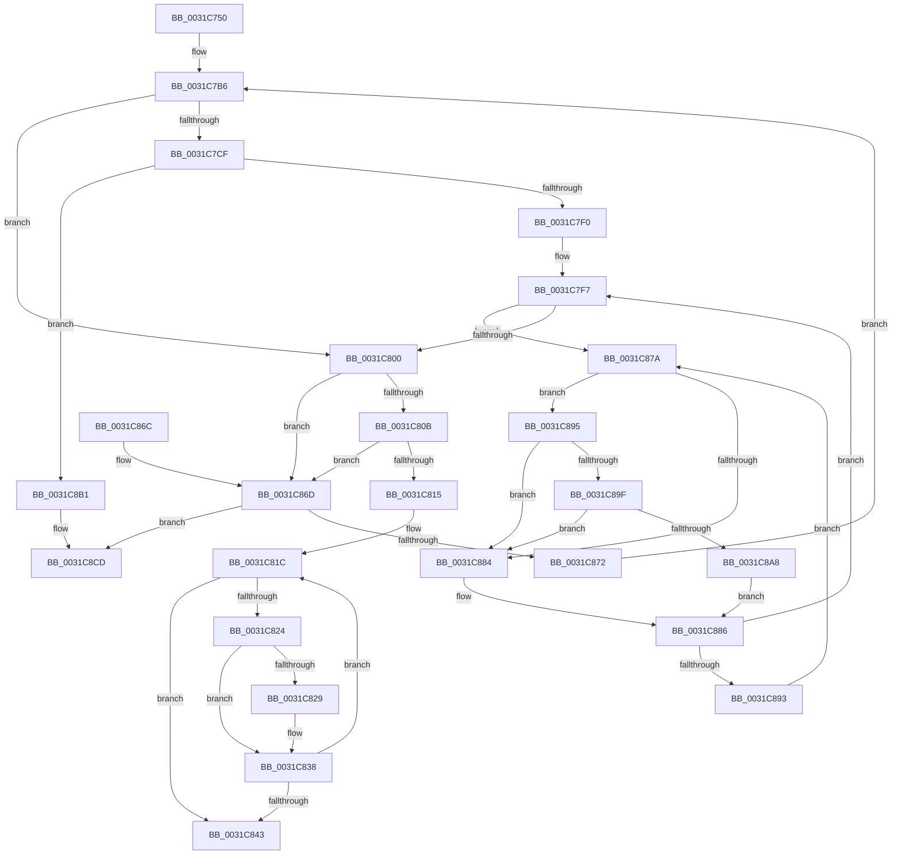

# MiGetBaseResidentPage

- RVA: `0x0031C750`–`0x0031C8E9` (길이 `409` bytes)
- VA: `0x000000014031C750`
- 실행 섹션: `.text`
- PDB 이름 있음: `예`; PDB Function 태그: `아니요`
- unwind 정보 RVA: `0x00074DBC`
- 디코드: `115`개 명령, `409/409` bytes 표시
- 미해석 바이트: `0` (있으면 어셈블리에 `.byte`로 보존)

> 이 문서는 커널 이미지의 기계어와 PDB 기호를 분석해 생성했습니다. 4번과 5번은 함수 원형과 자료형을 바이너리 사용 방식에서 추정한 C 해석이며 원본 소스 복구 결과는 아닙니다.

## 1. Dependencies

- 직접 호출 지점: **5**; 고유 호출 대상: **4**
- 직접 호출자로 확인된 함수: **8**
- RIP 상대 이미지 참조: **4**

### Outgoing calls
- `0x0031C84E` → [_security_check_cookie](../6A/_security_check_cookie_function_006AC640.md) (function, `0x006AC640`)
- `0x0031C89F` → [KiCheckVpBackingLongSpinWaitHypercall](../30/KiCheckVpBackingLongSpinWaitHypercall_function_0030F490.md) (function, `0x0030F490`)
- `0x0031C8AA` → [HvlNotifyLongSpinWait](../30/HvlNotifyLongSpinWait_function_0030F460.md) (function, `0x0030F460`)
- `0x0031C8C7` → [KeBugCheckEx](../4F/KeBugCheckEx_function_004FD660.md) (function, `0x004FD660`)
- `0x0031C8E3` → [KeBugCheckEx](../4F/KeBugCheckEx_function_004FD660.md) (function, `0x004FD660`)

### Direct callers
- [MiTradePage](../28/MiTradePage_function_0028D160.md) at `0x0028D8E1`
- [MiPfnsWorthTrying](MiPfnsWorthTrying_function_0031B0C0.md) at `0x0031B38C`
- [MiActivePageClaimCandidate](MiActivePageClaimCandidate_function_0031BB00.md) at `0x0031C2F0`
- [sub_0031CBBA](Unknown_function_0031CBBA.md) at `0x0031CBBF`
- [MiDemoteLargeFreePage](../43/MiDemoteLargeFreePage_function_00435118.md) at `0x0043516C`
- [MiGetPfnPageSizeIndexUnsynchronized](../46/MiGetPfnPageSizeIndexUnsynchronized_function_0046C008.md) at `0x0046C0A1`
- [MiSetPfnRemovalRequested](../67/MiSetPfnRemovalRequested_function_0067A4D0.md) at `0x0067A577`
- [sub_006D7E56](../6D/Unknown_function_006D7E56.md) at `0x006D7E7B`

### Static image references
- `0x0031C766` → RVA `0x00E0A740` (`.data`; read)
- `0x0031C7B9` → RVA `0x00011C60` (`.rdata`; read)
- `0x0031C87C` → RVA `0x00FC52AC` (`ALMOSTRO`; reference)
- `0x0031C895` → RVA `0x00FC6AB8` (`ALMOSTRO`; read)

## 2. Other-region calls and transfers

- 다른 실행 섹션으로 향하는 call: **0**
- 별도 외부 분기/꼬리 이동을 확인하지 못했습니다.

## 3. Assembly (complete function range)

```asm
0031C750  48 89 5C 24 10                  mov qword ptr [rsp + 0x10], rbx
0031C755  48 89 6C 24 18                  mov qword ptr [rsp + 0x18], rbp
0031C75A  56                              push rsi
0031C75B  57                              push rdi
0031C75C  41 54                           push r12
0031C75E  41 56                           push r14
0031C760  41 57                           push r15
0031C762  48 83 EC 50                     sub rsp, 0x50
0031C766  48 8B 05 D3 DF AE 00            mov rax, qword ptr [rip + 0xaedfd3]
0031C76D  48 33 C4                        xor rax, rsp
0031C770  48 89 44 24 48                  mov qword ptr [rsp + 0x48], rax
0031C775  0F 57 C0                        xorps xmm0, xmm0
0031C778  49 BC 00 00 00 00 00 DE FF FF   movabs r12, 0xffffde0000000000
0031C782  33 C0                           xor eax, eax
0031C784  48 8B D9                        mov rbx, rcx
0031C787  0F 11 44 24 30                  movups xmmword ptr [rsp + 0x30], xmm0
0031C78C  48 89 44 24 40                  mov qword ptr [rsp + 0x40], rax
0031C791  49 8B C4                        mov rax, r12
0031C794  48 8B E9                        mov rbp, rcx
0031C797  48 2B E8                        sub rbp, rax
0031C79A  48 B8 AB AA AA AA AA AA AA AA   movabs rax, 0xaaaaaaaaaaaaaaab
0031C7A4  48 C1 FD 04                     sar rbp, 4
0031C7A8  48 0F AF E8                     imul rbp, rax
0031C7AC  45 33 FF                        xor r15d, r15d
0031C7AF  48 8B FD                        mov rdi, rbp
0031C7B2  45 8D 77 02                     lea r14d, [r15 + 2]
0031C7B6  41 8B C6                        mov eax, r14d
0031C7B9  48 8D 15 A0 54 CF FF            lea rdx, [rip - 0x30ab60]
0031C7C0  41 8B CF                        mov ecx, r15d
0031C7C3  48 8B 04 C2                     mov rax, qword ptr [rdx + rax*8]
0031C7C7  48 FF C8                        dec rax
0031C7CA  48 85 C7                        test rdi, rax
0031C7CD  74 31                           je 0x14031c800
0031C7CF  48 F7 D0                        not rax
0031C7D2  48 23 F8                        and rdi, rax
0031C7D5  48 8D 1C 7F                     lea rbx, [rdi + rdi*2]
0031C7D9  48 C1 E3 04                     shl rbx, 4
0031C7DD  49 8B C4                        mov rax, r12
0031C7E0  48 03 D8                        add rbx, rax
0031C7E3  41 FF C7                        inc r15d
0031C7E6  41 83 FF 03                     cmp r15d, 3
0031C7EA  0F 87 C1 00 00 00               ja 0x14031c8b1
0031C7F0  48 89 5C CC 30                  mov qword ptr [rsp + rcx*8 + 0x30], rbx
0031C7F5  33 F6                           xor esi, esi
0031C7F7  F0 48 0F BA 6B 18 3F            lock bts qword ptr [rbx + 0x18], 0x3f
0031C7FE  72 7A                           jb 0x14031c87a
0031C800  48 8B 43 28                     mov rax, qword ptr [rbx + 0x28]
0031C804  48 0F BA E0 28                  bt rax, 0x28
0031C809  73 62                           jae 0x14031c86d
0031C80B  8B 43 24                        mov eax, dword ptr [rbx + 0x24]
0031C80E  A9 00 00 00 18                  test eax, 0x18000000
0031C813  74 58                           je 0x14031c86d
0031C815  33 C9                           xor ecx, ecx
0031C817  48 8D 54 24 30                  lea rdx, [rsp + 0x30]
0031C81C  48 8B 02                        mov rax, qword ptr [rdx]
0031C81F  48 85 C0                        test rax, rax
0031C822  74 1F                           je 0x14031c843
0031C824  48 3B C3                        cmp rax, rbx
0031C827  74 0F                           je 0x14031c838
0031C829  49 B8 FF FF FF FF FF FF FF 7F   movabs r8, 0x7fffffffffffffff
0031C833  F0 4C 21 40 18                  lock and qword ptr [rax + 0x18], r8
0031C838  FF C1                           inc ecx
0031C83A  48 83 C2 08                     add rdx, 8
0031C83E  83 F9 03                        cmp ecx, 3
0031C841  72 D9                           jb 0x14031c81c
0031C843  48 8B C3                        mov rax, rbx
0031C846  48 8B 4C 24 48                  mov rcx, qword ptr [rsp + 0x48]
0031C84B  48 33 CC                        xor rcx, rsp
0031C84E  E8 ED FD 38 00                  call 0x1406ac640
0031C853  4C 8D 5C 24 50                  lea r11, [rsp + 0x50]
0031C858  49 8B 5B 38                     mov rbx, qword ptr [r11 + 0x38]
0031C85C  49 8B 6B 40                     mov rbp, qword ptr [r11 + 0x40]
0031C860  49 8B E3                        mov rsp, r11
0031C863  41 5F                           pop r15
0031C865  41 5E                           pop r14
0031C867  41 5C                           pop r12
0031C869  5F                              pop rdi
0031C86A  5E                              pop rsi
0031C86B  C3                              ret
0031C86C  CC                              int3
0031C86D  45 85 F6                        test r14d, r14d
0031C870  74 5B                           je 0x14031c8cd
0031C872  41 FF CE                        dec r14d
0031C875  E9 3C FF FF FF                  jmp 0x14031c7b6
0031C87A  FF C6                           inc esi
0031C87C  85 35 2A 8A CA 00               test dword ptr [rip + 0xca8a2a], esi
0031C882  74 11                           je 0x14031c895
0031C884  F3 90                           pause
0031C886  48 8B 43 18                     mov rax, qword ptr [rbx + 0x18]
0031C88A  48 85 C0                        test rax, rax
0031C88D  0F 89 64 FF FF FF               jns 0x14031c7f7
0031C893  EB E5                           jmp 0x14031c87a
0031C895  8B 05 1D A2 CA 00               mov eax, dword ptr [rip + 0xcaa21d]
0031C89B  A8 40                           test al, 0x40
0031C89D  74 E5                           je 0x14031c884
0031C89F  E8 EC 2B FF FF                  call 0x14030f490
0031C8A4  84 C0                           test al, al
0031C8A6  74 DC                           je 0x14031c884
0031C8A8  8B CE                           mov ecx, esi
0031C8AA  E8 B1 2B FF FF                  call 0x14030f460
0031C8AF  EB D5                           jmp 0x14031c886
0031C8B1  48 83 64 24 20 00               and qword ptr [rsp + 0x20], 0
0031C8B7  4C 8B CF                        mov r9, rdi
0031C8BA  4C 8B C5                        mov r8, rbp
0031C8BD  BA 00 15 00 00                  mov edx, 0x1500
0031C8C2  B9 1A 00 00 00                  mov ecx, 0x1a
0031C8C7  E8 94 0D 1E 00                  call 0x1404fd660
0031C8CC  CC                              int3
0031C8CD  48 83 64 24 20 00               and qword ptr [rsp + 0x20], 0
0031C8D3  4C 8B CF                        mov r9, rdi
0031C8D6  4C 8B C5                        mov r8, rbp
0031C8D9  BA 01 15 00 00                  mov edx, 0x1501
0031C8DE  B9 1A 00 00 00                  mov ecx, 0x1a
0031C8E3  E8 78 0D 1E 00                  call 0x1404fd660
0031C8E8  CC                              int3
```

## 4. C-style interpretation (structured pseudocode)

```c
__int64 __fastcall MiGetBaseResidentPage(__int64 a1)
{
    __int64 result;
    __int64 v_r14;
    __int64 v_r15;
    __int64 v_rbp;
    __int64 v_rbx;
    __int64 v_rdi;
    __int64 v_rsi;
    __int64 v_rsp;
    unsigned __int64 v_stack_m28;
    unsigned __int64 v_stack_m30;
    unsigned __int64 v_stack_m38;
    unsigned __int64 v_stack_m48;
    unsigned __int64 v_stack_p10;
    unsigned __int64 v_stack_p18;

    v_stack_p10 = v_rbx;
    v_stack_p18 = v_rbp;
    v_rsp = (v_rsp) - (80);
    result = (*(unsigned __int64 *)(v_rip + 11460563)) ^ (v_rsp);
    v_stack_m30 = result;
    result = 0;
    v_stack_m48 = v_xmm0;
    v_stack_m38 = 0;
    v_rbp = (a1) - (v_r12);
    v_rbp = (v_rbp) >> (4);
    v_rbp = (v_rbp) * (v_r12);
    v_r15 = 0;
loc_0031C7B6:
    result = (*(unsigned __int64 *)(v_rip - 3189600 + (unsigned int)((unsigned int)(v_r15 + 2)) * 8)) - 1;
    if (((v_rbp) & (result)) == 0) goto loc_0031C800;
    result = ~(result);
    v_rdi = (v_rbp) & (result);
    v_rbx = (v_rdi + v_rdi * 2) << (4);
    v_rbx = (v_rbx) + (v_r12);
    v_r15 = (unsigned int)((v_r15) + 1);
    if (((unsigned int)(v_r15)) > 3) goto loc_0031C8B1;
    *(unsigned __int64 *)(v_rsp + 0 * 8 + 48) = v_rbx;
    v_rsi = 0;
loc_0031C7F7:
    if (condition_is_below) goto loc_0031C87A;
loc_0031C800:
    if (condition_is_above_or_equal) goto loc_0031C86D;
    if ((((unsigned int)((unsigned int)(*(unsigned int *)(v_rbx + 36)))) & (0x18000000ULL)) == 0) goto loc_0031C86D;
    a1 = 0;
loc_0031C81C:
    if (*(unsigned __int64 *)(v_stack_m48) == 0) goto loc_0031C843;
    if ((*(unsigned __int64 *)(v_stack_m48)) != v_rbx) {
    }
    a1 = (unsigned int)((a1) + 1);
    a2 = (v_stack_m48) + (8);
    if (((unsigned int)(a1)) < 3) goto loc_0031C81C;
loc_0031C843:
    a1 = (v_stack_m30) ^ (v_rsp);
    result = _security_check_cookie(a1, a2, a3, a4);
    return result;
loc_0031C86D:
    if ((unsigned int)(v_r15 + 2) == 0) goto loc_0031C8CD;
    v_r14 = (unsigned int)((v_r15 + 2) - 1);
    goto loc_0031C7B6;
loc_0031C87A:
    v_rsi = (unsigned int)((v_rsi) + 1);
    if (((*(unsigned int *)(v_rip + 13273642)) & ((unsigned int)(v_rsi))) == 0) goto loc_0031C895;
loc_0031C884:
loc_0031C886:
    if (!sign_flag) goto loc_0031C7F7;
    goto loc_0031C87A;
loc_0031C895:
    if ((((unsigned __int8)((unsigned int)(*(unsigned int *)(v_rip + 13279773)))) & (64)) == 0) goto loc_0031C884;
    result = KiCheckVpBackingLongSpinWaitHypercall(a1, a2, a3, a4);
    if ((unsigned __int8)(result) == 0) goto loc_0031C884;
    result = HvlNotifyLongSpinWait((unsigned int)((unsigned int)(v_rsi)), a2, a3, a4);
    goto loc_0031C886;
loc_0031C8B1:
    result = KeBugCheckEx(26, (unsigned int)(0x1500ULL), *(unsigned __int64 *)(v_stack_m28 + 64), v_rdi);
loc_0031C8CD:
    result = KeBugCheckEx(26, (unsigned int)(0x1501ULL), *(unsigned __int64 *)(v_stack_m28 + 64), v_rdi);
    return result;
}
```

## 5. (Beta) C Style

```c
int64_t MiGetBaseResidentPage(int64_t Arg1)
{
    int64_t result;
    int64_t local_r14;
    int64_t local_r15;
    int64_t local_rbp;
    int64_t local_rbx;
    int64_t local_rdi;
    int64_t local_rsi;
    int64_t local_rsp;
    uint64_t v_stack_m28;
    uint64_t v_stack_m30;
    uint64_t v_stack_m38;
    uint64_t v_stack_m48;
    uint64_t v_stack_p10;
    uint64_t v_stack_p18;

    v_stack_p10 = local_rbx;
    v_stack_p18 = local_rbp;
    local_rsp = (local_rsp) - (80);
    result = (*(uint64_t *)(v_rip + 0xAEDFD3)) ^ (local_rsp);
    v_stack_m30 = result;
    result = 0;
    v_stack_m48 = v_xmm0;
    v_stack_m38 = 0;
    local_rbp = (Arg1) - (local_r12);
    local_rbp = (local_rbp) >> (4);
    local_rbp = (local_rbp) * (local_r12);
    local_r15 = 0;
loc_0031C7B6:
    result = (*(uint64_t *)(v_rip - 0x30AB60 + (uint32_t)((uint32_t)(local_r15 + 0x2)) * 8)) - 1;
    if (((local_rbp) & (result)) == 0) goto loc_0031C800;
    result = ~(result);
    local_rdi = (local_rbp) & (result);
    local_rbx = (local_rdi + local_rdi * 2) << (4);
    local_rbx = (local_rbx) + (local_r12);
    local_r15 = (uint32_t)((local_r15) + 1);
    if (((uint32_t)(local_r15)) > 3) goto loc_0031C8B1;
    *(uint64_t *)(local_rsp + 0x0 * 8 + 0x30) = local_rbx;
    local_rsi = 0;
loc_0031C7F7:
    if (condition_is_below) goto loc_0031C87A;
loc_0031C800:
    if (condition_is_above_or_equal) goto loc_0031C86D;
    if ((((uint32_t)((uint32_t)(*(uint32_t *)(local_rbx + 0x24)))) & (0x18000000ULL)) == 0) goto loc_0031C86D;
    Arg1 = 0;
loc_0031C81C:
    if (*(uint64_t *)(v_stack_m48) == 0) goto loc_0031C843;
    if ((*(uint64_t *)(v_stack_m48)) != local_rbx) {
    }
    Arg1 = (uint32_t)((Arg1) + 1);
    a2 = (v_stack_m48) + (8);
    if (((uint32_t)(Arg1)) < 3) goto loc_0031C81C;
loc_0031C843:
    Arg1 = (v_stack_m30) ^ (local_rsp);
    result = _security_check_cookie(Arg1, a2, a3, a4);
    return result;
loc_0031C86D:
    if ((uint32_t)(local_r15 + 2) == 0) goto loc_0031C8CD;
    local_r14 = (uint32_t)((local_r15 + 2) - 1);
    goto loc_0031C7B6;
loc_0031C87A:
    local_rsi = (uint32_t)((local_rsi) + 1);
    if (((*(uint32_t *)(v_rip + 0xCA8A2A)) & ((uint32_t)(local_rsi))) == 0) goto loc_0031C895;
loc_0031C884:
loc_0031C886:
    if (!sign_flag) goto loc_0031C7F7;
    goto loc_0031C87A;
loc_0031C895:
    if ((((uint8_t)((uint32_t)(*(uint32_t *)(v_rip + 0xCAA21D)))) & (64)) == 0) goto loc_0031C884;
    result = KiCheckVpBackingLongSpinWaitHypercall(Arg1, a2, a3, a4);
    if ((uint8_t)(result) == 0) goto loc_0031C884;
    result = HvlNotifyLongSpinWait((uint32_t)((uint32_t)(local_rsi)), a2, a3, a4);
    goto loc_0031C886;
loc_0031C8B1:
    result = KeBugCheckEx(26, (uint32_t)(0x1500ULL), *(uint64_t *)(v_stack_m28 + 0x40), local_rdi);
loc_0031C8CD:
    result = KeBugCheckEx(26, (uint32_t)(0x1501ULL), *(uint64_t *)(v_stack_m28 + 0x40), local_rdi);
    return result;
}
```

## 6. Execution-region graph

[열기: 2D/3D 그래프와 함수 탐색 컨트롤 패널](../../../control-panel.html?section=text&rva=0x0031C750&view=graph)

- 2D 그래프는 위에서 아래로 흐르고, 3D 그래프는 빈 공간을 드래그해 회전합니다. Shift+드래그는 이동, 휠은 확대·축소, 함수 노드 선택은 대상 보고서 이동입니다.

### Static fallback


