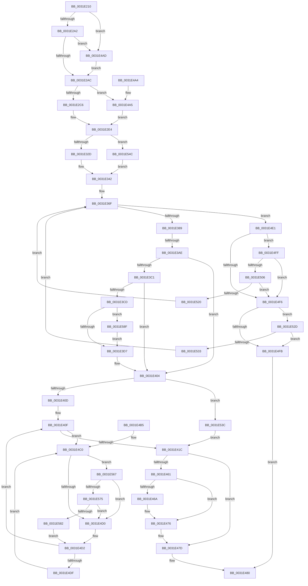

# MiGetLargePage

- RVA: `0x0031E210`–`0x0031E59C` (길이 `908` bytes)
- VA: `0x000000014031E210`
- 실행 섹션: `.text`
- PDB 이름 있음: `예`; PDB Function 태그: `예`
- unwind 정보 RVA: `0x000751DC`
- 디코드: `221`개 명령, `908/908` bytes 표시
- 미해석 바이트: `0` (있으면 어셈블리에 `.byte`로 보존)

> 이 문서는 커널 이미지의 기계어와 PDB 기호를 분석해 생성했습니다. 4번과 5번은 함수 원형과 자료형을 바이너리 사용 방식에서 추정한 C 해석이며 원본 소스 복구 결과는 아닙니다.

## 1. Dependencies

- 직접 호출 지점: **12**; 고유 호출 대상: **12**
- 직접 호출자로 확인된 함수: **5**
- RIP 상대 이미지 참조: **5**

### Outgoing calls
- `0x0031E270` → [memset](../6C/memset_function_006C6C40.md) (function, `0x006C6C40`)
- `0x0031E2E7` → [MiAssignDefaultChannel](MiAssignDefaultChannel_function_0031E5B0.md) (function, `0x0031E5B0`)
- `0x0031E377` → [MiGetPage](../28/MiGetPage_function_002884C0.md) (function, `0x002884C0`)
- `0x0031E3A1` → [MiIsFreeZeroPfnCold](MiIsFreeZeroPfnCold_function_0031E5E4.md) (function, `0x0031E5E4`)
- `0x0031E3F1` → [MiZeroLargePage](../2C/MiZeroLargePage_function_002C6914.md) (function, `0x002C6914`)
- `0x0031E471` → [KiLowerIrqlProcessIrqlFlags](../4F/KiLowerIrqlProcessIrqlFlags_function_004F5698.md) (function, `0x004F5698`)
- `0x0031E48B` → [_security_check_cookie](../6A/_security_check_cookie_function_006AC640.md) (function, `0x006AC640`)
- `0x0031E517` → [MiPerformOnDemandLargePageCoalesce](../37/MiPerformOnDemandLargePageCoalesce_function_00379678.md) (function, `0x00379678`)
- `0x0031E53F` → [MiLockPageInline](MiLockPageInline_function_0031A340.md) (function, `0x0031A340`)
- `0x0031E575` → [KiCheckVpBackingLongSpinWaitHypercall](../30/KiCheckVpBackingLongSpinWaitHypercall_function_0030F490.md) (function, `0x0030F490`)
- `0x0031E585` → [HvlNotifyLongSpinWait](../30/HvlNotifyLongSpinWait_function_0030F460.md) (function, `0x0030F460`)
- `0x0031E592` → [MiIssuePageHeatList](../44/MiIssuePageHeatList_function_0044615C.md) (function, `0x0044615C`)

### Direct callers
- [MiGetLargePagesForChain](MiGetLargePagesForChain_function_0031DF88.md) at `0x0031E07B`
- [MiPrefetchPreallocatePages](../36/MiPrefetchPreallocatePages_function_0036B1F0.md) at `0x0036B43B`
- [MiIdealClusterPage](../4D/MiIdealClusterPage_function_004DB964.md) at `0x004DBDED`
- [MiGetClusterPage](../4D/MiGetClusterPage_function_004DC57C.md) at `0x004DC8CB`
- [MiProcessVaContiguityInformation](../69/MiProcessVaContiguityInformation_function_006939C0.md) at `0x00693C32`

### Static image references
- `0x0031E224` → RVA `0x00E0A740` (`.data`; read)
- `0x0031E2AF` → RVA `0x00000000` (`image boundary/outside`; read)
- `0x0031E461` → RVA `0x00FC6D20` (`ALMOSTRO`; read)
- `0x0031E4C3` → RVA `0x00FC52AC` (`ALMOSTRO`; reference)
- `0x0031E567` → RVA `0x00FC6AB8` (`ALMOSTRO`; read)

## 2. Other-region calls and transfers

- 다른 실행 섹션으로 향하는 call: **0**
- call이 아닌 외부 분기/꼬리 이동: **1**
  - `0x0031E3A8` → [sub_006E169E](../6E/Unknown_function_006E169E.md) (`tail-transfer`)

## 3. Assembly (complete function range)

```asm
0031E210  40 53                           push rbx
0031E212  55                              push rbp
0031E213  56                              push rsi
0031E214  57                              push rdi
0031E215  41 54                           push r12
0031E217  41 55                           push r13
0031E219  41 56                           push r14
0031E21B  41 57                           push r15
0031E21D  48 81 EC 08 01 00 00            sub rsp, 0x108
0031E224  48 8B 05 15 C5 AE 00            mov rax, qword ptr [rip + 0xaec515]
0031E22B  48 33 C4                        xor rax, rsp
0031E22E  48 89 84 24 F0 00 00 00         mov qword ptr [rsp + 0xf0], rax
0031E236  48 8B 84 24 88 01 00 00         mov rax, qword ptr [rsp + 0x188]
0031E23E  4C 8B F2                        mov r14, rdx
0031E241  8B B4 24 78 01 00 00            mov esi, dword ptr [rsp + 0x178]
0031E248  4C 8B E9                        mov r13, rcx
0031E24B  48 89 44 24 40                  mov qword ptr [rsp + 0x40], rax
0031E250  48 8D 4C 24 60                  lea rcx, [rsp + 0x60]
0031E255  48 8B 84 24 80 01 00 00         mov rax, qword ptr [rsp + 0x180]
0031E25D  33 D2                           xor edx, edx
0031E25F  45 8B E0                        mov r12d, r8d
0031E262  41 B8 90 00 00 00               mov r8d, 0x90
0031E268  48 89 44 24 38                  mov qword ptr [rsp + 0x38], rax
0031E26D  41 8B E9                        mov ebp, r9d
0031E270  E8 CB 89 3A 00                  call 0x1406c6c40
0031E275  45 33 FF                        xor r15d, r15d
0031E278  8B DE                           mov ebx, esi
0031E27A  83 E3 10                        and ebx, 0x10
0031E27D  44 89 7C 24 34                  mov dword ptr [rsp + 0x34], r15d
0031E282  81 CB 00 40 33 00               or ebx, 0x334000
0031E288  44 89 7C 24 30                  mov dword ptr [rsp + 0x30], r15d
0031E28D  C1 EB 04                        shr ebx, 4
0031E290  0F 57 C0                        xorps xmm0, xmm0
0031E293  0F 11 44 24 48                  movups xmmword ptr [rsp + 0x48], xmm0
0031E298  40 F6 C6 02                     test sil, 2
0031E29C  0F 85 0B 02 00 00               jne 0x14031e4ad
0031E2A2  40 F6 C6 04                     test sil, 4
0031E2A6  0F 84 01 02 00 00               je 0x14031e4ad
0031E2AC  8D 45 01                        lea eax, [rbp + 1]
0031E2AF  48 8D 15 4A 1D CE FF            lea rdx, [rip - 0x31e2b6]
0031E2B6  4E 8B 94 E2 60 1C 01 00         mov r10, qword ptr [rdx + r12*8 + 0x11c60]
0031E2BE  85 C0                           test eax, eax
0031E2C0  0F 85 DF 01 00 00               jne 0x14031e4a5
0031E2C6  65 48 8B 04 25 88 01 00 00      mov rax, qword ptr gs:[0x188]
0031E2CF  8B 88 4C 02 00 00               mov ecx, dword ptr [rax + 0x24c]
0031E2D5  4C 8B 8C CA 40 8C FC 00         mov r9, qword ptr [rdx + rcx*8 + 0xfc8c40]
0031E2DD  45 8B 89 54 87 00 00            mov r9d, dword ptr [r9 + 0x8754]
0031E2E4  41 8B C9                        mov ecx, r9d
0031E2E7  E8 C4 02 00 00                  call 0x14031e5b0
0031E2EC  8B 8C 24 70 01 00 00            mov ecx, dword ptr [rsp + 0x170]
0031E2F3  44 0F B6 D8                     movzx r11d, al
0031E2F7  83 E1 03                        and ecx, 3
0031E2FA  41 83 E3 01                     and r11d, 1
0031E2FE  C1 E1 02                        shl ecx, 2
0031E301  41 83 E1 3F                     and r9d, 0x3f
0031E305  41 8B C4                        mov eax, r12d
0031E308  83 E0 03                        and eax, 3
0031E30B  0B C8                           or ecx, eax
0031E30D  C1 E1 07                        shl ecx, 7
0031E310  41 0B C9                        or ecx, r9d
0031E313  03 C9                           add ecx, ecx
0031E315  44 0B D9                        or r11d, ecx
0031E318  41 C1 E3 08                     shl r11d, 8
0031E31C  44 89 5C 24 50                  mov dword ptr [rsp + 0x50], r11d
0031E321  45 8B C3                        mov r8d, r11d
0031E324  4D 85 F6                        test r14, r14
0031E327  0F 84 1F 02 00 00               je 0x14031e54c
0031E32D  49 C1 E2 0C                     shl r10, 0xc
0031E331  48 8D 4C 24 34                  lea rcx, [rsp + 0x34]
0031E336  33 D2                           xor edx, edx
0031E338  49 8B C6                        mov rax, r14
0031E33B  49 F7 F2                        div r10
0031E33E  89 44 24 34                     mov dword ptr [rsp + 0x34], eax
0031E342  48 89 4C 24 48                  mov qword ptr [rsp + 0x48], rcx
0031E347  B8 01 00 00 00                  mov eax, 1
0031E34C  F0 0F C1 01                     lock xadd dword ptr [rcx], eax
0031E350  49 C1 E8 10                     shr r8, 0x10
0031E354  48 8D 0D A5 1C CE FF            lea rcx, [rip - 0x31e35b]
0031E35B  41 83 E0 03                     and r8d, 3
0031E35F  33 D2                           xor edx, edx
0031E361  42 F7 B4 81 C0 DC E2 00         div dword ptr [rcx + r8*4 + 0xe2dcc0]
0031E369  0F B6 FA                        movzx edi, dl
0031E36C  41 0B FB                        or edi, r11d
0031E36F  44 8B C3                        mov r8d, ebx
0031E372  8B D7                           mov edx, edi
0031E374  49 8B CD                        mov rcx, r13
0031E377  E8 44 A1 F6 FF                  call 0x1402884c0
0031E37C  4C 8B C8                        mov r9, rax
0031E37F  48 83 F8 FF                     cmp rax, -1
0031E383  0F 84 58 01 00 00               je 0x14031e4e1
0031E389  48 8D 3C 40                     lea rdi, [rax + rax*2]
0031E38D  48 C1 E7 04                     shl rdi, 4
0031E391  48 B8 00 00 00 00 00 DE FF FF   movabs rax, 0xffffde0000000000
0031E39B  48 03 F8                        add rdi, rax
0031E39E  48 8B CF                        mov rcx, rdi
0031E3A1  E8 3E 02 00 00                  call 0x14031e5e4
0031E3A6  85 C0                           test eax, eax
0031E3A8  0F 85 F0 32 3C 00               jne 0x1406e169e
0031E3AE  C7 44 24 60 81 00 00 00         mov dword ptr [rsp + 0x60], 0x81
0031E3B6  48 8D 6C 24 60                  lea rbp, [rsp + 0x60]
0031E3BB  40 F6 C6 04                     test sil, 4
0031E3BF  75 43                           jne 0x14031e404
0031E3C1  48 8B 47 10                     mov rax, qword ptr [rdi + 0x10]
0031E3C5  48 A9 E0 03 00 00               test rax, 0x3e0
0031E3CB  74 37                           je 0x14031e404
0031E3CD  44 39 7D 04                     cmp dword ptr [rbp + 4], r15d
0031E3D1  0F 85 B8 01 00 00               jne 0x14031e58f
0031E3D7  44 8B 8C 24 70 01 00 00         mov r9d, dword ptr [rsp + 0x170]
0031E3DF  45 8B C4                        mov r8d, r12d
0031E3E2  C1 EE 04                        shr esi, 4
0031E3E5  48 8B D7                        mov rdx, rdi
0031E3E8  83 E6 01                        and esi, 1
0031E3EB  33 C9                           xor ecx, ecx
0031E3ED  89 74 24 20                     mov dword ptr [rsp + 0x20], esi
0031E3F1  E8 1E 85 FA FF                  call 0x1402c6914
0031E3F6  48 8B 47 10                     mov rax, qword ptr [rdi + 0x10]
0031E3FA  48 25 1F FC FF FF               and rax, 0xfffffffffffffc1f
0031E400  48 89 47 10                     mov qword ptr [rdi + 0x10], rax
0031E404  F6 C3 01                        test bl, 1
0031E407  0F 84 2F 01 00 00               je 0x14031e53c
0031E40D  B3 11                           mov bl, 0x11
0031E40F  F0 48 0F BA 6F 18 3F            lock bts qword ptr [rdi + 0x18], 0x3f
0031E416  0F 82 A4 00 00 00               jb 0x14031e4c0
0031E41C  48 8B 47 18                     mov rax, qword ptr [rdi + 0x18]
0031E420  48 B9 01 00 00 00 00 00 00 C0   movabs rcx, 0xc000000000000001
0031E42A  48 23 C1                        and rax, rcx
0031E42D  48 83 C8 01                     or rax, 1
0031E431  48 89 47 18                     mov qword ptr [rdi + 0x18], rax
0031E435  8B 47 20                        mov eax, dword ptr [rdi + 0x20]
0031E438  89 44 24 30                     mov dword ptr [rsp + 0x30], eax
0031E43C  B8 02 00 00 00                  mov eax, 2
0031E441  66 89 44 24 30                  mov word ptr [rsp + 0x30], ax
0031E446  8B 44 24 30                     mov eax, dword ptr [rsp + 0x30]
0031E44A  89 47 20                        mov dword ptr [rdi + 0x20], eax
0031E44D  48 B8 FF FF FF FF FF FF FF 7F   movabs rax, 0x7fffffffffffffff
0031E457  F0 48 21 47 18                  lock and qword ptr [rdi + 0x18], rax
0031E45C  80 FB 02                        cmp bl, 2
0031E45F  73 1C                           jae 0x14031e47d
0031E461  83 3D B8 88 CA 00 00            cmp dword ptr [rip + 0xca88b8], 0
0031E468  74 0C                           je 0x14031e476
0031E46A  44 0F 20 C1                     mov rcx, cr8
0031E46E  0F B6 D3                        movzx edx, bl
0031E471  E8 22 72 1D 00                  call 0x1404f5698
0031E476  0F B6 C3                        movzx eax, bl
0031E479  44 0F 22 C0                     mov cr8, rax
0031E47D  48 8B C7                        mov rax, rdi
0031E480  48 8B 8C 24 F0 00 00 00         mov rcx, qword ptr [rsp + 0xf0]
0031E488  48 33 CC                        xor rcx, rsp
0031E48B  E8 B0 E1 38 00                  call 0x1406ac640
0031E490  48 81 C4 08 01 00 00            add rsp, 0x108
0031E497  41 5F                           pop r15
0031E499  41 5E                           pop r14
0031E49B  41 5D                           pop r13
0031E49D  41 5C                           pop r12
0031E49F  5F                              pop rdi
0031E4A0  5E                              pop rsi
0031E4A1  5D                              pop rbp
0031E4A2  5B                              pop rbx
0031E4A3  C3                              ret
0031E4A4  CC                              int3
0031E4A5  44 8B CD                        mov r9d, ebp
0031E4A8  E9 37 FE FF FF                  jmp 0x14031e2e4
0031E4AD  83 CB 10                        or ebx, 0x10
0031E4B0  E9 F7 FD FF FF                  jmp 0x14031e2ac
0031E4B5  66 66 66 0F 1F 84 00 00 00 00 00  nop word ptr [rax + rax]
0031E4C0  41 FF C7                        inc r15d
0031E4C3  44 85 3D E2 6D CA 00            test dword ptr [rip + 0xca6de2], r15d
0031E4CA  0F 84 97 00 00 00               je 0x14031e567
0031E4D0  F3 90                           pause
0031E4D2  48 8B 47 18                     mov rax, qword ptr [rdi + 0x18]
0031E4D6  48 85 C0                        test rax, rax
0031E4D9  0F 89 30 FF FF FF               jns 0x14031e40f
0031E4DF  EB DF                           jmp 0x14031e4c0
0031E4E1  48 8B 44 24 38                  mov rax, qword ptr [rsp + 0x38]
0031E4E6  44 8B F7                        mov r14d, edi
0031E4E9  41 C1 EE 0F                     shr r14d, 0xf
0031E4ED  41 83 E6 01                     and r14d, 1
0031E4F1  48 85 C0                        test rax, rax
0031E4F4  75 09                           jne 0x14031e4ff
0031E4F6  45 85 F6                        test r14d, r14d
0031E4F9  74 32                           je 0x14031e52d
0031E4FB  33 C0                           xor eax, eax
0031E4FD  EB 81                           jmp 0x14031e480
0031E4FF  44 39 7C 24 30                  cmp dword ptr [rsp + 0x30], r15d
0031E504  75 F0                           jne 0x14031e4f6
0031E506  45 8B CE                        mov r9d, r14d
0031E509  48 89 44 24 20                  mov qword ptr [rsp + 0x20], rax
0031E50E  44 8B C5                        mov r8d, ebp
0031E511  41 8B D4                        mov edx, r12d
0031E514  49 8B CD                        mov rcx, r13
0031E517  E8 5C B1 05 00                  call 0x140379678
0031E51C  85 C0                           test eax, eax
0031E51E  74 D6                           je 0x14031e4f6
0031E520  C7 44 24 30 01 00 00 00         mov dword ptr [rsp + 0x30], 1
0031E528  E9 42 FE FF FF                  jmp 0x14031e36f
0031E52D  40 F6 C6 01                     test sil, 1
0031E531  75 C8                           jne 0x14031e4fb
0031E533  0F BA EF 0F                     bts edi, 0xf
0031E537  E9 33 FE FF FF                  jmp 0x14031e36f
0031E53C  48 8B CF                        mov rcx, rdi
0031E53F  E8 FC BD FF FF                  call 0x14031a340
0031E544  0F B6 D8                        movzx ebx, al
0031E547  E9 D0 FE FF FF                  jmp 0x14031e41c
0031E54C  48 69 CD 80 DF 00 00            imul rcx, rbp, 0xdf80
0031E553  4B 8D 04 A4                     lea rax, [r12 + r12*4]
0031E557  48 C1 E0 08                     shl rax, 8
0031E55B  48 03 C8                        add rcx, rax
0031E55E  49 03 4D 10                     add rcx, qword ptr [r13 + 0x10]
0031E562  E9 DB FD FF FF                  jmp 0x14031e342
0031E567  8B 05 4B 85 CA 00               mov eax, dword ptr [rip + 0xca854b]
0031E56D  A8 40                           test al, 0x40
0031E56F  0F 84 5B FF FF FF               je 0x14031e4d0
0031E575  E8 16 0F FF FF                  call 0x14030f490
0031E57A  84 C0                           test al, al
0031E57C  0F 84 4E FF FF FF               je 0x14031e4d0
0031E582  41 8B CF                        mov ecx, r15d
0031E585  E8 D6 0E FF FF                  call 0x14030f460
0031E58A  E9 43 FF FF FF                  jmp 0x14031e4d2
0031E58F  48 8B CD                        mov rcx, rbp
0031E592  E8 C5 7B 12 00                  call 0x14044615c
0031E597  E9 3B FE FF FF                  jmp 0x14031e3d7
```

## 4. C-style interpretation (structured pseudocode)

```c
__int64 __fastcall MiGetLargePage(__int64 a1, __int64 a2, int a3, int a4, unsigned int a5, unsigned int a6, __int64 a7, __int64 a8)
{
    __int64 result;
    __int64 v_r10;
    __int64 v_r11;
    __int64 v_r14;
    __int64 v_r15;
    __int64 v_rbx;
    __int64 v_rdi;
    __int64 v_rsi;
    __int64 v_rsp;
    unsigned __int64 v_stack_m100;
    unsigned __int64 v_stack_m108;
    unsigned __int64 v_stack_m110;
    unsigned int v_stack_m114;
    unsigned int v_stack_m118;
    unsigned int v_stack_m128;
    unsigned __int64 v_stack_m58;
    unsigned int v_stack_mE4;
    unsigned __int64 v_stack_mE8;
    unsigned int v_stack_mF8;
    unsigned __int64 v_stack_p20;
    unsigned int v_stack_p30;
    unsigned __int64 v_stack_p38;

    v_rsp = (v_rsp) - (264);
    result = (*(unsigned __int64 *)(v_rip + 11453717)) ^ (v_rsp);
    v_stack_m58 = result;
    v_stack_m108 = a8;
    a2 = 0;
    v_stack_m110 = a7;
    result = memset(v_stack_mE8, a2, 144, a4);
    v_r15 = 0;
    v_rbx = (unsigned int)(((unsigned int)((unsigned int)((unsigned int)(a6)))) & (16));
    v_stack_m114 = 0;
    v_rbx = (unsigned int)((v_rbx) | (0x334000ULL));
    v_stack_m118 = 0;
    v_rbx = (unsigned int)((v_rbx) >> (4));
    v_stack_m100 = v_xmm0;
    if ((((unsigned __int8)((unsigned int)(a6))) & (2)) != 0) goto loc_0031E4AD;
    if ((((unsigned __int8)((unsigned int)(a6))) & (4)) == 0) goto loc_0031E4AD;
loc_0031E2AC:
    if ((unsigned int)((unsigned int)(a4) + 1) != 0) goto loc_0031E4A5;
loc_0031E2E4:
    result = MiAssignDefaultChannel((unsigned int)((unsigned int)((unsigned int)(*(unsigned int *)(*(unsigned __int64 *)(v_rip - 3269302 + (unsigned int)(*(unsigned int *)(*(unsigned __int64 *)(gs_base + (0 + 392)) + 588)) * 8 + 16550976) + 34644)))), v_rip - 3269302, 144, (unsigned int)(*(unsigned int *)(*(unsigned __int64 *)(v_rip - 3269302 + (unsigned int)(*(unsigned int *)(*(unsigned __int64 *)(gs_base + (0 + 392)) + 588)) * 8 + 16550976) + 34644)));
    a1 = (unsigned int)(((unsigned int)(a5)) & (3));
    v_r11 = (unsigned int)(((unsigned __int8)(result)) & (1));
    a1 = (unsigned int)((a1) << (2));
    a4 = (unsigned int)(((unsigned int)(*(unsigned int *)(*(unsigned __int64 *)(v_rip - 3269302 + (unsigned int)(*(unsigned int *)(*(unsigned __int64 *)(gs_base + (0 + 392)) + 588)) * 8 + 16550976) + 34644))) & (63));
    result = (unsigned int)(((unsigned int)((unsigned int)((unsigned int)(a3)))) & (3));
    a1 = (unsigned int)((a1) | ((unsigned int)(result)));
    a1 = (unsigned int)((a1) << (7));
    a1 = (unsigned int)((a1) | (a4));
    a1 = (unsigned int)((a1) + ((unsigned int)(a1)));
    v_r11 = (unsigned int)((v_r11) | ((unsigned int)(a1)));
    v_r11 = (unsigned int)((v_r11) << (8));
    v_stack_mF8 = (unsigned int)(v_r11);
    if (0 == 0) goto loc_0031E54C;
    v_r10 = (*(unsigned __int64 *)(v_rip - 3269302 + (unsigned int)(a3) * 8 + 72800)) << (12);
    a2 = 0;
    v_stack_m114 = 0;
loc_0031E342:
    v_stack_m100 = v_stack_m114;
    a3 = ((unsigned int)((unsigned int)(v_r11))) >> (16);
    a3 = (unsigned int)((a3) & (3));
    a2 = 0;
    v_rdi = (unsigned int)((0) | ((unsigned int)(v_r11)));
loc_0031E36F:
    result = MiGetPage(a1, (unsigned int)((unsigned int)(v_rdi)), (unsigned int)((unsigned int)(v_rbx)), a4);
    if (result == -1) goto loc_0031E4E1;
    v_rdi = (result + result * 2) << (4);
    v_rdi = (v_rdi) + (result);
    result = MiIsFreeZeroPfnCold(v_rdi, (unsigned int)((unsigned int)(v_rdi)), (unsigned int)((unsigned int)(v_rbx)), result);
    v_stack_mE8 = 129;
    if ((((unsigned __int8)((unsigned int)(a6))) & (4)) != 0) goto loc_0031E404;
    if (((*(unsigned __int64 *)(v_rdi + 16)) & (992)) == 0) goto loc_0031E404;
    if (v_stack_mE4 != 0) goto loc_0031E58F;
loc_0031E3D7:
    v_rsi = (unsigned int)(((unsigned int)(a6)) >> (4));
    v_rsi = (unsigned int)((v_rsi) & (1));
    a1 = 0;
    v_stack_m128 = (unsigned int)(v_rsi);
    result = MiZeroLargePage(a1, v_rdi, (unsigned int)((unsigned int)((unsigned int)(a3))), (unsigned int)(a5));
    result = (*(unsigned __int64 *)(v_rdi + 16)) & (-993);
    *(unsigned __int64 *)(v_rdi + 16) = result;
loc_0031E404:
    if ((((unsigned __int8)(v_rbx)) & (1)) == 0) goto loc_0031E53C;
loc_0031E40F:
    if (condition_is_below) goto loc_0031E4C0;
loc_0031E41C:
    result = (*(unsigned __int64 *)(v_rdi + 24)) & (0);
    result = (result) | (1);
    *(unsigned __int64 *)(v_rdi + 24) = result;
    v_stack_m118 = (unsigned int)((unsigned int)(*(unsigned int *)(v_rdi + 32)));
    v_stack_m118 = 2;
    *(unsigned int *)(v_rdi + 32) = (unsigned int)((unsigned int)(v_stack_m118));
    if (17 >= 2) goto loc_0031E47D;
    result = (unsigned int)(v_stack_m118);
    if ((*(unsigned int *)(v_rip + 13273272)) != 0) {
        a1 = v_cr8;
        a2 = 17;
        result = KiLowerIrqlProcessIrqlFlags(a1, a2, (unsigned int)((unsigned int)((unsigned int)(a3))), (unsigned int)(a5));
    }
loc_0031E47D:
loc_0031E480:
    a1 = (v_stack_m58) ^ (v_rsp);
    result = _security_check_cookie(a1, a2, (unsigned int)((unsigned int)((unsigned int)(a3))), (unsigned int)(a5));
    v_rsp = (v_rsp) + (264);
    return result;
loc_0031E4A5:
    goto loc_0031E2E4;
loc_0031E4AD:
    v_rbx = (unsigned int)((17) | (16));
    goto loc_0031E2AC;
loc_0031E4C0:
    v_r15 = (unsigned int)((v_r15) + 1);
    if (((*(unsigned int *)(v_rip + 13266402)) & ((unsigned int)(v_r15))) == 0) goto loc_0031E567;
loc_0031E4D0:
loc_0031E4D2:
    if (!sign_flag) goto loc_0031E40F;
    goto loc_0031E4C0;
loc_0031E4E1:
    v_r14 = (unsigned int)(((unsigned int)((unsigned int)(v_rdi))) >> (15));
    v_r14 = (unsigned int)((v_r14) & (1));
    if (v_stack_p38 != 0) goto loc_0031E4FF;
loc_0031E4F6:
    if ((unsigned int)(v_r14) == 0) goto loc_0031E52D;
loc_0031E4FB:
    result = 0;
    goto loc_0031E480;
loc_0031E4FF:
    if (v_stack_p30 != ((unsigned int)(v_r15))) goto loc_0031E4F6;
    v_stack_p20 = 0;
    result = MiPerformOnDemandLargePageCoalesce(a1, (unsigned int)((unsigned int)((unsigned int)(a3))), (unsigned int)((unsigned int)(v_stack_mE8)), (unsigned int)((unsigned int)(v_r14)));
    if ((unsigned int)(result) == 0) goto loc_0031E4F6;
    v_stack_p30 = 1;
    goto loc_0031E36F;
loc_0031E52D:
    if ((((unsigned __int8)(v_rsi)) & (1)) != 0) goto loc_0031E4FB;
    goto loc_0031E36F;
loc_0031E53C:
    result = MiLockPageInline(v_rdi, (unsigned int)((unsigned int)((unsigned int)(a3))), (unsigned int)((unsigned int)(v_stack_mE8)), (unsigned int)((unsigned int)(v_r14)));
    goto loc_0031E41C;
loc_0031E54C:
    a1 = (v_rdi) * (v_stack_mE8);
    result = ((unsigned int)(a3) + (unsigned int)(a3) * 4) << (8);
    a1 = (a1) + (result);
    a1 = (a1) + (*(unsigned __int64 *)(a1 + 16));
    goto loc_0031E342;
loc_0031E567:
    if ((((unsigned __int8)((unsigned int)(*(unsigned int *)(v_rip + 13272395)))) & (64)) == 0) goto loc_0031E4D0;
    result = KiCheckVpBackingLongSpinWaitHypercall(a1, (unsigned int)((unsigned int)((unsigned int)(a3))), (unsigned int)((unsigned int)(v_stack_mE8)), (unsigned int)((unsigned int)(v_r14)));
    if ((unsigned __int8)(result) == 0) goto loc_0031E4D0;
    result = HvlNotifyLongSpinWait((unsigned int)((unsigned int)(v_r15)), (unsigned int)((unsigned int)((unsigned int)(a3))), (unsigned int)((unsigned int)(v_stack_mE8)), (unsigned int)((unsigned int)(v_r14)));
    goto loc_0031E4D2;
loc_0031E58F:
    result = MiIssuePageHeatList(v_stack_mE8, (unsigned int)((unsigned int)((unsigned int)(a3))), (unsigned int)((unsigned int)(v_stack_mE8)), (unsigned int)((unsigned int)(v_r14)));
    goto loc_0031E3D7;
}
```

## 5. (Beta) C Style

```c
int64_t MiGetLargePage(void *Arg1, int64_t Arg2, void *Arg3, void *Arg4, uint32_t Arg5, uint32_t Arg6, int64_t Arg7, int64_t Arg8)
{
    uint8_t *arg1 = (uint8_t *)Arg1;
    uint8_t *arg3 = (uint8_t *)Arg3;
    uint8_t *arg4 = (uint8_t *)Arg4;

    int64_t result;
    int64_t local_r10;
    int64_t local_r11;
    int64_t local_r14;
    int64_t local_r15;
    int64_t local_rbx;
    int64_t local_rdi;
    int64_t local_rsi;
    int64_t local_rsp;
    uint64_t v_stack_m100;
    uint64_t v_stack_m108;
    uint64_t v_stack_m110;
    uint32_t v_stack_m114;
    uint32_t v_stack_m118;
    uint32_t v_stack_m128;
    uint64_t v_stack_m58;
    uint32_t v_stack_mE4;
    uint64_t v_stack_mE8;
    uint32_t v_stack_mF8;
    uint64_t v_stack_p20;
    uint32_t v_stack_p30;
    uint64_t v_stack_p38;

    local_rsp = (local_rsp) - (264);
    result = (*(uint64_t *)(v_rip + 0xAEC515)) ^ (local_rsp);
    v_stack_m58 = result;
    v_stack_m108 = Arg8;
    Arg2 = 0;
    v_stack_m110 = Arg7;
    result = memset(v_stack_mE8, Arg2, 144, Arg4);
    local_r15 = 0;
    local_rbx = (uint32_t)(((uint32_t)((uint32_t)((uint32_t)(Arg6)))) & (16));
    v_stack_m114 = 0;
    local_rbx = (uint32_t)((local_rbx) | (0x334000ULL));
    v_stack_m118 = 0;
    local_rbx = (uint32_t)((local_rbx) >> (4));
    v_stack_m100 = v_xmm0;
    if ((((uint8_t)((uint32_t)(Arg6))) & (2)) != 0) goto loc_0031E4AD;
    if ((((uint8_t)((uint32_t)(Arg6))) & (4)) == 0) goto loc_0031E4AD;
loc_0031E2AC:
    if ((uint32_t)((uint32_t)(Arg4) + 1) != 0) goto loc_0031E4A5;
loc_0031E2E4:
    result = MiAssignDefaultChannel((uint32_t)((uint32_t)((uint32_t)(*(uint32_t *)(*(uint64_t *)(v_rip - 0x31E2B6 + (uint32_t)(*(uint32_t *)(*(uint64_t *)(gs_base + (0 + 0x188)) + 0x24C)) * 8 + 0xFC8C40) + 0x8754)))), v_rip - 3269302, 144, (uint32_t)(*(uint32_t *)(*(uint64_t *)(v_rip - 0x31E2B6 + (uint32_t)(*(uint32_t *)(*(uint64_t *)(gs_base + (0 + 0x188)) + 0x24C)) * 8 + 0xFC8C40) + 0x8754)));
    Arg1 = (uint32_t)(((uint32_t)(Arg5)) & (3));
    local_r11 = (uint32_t)(((uint8_t)(result)) & (1));
    Arg1 = (uint32_t)((Arg1) << (2));
    Arg4 = (uint32_t)(((uint32_t)(*(uint32_t *)(*(uint64_t *)(v_rip - 0x31E2B6 + (uint32_t)(*(uint32_t *)(*(uint64_t *)(gs_base + (0 + 0x188)) + 0x24C)) * 8 + 0xFC8C40) + 0x8754))) & (63));
    result = (uint32_t)(((uint32_t)((uint32_t)((uint32_t)(Arg3)))) & (3));
    Arg1 = (uint32_t)((Arg1) | ((uint32_t)(result)));
    Arg1 = (uint32_t)((Arg1) << (7));
    Arg1 = (uint32_t)((Arg1) | (Arg4));
    Arg1 = (uint32_t)((Arg1) + ((uint32_t)(Arg1)));
    local_r11 = (uint32_t)((local_r11) | ((uint32_t)(Arg1)));
    local_r11 = (uint32_t)((local_r11) << (8));
    v_stack_mF8 = (uint32_t)(local_r11);
    if (0 == 0) goto loc_0031E54C;
    local_r10 = (*(uint64_t *)(v_rip - 0x31E2B6 + (uint32_t)(arg3) * 8 + 0x11C60)) << (12);
    Arg2 = 0;
    v_stack_m114 = 0;
loc_0031E342:
    v_stack_m100 = v_stack_m114;
    Arg3 = ((uint32_t)((uint32_t)(local_r11))) >> (16);
    Arg3 = (uint32_t)((Arg3) & (3));
    Arg2 = 0;
    local_rdi = (uint32_t)((0) | ((uint32_t)(local_r11)));
loc_0031E36F:
    result = MiGetPage(Arg1, (uint32_t)((uint32_t)(local_rdi)), (uint32_t)((uint32_t)(local_rbx)), Arg4);
    if (result == -1) goto loc_0031E4E1;
    local_rdi = (result + result * 2) << (4);
    local_rdi = (local_rdi) + (result);
    result = MiIsFreeZeroPfnCold(local_rdi, (uint32_t)((uint32_t)(local_rdi)), (uint32_t)((uint32_t)(local_rbx)), result);
    v_stack_mE8 = 129;
    if ((((uint8_t)((uint32_t)(Arg6))) & (4)) != 0) goto loc_0031E404;
    if (((*(uint64_t *)(local_rdi + 0x10)) & (992)) == 0) goto loc_0031E404;
    if (v_stack_mE4 != 0) goto loc_0031E58F;
loc_0031E3D7:
    local_rsi = (uint32_t)(((uint32_t)(Arg6)) >> (4));
    local_rsi = (uint32_t)((local_rsi) & (1));
    Arg1 = 0;
    v_stack_m128 = (uint32_t)(local_rsi);
    result = MiZeroLargePage(Arg1, local_rdi, (uint32_t)((uint32_t)((uint32_t)(Arg3))), (uint32_t)(Arg5));
    result = (*(uint64_t *)(local_rdi + 0x10)) & (-993);
    *(uint64_t *)(local_rdi + 0x10) = result;
loc_0031E404:
    if ((((uint8_t)(local_rbx)) & (1)) == 0) goto loc_0031E53C;
loc_0031E40F:
    if (condition_is_below) goto loc_0031E4C0;
loc_0031E41C:
    result = (*(uint64_t *)(local_rdi + 0x18)) & (0);
    result = (result) | (1);
    *(uint64_t *)(local_rdi + 0x18) = result;
    v_stack_m118 = (uint32_t)((uint32_t)(*(uint32_t *)(local_rdi + 0x20)));
    v_stack_m118 = 2;
    *(uint32_t *)(local_rdi + 0x20) = (uint32_t)((uint32_t)(v_stack_m118));
    if (17 >= 2) goto loc_0031E47D;
    result = (uint32_t)(v_stack_m118);
    if ((*(uint32_t *)(v_rip + 0xCA88B8)) != 0) {
        Arg1 = v_cr8;
        Arg2 = 17;
        result = KiLowerIrqlProcessIrqlFlags(Arg1, Arg2, (uint32_t)((uint32_t)((uint32_t)(Arg3))), (uint32_t)(Arg5));
    }
loc_0031E47D:
loc_0031E480:
    Arg1 = (v_stack_m58) ^ (local_rsp);
    result = _security_check_cookie(Arg1, Arg2, (uint32_t)((uint32_t)((uint32_t)(Arg3))), (uint32_t)(Arg5));
    local_rsp = (local_rsp) + (264);
    return result;
loc_0031E4A5:
    goto loc_0031E2E4;
loc_0031E4AD:
    local_rbx = (uint32_t)((17) | (16));
    goto loc_0031E2AC;
loc_0031E4C0:
    local_r15 = (uint32_t)((local_r15) + 1);
    if (((*(uint32_t *)(v_rip + 0xCA6DE2)) & ((uint32_t)(local_r15))) == 0) goto loc_0031E567;
loc_0031E4D0:
loc_0031E4D2:
    if (!sign_flag) goto loc_0031E40F;
    goto loc_0031E4C0;
loc_0031E4E1:
    local_r14 = (uint32_t)(((uint32_t)((uint32_t)(local_rdi))) >> (15));
    local_r14 = (uint32_t)((local_r14) & (1));
    if (v_stack_p38 != 0) goto loc_0031E4FF;
loc_0031E4F6:
    if ((uint32_t)(local_r14) == 0) goto loc_0031E52D;
loc_0031E4FB:
    result = 0;
    goto loc_0031E480;
loc_0031E4FF:
    if (v_stack_p30 != ((uint32_t)(local_r15))) goto loc_0031E4F6;
    v_stack_p20 = 0;
    result = MiPerformOnDemandLargePageCoalesce(Arg1, (uint32_t)((uint32_t)((uint32_t)(Arg3))), (uint32_t)((uint32_t)(v_stack_mE8)), (uint32_t)((uint32_t)(local_r14)));
    if ((uint32_t)(result) == 0) goto loc_0031E4F6;
    v_stack_p30 = 1;
    goto loc_0031E36F;
loc_0031E52D:
    if ((((uint8_t)(local_rsi)) & (1)) != 0) goto loc_0031E4FB;
    goto loc_0031E36F;
loc_0031E53C:
    result = MiLockPageInline(local_rdi, (uint32_t)((uint32_t)((uint32_t)(Arg3))), (uint32_t)((uint32_t)(v_stack_mE8)), (uint32_t)((uint32_t)(local_r14)));
    goto loc_0031E41C;
loc_0031E54C:
    Arg1 = (local_rdi) * (v_stack_mE8);
    result = ((uint32_t)(Arg3) + (uint32_t)(Arg3) * 4) << (8);
    Arg1 = (Arg1) + (result);
    Arg1 = (Arg1) + (*(uint64_t *)(arg1 + 0x10));
    goto loc_0031E342;
loc_0031E567:
    if ((((uint8_t)((uint32_t)(*(uint32_t *)(v_rip + 0xCA854B)))) & (64)) == 0) goto loc_0031E4D0;
    result = KiCheckVpBackingLongSpinWaitHypercall(Arg1, (uint32_t)((uint32_t)((uint32_t)(Arg3))), (uint32_t)((uint32_t)(v_stack_mE8)), (uint32_t)((uint32_t)(local_r14)));
    if ((uint8_t)(result) == 0) goto loc_0031E4D0;
    result = HvlNotifyLongSpinWait((uint32_t)((uint32_t)(local_r15)), (uint32_t)((uint32_t)((uint32_t)(Arg3))), (uint32_t)((uint32_t)(v_stack_mE8)), (uint32_t)((uint32_t)(local_r14)));
    goto loc_0031E4D2;
loc_0031E58F:
    result = MiIssuePageHeatList(v_stack_mE8, (uint32_t)((uint32_t)((uint32_t)(Arg3))), (uint32_t)((uint32_t)(v_stack_mE8)), (uint32_t)((uint32_t)(local_r14)));
    goto loc_0031E3D7;
}
```

### 관측된 메모리 오프셋

구조체 형식이 확인되지 않은 접근은 인자 기준의 오프셋으로만 기록했습니다.

| 기준 인자 | 오프셋 표현 | 폭 (bit) | 접근 |
|---|---:|---:|---|
| `Arg1` | `+ 0x10` | `64` | `R` |
| `Arg3` | `+ 0x0 + r12*4` | `64` | `R` |
| `Arg4` | `+ 0x1` | `32` | `R` |

## 6. Execution-region graph

[열기: 2D/3D 그래프와 함수 탐색 컨트롤 패널](../../../control-panel.html?section=text&rva=0x0031E210&view=graph)

- 2D 그래프는 위에서 아래로 흐르고, 3D 그래프는 빈 공간을 드래그해 회전합니다. Shift+드래그는 이동, 휠은 확대·축소, 함수 노드 선택은 대상 보고서 이동입니다.

### Static fallback


