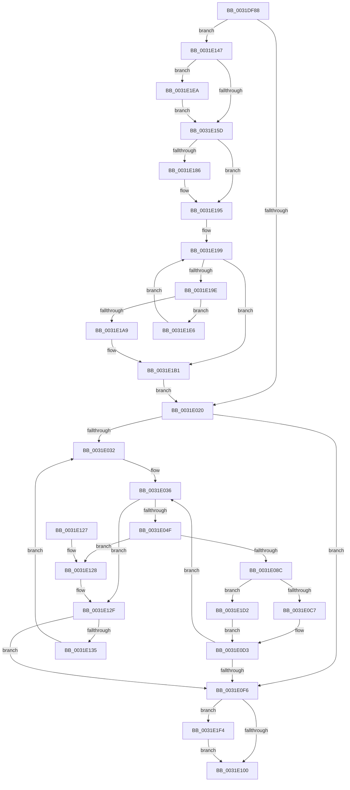

# MiGetLargePagesForChain

- RVA: `0x0031DF88`–`0x0031E202` (길이 `634` bytes)
- VA: `0x000000014031DF88`
- 실행 섹션: `.text`
- PDB 이름 있음: `예`; PDB Function 태그: `아니요`
- unwind 정보 RVA: `0x000751B4`
- 디코드: `157`개 명령, `634/634` bytes 표시
- 미해석 바이트: `0` (있으면 어셈블리에 `.byte`로 보존)

> 이 문서는 커널 이미지의 기계어와 PDB 기호를 분석해 생성했습니다. 4번과 5번은 함수 원형과 자료형을 바이너리 사용 방식에서 추정한 C 해석이며 원본 소스 복구 결과는 아닙니다.

## 1. Dependencies

- 직접 호출 지점: **5**; 고유 호출 대상: **5**
- 직접 호출자로 확인된 함수: **1**
- RIP 상대 이미지 참조: **3**

### Outgoing calls
- `0x0031DFC3` → [memset](../6C/memset_function_006C6C40.md) (function, `0x006C6C40`)
- `0x0031E07B` → [MiGetLargePage](MiGetLargePage_function_0031E210.md) (function, `0x0031E210`)
- `0x0031E09E` → [MiConvertLargeActivePageToChain](MiConvertLargeActivePageToChain_function_0031D980.md) (function, `0x0031D980`)
- `0x0031E107` → [_security_check_cookie](../6A/_security_check_cookie_function_006AC640.md) (function, `0x006AC640`)
- `0x0031E1F8` → [MiIssuePageHeatList](../44/MiIssuePageHeatList_function_0044615C.md) (function, `0x0044615C`)

### Direct callers
- [MiGetPageChain](../33/MiGetPageChain_function_00330130.md) at `0x0033058E`

### Static image references
- `0x0031DFA4` → RVA `0x00E0A740` (`.data`; read)
- `0x0031DFCC` → RVA `0x00000000` (`image boundary/outside`; read)
- `0x0031E147` → RVA `0x00FC5000` (`ALMOSTRO`; read)

## 2. Other-region calls and transfers

- 다른 실행 섹션으로 향하는 call: **0**
- 별도 외부 분기/꼬리 이동을 확인하지 못했습니다.

## 3. Assembly (complete function range)

```asm
0031DF88  48 89 5C 24 18                  mov qword ptr [rsp + 0x18], rbx
0031DF8D  55                              push rbp
0031DF8E  56                              push rsi
0031DF8F  57                              push rdi
0031DF90  41 54                           push r12
0031DF92  41 55                           push r13
0031DF94  41 56                           push r14
0031DF96  41 57                           push r15
0031DF98  48 8D 6C 24 D0                  lea rbp, [rsp - 0x30]
0031DF9D  48 81 EC 30 01 00 00            sub rsp, 0x130
0031DFA4  48 8B 05 95 C7 AE 00            mov rax, qword ptr [rip + 0xaec795]
0031DFAB  48 33 C4                        xor rax, rsp
0031DFAE  48 89 45 20                     mov qword ptr [rbp + 0x20], rax
0031DFB2  8B DA                           mov ebx, edx
0031DFB4  48 8B F1                        mov rsi, rcx
0031DFB7  33 D2                           xor edx, edx
0031DFB9  48 8D 4D A0                     lea rcx, [rbp - 0x60]
0031DFBD  41 B8 80 00 00 00               mov r8d, 0x80
0031DFC3  E8 78 8C 3A 00                  call 0x1406c6c40
0031DFC8  48 8B 56 40                     mov rdx, qword ptr [rsi + 0x40]
0031DFCC  4C 8D 15 2D 20 CE FF            lea r10, [rip - 0x31dfd3]
0031DFD3  44 8B 46 20                     mov r8d, dword ptr [rsi + 0x20]
0031DFD7  33 C0                           xor eax, eax
0031DFD9  0F 57 C0                        xorps xmm0, xmm0
0031DFDC  48 89 45 80                     mov qword ptr [rbp - 0x80], rax
0031DFE0  41 83 E0 01                     and r8d, 1
0031DFE4  89 45 88                        mov dword ptr [rbp - 0x78], eax
0031DFE7  41 C1 E0 04                     shl r8d, 4
0031DFEB  41 83 C0 02                     add r8d, 2
0031DFEF  48 89 54 24 48                  mov qword ptr [rsp + 0x48], rdx
0031DFF4  44 89 44 24 40                  mov dword ptr [rsp + 0x40], r8d
0031DFF9  44 8D 78 01                     lea r15d, [rax + 1]
0031DFFD  0F 11 45 90                     movups xmmword ptr [rbp - 0x70], xmm0
0031E001  C7 45 90 81 00 00 00            mov dword ptr [rbp - 0x70], 0x81
0031E008  0F 11 44 24 50                  movups xmmword ptr [rsp + 0x50], xmm0
0031E00D  0F 11 44 24 60                  movups xmmword ptr [rsp + 0x60], xmm0
0031E012  0F 11 44 24 70                  movups xmmword ptr [rsp + 0x70], xmm0
0031E017  48 85 D2                        test rdx, rdx
0031E01A  0F 84 27 01 00 00               je 0x14031e147
0031E020  48 8B 4E 50                     mov rcx, qword ptr [rsi + 0x50]
0031E024  48 2B 4E 68                     sub rcx, qword ptr [rsi + 0x68]
0031E028  48 83 F9 10                     cmp rcx, 0x10
0031E02C  0F 82 C4 00 00 00               jb 0x14031e0f6
0031E032  48 8D 7E 10                     lea rdi, [rsi + 0x10]
0031E036  48 8B 4E 50                     mov rcx, qword ptr [rsi + 0x50]
0031E03A  48 2B 4E 68                     sub rcx, qword ptr [rsi + 0x68]
0031E03E  45 8B E7                        mov r12d, r15d
0031E041  4B 3B 8C E2 60 1C 01 00         cmp rcx, qword ptr [r10 + r12*8 + 0x11c60]
0031E049  0F 82 E0 00 00 00               jb 0x14031e12f
0031E04F  8B 46 30                        mov eax, dword ptr [rsi + 0x30]
0031E052  48 8D 4D 90                     lea rcx, [rbp - 0x70]
0031E056  48 89 4C 24 38                  mov qword ptr [rsp + 0x38], rcx
0031E05B  44 8B CB                        mov r9d, ebx
0031E05E  48 8B 0E                        mov rcx, qword ptr [rsi]
0031E061  48 89 54 24 30                  mov qword ptr [rsp + 0x30], rdx
0031E066  48 8B 17                        mov rdx, qword ptr [rdi]
0031E069  44 89 44 24 28                  mov dword ptr [rsp + 0x28], r8d
0031E06E  45 8B C7                        mov r8d, r15d
0031E071  C1 E8 12                        shr eax, 0x12
0031E074  83 E0 03                        and eax, 3
0031E077  89 44 24 20                     mov dword ptr [rsp + 0x20], eax
0031E07B  E8 90 01 00 00                  call 0x14031e210
0031E080  4C 8B F0                        mov r14, rax
0031E083  48 85 C0                        test rax, rax
0031E086  0F 84 9C 00 00 00               je 0x14031e128
0031E08C  48 8D 05 6D 1F CE FF            lea rax, [rip - 0x31e093]
0031E093  49 8B CE                        mov rcx, r14
0031E096  4E 8B A4 E0 60 1C 01 00         mov r12, qword ptr [rax + r12*8 + 0x11c60]
0031E09E  E8 DD F8 FF FF                  call 0x14031d980
0031E0A3  4B 8D 0C 64                     lea rcx, [r12 + r12*2]
0031E0A7  49 8B C4                        mov rax, r12
0031E0AA  48 C1 E1 04                     shl rcx, 4
0031E0AE  48 83 C1 D0                     add rcx, -0x30
0031E0B2  48 C1 E0 0C                     shl rax, 0xc
0031E0B6  48 01 07                        add qword ptr [rdi], rax
0031E0B9  49 03 CE                        add rcx, r14
0031E0BC  48 83 7E 58 00                  cmp qword ptr [rsi + 0x58], 0
0031E0C1  0F 85 0B 01 00 00               jne 0x14031e1d2
0031E0C7  4C 89 76 58                     mov qword ptr [rsi + 0x58], r14
0031E0CB  48 89 4E 60                     mov qword ptr [rsi + 0x60], rcx
0031E0CF  4C 89 66 68                     mov qword ptr [rsi + 0x68], r12
0031E0D3  48 8B 4E 50                     mov rcx, qword ptr [rsi + 0x50]
0031E0D7  4C 8D 15 22 1F CE FF            lea r10, [rip - 0x31e0de]
0031E0DE  48 2B 4E 68                     sub rcx, qword ptr [rsi + 0x68]
0031E0E2  48 8B 54 24 48                  mov rdx, qword ptr [rsp + 0x48]
0031E0E7  44 8B 44 24 40                  mov r8d, dword ptr [rsp + 0x40]
0031E0EC  48 83 F9 10                     cmp rcx, 0x10
0031E0F0  0F 83 40 FF FF FF               jae 0x14031e036
0031E0F6  83 7D 94 00                     cmp dword ptr [rbp - 0x6c], 0
0031E0FA  0F 85 F4 00 00 00               jne 0x14031e1f4
0031E100  48 8B 4D 20                     mov rcx, qword ptr [rbp + 0x20]
0031E104  48 33 CC                        xor rcx, rsp
0031E107  E8 34 E5 38 00                  call 0x1406ac640
0031E10C  48 8B 9C 24 80 01 00 00         mov rbx, qword ptr [rsp + 0x180]
0031E114  48 81 C4 30 01 00 00            add rsp, 0x130
0031E11B  41 5F                           pop r15
0031E11D  41 5E                           pop r14
0031E11F  41 5D                           pop r13
0031E121  41 5C                           pop r12
0031E123  5F                              pop rdi
0031E124  5E                              pop rsi
0031E125  5D                              pop rbp
0031E126  C3                              ret
0031E127  CC                              int3
0031E128  4C 8D 15 D1 1E CE FF            lea r10, [rip - 0x31e12f]
0031E12F  41 83 FF 02                     cmp r15d, 2
0031E133  74 C1                           je 0x14031e0f6
0031E135  48 8B 54 24 48                  mov rdx, qword ptr [rsp + 0x48]
0031E13A  41 FF C7                        inc r15d
0031E13D  44 8B 44 24 40                  mov r8d, dword ptr [rsp + 0x40]
0031E142  E9 EB FE FF FF                  jmp 0x14031e032
0031E147  44 0F B7 05 B1 6E CA 00         movzx r8d, word ptr [rip + 0xca6eb1]
0031E14F  48 8D 54 24 50                  lea rdx, [rsp + 0x50]
0031E154  83 E2 04                        and edx, 4
0031E157  0F 85 8D 00 00 00               jne 0x14031e1ea
0031E15D  48 85 D2                        test rdx, rdx
0031E160  48 8D 44 24 54                  lea rax, [rsp + 0x54]
0031E165  4C 8D 4C 24 50                  lea r9, [rsp + 0x50]
0031E16A  49 8B CF                        mov rcx, r15
0031E16D  4C 0F 45 C8                     cmovne r9, rax
0031E171  49 8B C0                        mov rax, r8
0031E174  48 C1 E0 20                     shl rax, 0x20
0031E178  49 8B F9                        mov rdi, r9
0031E17B  49 0B C0                        or rax, r8
0031E17E  F3 48 AB                        rep stosq qword ptr [rdi], rax
0031E181  48 85 D2                        test rdx, rdx
0031E184  75 0F                           jne 0x14031e195
0031E186  48 F7 DA                        neg rdx
0031E189  48 1B C0                        sbb rax, rax
0031E18C  48 83 E0 FC                     and rax, 0xfffffffffffffffc
0031E190  46 89 44 08 08                  mov dword ptr [rax + r9 + 8], r8d
0031E195  33 C9                           xor ecx, ecx
0031E197  33 C0                           xor eax, eax
0031E199  83 F8 03                        cmp eax, 3
0031E19C  73 13                           jae 0x14031e1b1
0031E19E  49 83 BC C2 60 1C 01 00 10      cmp qword ptr [r10 + rax*8 + 0x11c60], 0x10
0031E1A7  75 3D                           jne 0x14031e1e6
0031E1A9  49 8B 8C C2 D0 EC E0 00         mov rcx, qword ptr [r10 + rax*8 + 0xe0ecd0]
0031E1B1  44 8B 44 24 40                  mov r8d, dword ptr [rsp + 0x40]
0031E1B6  48 8D 54 24 50                  lea rdx, [rsp + 0x50]
0031E1BB  0F 57 C0                        xorps xmm0, xmm0
0031E1BE  48 89 54 24 48                  mov qword ptr [rsp + 0x48], rdx
0031E1C3  66 0F 7F 45 80                  movdqa xmmword ptr [rbp - 0x80], xmm0
0031E1C8  48 89 4C 24 78                  mov qword ptr [rsp + 0x78], rcx
0031E1CD  E9 4E FE FF FF                  jmp 0x14031e020
0031E1D2  48 8B 46 60                     mov rax, qword ptr [rsi + 0x60]
0031E1D6  4C 89 30                        mov qword ptr [rax], r14
0031E1D9  4C 01 66 68                     add qword ptr [rsi + 0x68], r12
0031E1DD  48 89 4E 60                     mov qword ptr [rsi + 0x60], rcx
0031E1E1  E9 ED FE FF FF                  jmp 0x14031e0d3
0031E1E6  FF C0                           inc eax
0031E1E8  EB AF                           jmp 0x14031e199
0031E1EA  44 89 44 24 50                  mov dword ptr [rsp + 0x50], r8d
0031E1EF  E9 69 FF FF FF                  jmp 0x14031e15d
0031E1F4  48 8D 4D 90                     lea rcx, [rbp - 0x70]
0031E1F8  E8 5F 7F 12 00                  call 0x14044615c
0031E1FD  E9 FE FE FF FF                  jmp 0x14031e100
```

## 4. C-style interpretation (structured pseudocode)

```c
__int64 __fastcall MiGetLargePagesForChain(__int64 a1, int a2)
{
    __int64 result;
    __int64 v_r15;
    __int64 v_rsp;
    unsigned __int64 v_stack_m108;
    unsigned __int64 v_stack_m118;
    unsigned __int64 v_stack_m120;
    unsigned int v_stack_m128;
    unsigned __int64 v_stack_m130;
    unsigned __int64 v_stack_m138;
    unsigned int v_stack_m140;
    unsigned int v_stack_m148;
    unsigned __int64 v_stack_m48;
    unsigned __int64 v_stack_m68;
    unsigned __int64 v_stack_mC8;
    unsigned int v_stack_mD4;
    unsigned __int64 v_stack_mD8;
    unsigned int v_stack_mE0;
    unsigned __int64 v_stack_mE8;
    unsigned __int64 v_stack_mF8;
    unsigned __int64 v_stack_p18;
    unsigned int v_stack_p40;
    unsigned __int64 v_stack_p48;
    unsigned __int64 v_stack_p50;
    unsigned __int64 v_stack_p54;
    unsigned __int64 v_stack_p78;

    v_stack_p18 = v_rbx;
    v_rsp = (v_rsp) - (304);
    result = (*(unsigned __int64 *)(v_rip + 11454357)) ^ (v_rsp);
    v_stack_m48 = result;
    a2 = 0;
    result = memset(v_stack_mC8, a2, 128, a4);
    result = 0;
    v_stack_mE8 = 0;
    a3 = (unsigned int)(((unsigned int)(*(unsigned int *)(a1 + 32))) & (1));
    v_stack_mE0 = 0;
    a3 = (unsigned int)((a3) << (4));
    a3 = (unsigned int)((a3) + (2));
    v_stack_m120 = *(unsigned __int64 *)(a1 + 64);
    v_stack_m128 = (unsigned int)(a3);
    v_stack_mD8 = v_xmm0;
    v_stack_mD8 = 129;
    v_stack_m118 = v_xmm0;
    v_stack_m108 = v_xmm0;
    v_stack_mF8 = v_xmm0;
    if (*(unsigned __int64 *)(a1 + 64) == 0) goto loc_0031E147;
loc_0031E020:
    a1 = (*(unsigned __int64 *)(a1 + 80)) - (*(unsigned __int64 *)(a1 + 104));
    if (a1 < 16) goto loc_0031E0F6;
loc_0031E032:
loc_0031E036:
    a1 = (*(unsigned __int64 *)(a1 + 80)) - (*(unsigned __int64 *)(a1 + 104));
    if (a1 < (*(unsigned __int64 *)(v_rip - 3268563 + (unsigned int)((unsigned int)(result + 1)) * 8 + 72800))) goto loc_0031E12F;
    v_stack_m130 = v_stack_mD8;
    v_stack_m138 = *(unsigned __int64 *)(a1 + 64);
    v_stack_m140 = (unsigned int)(a3);
    result = (unsigned int)(((unsigned int)(*(unsigned int *)(a1 + 48))) >> (18));
    result = (unsigned int)((result) & (3));
    v_stack_m148 = (unsigned int)(result);
    result = MiGetLargePage(*(unsigned __int64 *)(a1), *(unsigned __int64 *)(a1 + 16), (unsigned int)((unsigned int)(result + 1)), (unsigned int)((unsigned int)((unsigned int)(a2))));
    if (result == 0) goto loc_0031E128;
    result = MiConvertLargeActivePageToChain(result, *(unsigned __int64 *)(a1 + 16), (unsigned int)((unsigned int)(result + 1)), (unsigned int)((unsigned int)((unsigned int)(a2))));
    a1 = (*(unsigned __int64 *)(v_rip - 3268755 + (unsigned int)((unsigned int)(result + 1)) * 8 + 72800) + *(unsigned __int64 *)(v_rip - 3268755 + (unsigned int)((unsigned int)(result + 1)) * 8 + 72800) * 2) << (4);
    a1 = (a1) + (-48);
    result = (*(unsigned __int64 *)(v_rip - 3268755 + (unsigned int)((unsigned int)(result + 1)) * 8 + 72800)) << (12);
    a1 = (a1) + (result);
    if ((*(unsigned __int64 *)(a1 + 88)) != 0) goto loc_0031E1D2;
    *(unsigned __int64 *)(a1 + 88) = result;
    *(unsigned __int64 *)(a1 + 96) = a1;
    *(unsigned __int64 *)(a1 + 104) = *(unsigned __int64 *)(v_rip - 3268755 + (unsigned int)((unsigned int)(result + 1)) * 8 + 72800);
loc_0031E0D3:
    a1 = (*(unsigned __int64 *)(a1 + 80)) - (*(unsigned __int64 *)(a1 + 104));
    if (a1 >= 16) goto loc_0031E036;
loc_0031E0F6:
    if (v_stack_mD4 != 0) goto loc_0031E1F4;
loc_0031E100:
    a1 = (v_stack_m48) ^ (v_rsp);
    result = _security_check_cookie(a1, v_stack_m120, (unsigned int)(v_stack_m128), (unsigned int)((unsigned int)((unsigned int)(a2))));
    v_rsp = (v_rsp) + (304);
    return result;
loc_0031E128:
loc_0031E12F:
    if (((unsigned int)(result + 1)) == 2) goto loc_0031E0F6;
    v_r15 = (unsigned int)((result + 1) + 1);
    goto loc_0031E032;
loc_0031E147:
    a2 = (unsigned int)((v_stack_p50) & (4));
    if (condition_is_not_equal) goto loc_0031E1EA;
loc_0031E15D:
    a4 = v_stack_p50;
    if (a2 != 0) { a4 = v_stack_p54; }
    result = (*(unsigned __int16 *)(v_rip + 13266609)) << (32);
    result = (result) | (*(unsigned __int16 *)(v_rip + 13266609));
    if (a2 == 0) {
        a2 = -(a2);
        result = (result) & (-4);
        *(unsigned int *)(result + a4 * 1 + 8) = (unsigned int)(*(unsigned __int16 *)(v_rip + 13266609));
    }
    a1 = 0;
    result = 0;
loc_0031E199:
    if (0 >= 3) goto loc_0031E1B1;
    if ((*(unsigned __int64 *)(v_rip - 3268911 + result * 8 + 72800)) != 16) goto loc_0031E1E6;
loc_0031E1B1:
    v_stack_p48 = v_stack_p50;
    v_stack_mE8 = v_xmm0;
    v_stack_p78 = *(unsigned __int64 *)(v_rip - 3268911 + result * 8 + 14740688);
    goto loc_0031E020;
loc_0031E1D2:
    *(unsigned __int64 *)(*(unsigned __int64 *)(a1 + 96)) = 0;
    *(unsigned __int64 *)(a1 + 96) = *(unsigned __int64 *)(v_rip - 3268911 + result * 8 + 14740688);
    goto loc_0031E0D3;
loc_0031E1E6:
    result = (unsigned int)((*(unsigned __int64 *)(a1 + 96)) + 1);
    goto loc_0031E199;
loc_0031E1EA:
    v_stack_p50 = (unsigned int)((unsigned int)(v_stack_p40));
    goto loc_0031E15D;
loc_0031E1F4:
    result = MiIssuePageHeatList(v_stack_mD8, v_stack_p50, (unsigned int)(v_stack_p40), a4);
    goto loc_0031E100;
}
```

## 5. (Beta) C Style

```c
int64_t MiGetLargePagesForChain(void *Arg1, int32_t Arg2)
{
    uint8_t *arg1 = (uint8_t *)Arg1;

    int64_t result;
    int64_t local_r15;
    int64_t local_rsp;
    uint64_t v_stack_m108;
    uint64_t v_stack_m118;
    uint64_t v_stack_m120;
    uint32_t v_stack_m128;
    uint64_t v_stack_m130;
    uint64_t v_stack_m138;
    uint32_t v_stack_m140;
    uint32_t v_stack_m148;
    uint64_t v_stack_m48;
    uint64_t v_stack_m68;
    uint64_t v_stack_mC8;
    uint32_t v_stack_mD4;
    uint64_t v_stack_mD8;
    uint32_t v_stack_mE0;
    uint64_t v_stack_mE8;
    uint64_t v_stack_mF8;
    uint64_t v_stack_p18;
    uint32_t v_stack_p40;
    uint64_t v_stack_p48;
    uint64_t v_stack_p50;
    uint64_t v_stack_p54;
    uint64_t v_stack_p78;

    v_stack_p18 = local_rbx;
    local_rsp = (local_rsp) - (304);
    result = (*(uint64_t *)(v_rip + 0xAEC795)) ^ (local_rsp);
    v_stack_m48 = result;
    Arg2 = 0;
    result = memset(v_stack_mC8, Arg2, 128, a4);
    result = 0;
    v_stack_mE8 = 0;
    a3 = (uint32_t)(((uint32_t)(*(uint32_t *)(arg1 + 0x20))) & (1));
    v_stack_mE0 = 0;
    a3 = (uint32_t)((a3) << (4));
    a3 = (uint32_t)((a3) + (2));
    v_stack_m120 = *(uint64_t *)(arg1 + 0x40);
    v_stack_m128 = (uint32_t)(a3);
    v_stack_mD8 = v_xmm0;
    v_stack_mD8 = 129;
    v_stack_m118 = v_xmm0;
    v_stack_m108 = v_xmm0;
    v_stack_mF8 = v_xmm0;
    if (*(uint64_t *)(arg1 + 0x40) == 0) goto loc_0031E147;
loc_0031E020:
    Arg1 = (*(uint64_t *)(arg1 + 0x50)) - (*(uint64_t *)(arg1 + 0x68));
    if (Arg1 < 16) goto loc_0031E0F6;
loc_0031E032:
loc_0031E036:
    Arg1 = (*(uint64_t *)(arg1 + 0x50)) - (*(uint64_t *)(arg1 + 0x68));
    if (Arg1 < (*(uint64_t *)(v_rip - 0x31DFD3 + (uint32_t)((uint32_t)(result + 0x1)) * 8 + 0x11C60))) goto loc_0031E12F;
    v_stack_m130 = v_stack_mD8;
    v_stack_m138 = *(uint64_t *)(arg1 + 0x40);
    v_stack_m140 = (uint32_t)(a3);
    result = (uint32_t)(((uint32_t)(*(uint32_t *)(arg1 + 0x30))) >> (18));
    result = (uint32_t)((result) & (3));
    v_stack_m148 = (uint32_t)(result);
    result = MiGetLargePage(*(uint64_t *)(arg1), *(uint64_t *)(arg1 + 0x10), (uint32_t)((uint32_t)(result + 1)), (uint32_t)((uint32_t)((uint32_t)(Arg2))));
    if (result == 0) goto loc_0031E128;
    result = MiConvertLargeActivePageToChain(result, *(uint64_t *)(arg1 + 0x10), (uint32_t)((uint32_t)(result + 1)), (uint32_t)((uint32_t)((uint32_t)(Arg2))));
    Arg1 = (*(uint64_t *)(v_rip - 0x31E093 + (uint32_t)((uint32_t)(result + 0x1)) * 8 + 0x11C60) + *(uint64_t *)(v_rip - 0x31E093 + (uint32_t)((uint32_t)(result + 0x1)) * 8 + 0x11C60) * 2) << (4);
    Arg1 = (Arg1) + (-48);
    result = (*(uint64_t *)(v_rip - 0x31E093 + (uint32_t)((uint32_t)(result + 0x1)) * 8 + 0x11C60)) << (12);
    Arg1 = (Arg1) + (result);
    if ((*(uint64_t *)(arg1 + 0x58)) != 0) goto loc_0031E1D2;
    *(uint64_t *)(arg1 + 0x58) = result;
    *(void **)(arg1 + 0x60) = Arg1;
    *(uint64_t *)(arg1 + 0x68) = *(uint64_t *)(v_rip - 0x31E093 + (uint32_t)((uint32_t)(result + 0x1)) * 8 + 0x11C60);
loc_0031E0D3:
    Arg1 = (*(uint64_t *)(arg1 + 0x50)) - (*(uint64_t *)(arg1 + 0x68));
    if (Arg1 >= 16) goto loc_0031E036;
loc_0031E0F6:
    if (v_stack_mD4 != 0) goto loc_0031E1F4;
loc_0031E100:
    Arg1 = (v_stack_m48) ^ (local_rsp);
    result = _security_check_cookie(Arg1, v_stack_m120, (uint32_t)(v_stack_m128), (uint32_t)((uint32_t)((uint32_t)(Arg2))));
    local_rsp = (local_rsp) + (304);
    return result;
loc_0031E128:
loc_0031E12F:
    if (((uint32_t)(result + 1)) == 2) goto loc_0031E0F6;
    local_r15 = (uint32_t)((result + 1) + 1);
    goto loc_0031E032;
loc_0031E147:
    Arg2 = (uint32_t)((v_stack_p50) & (4));
    if (condition_is_not_equal) goto loc_0031E1EA;
loc_0031E15D:
    a4 = v_stack_p50;
    if (Arg2 != 0) { a4 = v_stack_p54; }
    result = (*(uint16_t *)(v_rip + 0xCA6EB1)) << (32);
    result = (result) | (*(uint16_t *)(v_rip + 0xCA6EB1));
    if (Arg2 == 0) {
        Arg2 = -(Arg2);
        result = (result) & (-4);
        *(uint32_t *)(result + a4 * 1 + 0x8) = (uint32_t)(*(uint16_t *)(v_rip + 0xCA6EB1));
    }
    Arg1 = 0;
    result = 0;
loc_0031E199:
    if (0 >= 3) goto loc_0031E1B1;
    if ((*(uint64_t *)(v_rip - 0x31E12F + result * 8 + 0x11C60)) != 16) goto loc_0031E1E6;
loc_0031E1B1:
    v_stack_p48 = v_stack_p50;
    v_stack_mE8 = v_xmm0;
    v_stack_p78 = *(uint64_t *)(v_rip - 0x31E12F + result * 8 + 0xE0ECD0);
    goto loc_0031E020;
loc_0031E1D2:
    *(uint64_t *)(*(uint64_t *)(arg1 + 0x60)) = 0;
    *(uint64_t *)(arg1 + 0x60) = *(uint64_t *)(v_rip - 0x31E12F + result * 8 + 0xE0ECD0);
    goto loc_0031E0D3;
loc_0031E1E6:
    result = (uint32_t)((*(uint64_t *)(arg1 + 0x60)) + 1);
    goto loc_0031E199;
loc_0031E1EA:
    v_stack_p50 = (uint32_t)((uint32_t)(v_stack_p40));
    goto loc_0031E15D;
loc_0031E1F4:
    result = MiIssuePageHeatList(v_stack_mD8, v_stack_p50, (uint32_t)(v_stack_p40), a4);
    goto loc_0031E100;
}
```

### 관측된 메모리 오프셋

구조체 형식이 확인되지 않은 접근은 인자 기준의 오프셋으로만 기록했습니다.

| 기준 인자 | 오프셋 표현 | 폭 (bit) | 접근 |
|---|---:|---:|---|
| `Arg1` | `+ 0x0` | `64` | `R` |
| `Arg1` | `+ 0x0` | `64` | `R/W` |
| `Arg1` | `+ 0x10` | `64` | `R` |
| `Arg1` | `+ 0x20` | `32` | `R` |
| `Arg1` | `+ 0x30` | `32` | `R` |
| `Arg1` | `+ 0x40` | `64` | `R` |
| `Arg1` | `+ 0x50` | `64` | `R` |
| `Arg1` | `+ 0x58` | `64` | `R` |
| `Arg1` | `+ 0x58` | `64` | `W` |
| `Arg1` | `+ 0x60` | `64` | `R` |
| `Arg1` | `+ 0x60` | `64` | `W` |
| `Arg1` | `+ 0x68` | `64` | `R` |
| `Arg1` | `+ 0x68` | `64` | `R/W` |
| `Arg1` | `+ 0x68` | `64` | `W` |

## 6. Execution-region graph

[열기: 2D/3D 그래프와 함수 탐색 컨트롤 패널](../../../control-panel.html?section=text&rva=0x0031DF88&view=graph)

- 2D 그래프는 위에서 아래로 흐르고, 3D 그래프는 빈 공간을 드래그해 회전합니다. Shift+드래그는 이동, 휠은 확대·축소, 함수 노드 선택은 대상 보고서 이동입니다.

### Static fallback


