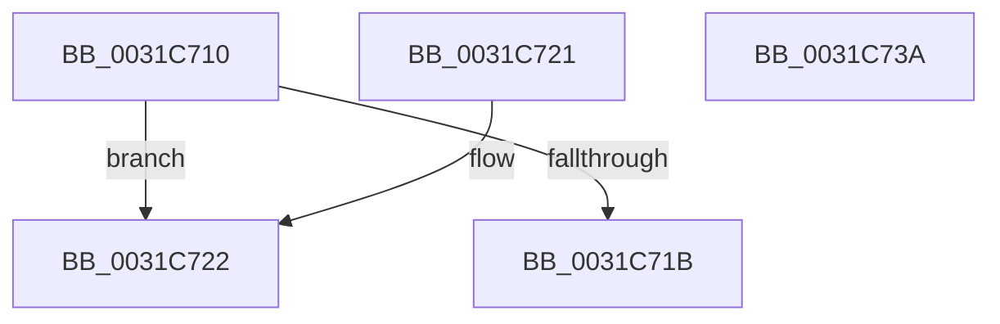

# MiGetPfnPageSizeIndex

- RVA: `0x0031C710`–`0x0031C73B` (길이 `43` bytes)
- VA: `0x000000014031C710`
- 실행 섹션: `.text`
- PDB 이름 있음: `예`; PDB Function 태그: `아니요`
- unwind 정보 RVA: `0x000DB714`
- 디코드: `16`개 명령, `43/43` bytes 표시
- 미해석 바이트: `0` (있으면 어셈블리에 `.byte`로 보존)

> 이 문서는 커널 이미지의 기계어와 PDB 기호를 분석해 생성했습니다. 4번과 5번은 함수 원형과 자료형을 바이너리 사용 방식에서 추정한 C 해석이며 원본 소스 복구 결과는 아닙니다.

## 1. Dependencies

- 직접 호출 지점: **0**; 고유 호출 대상: **0**
- 직접 호출자로 확인된 함수: **44**
- RIP 상대 이미지 참조: **0**

### Outgoing calls
- 직접 디코드된 call 명령이 없습니다.

### Direct callers
- [MiDemoteLocalLargePage](../28/MiDemoteLocalLargePage_function_0028A4F0.md) at `0x0028A814`
- [MiFindContiguousPagesEx](../28/MiFindContiguousPagesEx_function_0028BDE0.md) at `0x0028CA5C`
- [MiTradePage](../28/MiTradePage_function_0028D160.md) at `0x0028D8FF`
- [MiFreeLargePages](../2A/MiFreeLargePages_function_002A99D0.md) at `0x002A9C35`
- [MiZeroChainWorker](../2C/MiZeroChainWorker_function_002C67C8.md) at `0x002C6882`
- [MiZeroWithUltraSpace](../2C/MiZeroWithUltraSpace_function_002C6C9C.md) at `0x002C6CD3`
- [MiInitializeLargeMdlLeafPfns](../2C/MiInitializeLargeMdlLeafPfns_function_002C8EA4.md) at `0x002C8F30`
- [MiPfnsWorthTrying](MiPfnsWorthTrying_function_0031B0C0.md) at `0x0031B3A1`
- [MiActivePageClaimCandidate](MiActivePageClaimCandidate_function_0031BB00.md) at `0x0031C2FB`
- [sub_0031CBBA](Unknown_function_0031CBBA.md) at `0x0031CBD3`
- [MiConvertLargeActivePageToChain](MiConvertLargeActivePageToChain_function_0031D980.md) at `0x0031D99F`
- [MiChangePageAttribute](../33/MiChangePageAttribute_function_00332ECC.md) at `0x00332EFE`
- [MiProcessPageGroupInfo](../37/MiProcessPageGroupInfo_function_00376910.md) at `0x003769A2`
- [MiFinishLargePageFree](../37/MiFinishLargePageFree_function_00377B94.md) at `0x00377BCD`
- [MiLargePagePromote](../37/MiLargePagePromote_function_0037915C.md) at `0x003791B0`
- [MiLargePfnPromoteCandidate](../37/MiLargePfnPromoteCandidate_function_0037AB4C.md) at `0x0037ABA1`
- [MiGetFastLargePages](../3B/MiGetFastLargePages_function_003B7EE0.md) at `0x003B8084`
- [MiGetFastLargePages](../3B/MiGetFastLargePages_function_003B7EE0.md) at `0x003B8129`
- [MiFreeListPageContentsChanged](../3B/MiFreeListPageContentsChanged_function_003BD4BC.md) at `0x003BD500`
- [MiConvertLargeFreePageToActive](../42/MiConvertLargeFreePageToActive_function_00420974.md) at `0x00420994`
- [MiConvertActiveLargePageToSmall](../42/MiConvertActiveLargePageToSmall_function_00420AF8.md) at `0x00420B1A`
- [MiDemoteLargeFreePage](../43/MiDemoteLargeFreePage_function_00435118.md) at `0x00435177`
- [MiInsertDemotedPages](../43/MiInsertDemotedPages_function_004354B8.md) at `0x004354E5`
- [MiSetPageZeroInProgress](../43/MiSetPageZeroInProgress_function_0043B980.md) at `0x0043BAFB`
- [MiGetPfnPageSizeIndexUnsynchronized](../46/MiGetPfnPageSizeIndexUnsynchronized_function_0046C008.md) at `0x0046C0C3`
- [MiLargePageHasNoDanglingReferences](../48/MiLargePageHasNoDanglingReferences_function_00485A24.md) at `0x00485A2D`
- [MiMirrorRemoveInactivePages](../4A/MiMirrorRemoveInactivePages_function_004AC24C.md) at `0x004AC2F2`
- [MiPurgeZeroListHead](../4C/MiPurgeZeroListHead_function_004CE464.md) at `0x004CE510`
- [MiFindLargeNodePage](../4D/MiFindLargeNodePage_function_004DB7E8.md) at `0x004DB8F4`
- [MiInitializeFoundLargeNodePage](../4F/MiInitializeFoundLargeNodePage_function_004F97E8.md) at `0x004F9808`
- [MiUpdateLargePageSectionPfns](../67/MiUpdateLargePageSectionPfns_function_00678F8C.md) at `0x00678FEF`
- [MiSetPfnRemovalRequested](../67/MiSetPfnRemovalRequested_function_0067A4D0.md) at `0x0067A5AB`
- [MiFreeContiguousLargePageRun](../68/MiFreeContiguousLargePageRun_function_00688A34.md) at `0x00688B11`
- [MiInsertPossiblyBadPage](../68/MiInsertPossiblyBadPage_function_00689DF0.md) at `0x00689EAD`
- [MiDemoteValidLargePageOneLevel](../68/MiDemoteValidLargePageOneLevel_function_0068A3F4.md) at `0x0068A839`
- [MiGetBaseResidentPageForBugCheck](../68/MiGetBaseResidentPageForBugCheck_function_0068AB60.md) at `0x0068ABD9`
- [MiGetPagesRemainingInResidentPage](../68/MiGetPagesRemainingInResidentPage_function_0068AC14.md) at `0x0068AC84`
- [MiTryUnlinkNodeLargePages](../68/MiTryUnlinkNodeLargePages_function_0068ADA0.md) at `0x0068AEF4`
- [MiTransferPartitionPageRun](../69/MiTransferPartitionPageRun_function_00691DCC.md) at `0x00691F9B`
- [MiCoalesceActivePagesIntoFree](../69/MiCoalesceActivePagesIntoFree_function_00693558.md) at `0x006935B1`
- [MiScrubLargePage](../69/MiScrubLargePage_function_006942E8.md) at `0x0069440B`
- [MiNextPhysicallyContiguousPfnWorthTrying](../69/MiNextPhysicallyContiguousPfnWorthTrying_function_006993EC.md) at `0x0069945E`
- [sub_006DCA72](../6D/Unknown_function_006DCA72.md) at `0x006DCAB6`
- [MiScrubLargePageRegions](../../page/70/MiScrubLargePageRegions_function_007011B4.md) at `0x00701299`
- [MiAllocatePartitionPhysicalPages](../../page/80/MiAllocatePartitionPhysicalPages_function_0080C9D4.md) at `0x0080CCFF`

### Static image references
- 디코드된 RIP-relative 메모리 참조가 없습니다.

## 2. Other-region calls and transfers

- 다른 실행 섹션으로 향하는 call: **0**
- 별도 외부 분기/꼬리 이동을 확인하지 못했습니다.

## 3. Assembly (complete function range)

```asm
0031C710  48 8B 41 28                     mov rax, qword ptr [rcx + 0x28]
0031C714  48 0F BA E0 28                  bt rax, 0x28
0031C719  72 07                           jb 0x14031c722
0031C71B  B8 03 00 00 00                  mov eax, 3
0031C720  C3                              ret
0031C721  CC                              int3
0031C722  8B 49 24                        mov ecx, dword ptr [rcx + 0x24]
0031C725  BA 03 00 00 00                  mov edx, 3
0031C72A  C1 E9 1B                        shr ecx, 0x1b
0031C72D  8B C2                           mov eax, edx
0031C72F  83 E1 03                        and ecx, 3
0031C732  2B C1                           sub eax, ecx
0031C734  3B C2                           cmp eax, edx
0031C736  0F 44 C2                        cmove eax, edx
0031C739  C3                              ret
0031C73A  CC                              int3
```

## 4. C-style interpretation (structured pseudocode)

```c
__int64 __fastcall MiGetPfnPageSizeIndex(__int64 a1)
{
    __int64 result;

    if (condition_is_below) goto loc_0031C722;
    return 3;
loc_0031C722:
    a1 = (unsigned int)(((unsigned int)(*(unsigned int *)(a1 + 36))) >> (27));
    a1 = (unsigned int)((a1) & (3));
    result = (unsigned int)((3) - ((unsigned int)(a1)));
    if (((unsigned int)(result)) == 3) { result = 3; }
    return result;
}
```

## 5. (Beta) C Style

```c
int64_t MiGetPfnPageSizeIndex(void *Arg1)
{
    uint8_t *arg1 = (uint8_t *)Arg1;

    int64_t result;

    if (condition_is_below) goto loc_0031C722;
    return 3;
loc_0031C722:
    Arg1 = (uint32_t)(((uint32_t)(*(uint32_t *)(arg1 + 0x24))) >> (27));
    Arg1 = (uint32_t)((Arg1) & (3));
    result = (uint32_t)((3) - ((uint32_t)(Arg1)));
    if (((uint32_t)(result)) == 3) { result = 3; }
    return result;
}
```

### 관측된 메모리 오프셋

구조체 형식이 확인되지 않은 접근은 인자 기준의 오프셋으로만 기록했습니다.

| 기준 인자 | 오프셋 표현 | 폭 (bit) | 접근 |
|---|---:|---:|---|
| `Arg1` | `+ 0x24` | `32` | `R` |
| `Arg1` | `+ 0x28` | `64` | `R` |

## 6. Execution-region graph

[열기: 2D/3D 그래프와 함수 탐색 컨트롤 패널](../../../control-panel.html?section=text&rva=0x0031C710&view=graph)

- 2D 그래프는 위에서 아래로 흐르고, 3D 그래프는 빈 공간을 드래그해 회전합니다. Shift+드래그는 이동, 휠은 확대·축소, 함수 노드 선택은 대상 보고서 이동입니다.

### Static fallback


