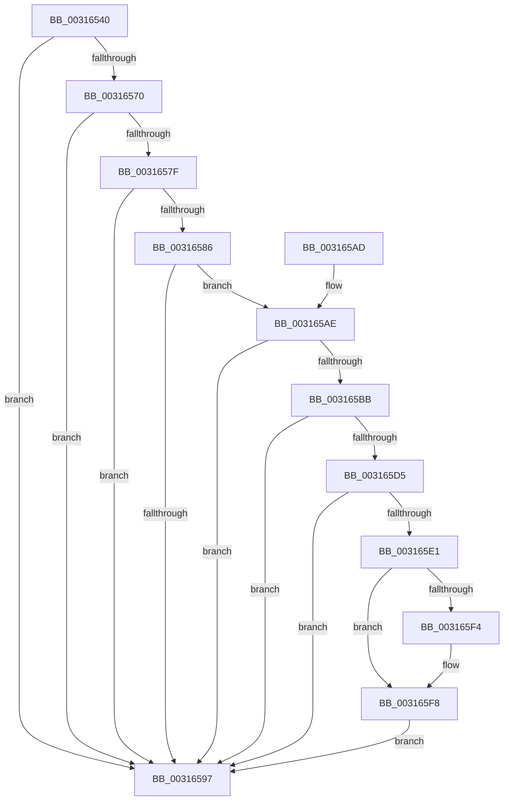

# MiGetWsleContents

- RVA: `0x00316540`–`0x00316608` (길이 `200` bytes)
- VA: `0x0000000140316540`
- 실행 섹션: `.text`
- PDB 이름 있음: `예`; PDB Function 태그: `아니요`
- unwind 정보 RVA: `0x000DB714`
- 디코드: `50`개 명령, `200/200` bytes 표시
- 미해석 바이트: `0` (있으면 어셈블리에 `.byte`로 보존)

> 이 문서는 커널 이미지의 기계어와 PDB 기호를 분석해 생성했습니다. 4번과 5번은 함수 원형과 자료형을 바이너리 사용 방식에서 추정한 C 해석이며 원본 소스 복구 결과는 아닙니다.

## 1. Dependencies

- 직접 호출 지점: **0**; 고유 호출 대상: **0**
- 직접 호출자로 확인된 함수: **29**
- RIP 상대 이미지 참조: **1**

### Outgoing calls
- 직접 디코드된 call 명령이 없습니다.

### Direct callers
- [MiDemoteCombinedPte](../22/MiDemoteCombinedPte_function_0022ABAC.md) at `0x0022ACCF`
- [MiCombineWithExisting](../22/MiCombineWithExisting_function_0022B4B8.md) at `0x0022B6AB`
- [MiBuildForkPte](../22/MiBuildForkPte_function_0022E32C.md) at `0x0022E479`
- [MiDecommitAddToList](../24/MiDecommitAddToList_function_00242264.md) at `0x00242434`
- [MiSetReadOnlyOnSectionView](../29/MiSetReadOnlyOnSectionView_function_00294538.md) at `0x002946B7`
- [MiPteForTrimmedProto](../29/MiPteForTrimmedProto_function_0029496C.md) at `0x0029497F`
- [MiGetWorkingSetInfoList](../2A/MiGetWorkingSetInfoList_function_002AF770.md) at `0x002AFD80`
- [sub_002C3A7C](../2C/Unknown_function_002C3A7C.md) at `0x002C41AB`
- [MiTrimSharedPageFromViews](../2E/MiTrimSharedPageFromViews_function_002E16F8.md) at `0x002E1F82`
- [MiSharePages](MiSharePages_function_00315110.md) at `0x00315582`
- [MiCrcStillIntact](MiCrcStillIntact_function_00317028.md) at `0x00317198`
- [MiCopyOnWrite](../36/MiCopyOnWrite_function_00362A0C.md) at `0x00362BD0`
- [MiLockCode](../36/MiLockCode_function_0036F91C.md) at `0x0036FA14`
- [MiLockCode](../36/MiLockCode_function_0036F91C.md) at `0x0036FE14`
- [MiOutSwapWorkingSetPte](../37/MiOutSwapWorkingSetPte_function_00372190.md) at `0x003725FF`
- [MiMakeDriverPageStayResident](../38/MiMakeDriverPageStayResident_function_00385D18.md) at `0x00385D65`
- [MiUnlockWsle](../40/MiUnlockWsle_function_00407F84.md) at `0x004080E6`
- [NtLockVirtualMemory](../40/NtLockVirtualMemory_function_004088A0.md) at `0x00408BA3`
- [MiProcessVpabAccessedInfo](../42/MiProcessVpabAccessedInfo_function_00428FD4.md) at `0x0042900B`
- [MiDeprioritizeVirtualAddresses](../42/MiDeprioritizeVirtualAddresses_function_0042AD1C.md) at `0x0042AE7B`
- [MiConvertAndFlushWsleVas](../49/MiConvertAndFlushWsleVas_function_00492CB4.md) at `0x00492D91`
- [MiMakeVaRangeNoAccess](../4A/MiMakeVaRangeNoAccess_function_004A3CE0.md) at `0x004A3E0E`
- [MiSetPagingOfDriver](../4A/MiSetPagingOfDriver_function_004A76C4.md) at `0x004A784E`
- [MiUnmapKernelScp](../4A/MiUnmapKernelScp_function_004A82E8.md) at `0x004A83EF`
- [NtUnlockVirtualMemory](../4E/NtUnlockVirtualMemory_function_004EE890.md) at `0x004EEC63`
- [MiPageBootRegistry](../66/MiPageBootRegistry_function_0066E82C.md) at `0x0066E9E1`
- [MiClearDriverTablePtes](../68/MiClearDriverTablePtes_function_00683024.md) at `0x00683165`
- [MiStoreDiscardPoisonedPage](../69/MiStoreDiscardPoisonedPage_function_00692858.md) at `0x00692B9F`
- [sub_006D9212](../6D/Unknown_function_006D9212.md) at `0x006D93E6`
- [sub_006DB77C](../6D/Unknown_function_006DB77C.md) at `0x006DB7F4`

### Static image references
- `0x003165AE` → RVA `0x00FC6A88` (`ALMOSTRO`; read)

## 2. Other-region calls and transfers

- 다른 실행 섹션으로 향하는 call: **0**
- 별도 외부 분기/꼬리 이동을 확인하지 못했습니다.

## 3. Assembly (complete function range)

```asm
00316540  48 C1 EA 09                     shr rdx, 9
00316544  48 B8 F8 FF FF FF 7F 00 00 00   movabs rax, 0x7ffffffff8
0031654E  48 23 D0                        and rdx, rax
00316551  48 B8 00 00 00 00 80 F6 FF FF   movabs rax, 0xfffff68000000000
0031655B  48 03 D0                        add rdx, rax
0031655E  48 8B 02                        mov rax, qword ptr [rdx]
00316561  48 B9 00 D0 BE 7D FB F6 FF FF   movabs rcx, 0xfffff6fb7dbed000
0031656B  48 3B D1                        cmp rdx, rcx
0031656E  72 27                           jb 0x140316597
00316570  48 B9 F8 D7 BE 7D FB F6 FF FF   movabs rcx, 0xfffff6fb7dbed7f8
0031657A  48 3B D1                        cmp rdx, rcx
0031657D  77 18                           ja 0x140316597
0031657F  48 8B C8                        mov rcx, rax
00316582  A8 01                           test al, 1
00316584  74 11                           je 0x140316597
00316586  A8 42                           test al, 0x42
00316588  41 0F 95 C1                     setne r9b
0031658C  A8 20                           test al, 0x20
0031658E  41 0F 95 C0                     setne r8b
00316592  45 84 C8                        test r8b, r9b
00316595  74 17                           je 0x1403165ae
00316597  48 8B C8                        mov rcx, rax
0031659A  48 C1 E8 38                     shr rax, 0x38
0031659E  48 C1 E9 3C                     shr rcx, 0x3c
003165A2  24 0F                           and al, 0xf
003165A4  80 E1 07                        and cl, 7
003165A7  C0 E1 04                        shl cl, 4
003165AA  0A C1                           or al, cl
003165AC  C3                              ret
003165AD  CC                              int3
003165AE  48 F7 05 CF 04 CB 00 00 00 60 00  test qword ptr [rip + 0xcb04cf], 0x600000
003165B9  74 DC                           je 0x140316597
003165BB  65 4C 8B 04 25 88 01 00 00      mov r8, qword ptr gs:[0x188]
003165C4  4D 8B 88 B8 00 00 00            mov r9, qword ptr [r8 + 0xb8]
003165CB  41 80 B9 60 01 00 00 01         cmp byte ptr [r9 + 0x160], 1
003165D3  74 C2                           je 0x140316597
003165D5  4D 8B 81 08 05 00 00            mov r8, qword ptr [r9 + 0x508]
003165DC  4D 85 C0                        test r8, r8
003165DF  74 B6                           je 0x140316597
003165E1  48 C1 EA 03                     shr rdx, 3
003165E5  81 E2 FF 01 00 00               and edx, 0x1ff
003165EB  49 8B 14 D0                     mov rdx, qword ptr [r8 + rdx*8]
003165EF  F6 C2 20                        test dl, 0x20
003165F2  74 04                           je 0x1403165f8
003165F4  48 83 C9 20                     or rcx, 0x20
003165F8  48 8B C1                        mov rax, rcx
003165FB  48 83 C8 42                     or rax, 0x42
003165FF  F6 C2 42                        test dl, 0x42
00316602  48 0F 44 C1                     cmove rax, rcx
00316606  EB 8F                           jmp 0x140316597
```

## 4. C-style interpretation (structured pseudocode)

```c
__int64 __fastcall MiGetWsleContents(__int64 a1, __int64 a2)
{
    __int64 result;

    a2 = (a2) >> (9);
    a2 = (a2) & (result);
    a2 = (a2) + (result);
    if (a2 < a1) goto loc_00316597;
    if (a2 > a1) goto loc_00316597;
    if ((((unsigned __int8)(*(unsigned __int64 *)(a2))) & (1)) == 0) goto loc_00316597;
    a4 = ((((unsigned __int8)(*(unsigned __int64 *)(a2))) & (66)) != 0) ? 1 : 0;
    a3 = ((((unsigned __int8)(*(unsigned __int64 *)(a2))) & (32)) != 0) ? 1 : 0;
    if ((((unsigned __int8)(a3)) & ((unsigned __int8)(a4))) == 0) goto loc_003165AE;
loc_00316597:
    result = (*(unsigned __int64 *)(a2)) >> (56);
    a1 = (*(unsigned __int64 *)(a2)) >> (60);
    result = (unsigned __int8)((result) & (15));
    a1 = (unsigned __int8)((a1) & (7));
    a1 = (unsigned __int8)((a1) << (4));
    result = (unsigned __int8)((result) | ((unsigned __int8)(a1)));
    return result;
loc_003165AE:
    if (((*(unsigned __int64 *)(v_rip + 13305039)) & (0x600000ULL)) == 0) goto loc_00316597;
    if ((*(unsigned __int8 *)(*(unsigned __int64 *)(*(unsigned __int64 *)(gs_base + (0 + 392)) + 184) + 352)) == 1) goto loc_00316597;
    if (*(unsigned __int64 *)(*(unsigned __int64 *)(*(unsigned __int64 *)(gs_base + (0 + 392)) + 184) + 1288) == 0) goto loc_00316597;
    a2 = (a2) >> (3);
    a2 = (unsigned int)((a2) & (511));
    if ((((unsigned __int8)(*(unsigned __int64 *)(*(unsigned __int64 *)(*(unsigned __int64 *)(*(unsigned __int64 *)(gs_base + (0 + 392)) + 184) + 1288) + a2 * 8))) & (32)) != 0) {
        a1 = (a1) | (32);
    }
    result = (a1) | (66);
    if ((((unsigned __int8)(*(unsigned __int64 *)(*(unsigned __int64 *)(*(unsigned __int64 *)(*(unsigned __int64 *)(gs_base + (0 + 392)) + 184) + 1288) + a2 * 8))) & (66)) == 0) { result = a1; }
    goto loc_00316597;
}
```

## 5. (Beta) C Style

```c
int64_t MiGetWsleContents(int64_t Arg1, int64_t Arg2)
{
    int64_t result;

    Arg2 = (Arg2) >> (9);
    Arg2 = (Arg2) & (result);
    Arg2 = (Arg2) + (result);
    if (Arg2 < Arg1) goto loc_00316597;
    if (Arg2 > Arg1) goto loc_00316597;
    if ((((uint8_t)(*(uint64_t *)(Arg2))) & (1)) == 0) goto loc_00316597;
    a4 = ((((uint8_t)(*(uint64_t *)(Arg2))) & (66)) != 0) ? 1 : 0;
    a3 = ((((uint8_t)(*(uint64_t *)(Arg2))) & (32)) != 0) ? 1 : 0;
    if ((((uint8_t)(a3)) & ((uint8_t)(a4))) == 0) goto loc_003165AE;
loc_00316597:
    result = (*(uint64_t *)(Arg2)) >> (56);
    Arg1 = (*(uint64_t *)(Arg2)) >> (60);
    result = (uint8_t)((result) & (15));
    Arg1 = (uint8_t)((Arg1) & (7));
    Arg1 = (uint8_t)((Arg1) << (4));
    result = (uint8_t)((result) | ((uint8_t)(Arg1)));
    return result;
loc_003165AE:
    if (((*(uint64_t *)(v_rip + 0xCB04CF)) & (0x600000ULL)) == 0) goto loc_00316597;
    if ((*(uint8_t *)(*(uint64_t *)(*(uint64_t *)(gs_base + (0 + 0x188)) + 0xB8) + 0x160)) == 1) goto loc_00316597;
    if (*(uint64_t *)(*(uint64_t *)(*(uint64_t *)(gs_base + (0 + 0x188)) + 0xB8) + 0x508) == 0) goto loc_00316597;
    Arg2 = (Arg2) >> (3);
    Arg2 = (uint32_t)((Arg2) & (511));
    if ((((uint8_t)(*(uint64_t *)(*(uint64_t *)(*(uint64_t *)(*(uint64_t *)(gs_base + (0 + 0x188)) + 0xB8) + 0x508) + Arg2 * 8))) & (32)) != 0) {
        Arg1 = (Arg1) | (32);
    }
    result = (Arg1) | (66);
    if ((((uint8_t)(*(uint64_t *)(*(uint64_t *)(*(uint64_t *)(*(uint64_t *)(gs_base + (0 + 0x188)) + 0xB8) + 0x508) + Arg2 * 8))) & (66)) == 0) { result = Arg1; }
    goto loc_00316597;
}
```

## 6. Execution-region graph

[열기: 2D/3D 그래프와 함수 탐색 컨트롤 패널](../../../control-panel.html?section=text&rva=0x00316540&view=graph)

- 2D 그래프는 위에서 아래로 흐르고, 3D 그래프는 빈 공간을 드래그해 회전합니다. Shift+드래그는 이동, 휠은 확대·축소, 함수 노드 선택은 대상 보고서 이동입니다.

### Static fallback


