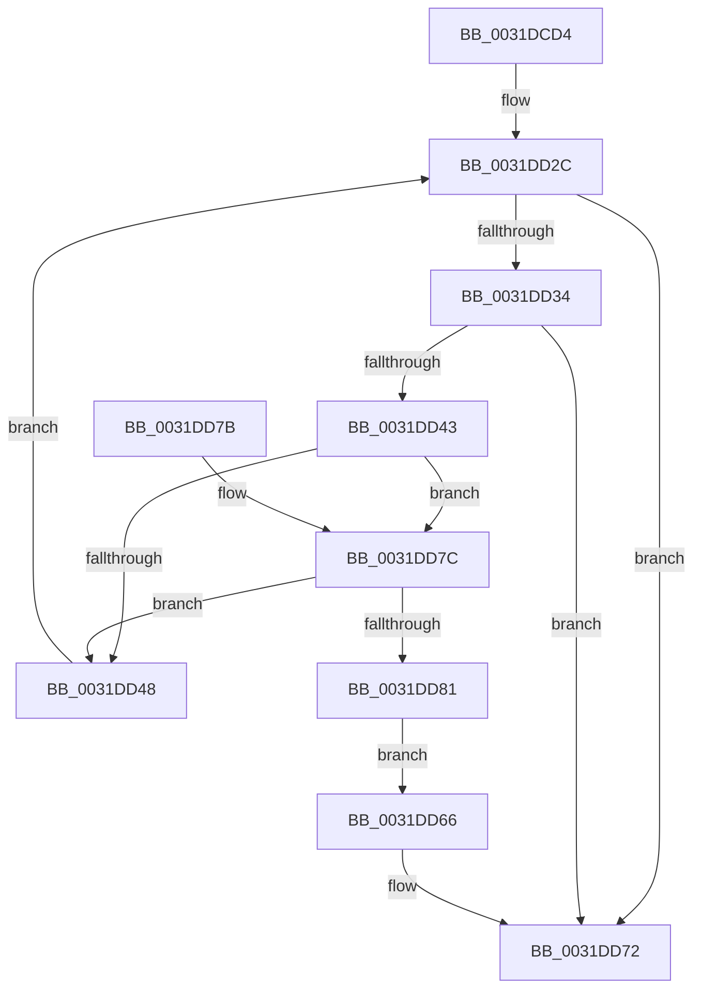

# MiHyperPage

- RVA: `0x0031DCD4`–`0x0031DD83` (길이 `175` bytes)
- VA: `0x000000014031DCD4`
- 실행 섹션: `.text`
- PDB 이름 있음: `예`; PDB Function 태그: `아니요`
- unwind 정보 RVA: `0x0007517C`
- 디코드: `45`개 명령, `175/175` bytes 표시
- 미해석 바이트: `0` (있으면 어셈블리에 `.byte`로 보존)

> 이 문서는 커널 이미지의 기계어와 PDB 기호를 분석해 생성했습니다. 4번과 5번은 함수 원형과 자료형을 바이너리 사용 방식에서 추정한 C 해석이며 원본 소스 복구 결과는 아닙니다.

## 1. Dependencies

- 직접 호출 지점: **0**; 고유 호출 대상: **0**
- 직접 호출자로 확인된 함수: **2**
- RIP 상대 이미지 참조: **2**

### Outgoing calls
- 직접 디코드된 call 명령이 없습니다.

### Direct callers
- [MiActivePageClaimCandidate](MiActivePageClaimCandidate_function_0031BB00.md) at `0x0031BE8F`
- [MiActivePageClaimCandidate](MiActivePageClaimCandidate_function_0031BB00.md) at `0x0031C225`
- [sub_0031D2E0](Unknown_function_0031D2E0.md) at `0x0031D2E9`

### Static image references
- `0x0031DCD9` → RVA `0x00E2F390` (`.data`; read)
- `0x0031DCFE` → RVA `0x00E2F380` (`.data`; read)

## 2. Other-region calls and transfers

- 다른 실행 섹션으로 향하는 call: **0**
- 별도 외부 분기/꼬리 이동을 확인하지 못했습니다.

## 3. Assembly (complete function range)

```asm
0031DCD4  48 89 5C 24 08                  mov qword ptr [rsp + 8], rbx
0031DCD9  4C 8B 1D B0 16 B1 00            mov r11, qword ptr [rip + 0xb116b0]
0031DCE0  48 BA F8 FF FF FF 7F 00 00 00   movabs rdx, 0x7ffffffff8
0031DCEA  49 C1 EB 09                     shr r11, 9
0031DCEE  4C 23 DA                        and r11, rdx
0031DCF1  48 BB 00 00 00 00 80 F6 FF FF   movabs rbx, 0xfffff68000000000
0031DCFB  48 8B C3                        mov rax, rbx
0031DCFE  4C 8B 15 7B 16 B1 00            mov r10, qword ptr [rip + 0xb1167b]
0031DD05  4C 03 D8                        add r11, rax
0031DD08  49 C1 EA 09                     shr r10, 9
0031DD0C  4C 23 D2                        and r10, rdx
0031DD0F  48 8B C3                        mov rax, rbx
0031DD12  48 8B 51 08                     mov rdx, qword ptr [rcx + 8]
0031DD16  4C 03 D0                        add r10, rax
0031DD19  45 33 C0                        xor r8d, r8d
0031DD1C  48 B8 00 00 00 00 00 00 00 80   movabs rax, 0x8000000000000000
0031DD26  48 0B D0                        or rdx, rax
0031DD29  45 8B C8                        mov r9d, r8d
0031DD2C  48 8B C3                        mov rax, rbx
0031DD2F  48 3B D0                        cmp rdx, rax
0031DD32  72 3E                           jb 0x14031dd72
0031DD34  48 B8 FF FF FF FF FF F6 FF FF   movabs rax, 0xfffff6ffffffffff
0031DD3E  48 3B D0                        cmp rdx, rax
0031DD41  77 2F                           ja 0x14031dd72
0031DD43  49 3B D2                        cmp rdx, r10
0031DD46  73 34                           jae 0x14031dd7c
0031DD48  41 FF C1                        inc r9d
0031DD4B  48 C1 E2 19                     shl rdx, 0x19
0031DD4F  48 8B C3                        mov rax, rbx
0031DD52  48 C1 E0 19                     shl rax, 0x19
0031DD56  48 2B D0                        sub rdx, rax
0031DD59  48 C1 FA 10                     sar rdx, 0x10
0031DD5D  49 81 E2 00 F0 FF FF            and r10, 0xfffffffffffff000
0031DD64  EB C6                           jmp 0x14031dd2c
0031DD66  41 F7 D9                        neg r9d
0031DD69  45 1B C0                        sbb r8d, r8d
0031DD6C  41 F7 D8                        neg r8d
0031DD6F  41 FF C0                        inc r8d
0031DD72  48 8B 5C 24 08                  mov rbx, qword ptr [rsp + 8]
0031DD77  41 8B C0                        mov eax, r8d
0031DD7A  C3                              ret
0031DD7B  CC                              int3
0031DD7C  49 3B D3                        cmp rdx, r11
0031DD7F  77 C7                           ja 0x14031dd48
0031DD81  EB E3                           jmp 0x14031dd66
```

## 4. C-style interpretation (structured pseudocode)

```c
__int64 __fastcall MiHyperPage(__int64 a1, __int64 a2, int a3)
{
    __int64 result;
    __int64 v_r10;
    __int64 v_r11;
    unsigned __int64 v_stack_p8;

    v_stack_p8 = v_rbx;
    v_r11 = (*(unsigned __int64 *)(v_rip + 11605680)) >> (9);
    v_r11 = (v_r11) & (a2);
    v_r11 = (v_r11) + (v_rbx);
    v_r10 = (*(unsigned __int64 *)(v_rip + 11605627)) >> (9);
    v_r10 = (v_r10) & (a2);
    v_r10 = (v_r10) + (v_rbx);
    a3 = 0;
    a2 = (*(unsigned __int64 *)(a1 + 8)) | (v_rbx);
loc_0031DD2C:
    if (a2 < v_rbx) goto loc_0031DD72;
    if (a2 > v_rbx) goto loc_0031DD72;
    if (a2 >= v_r10) goto loc_0031DD7C;
loc_0031DD48:
    a4 = (unsigned int)((0) + 1);
    a2 = (a2) << (25);
    result = (v_rbx) << (25);
    a2 = (a2) - (result);
    a2 = (a2) >> (16);
    v_r10 = (v_r10) & (0xFFFFFFFFFFFFF000ULL);
    goto loc_0031DD2C;
loc_0031DD66:
    a4 = (unsigned int)(-(a4));
    a3 = (unsigned int)(-(a3));
    a3 = (unsigned int)((a3) + 1);
loc_0031DD72:
    return (unsigned int)(a3);
loc_0031DD7C:
    if (a2 > v_r11) goto loc_0031DD48;
    goto loc_0031DD66;
}
```

## 5. (Beta) C Style

```c
int64_t MiHyperPage(void *Arg1, int64_t Arg2, int32_t Arg3)
{
    uint8_t *arg1 = (uint8_t *)Arg1;

    int64_t result;
    int64_t local_r10;
    int64_t local_r11;
    uint64_t v_stack_p8;

    v_stack_p8 = local_rbx;
    local_r11 = (*(uint64_t *)(v_rip + 0xB116B0)) >> (9);
    local_r11 = (local_r11) & (Arg2);
    local_r11 = (local_r11) + (local_rbx);
    local_r10 = (*(uint64_t *)(v_rip + 0xB1167B)) >> (9);
    local_r10 = (local_r10) & (Arg2);
    local_r10 = (local_r10) + (local_rbx);
    Arg3 = 0;
    Arg2 = (*(uint64_t *)(arg1 + 0x8)) | (local_rbx);
loc_0031DD2C:
    if (Arg2 < local_rbx) goto loc_0031DD72;
    if (Arg2 > local_rbx) goto loc_0031DD72;
    if (Arg2 >= local_r10) goto loc_0031DD7C;
loc_0031DD48:
    a4 = (uint32_t)((0) + 1);
    Arg2 = (Arg2) << (25);
    result = (local_rbx) << (25);
    Arg2 = (Arg2) - (result);
    Arg2 = (Arg2) >> (16);
    local_r10 = (local_r10) & (0xFFFFFFFFFFFFF000ULL);
    goto loc_0031DD2C;
loc_0031DD66:
    a4 = (uint32_t)(-(a4));
    Arg3 = (uint32_t)(-(Arg3));
    Arg3 = (uint32_t)((Arg3) + 1);
loc_0031DD72:
    return (uint32_t)(Arg3);
loc_0031DD7C:
    if (Arg2 > local_r11) goto loc_0031DD48;
    goto loc_0031DD66;
}
```

### 관측된 메모리 오프셋

구조체 형식이 확인되지 않은 접근은 인자 기준의 오프셋으로만 기록했습니다.

| 기준 인자 | 오프셋 표현 | 폭 (bit) | 접근 |
|---|---:|---:|---|
| `Arg1` | `+ 0x8` | `64` | `R` |

## 6. Execution-region graph

[열기: 2D/3D 그래프와 함수 탐색 컨트롤 패널](../../../control-panel.html?section=text&rva=0x0031DCD4&view=graph)

- 2D 그래프는 위에서 아래로 흐르고, 3D 그래프는 빈 공간을 드래그해 회전합니다. Shift+드래그는 이동, 휠은 확대·축소, 함수 노드 선택은 대상 보고서 이동입니다.

### Static fallback


