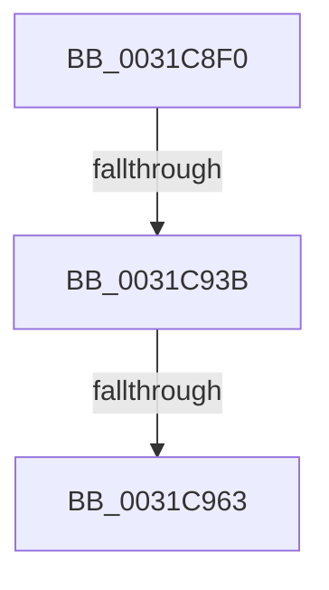

# MiIdentifyPfnWrapper

- RVA: `0x0031C8F0`–`0x0031C972` (길이 `130` bytes)
- VA: `0x000000014031C8F0`
- 실행 섹션: `.text`
- PDB 이름 있음: `예`; PDB Function 태그: `아니요`
- unwind 정보 RVA: `0x00074DE0`
- 디코드: `29`개 명령, `130/130` bytes 표시
- 미해석 바이트: `0` (있으면 어셈블리에 `.byte`로 보존)

> 이 문서는 커널 이미지의 기계어와 PDB 기호를 분석해 생성했습니다. 4번과 5번은 함수 원형과 자료형을 바이너리 사용 방식에서 추정한 C 해석이며 원본 소스 복구 결과는 아닙니다.

## 1. Dependencies

- 직접 호출 지점: **0**; 고유 호출 대상: **0**
- 직접 호출자로 확인된 함수: **7**
- RIP 상대 이미지 참조: **2**

### Outgoing calls
- 직접 디코드된 call 명령이 없습니다.

### Direct callers
- [MiQueryLeafPte](../3D/MiQueryLeafPte_function_003D2160.md) at `0x003D2671`
- [MiLogAllocateWsleEvent](../4B/MiLogAllocateWsleEvent_function_004BC098.md) at `0x004BC0D0`
- [MiScrubLargeMappedPage](../69/MiScrubLargeMappedPage_function_00693E2C.md) at `0x00693FB6`
- [MiScrubProcessLargePage](../../page/80/MiScrubProcessLargePage_function_0080EE70.md) at `0x0080EEB5`
- [MmRelocatePfnList](../../page/90/MmRelocatePfnList_function_00901E70.md) at `0x00901F99`
- [MmQueryPfnList](../../page/90/MmQueryPfnList_function_009028E0.md) at `0x0090291E`
- [MmIdentifyPhysicalMemory](../../page/AA/MmIdentifyPhysicalMemory_function_00AAD05C.md) at `0x00AAD15F`

### Static image references
- `0x0031C92E` → RVA `0x00E2DCE0` (`.data`; read)
- `0x0031C956` → RVA `0x00FC6D20` (`ALMOSTRO`; read)

## 2. Other-region calls and transfers

- 다른 실행 섹션으로 향하는 call: **0**
- call이 아닌 외부 분기/꼬리 이동: **3**
  - `0x0031C935` → [sub_0031CA0D + 0x11](Unknown_function_0031CA0D.md) (`tail-transfer`)
  - `0x0031C95D` → [sub_0031CA0D](Unknown_function_0031CA0D.md) (`tail-transfer`)
  - `0x0031C96C` → [sub_0031CA0D + 0x48](Unknown_function_0031CA0D.md) (`tail-transfer`)

## 3. Assembly (complete function range)

```asm
0031C8F0  48 89 5C 24 10                  mov qword ptr [rsp + 0x10], rbx
0031C8F5  48 89 74 24 18                  mov qword ptr [rsp + 0x18], rsi
0031C8FA  57                              push rdi
0031C8FB  41 54                           push r12
0031C8FD  41 57                           push r15
0031C8FF  48 83 EC 20                     sub rsp, 0x20
0031C903  4C 8B E1                        mov r12, rcx
0031C906  4C 8B FA                        mov r15, rdx
0031C909  48 B9 00 00 00 00 00 DE FF FF   movabs rcx, 0xffffde0000000000
0031C913  48 8B C1                        mov rax, rcx
0031C916  49 8B FC                        mov rdi, r12
0031C919  48 2B F8                        sub rdi, rax
0031C91C  48 B8 AB AA AA AA AA AA AA AA   movabs rax, 0xaaaaaaaaaaaaaaab
0031C926  48 C1 FF 04                     sar rdi, 4
0031C92A  48 0F AF F8                     imul rdi, rax
0031C92E  48 3B 3D AB 13 B1 00            cmp rdi, qword ptr [rip + 0xb113ab]
0031C935  0F 87 E3 00 00 00               ja 0x14031ca1e
0031C93B  48 8D 1C 7F                     lea rbx, [rdi + rdi*2]
0031C93F  48 C1 E3 04                     shl rbx, 4
0031C943  48 8B C1                        mov rax, rcx
0031C946  48 03 D8                        add rbx, rax
0031C949  44 0F 20 C6                     mov rsi, cr8
0031C94D  B8 02 00 00 00                  mov eax, 2
0031C952  44 0F 22 C0                     mov cr8, rax
0031C956  83 3D C3 A3 CA 00 00            cmp dword ptr [rip + 0xcaa3c3], 0
0031C95D  0F 85 AA 00 00 00               jne 0x14031ca0d
0031C963  48 8B 43 28                     mov rax, qword ptr [rbx + 0x28]
0031C967  48 0F BA E0 36                  bt rax, 0x36
0031C96C  0F 83 E3 00 00 00               jae 0x14031ca55
```

## 4. C-style interpretation (structured pseudocode)

```c
__int64 __fastcall MiIdentifyPfnWrapper(__int64 a1, __int64 a2)
{
    __int64 v_rbx;
    __int64 v_rdi;
    __int64 v_rsp;
    unsigned __int64 v_stack_p10;
    unsigned __int64 v_stack_p18;

    v_stack_p10 = v_rbx;
    v_stack_p18 = v_rsi;
    v_rsp = (v_rsp) - (32);
    v_rdi = (a1) - (a1);
    v_rdi = (v_rdi) >> (4);
    v_rdi = (v_rdi) * (a1);
    v_rbx = (v_rdi + v_rdi * 2) << (4);
    v_rbx = (v_rbx) + (a1);
}
```

## 5. (Beta) C Style

```c
int64_t MiIdentifyPfnWrapper(int64_t Arg1, int64_t Arg2)
{
    int64_t local_rbx;
    int64_t local_rdi;
    int64_t local_rsp;
    uint64_t v_stack_p10;
    uint64_t v_stack_p18;

    v_stack_p10 = local_rbx;
    v_stack_p18 = local_rsi;
    local_rsp = (local_rsp) - (32);
    local_rdi = (Arg1) - (Arg1);
    local_rdi = (local_rdi) >> (4);
    local_rdi = (local_rdi) * (Arg1);
    local_rbx = (local_rdi + local_rdi * 2) << (4);
    local_rbx = (local_rbx) + (Arg1);
}
```

## 6. Execution-region graph

[열기: 2D/3D 그래프와 함수 탐색 컨트롤 패널](../../../control-panel.html?section=text&rva=0x0031C8F0&view=graph)

- 2D 그래프는 위에서 아래로 흐르고, 3D 그래프는 빈 공간을 드래그해 회전합니다. Shift+드래그는 이동, 휠은 확대·축소, 함수 노드 선택은 대상 보고서 이동입니다.

### Static fallback


