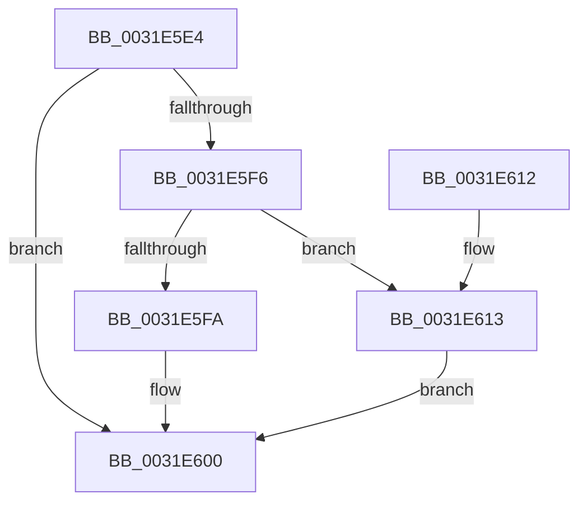

# MiIsFreeZeroPfnCold

- RVA: `0x0031E5E4`–`0x0031E619` (길이 `53` bytes)
- VA: `0x000000014031E5E4`
- 실행 섹션: `.text`
- PDB 이름 있음: `예`; PDB Function 태그: `아니요`
- unwind 정보 RVA: `0x000DB714`
- 디코드: `18`개 명령, `53/53` bytes 표시
- 미해석 바이트: `0` (있으면 어셈블리에 `.byte`로 보존)

> 이 문서는 커널 이미지의 기계어와 PDB 기호를 분석해 생성했습니다. 4번과 5번은 함수 원형과 자료형을 바이너리 사용 방식에서 추정한 C 해석이며 원본 소스 복구 결과는 아닙니다.

## 1. Dependencies

- 직접 호출 지점: **0**; 고유 호출 대상: **0**
- 직접 호출자로 확인된 함수: **12**
- RIP 상대 이미지 참조: **1**

### Outgoing calls
- 직접 디코드된 call 명령이 없습니다.

### Direct callers
- [MiGetPerfectColorHeadPage](../28/MiGetPerfectColorHeadPage_function_00289CA8.md) at `0x0028A0AF`
- [MiDemoteLocalLargePage](../28/MiDemoteLocalLargePage_function_0028A4F0.md) at `0x0028A788`
- [MiConvertContiguousPages](../29/MiConvertContiguousPages_function_0029F894.md) at `0x0029F930`
- [sub_002B2847](../2B/Unknown_function_002B2847.md) at `0x002B285A`
- [MiGetLargePage](MiGetLargePage_function_0031E210.md) at `0x0031E3A1`
- [MiUnlinkFreeOrZeroedPage](../33/MiUnlinkFreeOrZeroedPage_function_00336C40.md) at `0x00337448`
- [MiLargePagePromote](../37/MiLargePagePromote_function_0037915C.md) at `0x003792C8`
- [MiAllocateLargeZeroPages](../3B/MiAllocateLargeZeroPages_function_003B743C.md) at `0x003B75B9`
- [MiGetLargePageChain](../3B/MiGetLargePageChain_function_003B82D0.md) at `0x003B8403`
- [MiReplenishPageSlist](../3B/MiReplenishPageSlist_function_003BADE0.md) at `0x003BB202`
- [MiPruneStandbyPages](../3B/MiPruneStandbyPages_function_003BC0E4.md) at `0x003BC1CE`
- [MiLargeFreePageToMdl](../42/MiLargeFreePageToMdl_function_00420880.md) at `0x004208DE`

### Static image references
- `0x0031E5EA` → RVA `0x00E2DC80` (`.data`; read)

## 2. Other-region calls and transfers

- 다른 실행 섹션으로 향하는 call: **0**
- 별도 외부 분기/꼬리 이동을 확인하지 못했습니다.

## 3. Assembly (complete function range)

```asm
0031E5E4  48 8B 41 10                     mov rax, qword ptr [rcx + 0x10]
0031E5E8  33 D2                           xor edx, edx
0031E5EA  48 8B 0D 8F F6 B0 00            mov rcx, qword ptr [rip + 0xb0f68f]
0031E5F1  48 85 C9                        test rcx, rcx
0031E5F4  74 0A                           je 0x14031e600
0031E5F6  A8 10                           test al, 0x10
0031E5F8  75 19                           jne 0x14031e613
0031E5FA  48 F7 D1                        not rcx
0031E5FD  48 23 C1                        and rax, rcx
0031E600  48 C1 E8 20                     shr rax, 0x20
0031E604  B9 FD FF FF FF                  mov ecx, 0xfffffffd
0031E609  48 3B C1                        cmp rax, rcx
0031E60C  0F 94 C2                        sete dl
0031E60F  8B C2                           mov eax, edx
0031E611  C3                              ret
0031E612  CC                              int3
0031E613  48 83 E0 EF                     and rax, 0xffffffffffffffef
0031E617  EB E7                           jmp 0x14031e600
```

## 4. C-style interpretation (structured pseudocode)

```c
__int64 __fastcall MiIsFreeZeroPfnCold(__int64 a1, int a2)
{
    __int64 result;

    a2 = 0;
    if (*(unsigned __int64 *)(v_rip + 11597455) == 0) goto loc_0031E600;
    if ((((unsigned __int8)(*(unsigned __int64 *)(a1 + 16))) & (16)) != 0) goto loc_0031E613;
    a1 = ~(*(unsigned __int64 *)(v_rip + 11597455));
    result = (*(unsigned __int64 *)(a1 + 16)) & (a1);
loc_0031E600:
    result = (result) >> (32);
    a2 = (result == ((unsigned int)(0xFFFFFFFDULL))) ? 1 : 0;
    return (unsigned int)(a2);
loc_0031E613:
    result = ((unsigned int)(a2)) & (-17);
    goto loc_0031E600;
}
```

## 5. (Beta) C Style

```c
int64_t MiIsFreeZeroPfnCold(void *Arg1, int32_t Arg2)
{
    uint8_t *arg1 = (uint8_t *)Arg1;

    int64_t result;

    Arg2 = 0;
    if (*(uint64_t *)(v_rip + 0xB0F68F) == 0) goto loc_0031E600;
    if ((((uint8_t)(*(uint64_t *)(arg1 + 0x10))) & (16)) != 0) goto loc_0031E613;
    Arg1 = ~(*(uint64_t *)(v_rip + 0xB0F68F));
    result = (*(uint64_t *)(arg1 + 0x10)) & (Arg1);
loc_0031E600:
    result = (result) >> (32);
    Arg2 = (result == ((uint32_t)(0xFFFFFFFDULL))) ? 1 : 0;
    return (uint32_t)(Arg2);
loc_0031E613:
    result = ((uint32_t)(Arg2)) & (-17);
    goto loc_0031E600;
}
```

### 관측된 메모리 오프셋

구조체 형식이 확인되지 않은 접근은 인자 기준의 오프셋으로만 기록했습니다.

| 기준 인자 | 오프셋 표현 | 폭 (bit) | 접근 |
|---|---:|---:|---|
| `Arg1` | `+ 0x10` | `64` | `R` |

## 6. Execution-region graph

[열기: 2D/3D 그래프와 함수 탐색 컨트롤 패널](../../../control-panel.html?section=text&rva=0x0031E5E4&view=graph)

- 2D 그래프는 위에서 아래로 흐르고, 3D 그래프는 빈 공간을 드래그해 회전합니다. Shift+드래그는 이동, 휠은 확대·축소, 함수 노드 선택은 대상 보고서 이동입니다.

### Static fallback


