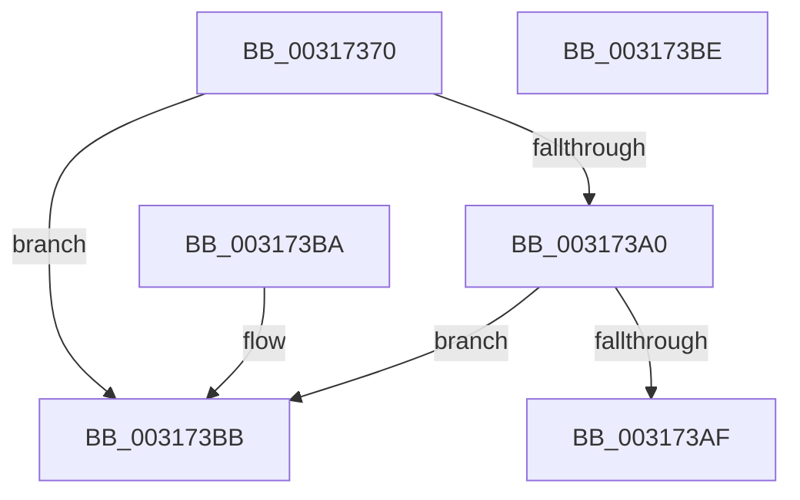

# MiIsPfnCommitNotCharged

- RVA: `0x00317370`–`0x003173BF` (길이 `79` bytes)
- VA: `0x0000000140317370`
- 실행 섹션: `.text`
- PDB 이름 있음: `예`; PDB Function 태그: `아니요`
- unwind 정보 RVA: `0x000DB714`
- 디코드: `22`개 명령, `79/79` bytes 표시
- 미해석 바이트: `0` (있으면 어셈블리에 `.byte`로 보존)

> 이 문서는 커널 이미지의 기계어와 PDB 기호를 분석해 생성했습니다. 4번과 5번은 함수 원형과 자료형을 바이너리 사용 방식에서 추정한 C 해석이며 원본 소스 복구 결과는 아닙니다.

## 1. Dependencies

- 직접 호출 지점: **0**; 고유 호출 대상: **0**
- 직접 호출자로 확인된 함수: **8**
- RIP 상대 이미지 참조: **0**

### Outgoing calls
- 직접 디코드된 call 명령이 없습니다.

### Direct callers
- [MiMigratePfn](../28/MiMigratePfn_function_0028DBB0.md) at `0x0028DD12`
- [MiHardFaultPageRelease](../2B/MiHardFaultPageRelease_function_002B5728.md) at `0x002B5897`
- [MiCombineCandidate](MiCombineCandidate_function_00316290.md) at `0x00316394`
- [MiCheckProtoPtePageState](MiCheckProtoPtePageState_function_003183E0.md) at `0x00318574`
- [MiLockProtoPoolPageForce](../32/MiLockProtoPoolPageForce_function_00320E10.md) at `0x003210C7`
- [MiResolveProtoPteFault](../32/MiResolveProtoPteFault_function_00321750.md) at `0x00321BAA`
- [MiWriteCompletePfn](../37/MiWriteCompletePfn_function_003737C4.md) at `0x00373A01`
- [MmMarkPhysicalMemoryAsBad](../67/MmMarkPhysicalMemoryAsBad_function_0067AA50.md) at `0x0067ADA8`

### Static image references
- 디코드된 RIP-relative 메모리 참조가 없습니다.

## 2. Other-region calls and transfers

- 다른 실행 섹션으로 향하는 call: **0**
- 별도 외부 분기/꼬리 이동을 확인하지 못했습니다.

## 3. Assembly (complete function range)

```asm
00317370  48 8B 51 08                     mov rdx, qword ptr [rcx + 8]
00317374  49 B9 00 00 00 00 80 F6 FF FF   movabs r9, 0xfffff68000000000
0031737E  49 8B C1                        mov rax, r9
00317381  49 B8 78 FF FF FF 3F 00 00 00   movabs r8, 0x3fffffff78
0031738B  49 03 C0                        add rax, r8
0031738E  49 B8 00 00 00 00 00 00 00 80   movabs r8, 0x8000000000000000
00317398  49 0B D0                        or rdx, r8
0031739B  48 3B D0                        cmp rdx, rax
0031739E  77 1B                           ja 0x1403173bb
003173A0  48 8B 51 08                     mov rdx, qword ptr [rcx + 8]
003173A4  49 0B D0                        or rdx, r8
003173A7  49 8B C1                        mov rax, r9
003173AA  48 3B D0                        cmp rdx, rax
003173AD  72 0C                           jb 0x1403173bb
003173AF  0F B6 41 23                     movzx eax, byte ptr [rcx + 0x23]
003173B3  C1 E8 05                        shr eax, 5
003173B6  83 E0 01                        and eax, 1
003173B9  C3                              ret
003173BA  CC                              int3
003173BB  33 C0                           xor eax, eax
003173BD  C3                              ret
003173BE  CC                              int3
```

## 4. C-style interpretation (structured pseudocode)

```c
__int64 __fastcall MiIsPfnCommitNotCharged(__int64 a1)
{
    __int64 result;

    result = (a4) + (a3);
    a2 = (*(unsigned __int64 *)(a1 + 8)) | (a3);
    if (a2 > result) goto loc_003173BB;
    a2 = (*(unsigned __int64 *)(a1 + 8)) | (a3);
    if (a2 < a4) goto loc_003173BB;
    result = (unsigned int)((*(unsigned __int8 *)(a1 + 35)) >> (5));
    result = (unsigned int)((result) & (1));
    return result;
loc_003173BB:
    result = 0;
    return result;
}
```

## 5. (Beta) C Style

```c
int64_t MiIsPfnCommitNotCharged(void *Arg1)
{
    uint8_t *arg1 = (uint8_t *)Arg1;

    int64_t result;

    result = (a4) + (a3);
    a2 = (*(uint64_t *)(arg1 + 0x8)) | (a3);
    if (a2 > result) goto loc_003173BB;
    a2 = (*(uint64_t *)(arg1 + 0x8)) | (a3);
    if (a2 < a4) goto loc_003173BB;
    result = (uint32_t)((*(uint8_t *)(arg1 + 0x23)) >> (5));
    result = (uint32_t)((result) & (1));
    return result;
loc_003173BB:
    result = 0;
    return result;
}
```

### 관측된 메모리 오프셋

구조체 형식이 확인되지 않은 접근은 인자 기준의 오프셋으로만 기록했습니다.

| 기준 인자 | 오프셋 표현 | 폭 (bit) | 접근 |
|---|---:|---:|---|
| `Arg1` | `+ 0x8` | `64` | `R` |
| `Arg1` | `+ 0x23` | `8` | `R` |

## 6. Execution-region graph

[열기: 2D/3D 그래프와 함수 탐색 컨트롤 패널](../../../control-panel.html?section=text&rva=0x00317370&view=graph)

- 2D 그래프는 위에서 아래로 흐르고, 3D 그래프는 빈 공간을 드래그해 회전합니다. Shift+드래그는 이동, 휠은 확대·축소, 함수 노드 선택은 대상 보고서 이동입니다.

### Static fallback


