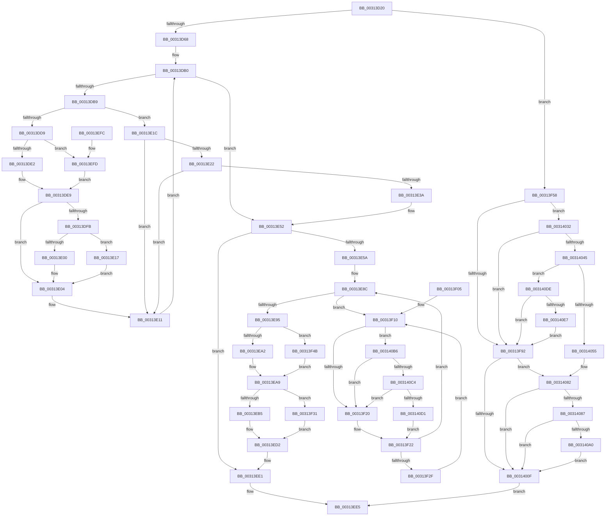

# MiLinkPoolCommitChain

- RVA: `0x00313D20`–`0x00314108` (길이 `1,000` bytes)
- VA: `0x0000000140313D20`
- 실행 섹션: `.text`
- PDB 이름 있음: `예`; PDB Function 태그: `아니요`
- unwind 정보 RVA: `0x0007467C`
- 디코드: `240`개 명령, `1,000/1,000` bytes 표시
- 미해석 바이트: `0` (있으면 어셈블리에 `.byte`로 보존)

> 이 문서는 커널 이미지의 기계어와 PDB 기호를 분석해 생성했습니다. 4번과 5번은 함수 원형과 자료형을 바이너리 사용 방식에서 추정한 C 해석이며 원본 소스 복구 결과는 아닙니다.

## 1. Dependencies

- 직접 호출 지점: **17**; 고유 호출 대상: **15**
- 직접 호출자로 확인된 함수: **1**
- RIP 상대 이미지 참조: **5**

### Outgoing calls
- `0x00313D7E` → [MiFlushTbAsNeeded](MiFlushTbAsNeeded_function_00313730.md) (function, `0x00313730`)
- `0x00313E4C` → [KeBugCheckEx](../4F/KeBugCheckEx_function_004FD660.md) (function, `0x004FD660`)
- `0x00313E5E` → [MI_READ_PTE_LOCK_FREE](../28/MI_READ_PTE_LOCK_FREE_function_002828A0.md) (function, `0x002828A0`)
- `0x00313F84` → [MiMakeDemandZeroPte](../33/MiMakeDemandZeroPte_function_00337A00.md) (function, `0x00337A00`)
- `0x00313F9E` → [MiUnlinkPageChainHead](../36/MiUnlinkPageChainHead_function_00365C40.md) (function, `0x00365C40`)
- `0x00313FDE` → [MiUpdateLargePageBitMap](../37/MiUpdateLargePageBitMap_function_0037619C.md) (function, `0x0037619C`)
- `0x00313FFC` → [MiMakeValidPte](../2C/MiMakeValidPte_function_002C5590.md) (function, `0x002C5590`)
- `0x00314015` → [MiGetContainingPageTable](../34/MiGetContainingPageTable_function_003467F0.md) (function, `0x003467F0`)
- `0x0031401D` → [MiLockAndIncrementShareCount](../49/MiLockAndIncrementShareCount_function_0049BE04.md) (function, `0x0049BE04`)
- `0x00314028` → [MiInitializeLargeNonPagedPoolLeafFrames](../4B/MiInitializeLargeNonPagedPoolLeafFrames_function_004B7CE4.md) (function, `0x004B7CE4`)
- `0x00314037` → [MiMakeDemandZeroPte](../33/MiMakeDemandZeroPte_function_00337A00.md) (function, `0x00337A00`)
- `0x00314048` → [MiIsPoolPteInUse](../43/MiIsPoolPteInUse_function_00433580.md) (function, `0x00433580`)
- `0x0031407C` → [KeBugCheckEx](../4F/KeBugCheckEx_function_004FD660.md) (function, `0x004FD660`)
- `0x003140AC` → [MiCheckLinearProtectedPteAccessedBit](../29/MiCheckLinearProtectedPteAccessedBit_function_00292D80.md) (function, `0x00292D80`)
- `0x003140C4` → [KiCheckVpBackingLongSpinWaitHypercall](../30/KiCheckVpBackingLongSpinWaitHypercall_function_0030F490.md) (function, `0x0030F490`)
- `0x003140D4` → [HvlNotifyLongSpinWait](../30/HvlNotifyLongSpinWait_function_0030F460.md) (function, `0x0030F460`)
- `0x003140FE` → [MiIncreaseUsedPtes](../24/MiIncreaseUsedPtes_function_00243630.md) (function, `0x00243630`)

### Direct callers
- [MiCommitPoolMemory](../32/MiCommitPoolMemory_function_00329520.md) at `0x003296BE`

### Static image references
- `0x00313DE9` → RVA `0x00E2DC80` (`.data`; read)
- `0x00313F13` → RVA `0x00FC52AC` (`ALMOSTRO`; reference)
- `0x00313FB6` → RVA `0x00E38D00` (`.data`; read)
- `0x00314001` → RVA `0x00FC6A88` (`ALMOSTRO`; read)
- `0x003140B6` → RVA `0x00FC6AB8` (`ALMOSTRO`; read)

## 2. Other-region calls and transfers

- 다른 실행 섹션으로 향하는 call: **0**
- 별도 외부 분기/꼬리 이동을 확인하지 못했습니다.

## 3. Assembly (complete function range)

```asm
00313D20  48 89 5C 24 10                  mov qword ptr [rsp + 0x10], rbx
00313D25  48 89 6C 24 18                  mov qword ptr [rsp + 0x18], rbp
00313D2A  56                              push rsi
00313D2B  57                              push rdi
00313D2C  41 54                           push r12
00313D2E  41 56                           push r14
00313D30  41 57                           push r15
00313D32  48 83 EC 30                     sub rsp, 0x30
00313D36  48 8B 41 50                     mov rax, qword ptr [rcx + 0x50]
00313D3A  48 8B EA                        mov rbp, rdx
00313D3D  48 81 E5 00 F0 FF FF            and rbp, 0xfffffffffffff000
00313D44  48 8B FA                        mov rdi, rdx
00313D47  48 81 C5 F8 0F 00 00            add rbp, 0xff8
00313D4E  4C 8B F9                        mov r15, rcx
00313D51  48 3B E8                        cmp rbp, rax
00313D54  48 0F 47 E8                     cmova rbp, rax
00313D58  45 33 E4                        xor r12d, r12d
00313D5B  F6 41 64 04                     test byte ptr [rcx + 0x64], 4
00313D5F  41 8B F4                        mov esi, r12d
00313D62  0F 85 F0 01 00 00               jne 0x140313f58
00313D68  48 8B 49 48                     mov rcx, qword ptr [rcx + 0x48]
00313D6C  45 8D 4C 24 01                  lea r9d, [r12 + 1]
00313D71  4C 8B C5                        mov r8, rbp
00313D74  4C 2B C2                        sub r8, rdx
00313D77  49 C1 F8 03                     sar r8, 3
00313D7B  49 FF C0                        inc r8
00313D7E  E8 AD F9 FF FF                  call 0x140313730
00313D83  49 BE 00 00 00 00 80 F6 FF FF   movabs r14, 0xfffff68000000000
00313D8D  4D 8B C6                        mov r8, r14
00313D90  49 8B 5F 38                     mov rbx, qword ptr [r15 + 0x38]
00313D94  48 B9 00 00 00 00 40 00 00 00   movabs rcx, 0x4000000000
00313D9E  4C 03 C1                        add r8, rcx
00313DA1  49 BA FF FF FF FF 7F 00 00 00   movabs r10, 0x7fffffffff
00313DAB  0F 1F 44 00 00                  nop dword ptr [rax + rax]
00313DB0  48 3B FD                        cmp rdi, rbp
00313DB3  0F 87 99 00 00 00               ja 0x140313e52
00313DB9  4C 8B 0F                        mov r9, qword ptr [rdi]
00313DBC  49 8B D1                        mov rdx, r9
00313DBF  81 E2 E0 03 00 00               and edx, 0x3e0
00313DC5  49 F7 C1 01 0C 00 00            test r9, 0xc01
00313DCC  0F 94 C1                        sete cl
00313DCF  48 85 D2                        test rdx, rdx
00313DD2  0F 94 C0                        sete al
00313DD5  84 C8                           test al, cl
00313DD7  74 43                           je 0x140313e1c
00313DD9  48 85 DB                        test rbx, rbx
00313DDC  0F 84 1B 01 00 00               je 0x140313efd
00313DE2  49 2B D8                        sub rbx, r8
00313DE5  48 C1 FB 03                     sar rbx, 3
00313DE9  48 8B 05 90 9E B1 00            mov rax, qword ptr [rip + 0xb19e90]
00313DF0  FF C6                           inc esi
00313DF2  48 C1 E3 19                     shl rbx, 0x19
00313DF6  48 85 C0                        test rax, rax
00313DF9  74 09                           je 0x140313e04
00313DFB  48 85 C3                        test rbx, rax
00313DFE  74 17                           je 0x140313e17
00313E00  48 83 CB 10                     or rbx, 0x10
00313E04  48 81 CB E0 03 00 00            or rbx, 0x3e0
00313E0B  48 89 1F                        mov qword ptr [rdi], rbx
00313E0E  48 8B DF                        mov rbx, rdi
00313E11  48 83 C7 08                     add rdi, 8
00313E15  EB 99                           jmp 0x140313db0
00313E17  48 0B D8                        or rbx, rax
00313E1A  EB E8                           jmp 0x140313e04
00313E1C  41 F6 C1 01                     test r9b, 1
00313E20  75 EF                           jne 0x140313e11
00313E22  49 F7 C1 00 0C 00 00            test r9, 0xc00
00313E29  0F 94 C1                        sete cl
00313E2C  48 81 FA E0 03 00 00            cmp rdx, 0x3e0
00313E33  0F 94 C0                        sete al
00313E36  84 C8                           test al, cl
00313E38  74 D7                           je 0x140313e11
00313E3A  4C 8B C7                        mov r8, rdi
00313E3D  4C 89 64 24 20                  mov qword ptr [rsp + 0x20], r12
00313E42  BA 08 53 00 00                  mov edx, 0x5308
00313E47  B9 1A 00 00 00                  mov ecx, 0x1a
00313E4C  E8 0F 98 1E 00                  call 0x1404fd660
00313E51  CC                              int3
00313E52  85 F6                           test esi, esi
00313E54  0F 84 87 00 00 00               je 0x140313ee1
00313E5A  49 8B 4F 58                     mov rcx, qword ptr [r15 + 0x58]
00313E5E  E8 3D EA F6 FF                  call 0x1402828a0
00313E63  48 C1 E8 0C                     shr rax, 0xc
00313E67  48 B9 FF FF FF FF FF 00 00 00   movabs rcx, 0xffffffffff
00313E71  48 23 C1                        and rax, rcx
00313E74  48 8D 3C 40                     lea rdi, [rax + rax*2]
00313E78  48 B8 00 00 00 00 00 DE FF FF   movabs rax, 0xffffde0000000000
00313E82  48 C1 E7 04                     shl rdi, 4
00313E86  48 8B C0                        mov rax, rax
00313E89  48 03 F8                        add rdi, rax
00313E8C  F0 48 0F BA 6F 18 3F            lock bts qword ptr [rdi + 0x18], 0x3f
00313E93  72 7B                           jb 0x140313f10
00313E95  8B 47 24                        mov eax, dword ptr [rdi + 0x24]
00313E98  0F BA E0 1A                     bt eax, 0x1a
00313E9C  0F 83 A9 00 00 00               jae 0x140313f4b
00313EA2  48 8B 0F                        mov rcx, qword ptr [rdi]
00313EA5  48 C1 E9 20                     shr rcx, 0x20
00313EA9  8B 47 24                        mov eax, dword ptr [rdi + 0x24]
00313EAC  8D 14 0E                        lea edx, [rsi + rcx]
00313EAF  0F BA E0 1A                     bt eax, 0x1a
00313EB3  73 7C                           jae 0x140313f31
00313EB5  48 8B 07                        mov rax, qword ptr [rdi]
00313EB8  48 B9 FF FF FF FF 00 FC FF FF   movabs rcx, 0xfffffc00ffffffff
00313EC2  48 C1 E2 20                     shl rdx, 0x20
00313EC6  48 33 C2                        xor rax, rdx
00313EC9  48 23 C1                        and rax, rcx
00313ECC  48 33 C2                        xor rax, rdx
00313ECF  48 89 07                        mov qword ptr [rdi], rax
00313ED2  48 B8 FF FF FF FF FF FF FF 7F   movabs rax, 0x7fffffffffffffff
00313EDC  F0 48 21 47 18                  lock and qword ptr [rdi + 0x18], rax
00313EE1  49 89 5F 38                     mov qword ptr [r15 + 0x38], rbx
00313EE5  48 8B 5C 24 68                  mov rbx, qword ptr [rsp + 0x68]
00313EEA  48 8B 6C 24 70                  mov rbp, qword ptr [rsp + 0x70]
00313EEF  48 83 C4 30                     add rsp, 0x30
00313EF3  41 5F                           pop r15
00313EF5  41 5E                           pop r14
00313EF7  41 5C                           pop r12
00313EF9  5F                              pop rdi
00313EFA  5E                              pop rsi
00313EFB  C3                              ret
00313EFC  CC                              int3
00313EFD  49 8B DA                        mov rbx, r10
00313F00  E9 E4 FE FF FF                  jmp 0x140313de9
00313F05  66 66 66 0F 1F 84 00 00 00 00 00  nop word ptr [rax + rax]
00313F10  41 FF C4                        inc r12d
00313F13  44 85 25 92 13 CB 00            test dword ptr [rip + 0xcb1392], r12d
00313F1A  0F 84 96 01 00 00               je 0x1403140b6
00313F20  F3 90                           pause
00313F22  48 8B 47 18                     mov rax, qword ptr [rdi + 0x18]
00313F26  48 85 C0                        test rax, rax
00313F29  0F 89 5D FF FF FF               jns 0x140313e8c
00313F2F  EB DF                           jmp 0x140313f10
00313F31  48 8B 47 10                     mov rax, qword ptr [rdi + 0x10]
00313F35  48 C1 E2 10                     shl rdx, 0x10
00313F39  48 33 C2                        xor rax, rdx
00313F3C  48 25 FF FF 00 FC               and rax, 0xfffffffffc00ffff
00313F42  48 33 C2                        xor rax, rdx
00313F45  48 89 47 10                     mov qword ptr [rdi + 0x10], rax
00313F49  EB 87                           jmp 0x140313ed2
00313F4B  48 8B 4F 10                     mov rcx, qword ptr [rdi + 0x10]
00313F4F  48 C1 E9 10                     shr rcx, 0x10
00313F53  E9 51 FF FF FF                  jmp 0x140313ea9
00313F58  48 8B F7                        mov rsi, rdi
00313F5B  49 BE 00 00 00 00 80 F6 FF FF   movabs r14, 0xfffff68000000000
00313F65  48 C1 EE 09                     shr rsi, 9
00313F69  49 B8 F8 FF FF FF 7F 00 00 00   movabs r8, 0x7ffffffff8
00313F73  49 23 F0                        and rsi, r8
00313F76  49 8B C6                        mov rax, r14
00313F79  48 03 F0                        add rsi, rax
00313F7C  B9 18 00 00 00                  mov ecx, 0x18
00313F81  48 8B 16                        mov rdx, qword ptr [rsi]
00313F84  E8 77 3A 02 00                  call 0x140337a00
00313F89  48 3B D0                        cmp rdx, rax
00313F8C  0F 85 A0 00 00 00               jne 0x140314032
00313F92  49 81 47 30 00 02 00 00         add qword ptr [r15 + 0x30], 0x200
00313F9A  49 8D 4F 10                     lea rcx, [r15 + 0x10]
00313F9E  E8 9D 1C 05 00                  call 0x140365c40
00313FA3  48 8B E8                        mov rbp, rax
00313FA6  48 B8 00 00 00 00 00 DE FF FF   movabs rax, 0xffffde0000000000
00313FB0  48 8B C0                        mov rax, rax
00313FB3  48 2B E8                        sub rbp, rax
00313FB6  48 8D 0D 43 4D B2 00            lea rcx, [rip + 0xb24d43]
00313FBD  48 B8 AB AA AA AA AA AA AA AA   movabs rax, 0xaaaaaaaaaaaaaaab
00313FC7  48 C1 FD 04                     sar rbp, 4
00313FCB  48 0F AF E8                     imul rbp, rax
00313FCF  41 B9 07 00 00 00               mov r9d, 7
00313FD5  41 B8 00 02 00 00               mov r8d, 0x200
00313FDB  48 8B D5                        mov rdx, rbp
00313FDE  E8 B9 21 06 00                  call 0x14037619c
00313FE3  45 0F B7 47 64                  movzx r8d, word ptr [r15 + 0x64]
00313FE8  48 8B D5                        mov rdx, rbp
00313FEB  41 C1 E8 03                     shr r8d, 3
00313FEF  33 C9                           xor ecx, ecx
00313FF1  41 83 E0 1F                     and r8d, 0x1f
00313FF5  41 81 C8 00 00 00 A4            or r8d, 0xa4000000
00313FFC  E8 8F 15 FB FF                  call 0x1402c5590
00314001  48 0F BA 25 7E 2A CB 00 24      bt qword ptr [rip + 0xcb2a7e], 0x24
0031400A  48 8B D8                        mov rbx, rax
0031400D  72 73                           jb 0x140314082
0031400F  48 8B CE                        mov rcx, rsi
00314012  48 89 1E                        mov qword ptr [rsi], rbx
00314015  E8 D6 27 03 00                  call 0x1403467f0
0031401A  48 8B C8                        mov rcx, rax
0031401D  E8 E2 7D 18 00                  call 0x14049be04
00314022  48 8B D5                        mov rdx, rbp
00314025  48 8B CF                        mov rcx, rdi
00314028  E8 B7 3C 1A 00                  call 0x1404b7ce4
0031402D  E9 B3 FE FF FF                  jmp 0x140313ee5
00314032  B9 10 00 00 00                  mov ecx, 0x10
00314037  E8 C4 39 02 00                  call 0x140337a00
0031403C  48 3B D0                        cmp rdx, rax
0031403F  0F 84 4D FF FF FF               je 0x140313f92
00314045  48 8B CA                        mov rcx, rdx
00314048  E8 33 F5 11 00                  call 0x140433580
0031404D  85 C0                           test eax, eax
0031404F  0F 84 89 00 00 00               je 0x1403140de
00314055  49 8B C6                        mov rax, r14
00314058  48 C1 E7 19                     shl rdi, 0x19
0031405C  4C 8B CA                        mov r9, rdx
0031405F  48 C1 E0 19                     shl rax, 0x19
00314063  BA 04 53 00 00                  mov edx, 0x5304
00314068  48 2B F8                        sub rdi, rax
0031406B  4C 89 64 24 20                  mov qword ptr [rsp + 0x20], r12
00314070  48 C1 FF 10                     sar rdi, 0x10
00314074  B9 1A 00 00 00                  mov ecx, 0x1a
00314079  4C 8B C7                        mov r8, rdi
0031407C  E8 DF 95 1E 00                  call 0x1404fd660
00314081  CC                              int3
00314082  F6 C3 20                        test bl, 0x20
00314085  75 88                           jne 0x14031400f
00314087  49 8B C6                        mov rax, r14
0031408A  48 B9 00 00 00 00 40 00 00 00   movabs rcx, 0x4000000000
00314094  48 03 C1                        add rax, rcx
00314097  48 3B F0                        cmp rsi, rax
0031409A  0F 82 6F FF FF FF               jb 0x14031400f
003140A0  41 B8 80 00 00 00               mov r8d, 0x80
003140A6  48 8B D3                        mov rdx, rbx
003140A9  48 8B CE                        mov rcx, rsi
003140AC  E8 CF EC F7 FF                  call 0x140292d80
003140B1  E9 59 FF FF FF                  jmp 0x14031400f
003140B6  8B 05 FC 29 CB 00               mov eax, dword ptr [rip + 0xcb29fc]
003140BC  A8 40                           test al, 0x40
003140BE  0F 84 5C FE FF FF               je 0x140313f20
003140C4  E8 C7 B3 FF FF                  call 0x14030f490
003140C9  84 C0                           test al, al
003140CB  0F 84 4F FE FF FF               je 0x140313f20
003140D1  41 8B CC                        mov ecx, r12d
003140D4  E8 87 B3 FF FF                  call 0x14030f460
003140D9  E9 44 FE FF FF                  jmp 0x140313f22
003140DE  48 85 D2                        test rdx, rdx
003140E1  0F 85 AB FE FF FF               jne 0x140313f92
003140E7  48 8B D6                        mov rdx, rsi
003140EA  48 C1 EA 09                     shr rdx, 9
003140EE  49 23 D0                        and rdx, r8
003140F1  49 8B C6                        mov rax, r14
003140F4  45 33 C9                        xor r9d, r9d
003140F7  48 03 D0                        add rdx, rax
003140FA  45 8D 41 01                     lea r8d, [r9 + 1]
003140FE  E8 2D F5 F2 FF                  call 0x140243630
00314103  E9 8A FE FF FF                  jmp 0x140313f92
```

## 4. C-style interpretation (structured pseudocode)

```c
__int64 __fastcall MiLinkPoolCommitChain(__int64 a1, __int64 a2)
{
    __int64 result;
    __int64 v_r12;
    __int64 v_rbp;
    __int64 v_rbx;
    __int64 v_rdi;
    __int64 v_rsi;
    __int64 v_rsp;
    unsigned __int64 v_stack_m38;
    unsigned __int64 v_stack_p10;
    unsigned __int64 v_stack_p18;
    unsigned __int64 v_stack_p20;

    v_stack_p10 = v_rbx;
    v_stack_p18 = v_rbp;
    v_rsp = (v_rsp) - (48);
    v_rbp = (a2) & (0xFFFFFFFFFFFFF000ULL);
    v_rbp = (v_rbp) + (0xFF8ULL);
    if (v_rbp > (*(unsigned __int64 *)(a1 + 80))) { v_rbp = *(unsigned __int64 *)(a1 + 80); }
    v_r12 = 0;
    if (((*(unsigned __int8 *)(a1 + 100)) & (4)) != 0) goto loc_00313F58;
    a3 = (v_rbp) - (a2);
    a3 = (a3) >> (3);
    a3 = (a3) + 1;
    result = MiFlushTbAsNeeded(*(unsigned __int64 *)(a1 + 72), a2, a3, v_r12 + 1);
    a3 = (v_r14) + (*(unsigned __int64 *)(a1 + 72));
loc_00313DB0:
    if (a2 > v_rbp) goto loc_00313E52;
    a2 = (unsigned int)((*(unsigned __int64 *)(a2)) & (992));
    a1 = (((*(unsigned __int64 *)(a2)) & (0xC01ULL)) == 0) ? 1 : 0;
    result = (a2 == 0) ? 1 : 0;
    if ((((unsigned __int8)(result)) & ((unsigned __int8)(a1))) == 0) goto loc_00313E1C;
    if (*(unsigned __int64 *)(a1 + 56) == 0) goto loc_00313EFD;
    v_rbx = (*(unsigned __int64 *)(a1 + 56)) - (a3);
    v_rbx = (v_rbx) >> (3);
loc_00313DE9:
    v_rsi = (unsigned int)((0) + 1);
    v_rbx = (v_rbx) << (25);
    if (*(unsigned __int64 *)(v_rip + 11640464) == 0) goto loc_00313E04;
    if (((v_rbx) & (*(unsigned __int64 *)(v_rip + 11640464))) == 0) goto loc_00313E17;
    v_rbx = (v_rbx) | (16);
loc_00313E04:
    v_rbx = (v_rbx) | (992);
    *(unsigned __int64 *)(a2) = v_rbx;
loc_00313E11:
    v_rdi = (a2) + (8);
    goto loc_00313DB0;
loc_00313E17:
    v_rbx = (a2) | (*(unsigned __int64 *)(v_rip + 11640464));
    goto loc_00313E04;
loc_00313E1C:
    if ((((unsigned __int8)(*(unsigned __int64 *)(a2))) & (1)) != 0) goto loc_00313E11;
    a1 = (((*(unsigned __int64 *)(a2)) & (0xC00ULL)) == 0) ? 1 : 0;
    result = (a2 == 992) ? 1 : 0;
    if ((((unsigned __int8)(result)) & ((unsigned __int8)(a1))) == 0) goto loc_00313E11;
    v_stack_m38 = 0;
    result = KeBugCheckEx(26, (unsigned int)(0x5308ULL), v_rdi, *(unsigned __int64 *)(a2));
loc_00313E52:
    if ((unsigned int)(v_rsi) == 0) goto loc_00313EE1;
    result = MI_READ_PTE_LOCK_FREE(*(unsigned __int64 *)(a1 + 88), (unsigned int)(0x5308ULL), v_rdi, *(unsigned __int64 *)(a2));
    result = (result) >> (12);
    result = (result) & (*(unsigned __int64 *)(a1 + 88));
    v_rdi = (result + result * 2) << (4);
    v_rdi = (v_rdi) + (result);
loc_00313E8C:
    if (condition_is_below) goto loc_00313F10;
    if (condition_is_above_or_equal) goto loc_00313F4B;
    a1 = (*(unsigned __int64 *)(v_rdi)) >> (32);
loc_00313EA9:
    if (condition_is_above_or_equal) goto loc_00313F31;
    a2 = (v_rsi + a1 * 1) << (32);
    result = (*(unsigned __int64 *)(v_rdi)) ^ (a2);
    result = (result) & (a1);
    result = (result) ^ (a2);
    *(unsigned __int64 *)(v_rdi) = result;
loc_00313ED2:
loc_00313EE1:
    *(unsigned __int64 *)(a1 + 56) = v_rbx;
loc_00313EE5:
    v_rsp = (v_rsp) + (48);
    return result;
loc_00313EFD:
    goto loc_00313DE9;
loc_00313F10:
    v_r12 = (unsigned int)((v_r12) + 1);
    if (((*(unsigned int *)(v_rip + 13308818)) & ((unsigned int)(v_r12))) == 0) goto loc_003140B6;
loc_00313F20:
loc_00313F22:
    if (!sign_flag) goto loc_00313E8C;
    goto loc_00313F10;
loc_00313F31:
    a2 = (a2) << (16);
    result = (*(unsigned __int64 *)(v_rdi + 16)) ^ (a2);
    result = (result) & (0xFFFFFFFFFC00FFFFULL);
    result = (result) ^ (a2);
    *(unsigned __int64 *)(v_rdi + 16) = result;
    goto loc_00313ED2;
loc_00313F4B:
    a1 = (*(unsigned __int64 *)(v_rdi + 16)) >> (16);
    goto loc_00313EA9;
loc_00313F58:
    v_rsi = (v_rdi) >> (9);
    v_rsi = (v_rsi) & (v_rdi);
    v_rsi = (v_rsi) + (v_r14);
    result = MiMakeDemandZeroPte(24, *(unsigned __int64 *)(v_rsi), v_rdi, *(unsigned __int64 *)(a2));
    if ((*(unsigned __int64 *)(v_rsi)) != result) goto loc_00314032;
loc_00313F92:
    result = MiUnlinkPageChainHead(a1 + 16, *(unsigned __int64 *)(v_rsi), v_rdi, *(unsigned __int64 *)(a2));
    v_rbp = (result) - (result);
    v_rbp = (v_rbp) >> (4);
    v_rbp = (v_rbp) * (result);
    result = MiUpdateLargePageBitMap(v_rip + 11685187, v_rbp, 512, 7);
    a3 = (unsigned int)((*(unsigned __int16 *)(a1 + 100)) >> (3));
    a1 = 0;
    a3 = (unsigned int)((a3) & (31));
    a3 = (unsigned int)((a3) | (0xA4000000ULL));
    result = MiMakeValidPte(a1, v_rbp, a3, 7);
    if (condition_is_below) goto loc_00314082;
loc_0031400F:
    *(unsigned __int64 *)(v_rsi) = result;
    result = MiGetContainingPageTable(v_rsi, v_rbp, a3, 7);
    result = MiLockAndIncrementShareCount(result, v_rbp, a3, 7);
    result = MiInitializeLargeNonPagedPoolLeafFrames(v_rdi, v_rbp, a3, 7);
    goto loc_00313EE5;
loc_00314032:
    result = MiMakeDemandZeroPte(16, v_rbp, a3, 7);
    if (v_rbp == result) goto loc_00313F92;
    result = MiIsPoolPteInUse(v_rbp, v_rbp, a3, 7);
    if ((unsigned int)(result) == 0) goto loc_003140DE;
    v_rdi = (v_rdi) << (25);
    result = (v_r14) << (25);
    v_rdi = (v_rdi) - (result);
    v_stack_p20 = v_r12;
    v_rdi = (v_rdi) >> (16);
    result = KeBugCheckEx(26, (unsigned int)(0x5304ULL), v_rdi, v_rbp);
loc_00314082:
    if ((((unsigned __int8)(result)) & (32)) != 0) goto loc_0031400F;
    result = (v_r14) + (26);
    if (v_rsi < result) goto loc_0031400F;
    result = MiCheckLinearProtectedPteAccessedBit(v_rsi, result, 128, v_rbp);
    goto loc_0031400F;
loc_003140B6:
    if ((((unsigned __int8)((unsigned int)(*(unsigned int *)(v_rip + 13314556)))) & (64)) == 0) goto loc_00313F20;
    result = KiCheckVpBackingLongSpinWaitHypercall(v_rsi, result, 128, v_rbp);
    if ((unsigned __int8)(result) == 0) goto loc_00313F20;
    result = HvlNotifyLongSpinWait((unsigned int)((unsigned int)(v_r12)), result, 128, v_rbp);
    goto loc_00313F22;
loc_003140DE:
    if (result != 0) goto loc_00313F92;
    a2 = (v_rsi) >> (9);
    a2 = (a2) & (128);
    a4 = 0;
    a2 = (a2) + (v_r14);
    result = MiIncreaseUsedPtes((unsigned int)((unsigned int)(v_r12)), a2, a4 + 1, a4);
    goto loc_00313F92;
}
```

## 5. (Beta) C Style

```c
int64_t MiLinkPoolCommitChain(void *Arg1, int64_t Arg2)
{
    uint8_t *arg1 = (uint8_t *)Arg1;

    int64_t result;
    int64_t local_r12;
    int64_t local_rbp;
    int64_t local_rbx;
    int64_t local_rdi;
    int64_t local_rsi;
    int64_t local_rsp;
    uint64_t v_stack_m38;
    uint64_t v_stack_p10;
    uint64_t v_stack_p18;
    uint64_t v_stack_p20;

    v_stack_p10 = local_rbx;
    v_stack_p18 = local_rbp;
    local_rsp = (local_rsp) - (48);
    local_rbp = (Arg2) & (0xFFFFFFFFFFFFF000ULL);
    local_rbp = (local_rbp) + (0xFF8ULL);
    if (local_rbp > (*(uint64_t *)(arg1 + 0x50))) { local_rbp = *(uint64_t *)(arg1 + 0x50); }
    local_r12 = 0;
    if (((*(uint8_t *)(arg1 + 0x64)) & (4)) != 0) goto loc_00313F58;
    a3 = (local_rbp) - (Arg2);
    a3 = (a3) >> (3);
    a3 = (a3) + 1;
    result = MiFlushTbAsNeeded(*(uint64_t *)(arg1 + 0x48), Arg2, a3, local_r12 + 1);
    a3 = (local_r14) + (*(uint64_t *)(arg1 + 0x48));
loc_00313DB0:
    if (Arg2 > local_rbp) goto loc_00313E52;
    Arg2 = (uint32_t)((*(uint64_t *)(Arg2)) & (992));
    Arg1 = (((*(uint64_t *)(Arg2)) & (0xC01ULL)) == 0) ? 1 : 0;
    result = (Arg2 == 0) ? 1 : 0;
    if ((((uint8_t)(result)) & ((uint8_t)(Arg1))) == 0) goto loc_00313E1C;
    if (*(uint64_t *)(arg1 + 0x38) == 0) goto loc_00313EFD;
    local_rbx = (*(uint64_t *)(arg1 + 0x38)) - (a3);
    local_rbx = (local_rbx) >> (3);
loc_00313DE9:
    local_rsi = (uint32_t)((0) + 1);
    local_rbx = (local_rbx) << (25);
    if (*(uint64_t *)(v_rip + 0xB19E90) == 0) goto loc_00313E04;
    if (((local_rbx) & (*(uint64_t *)(v_rip + 0xB19E90))) == 0) goto loc_00313E17;
    local_rbx = (local_rbx) | (16);
loc_00313E04:
    local_rbx = (local_rbx) | (992);
    *(uint64_t *)(Arg2) = local_rbx;
loc_00313E11:
    local_rdi = (Arg2) + (8);
    goto loc_00313DB0;
loc_00313E17:
    local_rbx = (Arg2) | (*(uint64_t *)(v_rip + 0xB19E90));
    goto loc_00313E04;
loc_00313E1C:
    if ((((uint8_t)(*(uint64_t *)(Arg2))) & (1)) != 0) goto loc_00313E11;
    Arg1 = (((*(uint64_t *)(Arg2)) & (0xC00ULL)) == 0) ? 1 : 0;
    result = (Arg2 == 992) ? 1 : 0;
    if ((((uint8_t)(result)) & ((uint8_t)(Arg1))) == 0) goto loc_00313E11;
    v_stack_m38 = 0;
    result = KeBugCheckEx(26, (uint32_t)(0x5308ULL), local_rdi, *(uint64_t *)(Arg2));
loc_00313E52:
    if ((uint32_t)(local_rsi) == 0) goto loc_00313EE1;
    result = MI_READ_PTE_LOCK_FREE(*(uint64_t *)(arg1 + 0x58), (uint32_t)(0x5308ULL), local_rdi, *(uint64_t *)(Arg2));
    result = (result) >> (12);
    result = (result) & (*(uint64_t *)(arg1 + 0x58));
    local_rdi = (result + result * 2) << (4);
    local_rdi = (local_rdi) + (result);
loc_00313E8C:
    if (condition_is_below) goto loc_00313F10;
    if (condition_is_above_or_equal) goto loc_00313F4B;
    Arg1 = (*(uint64_t *)(local_rdi)) >> (32);
loc_00313EA9:
    if (condition_is_above_or_equal) goto loc_00313F31;
    Arg2 = (local_rsi + Arg1 * 1) << (32);
    result = (*(uint64_t *)(local_rdi)) ^ (Arg2);
    result = (result) & (Arg1);
    result = (result) ^ (Arg2);
    *(uint64_t *)(local_rdi) = result;
loc_00313ED2:
loc_00313EE1:
    *(uint64_t *)(arg1 + 0x38) = local_rbx;
loc_00313EE5:
    local_rsp = (local_rsp) + (48);
    return result;
loc_00313EFD:
    goto loc_00313DE9;
loc_00313F10:
    local_r12 = (uint32_t)((local_r12) + 1);
    if (((*(uint32_t *)(v_rip + 0xCB1392)) & ((uint32_t)(local_r12))) == 0) goto loc_003140B6;
loc_00313F20:
loc_00313F22:
    if (!sign_flag) goto loc_00313E8C;
    goto loc_00313F10;
loc_00313F31:
    Arg2 = (Arg2) << (16);
    result = (*(uint64_t *)(local_rdi + 0x10)) ^ (Arg2);
    result = (result) & (0xFFFFFFFFFC00FFFFULL);
    result = (result) ^ (Arg2);
    *(uint64_t *)(local_rdi + 0x10) = result;
    goto loc_00313ED2;
loc_00313F4B:
    Arg1 = (*(uint64_t *)(local_rdi + 0x10)) >> (16);
    goto loc_00313EA9;
loc_00313F58:
    local_rsi = (local_rdi) >> (9);
    local_rsi = (local_rsi) & (local_rdi);
    local_rsi = (local_rsi) + (local_r14);
    result = MiMakeDemandZeroPte(24, *(uint64_t *)(local_rsi), local_rdi, *(uint64_t *)(Arg2));
    if ((*(uint64_t *)(local_rsi)) != result) goto loc_00314032;
loc_00313F92:
    result = MiUnlinkPageChainHead(Arg1 + 16, *(uint64_t *)(local_rsi), local_rdi, *(uint64_t *)(Arg2));
    local_rbp = (result) - (result);
    local_rbp = (local_rbp) >> (4);
    local_rbp = (local_rbp) * (result);
    result = MiUpdateLargePageBitMap(v_rip + 11685187, local_rbp, 512, 7);
    a3 = (uint32_t)((*(uint16_t *)(arg1 + 0x64)) >> (3));
    Arg1 = 0;
    a3 = (uint32_t)((a3) & (31));
    a3 = (uint32_t)((a3) | (0xA4000000ULL));
    result = MiMakeValidPte(Arg1, local_rbp, a3, 7);
    if (condition_is_below) goto loc_00314082;
loc_0031400F:
    *(uint64_t *)(local_rsi) = result;
    result = MiGetContainingPageTable(local_rsi, local_rbp, a3, 7);
    result = MiLockAndIncrementShareCount(result, local_rbp, a3, 7);
    result = MiInitializeLargeNonPagedPoolLeafFrames(local_rdi, local_rbp, a3, 7);
    goto loc_00313EE5;
loc_00314032:
    result = MiMakeDemandZeroPte(16, local_rbp, a3, 7);
    if (local_rbp == result) goto loc_00313F92;
    result = MiIsPoolPteInUse(local_rbp, local_rbp, a3, 7);
    if ((uint32_t)(result) == 0) goto loc_003140DE;
    local_rdi = (local_rdi) << (25);
    result = (local_r14) << (25);
    local_rdi = (local_rdi) - (result);
    v_stack_p20 = local_r12;
    local_rdi = (local_rdi) >> (16);
    result = KeBugCheckEx(26, (uint32_t)(0x5304ULL), local_rdi, local_rbp);
loc_00314082:
    if ((((uint8_t)(result)) & (32)) != 0) goto loc_0031400F;
    result = (local_r14) + (26);
    if (local_rsi < result) goto loc_0031400F;
    result = MiCheckLinearProtectedPteAccessedBit(local_rsi, result, 128, local_rbp);
    goto loc_0031400F;
loc_003140B6:
    if ((((uint8_t)((uint32_t)(*(uint32_t *)(v_rip + 0xCB29FC)))) & (64)) == 0) goto loc_00313F20;
    result = KiCheckVpBackingLongSpinWaitHypercall(local_rsi, result, 128, local_rbp);
    if ((uint8_t)(result) == 0) goto loc_00313F20;
    result = HvlNotifyLongSpinWait((uint32_t)((uint32_t)(local_r12)), result, 128, local_rbp);
    goto loc_00313F22;
loc_003140DE:
    if (result != 0) goto loc_00313F92;
    Arg2 = (local_rsi) >> (9);
    Arg2 = (Arg2) & (128);
    a4 = 0;
    Arg2 = (Arg2) + (local_r14);
    result = MiIncreaseUsedPtes((uint32_t)((uint32_t)(local_r12)), Arg2, a4 + 1, a4);
    goto loc_00313F92;
}
```

### 관측된 메모리 오프셋

구조체 형식이 확인되지 않은 접근은 인자 기준의 오프셋으로만 기록했습니다.

| 기준 인자 | 오프셋 표현 | 폭 (bit) | 접근 |
|---|---:|---:|---|
| `Arg1` | `+ 0x10` | `64` | `R` |
| `Arg1` | `+ 0x30` | `64` | `R/W` |
| `Arg1` | `+ 0x38` | `64` | `R` |
| `Arg1` | `+ 0x38` | `64` | `W` |
| `Arg1` | `+ 0x48` | `64` | `R` |
| `Arg1` | `+ 0x50` | `64` | `R` |
| `Arg1` | `+ 0x58` | `64` | `R` |
| `Arg1` | `+ 0x64` | `8` | `R` |
| `Arg1` | `+ 0x64` | `16` | `R` |

## 6. Execution-region graph

[열기: 2D/3D 그래프와 함수 탐색 컨트롤 패널](../../../control-panel.html?section=text&rva=0x00313D20&view=graph)

- 2D 그래프는 위에서 아래로 흐르고, 3D 그래프는 빈 공간을 드래그해 회전합니다. Shift+드래그는 이동, 휠은 확대·축소, 함수 노드 선택은 대상 보고서 이동입니다.

### Static fallback


