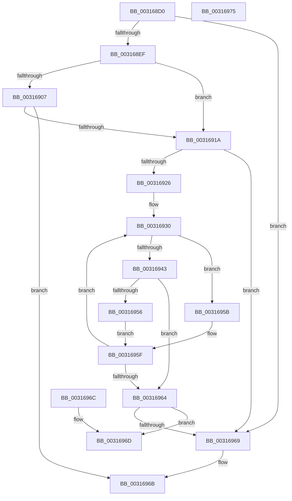

# MiLocateAddress

- RVA: `0x003168D0`–`0x00316976` (길이 `166` bytes)
- VA: `0x00000001403168D0`
- 실행 섹션: `.text`
- PDB 이름 있음: `예`; PDB Function 태그: `아니요`
- unwind 정보 RVA: `0x000DB714`
- 디코드: `48`개 명령, `166/166` bytes 표시
- 미해석 바이트: `0` (있으면 어셈블리에 `.byte`로 보존)

> 이 문서는 커널 이미지의 기계어와 PDB 기호를 분석해 생성했습니다. 4번과 5번은 함수 원형과 자료형을 바이너리 사용 방식에서 추정한 C 해석이며 원본 소스 복구 결과는 아닙니다.

## 1. Dependencies

- 직접 호출 지점: **0**; 고유 호출 대상: **0**
- 직접 호출자로 확인된 함수: **43**
- RIP 상대 이미지 참조: **0**

### Outgoing calls
- 직접 디코드된 call 명령이 없습니다.

### Direct callers
- [MiCloneVads](../22/MiCloneVads_function_0022DC1C.md) at `0x0022DE6D`
- [MiWalkPageTablesRecursively](../27/MiWalkPageTablesRecursively_function_002796C0.md) at `0x00279B85`
- [sub_0027F36E](../27/Unknown_function_0027F36E.md) at `0x0027F3C9`
- [sub_00283850](../28/Unknown_function_00283850.md) at `0x002839B9`
- [sub_00283AFC](../28/Unknown_function_00283AFC.md) at `0x00283B73`
- [sub_00283AFC](../28/Unknown_function_00283AFC.md) at `0x00283BF6`
- [MiObtainReferencedSecureVad](../29/MiObtainReferencedSecureVad_function_00295688.md) at `0x002956E2`
- [MiDeleteEmptyPageTables](../2A/MiDeleteEmptyPageTables_function_002A5220.md) at `0x002A52D1`
- [MiFindPlaceholderVadToReplace](../2A/MiFindPlaceholderVadToReplace_function_002A7280.md) at `0x002A72AD`
- [MmOutSwapVirtualAddresses](../2A/MmOutSwapVirtualAddresses_function_002A8C30.md) at `0x002A8E18`
- [MiLockStealUserVm](../2B/MiLockStealUserVm_function_002B3EDC.md) at `0x002B40C5`
- [sub_002B5C0F](../2B/Unknown_function_002B5C0F.md) at `0x002B5C2C`
- [MiComputeFaultNode](../2B/MiComputeFaultNode_function_002B60C0.md) at `0x002B61BF`
- [sub_002B674F](../2B/Unknown_function_002B674F.md) at `0x002B687A`
- [MiInitializeReadInProgressPfn](../2B/MiInitializeReadInProgressPfn_function_002B6990.md) at `0x002B6E7E`
- [MiTrimSharedPageFromViews](../2E/MiTrimSharedPageFromViews_function_002E16F8.md) at `0x002E1CB2`
- [MiSharePages](MiSharePages_function_00315110.md) at `0x003155B7`
- [MiVadSupportsCombine](MiVadSupportsCombine_function_00316610.md) at `0x00316626`
- [MiObtainReferencedVadEx](MiObtainReferencedVadEx_function_00316690.md) at `0x003166DB`
- [MiResolveProtoPteFault](../32/MiResolveProtoPteFault_function_00321750.md) at `0x00322406`
- [MiValidFault](../32/MiValidFault_function_003280B4.md) at `0x0032841A`
- [MiUserFault](../32/MiUserFault_function_00329840.md) at `0x0032A0A3`
- [MiUserFault](../32/MiUserFault_function_00329840.md) at `0x0032A0F3`
- [sub_0032F7AB](../32/Unknown_function_0032F7AB.md) at `0x0032FB48`
- [MiCompletePrivateZeroFault](../33/MiCompletePrivateZeroFault_function_00330CC0.md) at `0x00331D72`
- [MiCompleteProtoPteFault](../34/MiCompleteProtoPteFault_function_00345710.md) at `0x00346114`
- [MiCopyOnWrite](../36/MiCopyOnWrite_function_00362A0C.md) at `0x00363506`
- [MiImagePageOk](../36/MiImagePageOk_function_00365AE0.md) at `0x00365BC2`
- [MiResolveMappedFileFault](../36/MiResolveMappedFileFault_function_0036B640.md) at `0x0036B813`
- [MiResolveMappedFileFault](../36/MiResolveMappedFileFault_function_0036B640.md) at `0x0036BF54`
- [MiResolvePageFileFault](../36/MiResolvePageFileFault_function_0036D968.md) at `0x0036DC6B`
- [MiResolvePageFileFault](../36/MiResolvePageFileFault_function_0036D968.md) at `0x0036EA27`
- [MiResolvePageFileFault](../36/MiResolvePageFileFault_function_0036D968.md) at `0x0036EC6E`
- [MiReservePageFileSpace](../38/MiReservePageFileSpace_function_00383ED8.md) at `0x00383FAD`
- [MiUpdatePrefetchPriority](../40/MiUpdatePrefetchPriority_function_00402CB0.md) at `0x00402E0A`
- [NtLockVirtualMemory](../40/NtLockVirtualMemory_function_004088A0.md) at `0x00408A5F`
- [MiProcessCommitIntact](../40/MiProcessCommitIntact_function_004093C0.md) at `0x0040943A`
- [MiComputeMaximumFaultCluster](../41/MiComputeMaximumFaultCluster_function_00418210.md) at `0x0041836B`
- [MiCaptureWriteWatchDirtyBit](../46/MiCaptureWriteWatchDirtyBit_function_00465224.md) at `0x00465261`
- [MiStoreGetVadForAddress](../47/MiStoreGetVadForAddress_function_00474CB0.md) at `0x00474CC6`
- [MiCanGrantExecute](../4A/MiCanGrantExecute_function_004AD788.md) at `0x004AD7C6`
- [NtUnlockVirtualMemory](../4E/NtUnlockVirtualMemory_function_004EE890.md) at `0x004EEA82`
- [NtUnlockVirtualMemory](../4E/NtUnlockVirtualMemory_function_004EE890.md) at `0x004EED98`
- [MiStoreDiscardPoisonedPage](../69/MiStoreDiscardPoisonedPage_function_00692858.md) at `0x006929FA`
- [MmCheckForSafeExecution](../../page/80/MmCheckForSafeExecution_function_008076B0.md) at `0x008076FE`
- [MmCheckForSafeExecution](../../page/80/MmCheckForSafeExecution_function_008076B0.md) at `0x00807709`
- [MmCheckForSafeExecution](../../page/80/MmCheckForSafeExecution_function_008076B0.md) at `0x0080772A`
- [sub_0087F5A3](../../page/87/Unknown_function_0087F5A3.md) at `0x0087F5C0`
- [MiLockVadRange](../../page/87/MiLockVadRange_function_0087F670.md) at `0x0087F6F4`
- [MiCoalescePlaceholderAllocations](../../page/88/MiCoalescePlaceholderAllocations_function_0088095C.md) at `0x008809B1`
- [MiMapChildLargePageVads](../../page/AC/MiMapChildLargePageVads_function_00ACDE80.md) at `0x00ACDF15`

### Static image references
- 디코드된 RIP-relative 메모리 참조가 없습니다.

## 2. Other-region calls and transfers

- 다른 실행 섹션으로 향하는 call: **0**
- 별도 외부 분기/꼬리 이동을 확인하지 못했습니다.

## 3. Assembly (complete function range)

```asm
003168D0  65 48 8B 04 25 88 01 00 00      mov rax, qword ptr gs:[0x188]
003168D9  4C 8B C9                        mov r9, rcx
003168DC  4C 8B 90 B8 00 00 00            mov r10, qword ptr [rax + 0xb8]
003168E3  49 8B 82 60 05 00 00            mov rax, qword ptr [r10 + 0x560]
003168EA  48 85 C0                        test rax, rax
003168ED  74 7A                           je 0x140316969
003168EF  44 0F B6 40 20                  movzx r8d, byte ptr [rax + 0x20]
003168F4  8B 50 18                        mov edx, dword ptr [rax + 0x18]
003168F7  49 C1 E0 20                     shl r8, 0x20
003168FB  4C 0B C2                        or r8, rdx
003168FE  49 C1 E9 0C                     shr r9, 0xc
00316902  4D 3B C8                        cmp r9, r8
00316905  72 13                           jb 0x14031691a
00316907  0F B6 50 21                     movzx edx, byte ptr [rax + 0x21]
0031690B  8B 48 1C                        mov ecx, dword ptr [rax + 0x1c]
0031690E  48 C1 E2 20                     shl rdx, 0x20
00316912  48 0B D1                        or rdx, rcx
00316915  4C 3B CA                        cmp r9, rdx
00316918  76 51                           jbe 0x14031696b
0031691A  49 8B 82 58 05 00 00            mov rax, qword ptr [r10 + 0x558]
00316921  48 85 C0                        test rax, rax
00316924  74 43                           je 0x140316969
00316926  66 66 0F 1F 84 00 00 00 00 00   nop word ptr [rax + rax]
00316930  0F B6 50 21                     movzx edx, byte ptr [rax + 0x21]
00316934  8B 48 1C                        mov ecx, dword ptr [rax + 0x1c]
00316937  48 C1 E2 20                     shl rdx, 0x20
0031693B  48 0B D1                        or rdx, rcx
0031693E  4C 3B CA                        cmp r9, rdx
00316941  77 18                           ja 0x14031695b
00316943  0F B6 50 20                     movzx edx, byte ptr [rax + 0x20]
00316947  8B 48 18                        mov ecx, dword ptr [rax + 0x18]
0031694A  48 C1 E2 20                     shl rdx, 0x20
0031694E  48 0B D1                        or rdx, rcx
00316951  4C 3B CA                        cmp r9, rdx
00316954  73 0E                           jae 0x140316964
00316956  48 8B 00                        mov rax, qword ptr [rax]
00316959  EB 04                           jmp 0x14031695f
0031695B  48 8B 40 08                     mov rax, qword ptr [rax + 8]
0031695F  48 85 C0                        test rax, rax
00316962  75 CC                           jne 0x140316930
00316964  48 85 C0                        test rax, rax
00316967  75 04                           jne 0x14031696d
00316969  33 C0                           xor eax, eax
0031696B  C3                              ret
0031696C  CC                              int3
0031696D  49 89 82 60 05 00 00            mov qword ptr [r10 + 0x560], rax
00316974  C3                              ret
00316975  CC                              int3
```

## 4. C-style interpretation (structured pseudocode)

```c
__int64 __fastcall MiLocateAddress(__int64 a1)
{
    __int64 result;

    if (*(unsigned __int64 *)(*(unsigned __int64 *)(*(unsigned __int64 *)(gs_base + (0 + 392)) + 184) + 1376) == 0) goto loc_00316969;
    a3 = (*(unsigned __int8 *)(*(unsigned __int64 *)(*(unsigned __int64 *)(*(unsigned __int64 *)(gs_base + (0 + 392)) + 184) + 1376) + 32)) << (32);
    a3 = (a3) | ((unsigned int)(*(unsigned int *)(*(unsigned __int64 *)(*(unsigned __int64 *)(*(unsigned __int64 *)(gs_base + (0 + 392)) + 184) + 1376) + 24)));
    a4 = (a1) >> (12);
    if (a4 < a3) goto loc_0031691A;
    a2 = (*(unsigned __int8 *)(*(unsigned __int64 *)(*(unsigned __int64 *)(*(unsigned __int64 *)(gs_base + (0 + 392)) + 184) + 1376) + 33)) << (32);
    a2 = (a2) | ((unsigned int)(*(unsigned int *)(*(unsigned __int64 *)(*(unsigned __int64 *)(*(unsigned __int64 *)(gs_base + (0 + 392)) + 184) + 1376) + 28)));
    if (a4 <= a2) goto loc_0031696B;
loc_0031691A:
    if (*(unsigned __int64 *)(*(unsigned __int64 *)(*(unsigned __int64 *)(gs_base + (0 + 392)) + 184) + 1368) == 0) goto loc_00316969;
loc_00316930:
    a2 = (*(unsigned __int8 *)(*(unsigned __int64 *)(*(unsigned __int64 *)(*(unsigned __int64 *)(gs_base + (0 + 392)) + 184) + 1368) + 33)) << (32);
    a2 = (a2) | ((unsigned int)(*(unsigned int *)(*(unsigned __int64 *)(*(unsigned __int64 *)(*(unsigned __int64 *)(gs_base + (0 + 392)) + 184) + 1368) + 28)));
    if (a4 > a2) goto loc_0031695B;
    a2 = (*(unsigned __int8 *)(*(unsigned __int64 *)(*(unsigned __int64 *)(*(unsigned __int64 *)(gs_base + (0 + 392)) + 184) + 1368) + 32)) << (32);
    a2 = (a2) | ((unsigned int)(*(unsigned int *)(*(unsigned __int64 *)(*(unsigned __int64 *)(*(unsigned __int64 *)(gs_base + (0 + 392)) + 184) + 1368) + 24)));
    if (a4 >= a2) goto loc_00316964;
    goto loc_0031695F;
loc_0031695B:
loc_0031695F:
    if (*(unsigned __int64 *)(*(unsigned __int64 *)(*(unsigned __int64 *)(*(unsigned __int64 *)(*(unsigned __int64 *)(gs_base + (0 + 392)) + 184) + 1368)) + 8) != 0) goto loc_00316930;
loc_00316964:
    if (*(unsigned __int64 *)(*(unsigned __int64 *)(*(unsigned __int64 *)(*(unsigned __int64 *)(*(unsigned __int64 *)(gs_base + (0 + 392)) + 184) + 1368)) + 8) != 0) goto loc_0031696D;
loc_00316969:
    result = 0;
loc_0031696B:
    return result;
loc_0031696D:
    *(unsigned __int64 *)(*(unsigned __int64 *)(*(unsigned __int64 *)(gs_base + (0 + 392)) + 184) + 1376) = 0;
    return result;
}
```

## 5. (Beta) C Style

```c
int64_t MiLocateAddress(int64_t Arg1)
{
    int64_t result;

    if (*(uint64_t *)(*(uint64_t *)(*(uint64_t *)(gs_base + (0 + 0x188)) + 0xB8) + 0x560) == 0) goto loc_00316969;
    a3 = (*(uint8_t *)(*(uint64_t *)(*(uint64_t *)(*(uint64_t *)(gs_base + (0 + 0x188)) + 0xB8) + 0x560) + 0x20)) << (32);
    a3 = (a3) | ((uint32_t)(*(uint32_t *)(*(uint64_t *)(*(uint64_t *)(*(uint64_t *)(gs_base + (0 + 0x188)) + 0xB8) + 0x560) + 0x18)));
    a4 = (Arg1) >> (12);
    if (a4 < a3) goto loc_0031691A;
    a2 = (*(uint8_t *)(*(uint64_t *)(*(uint64_t *)(*(uint64_t *)(gs_base + (0 + 0x188)) + 0xB8) + 0x560) + 0x21)) << (32);
    a2 = (a2) | ((uint32_t)(*(uint32_t *)(*(uint64_t *)(*(uint64_t *)(*(uint64_t *)(gs_base + (0 + 0x188)) + 0xB8) + 0x560) + 0x1C)));
    if (a4 <= a2) goto loc_0031696B;
loc_0031691A:
    if (*(uint64_t *)(*(uint64_t *)(*(uint64_t *)(gs_base + (0 + 0x188)) + 0xB8) + 0x558) == 0) goto loc_00316969;
loc_00316930:
    a2 = (*(uint8_t *)(*(uint64_t *)(*(uint64_t *)(*(uint64_t *)(gs_base + (0 + 0x188)) + 0xB8) + 0x558) + 0x21)) << (32);
    a2 = (a2) | ((uint32_t)(*(uint32_t *)(*(uint64_t *)(*(uint64_t *)(*(uint64_t *)(gs_base + (0 + 0x188)) + 0xB8) + 0x558) + 0x1C)));
    if (a4 > a2) goto loc_0031695B;
    a2 = (*(uint8_t *)(*(uint64_t *)(*(uint64_t *)(*(uint64_t *)(gs_base + (0 + 0x188)) + 0xB8) + 0x558) + 0x20)) << (32);
    a2 = (a2) | ((uint32_t)(*(uint32_t *)(*(uint64_t *)(*(uint64_t *)(*(uint64_t *)(gs_base + (0 + 0x188)) + 0xB8) + 0x558) + 0x18)));
    if (a4 >= a2) goto loc_00316964;
    goto loc_0031695F;
loc_0031695B:
loc_0031695F:
    if (*(uint64_t *)(*(uint64_t *)(*(uint64_t *)(*(uint64_t *)(*(uint64_t *)(gs_base + (0 + 0x188)) + 0xB8) + 0x558)) + 0x8) != 0) goto loc_00316930;
loc_00316964:
    if (*(uint64_t *)(*(uint64_t *)(*(uint64_t *)(*(uint64_t *)(*(uint64_t *)(gs_base + (0 + 0x188)) + 0xB8) + 0x558)) + 0x8) != 0) goto loc_0031696D;
loc_00316969:
    result = 0;
loc_0031696B:
    return result;
loc_0031696D:
    *(uint64_t *)(*(uint64_t *)(*(uint64_t *)(gs_base + (0 + 0x188)) + 0xB8) + 0x560) = 0;
    return result;
}
```

## 6. Execution-region graph

[열기: 2D/3D 그래프와 함수 탐색 컨트롤 패널](../../../control-panel.html?section=text&rva=0x003168D0&view=graph)

- 2D 그래프는 위에서 아래로 흐르고, 3D 그래프는 빈 공간을 드래그해 회전합니다. Shift+드래그는 이동, 휠은 확대·축소, 함수 노드 선택은 대상 보고서 이동입니다.

### Static fallback


