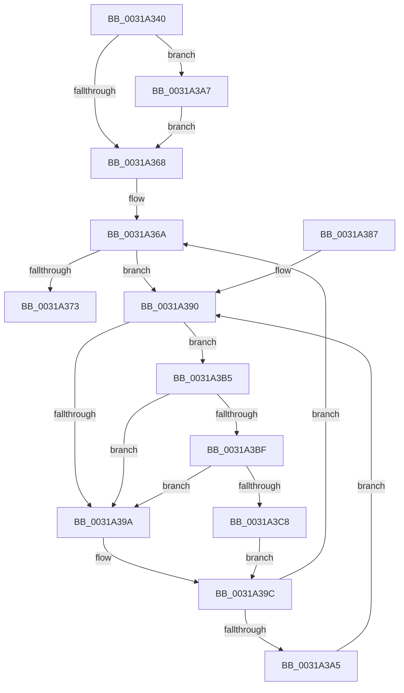

# MiLockPageInline

- RVA: `0x0031A340`–`0x0031A3D1` (길이 `145` bytes)
- VA: `0x000000014031A340`
- 실행 섹션: `.text`
- PDB 이름 있음: `예`; PDB Function 태그: `아니요`
- unwind 정보 RVA: `0x00074CA0`
- 디코드: `42`개 명령, `145/145` bytes 표시
- 미해석 바이트: `0` (있으면 어셈블리에 `.byte`로 보존)

> 이 문서는 커널 이미지의 기계어와 PDB 기호를 분석해 생성했습니다. 4번과 5번은 함수 원형과 자료형을 바이너리 사용 방식에서 추정한 C 해석이며 원본 소스 복구 결과는 아닙니다.

## 1. Dependencies

- 직접 호출 지점: **3**; 고유 호출 대상: **3**
- 직접 호출자로 확인된 함수: **93**
- RIP 상대 이미지 참조: **3**

### Outgoing calls
- `0x0031A3AE` → [KiRaiseIrqlProcessIrqlFlags](../4F/KiRaiseIrqlProcessIrqlFlags_function_004F56FC.md) (function, `0x004F56FC`)
- `0x0031A3BF` → [KiCheckVpBackingLongSpinWaitHypercall](../30/KiCheckVpBackingLongSpinWaitHypercall_function_0030F490.md) (function, `0x0030F490`)
- `0x0031A3CA` → [HvlNotifyLongSpinWait](../30/HvlNotifyLongSpinWait_function_0030F460.md) (function, `0x0030F460`)

### Direct callers
- [MiStoreModifiedWriteComplete](../20/MiStoreModifiedWriteComplete_function_002045E8.md) at `0x00204662`
- [MiFindContiguousPagesEx](../28/MiFindContiguousPagesEx_function_0028BDE0.md) at `0x0028C8E8`
- [MiChangePageAttributeBatch](../2A/MiChangePageAttributeBatch_function_002A06E0.md) at `0x002A07EB`
- [MiLockAndDecrementShareCount](../2A/MiLockAndDecrementShareCount_function_002A2854.md) at `0x002A2942`
- [MiFreeLargePages](../2A/MiFreeLargePages_function_002A99D0.md) at `0x002A9C9C`
- [MiFreePhysicalPageChain](../2A/MiFreePhysicalPageChain_function_002A9F1C.md) at `0x002AA14B`
- [MiGetSystemPage](../2A/MiGetSystemPage_function_002AB7E8.md) at `0x002AB8B6`
- [MiGetPageForHeader](../2A/MiGetPageForHeader_function_002AC120.md) at `0x002AC27B`
- [sub_002B1D4E](../2B/Unknown_function_002B1D4E.md) at `0x002B2078`
- [MiStoreWriteModifiedPages](../2B/MiStoreWriteModifiedPages_function_002B46C4.md) at `0x002B4994`
- [MiStoreWriteModifiedPages](../2B/MiStoreWriteModifiedPages_function_002B46C4.md) at `0x002B5039`
- [MmAllocateNonChargedSecurePages](../2C/MmAllocateNonChargedSecurePages_function_002C886C.md) at `0x002C8A67`
- [MiRelockProtoPoolPage](MiRelockProtoPoolPage_function_0031826C.md) at `0x003182F6`
- [MiDoubleLockMdlPage](MiDoubleLockMdlPage_function_00318324.md) at `0x0031833B`
- [MiFillSystemPtes](MiFillSystemPtes_function_00319850.md) at `0x00319BA4`
- [MiGetLargePage](MiGetLargePage_function_0031E210.md) at `0x0031E53F`
- [MiInitializePfn](../33/MiInitializePfn_function_00331E60.md) at `0x00332509`
- [MiChangePageAttribute](../33/MiChangePageAttribute_function_00332ECC.md) at `0x0033322D`
- [MmCopyToCachedPage](../34/MmCopyToCachedPage_function_00347B44.md) at `0x0034807A`
- [MiWalkEntireImage](../36/MiWalkEntireImage_function_00365D70.md) at `0x00366271`
- [MiWalkEntireImage](../36/MiWalkEntireImage_function_00365D70.md) at `0x003667C4`
- [MiWalkEntireImage](../36/MiWalkEntireImage_function_00365D70.md) at `0x00366D8E`
- [MiInitializeEnclavePfn](../36/MiInitializeEnclavePfn_function_003682A8.md) at `0x00368341`
- [MiDeleteEnclavePage](../36/MiDeleteEnclavePage_function_00368CCC.md) at `0x00368D8E`
- [MiWaitForCollidedFaultComplete](../36/MiWaitForCollidedFaultComplete_function_00369EDC.md) at `0x0036A1AC`
- [MiGatherPagefilePages](../37/MiGatherPagefilePages_function_00372B08.md) at `0x00372D60`
- [MiZeroAndReleasePages](../37/MiZeroAndReleasePages_function_003748D0.md) at `0x00374A7C`
- [MiFreeMdlPageRun](../37/MiFreeMdlPageRun_function_00375A4C.md) at `0x00375C74`
- [MiFreeSmallPageFromMdl](../37/MiFreeSmallPageFromMdl_function_00375D58.md) at `0x00375F3A`
- [MiGetPageFromSlabAllocator](../37/MiGetPageFromSlabAllocator_function_00377294.md) at `0x00377415`
- [MiReadyLargePageToFree](../37/MiReadyLargePageToFree_function_00377A68.md) at `0x00377AE6`
- [MiReadyLargePageToFree](../37/MiReadyLargePageToFree_function_00377A68.md) at `0x00377B24`
- [MiFinishLargePageFree](../37/MiFinishLargePageFree_function_00377B94.md) at `0x00377D24`
- [MiWaitForInPageComplete](../38/MiWaitForInPageComplete_function_00380AB8.md) at `0x00381021`
- [sub_0038167C](../38/Unknown_function_0038167C.md) at `0x003816C3`
- [MiWritePageFileHash](../38/MiWritePageFileHash_function_00381DC8.md) at `0x003820F1`
- [MiMarkPfnVerified](../38/MiMarkPfnVerified_function_003833C4.md) at `0x00383475`
- [MiAssignInitialPageAttribute](../3B/MiAssignInitialPageAttribute_function_003B472C.md) at `0x003B4747`
- [MiGetLargePageDemoteAsNeeded](../3B/MiGetLargePageDemoteAsNeeded_function_003B8440.md) at `0x003B86EB`
- [MiPruneStandbyPages](../3B/MiPruneStandbyPages_function_003BC0E4.md) at `0x003BC211`
- [MiPruneStandbyPages](../3B/MiPruneStandbyPages_function_003BC0E4.md) at `0x003BC373`
- [MiUnmapMdlCommon](../3E/MiUnmapMdlCommon_function_003E7DF0.md) at `0x003E839B`
- [MiFreeSecureKernelPage](../3E/MiFreeSecureKernelPage_function_003E9394.md) at `0x003E94EA`
- [MiFreeSecureKernelPage](../3E/MiFreeSecureKernelPage_function_003E9394.md) at `0x003E94FA`
- [MiFreeContiguousPages](../3F/MiFreeContiguousPages_function_003F7178.md) at `0x003F722E`
- [MiFreePagesFromMdl](../3F/MiFreePagesFromMdl_function_003F8300.md) at `0x003F8518`
- [MiWriteComplete](../40/MiWriteComplete_function_004069B0.md) at `0x00406B0F`
- [sub_0040710D](../40/Unknown_function_0040710D.md) at `0x0040716B`
- [MiBuildReservationCluster](../40/MiBuildReservationCluster_function_004071A0.md) at `0x00407654`
- [MiDoubleUnlockMdlPage](../41/MiDoubleUnlockMdlPage_function_0041F43C.md) at `0x0041F4ED`
- [MiDecayPfnFullyInitialized](../44/MiDecayPfnFullyInitialized_function_00447748.md) at `0x0044791B`
- [MiUpdateImportRelocationsOnDriverPrivatePages](../44/MiUpdateImportRelocationsOnDriverPrivatePages_function_00449BCC.md) at `0x00449D14`
- [MiSetPfnOwnedAndActive](../46/MiSetPfnOwnedAndActive_function_004652AC.md) at `0x004653C1`
- [MiLockAndInsertPageInFreeList](../47/MiLockAndInsertPageInFreeList_function_00470FA8.md) at `0x00470FEA`
- [MiUnlockPagedAddress](../49/MiUnlockPagedAddress_function_00492FC4.md) at `0x00493016`
- [MiSetPageTablePfnBuddy](../4A/MiSetPageTablePfnBuddy_function_004A3394.md) at `0x004A3479`
- [MiFinalizeImageHeaderPage](../4A/MiFinalizeImageHeaderPage_function_004A89A8.md) at `0x004A8A31`
- [MiFinishLastForkPageTable](../4B/MiFinishLastForkPageTable_function_004B2AD4.md) at `0x004B2B80`
- [MiMarkPfnTradable](../4B/MiMarkPfnTradable_function_004BDE84.md) at `0x004BDE8D`
- [MiPreInitializeSystemImagePage](../4D/MiPreInitializeSystemImagePage_function_004D621C.md) at `0x004D623A`
- [MiSplitDirectMapPage](../4D/MiSplitDirectMapPage_function_004DAAA0.md) at `0x004DAB77`
- [MiReturnEnclavePage](../4D/MiReturnEnclavePage_function_004DEEF8.md) at `0x004DEF22`
- [MiReadPagefilePage](../66/MiReadPagefilePage_function_0066F78C.md) at `0x0066F9D8`
- [MiFreeLargeInitializationCodePages](../67/MiFreeLargeInitializationCodePages_function_00670080.md) at `0x006700C1`
- [MiEnableNewPfns](../67/MiEnableNewPfns_function_00671DD0.md) at `0x00671EBE`
- [MiEnableNewPfns](../67/MiEnableNewPfns_function_00671DD0.md) at `0x00671FA7`
- [MiHotRemoveHugeRange](../67/MiHotRemoveHugeRange_function_00675DD0.md) at `0x00676085`
- [MiLogMdlRangeEvent](../67/MiLogMdlRangeEvent_function_006775E4.md) at `0x00677669`
- [MiUpdateLargePageSectionPfns](../67/MiUpdateLargePageSectionPfns_function_00678F8C.md) at `0x006790C9`
- [MiReturnPfnList](../67/MiReturnPfnList_function_0067FBEC.md) at `0x0067FC12`
- [MiChangePagingFileMaximum](../67/MiChangePagingFileMaximum_function_0067FEFC.md) at `0x006801EF`
- [MiDecrementProtoShareCounts](../68/MiDecrementProtoShareCounts_function_00680844.md) at `0x00680873`
- [MiPurgeBadFileOnlyPages](../68/MiPurgeBadFileOnlyPages_function_00681ADC.md) at `0x00681C39`
- [MiAddExpansionNonPagedPool](../68/MiAddExpansionNonPagedPool_function_00682B4C.md) at `0x00682BCE`
- [MmDbgMarkPfnModifiedWorker](../68/MmDbgMarkPfnModifiedWorker_function_00686298.md) at `0x006862D6`
- [MiChangeAwePageAttributes](../68/MiChangeAwePageAttributes_function_00687FB4.md) at `0x00687FD3`
- [MiFreeContiguousLargePageRun](../68/MiFreeContiguousLargePageRun_function_00688A34.md) at `0x00688B5B`
- [MiReadyLargeAwePageForFree](../68/MiReadyLargeAwePageForFree_function_00689258.md) at `0x00689265`
- [MiWakeWaitersForAweCacheAttributeChange](../68/MiWakeWaitersForAweCacheAttributeChange_function_00689A58.md) at `0x00689A79`
- [MiDefragmentSlabWorker](../68/MiDefragmentSlabWorker_function_0068D730.md) at `0x0068D8E1`
- [MmAllocateSecureKernelPages](../68/MmAllocateSecureKernelPages_function_0068F394.md) at `0x0068F5A9`
- [MiCoalesceActivePagesIntoFree](../69/MiCoalesceActivePagesIntoFree_function_00693558.md) at `0x0069361F`
- [MiPrepareLargePageSubPageForFree](../69/MiPrepareLargePageSubPageForFree_function_006994F0.md) at `0x00699506`
- [MiPrepareLargePageSubPageForFree](../69/MiPrepareLargePageSubPageForFree_function_006994F0.md) at `0x00699552`
- [MiPrepareLargePageSubPageForFree](../69/MiPrepareLargePageSubPageForFree_function_006994F0.md) at `0x00699583`
- [sub_006DA208](../6D/Unknown_function_006DA208.md) at `0x006DA237`
- [sub_006DAAE6](../6D/Unknown_function_006DAAE6.md) at `0x006DACE2`
- [sub_006DAAE6](../6D/Unknown_function_006DAAE6.md) at `0x006DAD10`
- [sub_006DB64E](../6D/Unknown_function_006DB64E.md) at `0x006DB66F`
- [sub_006E3DF6](../6E/Unknown_function_006E3DF6.md) at `0x006E3E0B`
- [sub_006E7436](../6E/Unknown_function_006E7436.md) at `0x006E74A0`
- [sub_006E798E](../6E/Unknown_function_006E798E.md) at `0x006E79AD`
- [sub_006EC446](../6E/Unknown_function_006EC446.md) at `0x006EC45E`
- [sub_006EC446](../6E/Unknown_function_006EC446.md) at `0x006EC539`
- [sub_006EDB06](../6E/Unknown_function_006EDB06.md) at `0x006EDB27`
- [MiInitializeSharedUserData](../../init/C5/MiInitializeSharedUserData_function_00C5F098.md) at `0x00C5F210`
- [MiAllocateDummyPage](../../init/C5/MiAllocateDummyPage_function_00C5F6E8.md) at `0x00C5F7B1`
- [MiFreeBootPageTable](../../init/C5/MiFreeBootPageTable_function_00C5FC10.md) at `0x00C5FC84`
- [MiInitializeDummyPages](../../init/C6/MiInitializeDummyPages_function_00C605CC.md) at `0x00C6063A`
- [MiInitializePfnsForValidMappings](../../init/C6/MiInitializePfnsForValidMappings_function_00C6267C.md) at `0x00C6276D`
- [MxInsertFreePages](../../init/C6/MxInsertFreePages_function_00C63AD0.md) at `0x00C63C6C`
- [MmInitializeImageViewExtensionCfg](../../init/C6/MmInitializeImageViewExtensionCfg_function_00C64FC4.md) at `0x00C6514F`
- [MiInitializeBootShadowStackPage](../../init/C6/MiInitializeBootShadowStackPage_function_00C67D8C.md) at `0x00C67DD9`
- [MiTradeBootImagePage](../../init/C6/MiTradeBootImagePage_function_00C6C554.md) at `0x00C6C5CF`

### Static image references
- `0x0031A35F` → RVA `0x00FC6D20` (`ALMOSTRO`; read)
- `0x0031A392` → RVA `0x00FC52AC` (`ALMOSTRO`; reference)
- `0x0031A3B5` → RVA `0x00FC6AB8` (`ALMOSTRO`; read)

## 2. Other-region calls and transfers

- 다른 실행 섹션으로 향하는 call: **0**
- 별도 외부 분기/꼬리 이동을 확인하지 못했습니다.

## 3. Assembly (complete function range)

```asm
0031A340  48 89 5C 24 08                  mov qword ptr [rsp + 8], rbx
0031A345  48 89 74 24 10                  mov qword ptr [rsp + 0x10], rsi
0031A34A  57                              push rdi
0031A34B  48 83 EC 20                     sub rsp, 0x20
0031A34F  48 8B D9                        mov rbx, rcx
0031A352  44 0F 20 C6                     mov rsi, cr8
0031A356  B8 02 00 00 00                  mov eax, 2
0031A35B  44 0F 22 C0                     mov cr8, rax
0031A35F  83 3D BA C9 CA 00 00            cmp dword ptr [rip + 0xcac9ba], 0
0031A366  75 3F                           jne 0x14031a3a7
0031A368  33 FF                           xor edi, edi
0031A36A  F0 48 0F BA 6B 18 3F            lock bts qword ptr [rbx + 0x18], 0x3f
0031A371  72 1D                           jb 0x14031a390
0031A373  48 8B 5C 24 30                  mov rbx, qword ptr [rsp + 0x30]
0031A378  40 0F B6 C6                     movzx eax, sil
0031A37C  48 8B 74 24 38                  mov rsi, qword ptr [rsp + 0x38]
0031A381  48 83 C4 20                     add rsp, 0x20
0031A385  5F                              pop rdi
0031A386  C3                              ret
0031A387  CC                              int3
0031A388  0F 1F 84 00 00 00 00 00         nop dword ptr [rax + rax]
0031A390  FF C7                           inc edi
0031A392  85 3D 14 AF CA 00               test dword ptr [rip + 0xcaaf14], edi
0031A398  74 1B                           je 0x14031a3b5
0031A39A  F3 90                           pause
0031A39C  48 8B 43 18                     mov rax, qword ptr [rbx + 0x18]
0031A3A0  48 85 C0                        test rax, rax
0031A3A3  79 C5                           jns 0x14031a36a
0031A3A5  EB E9                           jmp 0x14031a390
0031A3A7  0F B6 D0                        movzx edx, al
0031A3AA  40 0F B6 CE                     movzx ecx, sil
0031A3AE  E8 49 B3 1D 00                  call 0x1404f56fc
0031A3B3  EB B3                           jmp 0x14031a368
0031A3B5  8B 05 FD C6 CA 00               mov eax, dword ptr [rip + 0xcac6fd]
0031A3BB  A8 40                           test al, 0x40
0031A3BD  74 DB                           je 0x14031a39a
0031A3BF  E8 CC 50 FF FF                  call 0x14030f490
0031A3C4  84 C0                           test al, al
0031A3C6  74 D2                           je 0x14031a39a
0031A3C8  8B CF                           mov ecx, edi
0031A3CA  E8 91 50 FF FF                  call 0x14030f460
0031A3CF  EB CB                           jmp 0x14031a39c
```

## 4. C-style interpretation (structured pseudocode)

```c
__int64 __fastcall MiLockPageInline(__int64 a1)
{
    __int64 result;
    __int64 v_rdi;
    __int64 v_rsp;
    unsigned __int64 v_stack_p10;
    unsigned __int64 v_stack_p8;

    v_stack_p8 = v_rbx;
    v_stack_p10 = v_rsi;
    v_rsp = (v_rsp) - (32);
    if ((*(unsigned int *)(v_rip + 13289914)) != 0) goto loc_0031A3A7;
loc_0031A368:
    v_rdi = 0;
loc_0031A36A:
    if (condition_is_below) goto loc_0031A390;
    v_rsp = (v_rsp) + (32);
    return (unsigned __int8)(v_cr8);
loc_0031A390:
    v_rdi = (unsigned int)((v_rdi) + 1);
    if (((*(unsigned int *)(v_rip + 13283092)) & ((unsigned int)(v_rdi))) == 0) goto loc_0031A3B5;
loc_0031A39A:
loc_0031A39C:
    if (!sign_flag) goto loc_0031A36A;
    goto loc_0031A390;
loc_0031A3A7:
    result = KiRaiseIrqlProcessIrqlFlags((unsigned __int8)(v_stack_p10), (unsigned __int8)(*(unsigned __int64 *)(v_stack_p8 + 24)), a3, a4);
    goto loc_0031A368;
loc_0031A3B5:
    if ((((unsigned __int8)((unsigned int)(*(unsigned int *)(v_rip + 13289213)))) & (64)) == 0) goto loc_0031A39A;
    result = KiCheckVpBackingLongSpinWaitHypercall((unsigned __int8)(v_stack_p10), (unsigned __int8)(*(unsigned __int64 *)(v_stack_p8 + 24)), a3, a4);
    if ((unsigned __int8)(result) == 0) goto loc_0031A39A;
    result = HvlNotifyLongSpinWait((unsigned int)((unsigned int)(v_rdi)), (unsigned __int8)(*(unsigned __int64 *)(v_stack_p8 + 24)), a3, a4);
    goto loc_0031A39C;
}
```

## 5. (Beta) C Style

```c
int64_t MiLockPageInline(void *Arg1)
{
    uint8_t *arg1 = (uint8_t *)Arg1;

    int64_t result;
    int64_t local_rdi;
    int64_t local_rsp;
    uint64_t v_stack_p10;
    uint64_t v_stack_p8;

    v_stack_p8 = local_rbx;
    v_stack_p10 = local_rsi;
    local_rsp = (local_rsp) - (32);
    if ((*(uint32_t *)(v_rip + 0xCAC9BA)) != 0) goto loc_0031A3A7;
loc_0031A368:
    local_rdi = 0;
loc_0031A36A:
    if (condition_is_below) goto loc_0031A390;
    local_rsp = (local_rsp) + (32);
    return (uint8_t)(v_cr8);
loc_0031A390:
    local_rdi = (uint32_t)((local_rdi) + 1);
    if (((*(uint32_t *)(v_rip + 0xCAAF14)) & ((uint32_t)(local_rdi))) == 0) goto loc_0031A3B5;
loc_0031A39A:
loc_0031A39C:
    if (!sign_flag) goto loc_0031A36A;
    goto loc_0031A390;
loc_0031A3A7:
    result = KiRaiseIrqlProcessIrqlFlags((uint8_t)(v_stack_p10), (uint8_t)(*(uint64_t *)(v_stack_p8 + 0x18)), a3, a4);
    goto loc_0031A368;
loc_0031A3B5:
    if ((((uint8_t)((uint32_t)(*(uint32_t *)(v_rip + 0xCAC6FD)))) & (64)) == 0) goto loc_0031A39A;
    result = KiCheckVpBackingLongSpinWaitHypercall((uint8_t)(v_stack_p10), (uint8_t)(*(uint64_t *)(v_stack_p8 + 0x18)), a3, a4);
    if ((uint8_t)(result) == 0) goto loc_0031A39A;
    result = HvlNotifyLongSpinWait((uint32_t)((uint32_t)(local_rdi)), (uint8_t)(*(uint64_t *)(v_stack_p8 + 0x18)), a3, a4);
    goto loc_0031A39C;
}
```

### 관측된 메모리 오프셋

구조체 형식이 확인되지 않은 접근은 인자 기준의 오프셋으로만 기록했습니다.

| 기준 인자 | 오프셋 표현 | 폭 (bit) | 접근 |
|---|---:|---:|---|
| `Arg1` | `+ 0x18` | `64` | `R` |
| `Arg1` | `+ 0x18` | `64` | `R/W` |

## 6. Execution-region graph

[열기: 2D/3D 그래프와 함수 탐색 컨트롤 패널](../../../control-panel.html?section=text&rva=0x0031A340&view=graph)

- 2D 그래프는 위에서 아래로 흐르고, 3D 그래프는 빈 공간을 드래그해 회전합니다. Shift+드래그는 이동, 휠은 확대·축소, 함수 노드 선택은 대상 보고서 이동입니다.

### Static fallback


