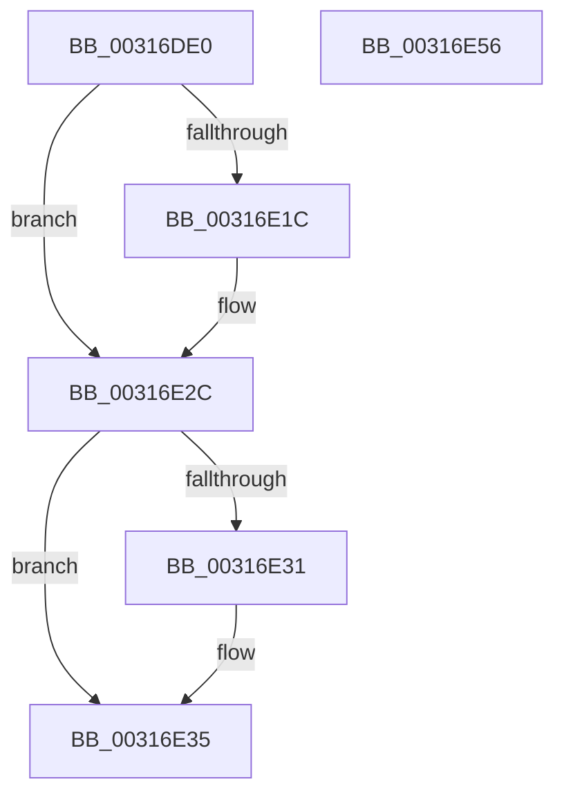

# MiLockVadShared

- RVA: `0x00316DE0`–`0x00316E57` (길이 `119` bytes)
- VA: `0x0000000140316DE0`
- 실행 섹션: `.text`
- PDB 이름 있음: `예`; PDB Function 태그: `아니요`
- unwind 정보 RVA: `0x0005FD94`
- 디코드: `35`개 명령, `119/119` bytes 표시
- 미해석 바이트: `0` (있으면 어셈블리에 `.byte`로 보존)

> 이 문서는 커널 이미지의 기계어와 PDB 기호를 분석해 생성했습니다. 4번과 5번은 함수 원형과 자료형을 바이너리 사용 방식에서 추정한 C 해석이며 원본 소스 복구 결과는 아닙니다.

## 1. Dependencies

- 직접 호출 지점: **2**; 고유 호출 대상: **2**
- 직접 호출자로 확인된 함수: **9**
- RIP 상대 이미지 참조: **0**

### Outgoing calls
- `0x00316E06` → [KeAbPreAcquire](../21/KeAbPreAcquire_function_00210230.md) (function, `0x00210230`)
- `0x00316E27` → [ExfAcquirePushLockSharedEx](../21/ExfAcquirePushLockSharedEx_function_0021044C.md) (function, `0x0021044C`)

### Direct callers
- [MiObtainReferencedVadEx](MiObtainReferencedVadEx_function_00316690.md) at `0x00316760`
- [MiReturnLockedVadOrNextVa](MiReturnLockedVadOrNextVa_function_00316980.md) at `0x00316BA5`
- [MiCleanCfg](../49/MiCleanCfg_function_00492778.md) at `0x004927C5`
- [sub_006F9816](../6F/Unknown_function_006F9816.md) at `0x006F982F`
- [MiHotPatchProcess](../../page/80/MiHotPatchProcess_function_00803B78.md) at `0x00803C0F`
- [MiHotPatchProcess](../../page/80/MiHotPatchProcess_function_00803B78.md) at `0x00803D27`
- [NtAreMappedFilesTheSame](../../page/87/NtAreMappedFilesTheSame_function_0087EC70.md) at `0x0087EDDC`
- [NtAreMappedFilesTheSame](../../page/87/NtAreMappedFilesTheSame_function_0087EC70.md) at `0x0087EE34`
- [NtAreMappedFilesTheSame](../../page/87/NtAreMappedFilesTheSame_function_0087EC70.md) at `0x0087EE8B`
- [NtAreMappedFilesTheSame](../../page/87/NtAreMappedFilesTheSame_function_0087EC70.md) at `0x0087EEB9`
- [MmIsFileMapped](../../page/91/MmIsFileMapped_function_0091D8D4.md) at `0x0091D9B7`
- [MmEnumerateAddressSpaceAndReferenceImages](../../page/97/MmEnumerateAddressSpaceAndReferenceImages_function_0097DD50.md) at `0x0097DE5D`
- [sub_00B44B9C](../../page/B4/Unknown_function_00B44B9C.md) at `0x00B44B9F`

### Static image references
- 디코드된 RIP-relative 메모리 참조가 없습니다.

## 2. Other-region calls and transfers

- 다른 실행 섹션으로 향하는 call: **0**
- 별도 외부 분기/꼬리 이동을 확인하지 못했습니다.

## 3. Assembly (complete function range)

```asm
00316DE0  48 89 5C 24 10                  mov qword ptr [rsp + 0x10], rbx
00316DE5  48 89 74 24 18                  mov qword ptr [rsp + 0x18], rsi
00316DEA  57                              push rdi
00316DEB  48 83 EC 20                     sub rsp, 0x20
00316DEF  66 FF 89 E6 01 00 00            dec word ptr [rcx + 0x1e6]
00316DF6  48 8D 72 28                     lea rsi, [rdx + 0x28]
00316DFA  48 8B F9                        mov rdi, rcx
00316DFD  45 33 C0                        xor r8d, r8d
00316E00  48 8B CE                        mov rcx, rsi
00316E03  33 D2                           xor edx, edx
00316E05  90                              nop
00316E06  E8 25 94 EF FF                  call 0x140210230
00316E0B  48 8B D8                        mov rbx, rax
00316E0E  B9 11 00 00 00                  mov ecx, 0x11
00316E13  33 C0                           xor eax, eax
00316E15  F0 48 0F B1 0E                  lock cmpxchg qword ptr [rsi], rcx
00316E1A  74 10                           je 0x140316e2c
00316E1C  4C 8B CE                        mov r9, rsi
00316E1F  4C 8B C3                        mov r8, rbx
00316E22  33 D2                           xor edx, edx
00316E24  48 8B CE                        mov rcx, rsi
00316E27  E8 20 96 EF FF                  call 0x14021044c
00316E2C  48 85 DB                        test rbx, rbx
00316E2F  74 04                           je 0x140316e35
00316E31  C6 43 0A 01                     mov byte ptr [rbx + 0xa], 1
00316E35  8B 87 A8 05 00 00               mov eax, dword ptr [rdi + 0x5a8]
00316E3B  48 8B 5C 24 38                  mov rbx, qword ptr [rsp + 0x38]
00316E40  0F BA E8 0E                     bts eax, 0xe
00316E44  48 8B 74 24 40                  mov rsi, qword ptr [rsp + 0x40]
00316E49  89 87 A8 05 00 00               mov dword ptr [rdi + 0x5a8], eax
00316E4F  90                              nop
00316E50  48 83 C4 20                     add rsp, 0x20
00316E54  5F                              pop rdi
00316E55  C3                              ret
00316E56  CC                              int3
```

## 4. C-style interpretation (structured pseudocode)

```c
__int64 __fastcall MiLockVadShared(__int64 a1, __int64 a2, int a3)
{
    __int64 result;
    __int64 v_rsp;
    unsigned __int64 v_stack_p10;
    unsigned __int64 v_stack_p18;

    v_stack_p10 = v_rbx;
    v_stack_p18 = v_rsi;
    v_rsp = (v_rsp) - (32);
    a3 = 0;
    a2 = 0;
    result = KeAbPreAcquire(a2 + 40, a2, a3, a4);
    result = 0;
    if (!(condition_is_equal)) {
        a4 = a2 + 40;
        a3 = 0;
        a2 = 0;
        a1 = a2 + 40;
        result = ExfAcquirePushLockSharedEx(a1, a2, a3, a4);
    }
    if (result != 0) {
        *(unsigned __int8 *)(result + 10) = 1;
    }
    *(unsigned int *)(a1 + 1448) = (unsigned int)((unsigned int)(*(unsigned int *)(a1 + 1448)));
    v_rsp = (v_rsp) + (32);
    return (unsigned int)(*(unsigned int *)(a1 + 1448));
}
```

## 5. (Beta) C Style

```c
int64_t MiLockVadShared(void *Arg1, void *Arg2, int32_t Arg3)
{
    uint8_t *arg1 = (uint8_t *)Arg1;
    uint8_t *arg2 = (uint8_t *)Arg2;

    int64_t result;
    int64_t local_rsp;
    uint64_t v_stack_p10;
    uint64_t v_stack_p18;

    v_stack_p10 = local_rbx;
    v_stack_p18 = local_rsi;
    local_rsp = (local_rsp) - (32);
    Arg3 = 0;
    Arg2 = 0;
    result = KeAbPreAcquire(Arg2 + 40, Arg2, Arg3, a4);
    result = 0;
    if (!(condition_is_equal)) {
        a4 = Arg2 + 40;
        Arg3 = 0;
        Arg2 = 0;
        Arg1 = Arg2 + 40;
        result = ExfAcquirePushLockSharedEx(Arg1, Arg2, Arg3, a4);
    }
    if (result != 0) {
        *(uint8_t *)(result + 0xA) = 1;
    }
    *(uint32_t *)(arg1 + 0x5A8) = (uint32_t)((uint32_t)(*(uint32_t *)(arg1 + 0x5A8)));
    local_rsp = (local_rsp) + (32);
    return (uint32_t)(*(uint32_t *)(arg1 + 0x5A8));
}
```

### 관측된 메모리 오프셋

구조체 형식이 확인되지 않은 접근은 인자 기준의 오프셋으로만 기록했습니다.

| 기준 인자 | 오프셋 표현 | 폭 (bit) | 접근 |
|---|---:|---:|---|
| `Arg1` | `+ 0x1E6` | `16` | `R/W` |
| `Arg1` | `+ 0x5A8` | `32` | `R` |
| `Arg1` | `+ 0x5A8` | `32` | `W` |
| `Arg2` | `+ 0x0` | `64` | `R` |
| `Arg2` | `+ 0x28` | `64` | `R` |

## 6. Execution-region graph

[열기: 2D/3D 그래프와 함수 탐색 컨트롤 패널](../../../control-panel.html?section=text&rva=0x00316DE0&view=graph)

- 2D 그래프는 위에서 아래로 흐르고, 3D 그래프는 빈 공간을 드래그해 회전합니다. Shift+드래그는 이동, 휠은 확대·축소, 함수 노드 선택은 대상 보고서 이동입니다.

### Static fallback


