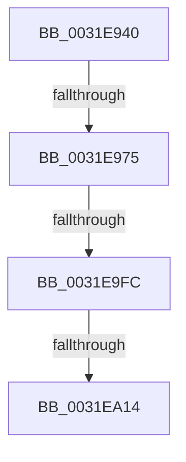

# MiMapBackgroundPagesToZero

- RVA: `0x0031E940`–`0x0031EA17` (길이 `215` bytes)
- VA: `0x000000014031E940`
- 실행 섹션: `.text`
- PDB 이름 있음: `예`; PDB Function 태그: `예`
- unwind 정보 RVA: `0x00075278`
- 디코드: `49`개 명령, `215/215` bytes 표시
- 미해석 바이트: `0` (있으면 어셈블리에 `.byte`로 보존)

> 이 문서는 커널 이미지의 기계어와 PDB 기호를 분석해 생성했습니다. 4번과 5번은 함수 원형과 자료형을 바이너리 사용 방식에서 추정한 C 해석이며 원본 소스 복구 결과는 아닙니다.

## 1. Dependencies

- 직접 호출 지점: **1**; 고유 호출 대상: **1**
- 직접 호출자로 확인된 함수: **1**
- RIP 상대 이미지 참조: **1**

### Outgoing calls
- `0x0031E9BA` → [MiGetUltraMapping](../32/MiGetUltraMapping_function_00323270.md) (function, `0x00323270`)

### Direct callers
- [MiBackgroundZeroLocalPages](MiBackgroundZeroLocalPages_function_0031EF30.md) at `0x0031F2CC`

### Static image references
- `0x0031E989` → RVA `0x00000000` (`image boundary/outside`; read)

## 2. Other-region calls and transfers

- 다른 실행 섹션으로 향하는 call: **0**
- call이 아닌 외부 분기/꼬리 이동: **3**
  - `0x0031E96F` → [sub_0031EEDC](Unknown_function_0031EEDC.md) (`tail-transfer`)
  - `0x0031E9F6` → [sub_0031EE80](Unknown_function_0031EE80.md) (`tail-transfer`)
  - `0x0031EA0E` → [sub_0031ED9E](Unknown_function_0031ED9E.md) (`tail-transfer`)

## 3. Assembly (complete function range)

```asm
0031E940  89 54 24 10                     mov dword ptr [rsp + 0x10], edx
0031E944  48 89 4C 24 08                  mov qword ptr [rsp + 8], rcx
0031E949  53                              push rbx
0031E94A  55                              push rbp
0031E94B  56                              push rsi
0031E94C  57                              push rdi
0031E94D  41 54                           push r12
0031E94F  41 56                           push r14
0031E951  41 57                           push r15
0031E953  48 81 EC 90 00 00 00            sub rsp, 0x90
0031E95A  83 B9 40 01 00 00 00            cmp dword ptr [rcx + 0x140], 0
0031E961  48 8B F1                        mov rsi, rcx
0031E964  44 8B F2                        mov r14d, edx
0031E967  48 8B E9                        mov rbp, rcx
0031E96A  48 89 4C 24 48                  mov qword ptr [rsp + 0x48], rcx
0031E96F  0F 84 67 05 00 00               je 0x14031eedc
0031E975  44 8B BD 18 01 00 00            mov r15d, dword ptr [rbp + 0x118]
0031E97C  4A 8D 0C F5 00 00 00 00         lea rcx, [r14*8]
0031E984  48 89 4C 24 68                  mov qword ptr [rsp + 0x68], rcx
0031E989  48 8D 15 70 16 CE FF            lea rdx, [rip - 0x31e990]
0031E990  48 8B 9C 11 60 1C 01 00         mov rbx, qword ptr [rcx + rdx + 0x11c60]
0031E998  45 33 C9                        xor r9d, r9d
0031E99B  4C 0F AF FB                     imul r15, rbx
0031E99F  49 8D 4E 0E                     lea rcx, [r14 + 0xe]
0031E9A3  48 89 5C 24 58                  mov qword ptr [rsp + 0x58], rbx
0031E9A8  48 C1 E1 05                     shl rcx, 5
0031E9AC  4D 8B C7                        mov r8, r15
0031E9AF  48 03 CE                        add rcx, rsi
0031E9B2  4C 89 7C 24 70                  mov qword ptr [rsp + 0x70], r15
0031E9B7  41 8B D6                        mov edx, r14d
0031E9BA  E8 B1 48 00 00                  call 0x140323270
0031E9BF  48 8B F8                        mov rdi, rax
0031E9C2  48 89 44 24 60                  mov qword ptr [rsp + 0x60], rax
0031E9C7  48 C1 EF 09                     shr rdi, 9
0031E9CB  49 B8 F8 FF FF FF 7F 00 00 00   movabs r8, 0x7ffffffff8
0031E9D5  49 23 F8                        and rdi, r8
0031E9D8  48 89 44 24 28                  mov qword ptr [rsp + 0x28], rax
0031E9DD  48 BA 00 00 00 00 80 F6 FF FF   movabs rdx, 0xfffff68000000000
0031E9E7  48 8B CA                        mov rcx, rdx
0031E9EA  48 03 F9                        add rdi, rcx
0031E9ED  48 89 7C 24 40                  mov qword ptr [rsp + 0x40], rdi
0031E9F2  41 83 FE 01                     cmp r14d, 1
0031E9F6  0F 86 84 04 00 00               jbe 0x14031ee80
0031E9FC  33 C0                           xor eax, eax
0031E9FE  45 33 E4                        xor r12d, r12d
0031EA01  89 84 24 E8 00 00 00            mov dword ptr [rsp + 0xe8], eax
0031EA08  39 85 18 01 00 00               cmp dword ptr [rbp + 0x118], eax
0031EA0E  0F 86 8A 03 00 00               jbe 0x14031ed9e
0031EA14  48 8B C3                        mov rax, rbx
```

## 4. C-style interpretation (structured pseudocode)

```c
__int64 __fastcall MiMapBackgroundPagesToZero(__int64 a1, int a2, __int64 a3, int a4)
{
    __int64 result;
    __int64 v_r12;
    __int64 v_r15;
    __int64 v_rdi;
    __int64 v_rsp;
    unsigned __int64 v_stack_m58;
    unsigned __int64 v_stack_m60;
    unsigned __int64 v_stack_m68;
    unsigned __int64 v_stack_m70;
    unsigned __int64 v_stack_m80;
    unsigned __int64 v_stack_m88;
    unsigned __int64 v_stack_mA0;
    unsigned int v_stack_p10;
    unsigned int v_stack_p20;
    unsigned __int64 v_stack_p8;

    v_stack_p10 = a2;
    v_stack_p8 = a1;
    v_rsp = (v_rsp) - (144);
    v_stack_m80 = a1;
    v_stack_m60 = (unsigned int)(a2) * 8;
    a4 = 0;
    v_r15 = ((unsigned int)(*(unsigned int *)(a1 + 280))) * (*(unsigned __int64 *)((unsigned int)(a2) * 8 + v_rip - 3271056 * 1 + 72800));
    v_stack_m70 = *(unsigned __int64 *)((unsigned int)(a2) * 8 + v_rip - 3271056 * 1 + 72800);
    a1 = ((unsigned int)(a2) + 14) << (5);
    a1 = (a1) + (a1);
    v_stack_m58 = v_r15;
    result = MiGetUltraMapping(a1, (unsigned int)((unsigned int)((unsigned int)(a2))), v_r15, a4);
    v_stack_m68 = result;
    v_rdi = (result) >> (9);
    v_rdi = (v_rdi) & (v_r15);
    v_stack_mA0 = result;
    v_rdi = (v_rdi) + ((unsigned int)((unsigned int)((unsigned int)(a2))));
    v_stack_m88 = v_rdi;
    result = 0;
    v_r12 = 0;
    v_stack_p20 = 0;
    return *(unsigned __int64 *)((unsigned int)(a2) * 8 + v_rip - 3271056 * 1 + 72800);
}
```

## 5. (Beta) C Style

```c
int64_t MiMapBackgroundPagesToZero(void *Arg1, void *Arg2, int64_t Arg3, int32_t Arg4)
{
    uint8_t *arg1 = (uint8_t *)Arg1;
    uint8_t *arg2 = (uint8_t *)Arg2;

    int64_t result;
    int64_t local_r12;
    int64_t local_r15;
    int64_t local_rdi;
    int64_t local_rsp;
    uint64_t v_stack_m58;
    uint64_t v_stack_m60;
    uint64_t v_stack_m68;
    uint64_t v_stack_m70;
    uint64_t v_stack_m80;
    uint64_t v_stack_m88;
    uint64_t v_stack_mA0;
    uint32_t v_stack_p10;
    uint32_t v_stack_p20;
    uint64_t v_stack_p8;

    v_stack_p10 = Arg2;
    v_stack_p8 = Arg1;
    local_rsp = (local_rsp) - (144);
    v_stack_m80 = Arg1;
    v_stack_m60 = (uint32_t)(Arg2) * 8;
    Arg4 = 0;
    local_r15 = ((uint32_t)(*(uint32_t *)(arg1 + 0x118))) * (*(uint64_t *)((uint32_t)(arg2) * 8 + v_rip - 0x31E990 * 1 + 0x11C60));
    v_stack_m70 = *(uint64_t *)((uint32_t)(arg2) * 8 + v_rip - 0x31E990 * 1 + 0x11C60);
    Arg1 = ((uint32_t)(Arg2) + 14) << (5);
    Arg1 = (Arg1) + (Arg1);
    v_stack_m58 = local_r15;
    result = MiGetUltraMapping(Arg1, (uint32_t)((uint32_t)((uint32_t)(Arg2))), local_r15, Arg4);
    v_stack_m68 = result;
    local_rdi = (result) >> (9);
    local_rdi = (local_rdi) & (local_r15);
    v_stack_mA0 = result;
    local_rdi = (local_rdi) + ((uint32_t)((uint32_t)((uint32_t)(Arg2))));
    v_stack_m88 = local_rdi;
    result = 0;
    local_r12 = 0;
    v_stack_p20 = 0;
    return *(uint64_t *)((uint32_t)(arg2) * 8 + v_rip - 0x31E990 * 1 + 0x11C60);
}
```

### 관측된 메모리 오프셋

구조체 형식이 확인되지 않은 접근은 인자 기준의 오프셋으로만 기록했습니다.

| 기준 인자 | 오프셋 표현 | 폭 (bit) | 접근 |
|---|---:|---:|---|
| `Arg1` | `+ 0x118` | `32` | `R` |
| `Arg1` | `+ 0x140` | `32` | `R` |
| `Arg2` | `+ 0xE` | `64` | `R` |

## 6. Execution-region graph

[열기: 2D/3D 그래프와 함수 탐색 컨트롤 패널](../../../control-panel.html?section=text&rva=0x0031E940&view=graph)

- 2D 그래프는 위에서 아래로 흐르고, 3D 그래프는 빈 공간을 드래그해 회전합니다. Shift+드래그는 이동, 휠은 확대·축소, 함수 노드 선택은 대상 보고서 이동입니다.

### Static fallback


