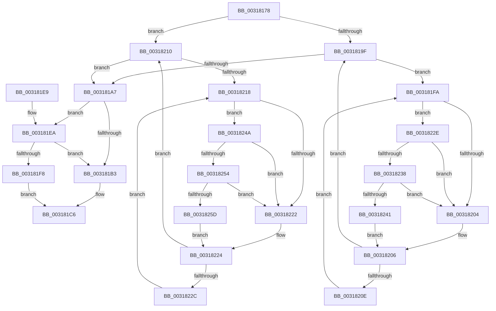

# MiObtainProtoReference

- RVA: `0x00318178`–`0x00318266` (길이 `238` bytes)
- VA: `0x0000000140318178`
- 실행 섹션: `.text`
- PDB 이름 있음: `예`; PDB Function 태그: `아니요`
- unwind 정보 RVA: `0x00074BB8`
- 디코드: `73`개 명령, `238/238` bytes 표시
- 미해석 바이트: `0` (있으면 어셈블리에 `.byte`로 보존)

> 이 문서는 커널 이미지의 기계어와 PDB 기호를 분석해 생성했습니다. 4번과 5번은 함수 원형과 자료형을 바이너리 사용 방식에서 추정한 C 해석이며 원본 소스 복구 결과는 아닙니다.

## 1. Dependencies

- 직접 호출 지점: **6**; 고유 호출 대상: **4**
- 직접 호출자로 확인된 함수: **12**
- RIP 상대 이미지 참조: **2**

### Outgoing calls
- `0x003181AA` → [MiAreChargesNeededToLockPage](MiAreChargesNeededToLockPage_function_00318720.md) (function, `0x00318720`)
- `0x003181EF` → [MiChargeForLockedPage](../28/MiChargeForLockedPage_function_00285AA0.md) (function, `0x00285AA0`)
- `0x00318238` → [KiCheckVpBackingLongSpinWaitHypercall](../30/KiCheckVpBackingLongSpinWaitHypercall_function_0030F490.md) (function, `0x0030F490`)
- `0x00318243` → [HvlNotifyLongSpinWait](../30/HvlNotifyLongSpinWait_function_0030F460.md) (function, `0x0030F460`)
- `0x00318254` → [KiCheckVpBackingLongSpinWaitHypercall](../30/KiCheckVpBackingLongSpinWaitHypercall_function_0030F490.md) (function, `0x0030F490`)
- `0x0031825F` → [HvlNotifyLongSpinWait](../30/HvlNotifyLongSpinWait_function_0030F460.md) (function, `0x0030F460`)

### Direct callers
- [MiFinishMdlForMappedFileFault](../2A/MiFinishMdlForMappedFileFault_function_002AC974.md) at `0x002AC9C2`
- [MiCopyDataPageToImagePage](../2A/MiCopyDataPageToImagePage_function_002AE818.md) at `0x002AED07`
- [sub_002B5F52](../2B/Unknown_function_002B5F52.md) at `0x002B5F5D`
- [MiPfPutPagesInTransition](../36/MiPfPutPagesInTransition_function_003640EC.md) at `0x0036463A`
- [MiWalkEntireImage](../36/MiWalkEntireImage_function_00365D70.md) at `0x00366C75`
- [MiHandleCollidedFault](../36/MiHandleCollidedFault_function_00369B48.md) at `0x00369BC7`
- [MiCopyFileOnlyGlobalSubsectionPage](../36/MiCopyFileOnlyGlobalSubsectionPage_function_0036A9EC.md) at `0x0036AD04`
- [MiResolvePageFileFault](../36/MiResolvePageFileFault_function_0036D968.md) at `0x0036E0DA`
- [MiFlushWaitForReadInProgress](../40/MiFlushWaitForReadInProgress_function_004032E0.md) at `0x00403346`
- [MiIdealClusterPage](../4D/MiIdealClusterPage_function_004DB964.md) at `0x004DBD46`
- [sub_006D6E94](../6D/Unknown_function_006D6E94.md) at `0x006D7015`
- [sub_006E313A](../6E/Unknown_function_006E313A.md) at `0x006E32AA`

### Static image references
- `0x003181FC` → RVA `0x00FC52AC` (`ALMOSTRO`; reference)
- `0x0031822E` → RVA `0x00FC6AB8` (`ALMOSTRO`; read)

## 2. Other-region calls and transfers

- 다른 실행 섹션으로 향하는 call: **0**
- 별도 외부 분기/꼬리 이동을 확인하지 못했습니다.

## 3. Assembly (complete function range)

```asm
00318178  48 89 5C 24 08                  mov qword ptr [rsp + 8], rbx
0031817D  48 89 6C 24 18                  mov qword ptr [rsp + 0x18], rbp
00318182  48 89 74 24 20                  mov qword ptr [rsp + 0x20], rsi
00318187  57                              push rdi
00318188  48 83 EC 20                     sub rsp, 0x20
0031818C  BD 01 00 00 00                  mov ebp, 1
00318191  48 8D 59 18                     lea rbx, [rcx + 0x18]
00318195  33 FF                           xor edi, edi
00318197  48 8B F1                        mov rsi, rcx
0031819A  40 84 D5                        test bpl, dl
0031819D  75 71                           jne 0x140318210
0031819F  F0 48 0F BA 2B 3F               lock bts qword ptr [rbx], 0x3f
003181A5  72 53                           jb 0x1403181fa
003181A7  48 8B CE                        mov rcx, rsi
003181AA  E8 71 05 00 00                  call 0x140318720
003181AF  85 C0                           test eax, eax
003181B1  75 37                           jne 0x1403181ea
003181B3  8B 46 20                        mov eax, dword ptr [rsi + 0x20]
003181B6  89 44 24 38                     mov dword ptr [rsp + 0x38], eax
003181BA  66 01 6C 24 38                  add word ptr [rsp + 0x38], bp
003181BF  8B 44 24 38                     mov eax, dword ptr [rsp + 0x38]
003181C3  89 46 20                        mov dword ptr [rsi + 0x20], eax
003181C6  48 B8 FF FF FF FF FF FF FF 7F   movabs rax, 0x7fffffffffffffff
003181D0  F0 48 21 03                     lock and qword ptr [rbx], rax
003181D4  48 8B 5C 24 30                  mov rbx, qword ptr [rsp + 0x30]
003181D9  48 8B 6C 24 40                  mov rbp, qword ptr [rsp + 0x40]
003181DE  48 8B 74 24 48                  mov rsi, qword ptr [rsp + 0x48]
003181E3  48 83 C4 20                     add rsp, 0x20
003181E7  5F                              pop rdi
003181E8  C3                              ret
003181E9  CC                              int3
003181EA  8B D5                           mov edx, ebp
003181EC  48 8B CE                        mov rcx, rsi
003181EF  E8 AC D8 F6 FF                  call 0x140285aa0
003181F4  85 C0                           test eax, eax
003181F6  75 BB                           jne 0x1403181b3
003181F8  EB CC                           jmp 0x1403181c6
003181FA  03 FD                           add edi, ebp
003181FC  85 3D AA D0 CA 00               test dword ptr [rip + 0xcad0aa], edi
00318202  74 2A                           je 0x14031822e
00318204  F3 90                           pause
00318206  48 8B 03                        mov rax, qword ptr [rbx]
00318209  48 85 C0                        test rax, rax
0031820C  79 91                           jns 0x14031819f
0031820E  EB EA                           jmp 0x1403181fa
00318210  F0 48 0F BA 2B 3F               lock bts qword ptr [rbx], 0x3f
00318216  73 8F                           jae 0x1403181a7
00318218  03 FD                           add edi, ebp
0031821A  85 3D 8C D0 CA 00               test dword ptr [rip + 0xcad08c], edi
00318220  74 28                           je 0x14031824a
00318222  F3 90                           pause
00318224  48 8B 03                        mov rax, qword ptr [rbx]
00318227  48 85 C0                        test rax, rax
0031822A  79 E4                           jns 0x140318210
0031822C  EB EA                           jmp 0x140318218
0031822E  8B 05 84 E8 CA 00               mov eax, dword ptr [rip + 0xcae884]
00318234  A8 40                           test al, 0x40
00318236  74 CC                           je 0x140318204
00318238  E8 53 72 FF FF                  call 0x14030f490
0031823D  84 C0                           test al, al
0031823F  74 C3                           je 0x140318204
00318241  8B CF                           mov ecx, edi
00318243  E8 18 72 FF FF                  call 0x14030f460
00318248  EB BC                           jmp 0x140318206
0031824A  8B 05 68 E8 CA 00               mov eax, dword ptr [rip + 0xcae868]
00318250  A8 40                           test al, 0x40
00318252  74 CE                           je 0x140318222
00318254  E8 37 72 FF FF                  call 0x14030f490
00318259  84 C0                           test al, al
0031825B  74 C5                           je 0x140318222
0031825D  8B CF                           mov ecx, edi
0031825F  E8 FC 71 FF FF                  call 0x14030f460
00318264  EB BE                           jmp 0x140318224
```

## 4. C-style interpretation (structured pseudocode)

```c
__int64 __fastcall MiObtainProtoReference(__int64 a1, unsigned __int8 a2)
{
    __int64 result;
    __int64 v_rdi;
    __int64 v_rsp;
    unsigned int v_stack_p10;
    unsigned __int64 v_stack_p18;
    unsigned __int64 v_stack_p20;
    unsigned __int64 v_stack_p8;

    v_stack_p8 = v_rbx;
    v_stack_p18 = v_rbp;
    v_stack_p20 = v_rsi;
    v_rsp = (v_rsp) - (32);
    v_rdi = 0;
    if (((1) & (a2)) != 0) goto loc_00318210;
loc_0031819F:
    if (condition_is_below) goto loc_003181FA;
loc_003181A7:
    result = MiAreChargesNeededToLockPage(a1, a2, a3, a4);
    if ((unsigned int)(result) != 0) goto loc_003181EA;
loc_003181B3:
    v_stack_p10 = (unsigned int)((unsigned int)(*(unsigned int *)(a1 + 32)));
    *(unsigned int *)(a1 + 32) = (unsigned int)((unsigned int)(v_stack_p10));
loc_003181C6:
    v_rsp = (v_rsp) + (32);
    return (unsigned int)(v_stack_p10);
loc_003181EA:
    result = MiChargeForLockedPage(v_stack_p20, (unsigned int)((unsigned int)(v_stack_p18)), a3, a4);
    if ((unsigned int)(result) != 0) goto loc_003181B3;
    goto loc_003181C6;
loc_003181FA:
    v_rdi = (unsigned int)((v_rdi) + ((unsigned int)(v_stack_p18)));
    if (((*(unsigned int *)(v_rip + 13291690)) & ((unsigned int)(v_rdi))) == 0) goto loc_0031822E;
loc_00318204:
loc_00318206:
    if (!sign_flag) goto loc_0031819F;
    goto loc_003181FA;
loc_00318210:
    if (condition_is_above_or_equal) goto loc_003181A7;
loc_00318218:
    v_rdi = (unsigned int)((v_rdi) + ((unsigned int)(v_stack_p18)));
    if (((*(unsigned int *)(v_rip + 13291660)) & ((unsigned int)(v_rdi))) == 0) goto loc_0031824A;
loc_00318222:
loc_00318224:
    if (!sign_flag) goto loc_00318210;
    goto loc_00318218;
loc_0031822E:
    if ((((unsigned __int8)((unsigned int)(*(unsigned int *)(v_rip + 13297796)))) & (64)) == 0) goto loc_00318204;
    result = KiCheckVpBackingLongSpinWaitHypercall(v_stack_p20, (unsigned int)((unsigned int)(v_stack_p18)), a3, a4);
    if ((unsigned __int8)(result) == 0) goto loc_00318204;
    result = HvlNotifyLongSpinWait((unsigned int)((unsigned int)(v_rdi)), (unsigned int)((unsigned int)(v_stack_p18)), a3, a4);
    goto loc_00318206;
loc_0031824A:
    if ((((unsigned __int8)((unsigned int)(*(unsigned int *)(v_rip + 13297768)))) & (64)) == 0) goto loc_00318222;
    result = KiCheckVpBackingLongSpinWaitHypercall((unsigned int)((unsigned int)(v_rdi)), (unsigned int)((unsigned int)(v_stack_p18)), a3, a4);
    if ((unsigned __int8)(result) == 0) goto loc_00318222;
    result = HvlNotifyLongSpinWait((unsigned int)((unsigned int)(v_rdi)), (unsigned int)((unsigned int)(v_stack_p18)), a3, a4);
    goto loc_00318224;
}
```

## 5. (Beta) C Style

```c
int64_t MiObtainProtoReference(void *Arg1, uint8_t Arg2)
{
    uint8_t *arg1 = (uint8_t *)Arg1;

    int64_t result;
    int64_t local_rdi;
    int64_t local_rsp;
    uint32_t v_stack_p10;
    uint64_t v_stack_p18;
    uint64_t v_stack_p20;
    uint64_t v_stack_p8;

    v_stack_p8 = local_rbx;
    v_stack_p18 = local_rbp;
    v_stack_p20 = local_rsi;
    local_rsp = (local_rsp) - (32);
    local_rdi = 0;
    if (((1) & (Arg2)) != 0) goto loc_00318210;
loc_0031819F:
    if (condition_is_below) goto loc_003181FA;
loc_003181A7:
    result = MiAreChargesNeededToLockPage(Arg1, Arg2, a3, a4);
    if ((uint32_t)(result) != 0) goto loc_003181EA;
loc_003181B3:
    v_stack_p10 = (uint32_t)((uint32_t)(*(uint32_t *)(arg1 + 0x20)));
    *(uint32_t *)(arg1 + 0x20) = (uint32_t)((uint32_t)(v_stack_p10));
loc_003181C6:
    local_rsp = (local_rsp) + (32);
    return (uint32_t)(v_stack_p10);
loc_003181EA:
    result = MiChargeForLockedPage(v_stack_p20, (uint32_t)((uint32_t)(v_stack_p18)), a3, a4);
    if ((uint32_t)(result) != 0) goto loc_003181B3;
    goto loc_003181C6;
loc_003181FA:
    local_rdi = (uint32_t)((local_rdi) + ((uint32_t)(v_stack_p18)));
    if (((*(uint32_t *)(v_rip + 0xCAD0AA)) & ((uint32_t)(local_rdi))) == 0) goto loc_0031822E;
loc_00318204:
loc_00318206:
    if (!sign_flag) goto loc_0031819F;
    goto loc_003181FA;
loc_00318210:
    if (condition_is_above_or_equal) goto loc_003181A7;
loc_00318218:
    local_rdi = (uint32_t)((local_rdi) + ((uint32_t)(v_stack_p18)));
    if (((*(uint32_t *)(v_rip + 0xCAD08C)) & ((uint32_t)(local_rdi))) == 0) goto loc_0031824A;
loc_00318222:
loc_00318224:
    if (!sign_flag) goto loc_00318210;
    goto loc_00318218;
loc_0031822E:
    if ((((uint8_t)((uint32_t)(*(uint32_t *)(v_rip + 0xCAE884)))) & (64)) == 0) goto loc_00318204;
    result = KiCheckVpBackingLongSpinWaitHypercall(v_stack_p20, (uint32_t)((uint32_t)(v_stack_p18)), a3, a4);
    if ((uint8_t)(result) == 0) goto loc_00318204;
    result = HvlNotifyLongSpinWait((uint32_t)((uint32_t)(local_rdi)), (uint32_t)((uint32_t)(v_stack_p18)), a3, a4);
    goto loc_00318206;
loc_0031824A:
    if ((((uint8_t)((uint32_t)(*(uint32_t *)(v_rip + 0xCAE868)))) & (64)) == 0) goto loc_00318222;
    result = KiCheckVpBackingLongSpinWaitHypercall((uint32_t)((uint32_t)(local_rdi)), (uint32_t)((uint32_t)(v_stack_p18)), a3, a4);
    if ((uint8_t)(result) == 0) goto loc_00318222;
    result = HvlNotifyLongSpinWait((uint32_t)((uint32_t)(local_rdi)), (uint32_t)((uint32_t)(v_stack_p18)), a3, a4);
    goto loc_00318224;
}
```

### 관측된 메모리 오프셋

구조체 형식이 확인되지 않은 접근은 인자 기준의 오프셋으로만 기록했습니다.

| 기준 인자 | 오프셋 표현 | 폭 (bit) | 접근 |
|---|---:|---:|---|
| `Arg1` | `+ 0x0` | `64` | `R` |
| `Arg1` | `+ 0x0` | `64` | `R/W` |
| `Arg1` | `+ 0x18` | `64` | `R` |
| `Arg1` | `+ 0x20` | `32` | `R` |
| `Arg1` | `+ 0x20` | `32` | `W` |

## 6. Execution-region graph

[열기: 2D/3D 그래프와 함수 탐색 컨트롤 패널](../../../control-panel.html?section=text&rva=0x00318178&view=graph)

- 2D 그래프는 위에서 아래로 흐르고, 3D 그래프는 빈 공간을 드래그해 회전합니다. Shift+드래그는 이동, 휠은 확대·축소, 함수 노드 선택은 대상 보고서 이동입니다.

### Static fallback


