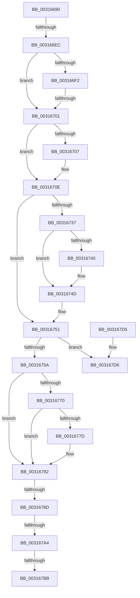

# MiObtainReferencedVadEx

- RVA: `0x00316690`–`0x003167E4` (길이 `340` bytes)
- VA: `0x0000000140316690`
- 실행 섹션: `.text`
- PDB 이름 있음: `예`; PDB Function 태그: `예`
- unwind 정보 RVA: `0x00074978`
- 디코드: `89`개 명령, `340/340` bytes 표시
- 미해석 바이트: `0` (있으면 어셈블리에 `.byte`로 보존)

> 이 문서는 커널 이미지의 기계어와 PDB 기호를 분석해 생성했습니다. 4번과 5번은 함수 원형과 자료형을 바이너리 사용 방식에서 추정한 C 해석이며 원본 소스 복구 결과는 아닙니다.

## 1. Dependencies

- 직접 호출 지점: **6**; 고유 호출 대상: **6**
- 직접 호출자로 확인된 함수: **42**
- RIP 상대 이미지 참조: **1**

### Outgoing calls
- `0x003166CF` → [MiLockVadTree](../27/MiLockVadTree_function_0027C0F0.md) (function, `0x0027C0F0`)
- `0x003166DB` → [MiLocateAddress](MiLocateAddress_function_003168D0.md) (function, `0x003168D0`)
- `0x0031672C` → [ExReleaseSpinLockSharedFromDpcLevel](../24/ExReleaseSpinLockSharedFromDpcLevel_function_0024A590.md) (function, `0x0024A590`)
- `0x00316748` → [KiLowerIrqlProcessIrqlFlags](../4F/KiLowerIrqlProcessIrqlFlags_function_004F5698.md) (function, `0x004F5698`)
- `0x00316760` → [MiLockVadShared](MiLockVadShared_function_00316DE0.md) (function, `0x00316DE0`)
- `0x0031677D` → [KiCheckForKernelApcDelivery](../2E/KiCheckForKernelApcDelivery_function_002E2C80.md) (function, `0x002E2C80`)

### Direct callers
- [MiProbeAndLockPrepare](../23/MiProbeAndLockPrepare_function_0023BB40.md) at `0x0023BD32`
- [NtGetWriteWatch](../2A/NtGetWriteWatch_function_002A7CE0.md) at `0x002A7F39`
- [MiGetWorkingSetInfoList](../2A/MiGetWorkingSetInfoList_function_002AF770.md) at `0x002AF929`
- [MiPrefetchPreallocatePages](../36/MiPrefetchPreallocatePages_function_0036B1F0.md) at `0x0036B2BA`
- [MmUpdateUserShadowStackValue](../49/MmUpdateUserShadowStackValue_function_004935D8.md) at `0x00493788`
- [MiQueryImageExtensionInformation](../4E/MiQueryImageExtensionInformation_function_004EE3C8.md) at `0x004EE496`
- [MmGetEnclaveModuleList](../68/MmGetEnclaveModuleList_function_0068719C.md) at `0x006871C8`
- [MiQueryImageExtensionInformationOld](../68/MiQueryImageExtensionInformationOld_function_00687384.md) at `0x006873FF`
- [MiProcessVaContiguityInformation](../69/MiProcessVaContiguityInformation_function_006939C0.md) at `0x00693B2D`
- [MiHandleEnclaveFault](../../page/70/MiHandleEnclaveFault_function_00702708.md) at `0x0070271B`
- [MmSetGraphicsPtes](../../page/7F/MmSetGraphicsPtes_function_007FC8B0.md) at `0x007FC96A`
- [MiGetVadForHotPatchInProgress](../../page/80/MiGetVadForHotPatchInProgress_function_008039C4.md) at `0x008039F8`
- [MmCommitHotPatchTable](../../page/80/MmCommitHotPatchTable_function_00807278.md) at `0x00807298`
- [MmPrepareImagePagesForHotPatch](../../page/80/MmPrepareImagePagesForHotPatch_function_008074E8.md) at `0x0080753B`
- [MiInitializeEnclave](../../page/80/MiInitializeEnclave_function_008089D8.md) at `0x00808A06`
- [NtTerminateEnclave](../../page/80/NtTerminateEnclave_function_00809320.md) at `0x0080934F`
- [MiScrubProcessLargePage](../../page/80/MiScrubProcessLargePage_function_0080EE70.md) at `0x0080EF3A`
- [NtAreMappedFilesTheSame](../../page/87/NtAreMappedFilesTheSame_function_0087EC70.md) at `0x0087EC9F`
- [NtAreMappedFilesTheSame](../../page/87/NtAreMappedFilesTheSame_function_0087EC70.md) at `0x0087ECC5`
- [MmDeleteTeb](../../page/87/MmDeleteTeb_function_0087FAC0.md) at `0x0087FB16`
- [sub_0087FFB4](../../page/87/Unknown_function_0087FFB4.md) at `0x00880031`
- [MmProtectVirtualMemory](../../page/88/MmProtectVirtualMemory_function_00881050.md) at `0x008811AE`
- [MiAllocateVirtualMemory](../../page/88/MiAllocateVirtualMemory_function_00883B40.md) at `0x00883CA7`
- [MiUnmapViewOfSection](../../page/88/MiUnmapViewOfSection_function_0088A4C4.md) at `0x0088A559`
- [MmSecureVirtualMemoryAgainstWrites](../../page/89/MmSecureVirtualMemoryAgainstWrites_function_00890164.md) at `0x0089020B`
- [MmGetImageInformation](../../page/8D/MmGetImageInformation_function_008D9C68.md) at `0x008D9C9E`
- [MiCopyVirtualMemory](../../page/9B/MiCopyVirtualMemory_function_009BBB50.md) at `0x009BBD61`
- [MiCopyVirtualMemory](../../page/9B/MiCopyVirtualMemory_function_009BBB50.md) at `0x009BC08A`
- [MmFlushVirtualMemory](../../page/9D/MmFlushVirtualMemory_function_009D6F5C.md) at `0x009D7004`
- [MiProcessVaRangesInfoClass](../../page/9F/MiProcessVaRangesInfoClass_function_009F4E50.md) at `0x009F4EA9`
- [MiCfgMarkValidEntries](../../page/9F/MiCfgMarkValidEntries_function_009F4FE8.md) at `0x009F5119`
- [MmSecureVirtualMemoryEx](../../page/9F/MmSecureVirtualMemoryEx_function_009F5620.md) at `0x009F56BF`
- [MmGetFileNameForAddress](../../page/A2/MmGetFileNameForAddress_function_00A2B878.md) at `0x00A2B89A`
- [MiCheckShadowStackOverflow](../../page/A3/MiCheckShadowStackOverflow_function_00A30B68.md) at `0x00A30BAE`
- [MmRotatePhysicalView](../../page/A3/MmRotatePhysicalView_function_00A37FE0.md) at `0x00A38065`
- [MiQuerySingleLoadedPatch](../../page/A4/MiQuerySingleLoadedPatch_function_00A41EB0.md) at `0x00A41F0C`
- [NtResetWriteWatch](../../page/A4/NtResetWriteWatch_function_00A48F60.md) at `0x00A49004`
- [MmSelectVsmEnclaveByAddress](../../page/A6/MmSelectVsmEnclaveByAddress_function_00A600B4.md) at `0x00A600D8`
- [MmStoreFreeVirtualMemory](../../page/A7/MmStoreFreeVirtualMemory_function_00A767A8.md) at `0x00A767C5`
- [MiUnmapLockedPagesInUserSpace](../../page/A7/MiUnmapLockedPagesInUserSpace_function_00A78E54.md) at `0x00A78EA1`
- [MiReferenceCfgVad](../../page/AA/MiReferenceCfgVad_function_00AABD28.md) at `0x00AABD6B`
- [MiQueryMemoryPhysicalContiguity](../../page/AD/MiQueryMemoryPhysicalContiguity_function_00AD5B98.md) at `0x00AD5F29`
- [NtLoadEnclaveData](../../page/AF/NtLoadEnclaveData_function_00AF8DF0.md) at `0x00AF90E3`
- [MiDeleteAllHardwareEnclaves](../../pagelk/B7/MiDeleteAllHardwareEnclaves_function_00B74CAC.md) at `0x00B74DD1`

### Static image references
- `0x00316737` → RVA `0x00FC6D20` (`ALMOSTRO`; read)

## 2. Other-region calls and transfers

- 다른 실행 섹션으로 향하는 call: **0**
- call이 아닌 외부 분기/꼬리 이동: **5**
  - `0x003166E6` → [sub_00316832 + 0x38](Unknown_function_00316832.md) (`tail-transfer`)
  - `0x003166FB` → [sub_00316832](Unknown_function_00316832.md) (`tail-transfer`)
  - `0x00316787` → [sub_00316832 + 0x51](Unknown_function_00316832.md) (`tail-transfer`)
  - `0x0031679E` → [sub_00316832 + 0x75](Unknown_function_00316832.md) (`tail-transfer`)
  - `0x003167B5` → [sub_00316832 + 0x75](Unknown_function_00316832.md) (`tail-transfer`)

## 3. Assembly (complete function range)

```asm
00316690  48 89 5C 24 10                  mov qword ptr [rsp + 0x10], rbx
00316695  48 89 6C 24 18                  mov qword ptr [rsp + 0x18], rbp
0031669A  56                              push rsi
0031669B  57                              push rdi
0031669C  41 54                           push r12
0031669E  41 55                           push r13
003166A0  41 56                           push r14
003166A2  48 83 EC 20                     sub rsp, 0x20
003166A6  41 C7 00 00 00 00 00            mov dword ptr [r8], 0
003166AD  48 8B F1                        mov rsi, rcx
003166B0  65 48 8B 3C 25 88 01 00 00      mov rdi, qword ptr gs:[0x188]
003166B9  33 C9                           xor ecx, ecx
003166BB  4D 8B E0                        mov r12, r8
003166BE  8B EA                           mov ebp, edx
003166C0  4C 8B AF B8 00 00 00            mov r13, qword ptr [rdi + 0xb8]
003166C7  66 FF 8F E6 01 00 00            dec word ptr [rdi + 0x1e6]
003166CE  90                              nop
003166CF  E8 1C 5A F6 FF                  call 0x14027c0f0
003166D4  48 8B CE                        mov rcx, rsi
003166D7  44 0F B6 F0                     movzx r14d, al
003166DB  E8 F0 01 00 00                  call 0x1403168d0
003166E0  48 8B D8                        mov rbx, rax
003166E3  48 85 C0                        test rax, rax
003166E6  0F 84 7E 01 00 00               je 0x14031686a
003166EC  40 F6 C5 01                     test bpl, 1
003166F0  75 0F                           jne 0x140316701
003166F2  41 8B 85 F4 01 00 00            mov eax, dword ptr [r13 + 0x1f4]
003166F9  A8 20                           test al, 0x20
003166FB  0F 85 31 01 00 00               jne 0x140316832
00316701  F0 FF 43 24                     lock inc dword ptr [rbx + 0x24]
00316705  75 07                           jne 0x14031670e
00316707  B9 0E 00 00 00                  mov ecx, 0xe
0031670C  CD 29                           int 0x29
0031670E  65 48 8B 04 25 88 01 00 00      mov rax, qword ptr gs:[0x188]
00316717  48 8B 88 B8 00 00 00            mov rcx, qword ptr [rax + 0xb8]
0031671E  48 8B 89 10 04 00 00            mov rcx, qword ptr [rcx + 0x410]
00316725  48 81 C1 EC 03 00 00            add rcx, 0x3ec
0031672C  E8 5F 3E F3 FF                  call 0x14024a590
00316731  41 80 FE 11                     cmp r14b, 0x11
00316735  74 1A                           je 0x140316751
00316737  83 3D E2 05 CB 00 00            cmp dword ptr [rip + 0xcb05e2], 0
0031673E  74 0D                           je 0x14031674d
00316740  44 0F 20 C1                     mov rcx, cr8
00316744  41 0F B6 D6                     movzx edx, r14b
00316748  E8 4B EF 1D 00                  call 0x1404f5698
0031674D  45 0F 22 C6                     mov cr8, r14
00316751  48 C1 EE 0C                     shr rsi, 0xc
00316755  83 E5 02                        and ebp, 2
00316758  74 7C                           je 0x1403167d6
0031675A  48 8B D3                        mov rdx, rbx
0031675D  48 8B CF                        mov rcx, rdi
00316760  E8 7B 06 00 00                  call 0x140316de0
00316765  90                              nop
00316766  66 83 87 E6 01 00 00 01         add word ptr [rdi + 0x1e6], 1
0031676E  75 12                           jne 0x140316782
00316770  48 8D 87 98 00 00 00            lea rax, [rdi + 0x98]
00316777  90                              nop
00316778  48 39 00                        cmp qword ptr [rax], rax
0031677B  74 05                           je 0x140316782
0031677D  E8 FE C4 FC FF                  call 0x1402e2c80
00316782  8B 43 30                        mov eax, dword ptr [rbx + 0x30]
00316785  A8 04                           test al, 4
00316787  0F 85 F6 00 00 00               jne 0x140316883
0031678D  0F B6 4B 20                     movzx ecx, byte ptr [rbx + 0x20]
00316791  8B 43 18                        mov eax, dword ptr [rbx + 0x18]
00316794  48 C1 E1 20                     shl rcx, 0x20
00316798  48 0B C8                        or rcx, rax
0031679B  48 3B F1                        cmp rsi, rcx
0031679E  0F 82 03 01 00 00               jb 0x1403168a7
003167A4  0F B6 4B 21                     movzx ecx, byte ptr [rbx + 0x21]
003167A8  8B 43 1C                        mov eax, dword ptr [rbx + 0x1c]
003167AB  48 C1 E1 20                     shl rcx, 0x20
003167AF  48 0B C8                        or rcx, rax
003167B2  48 3B F1                        cmp rsi, rcx
003167B5  0F 87 EC 00 00 00               ja 0x1403168a7
003167BB  48 8B C3                        mov rax, rbx
003167BE  48 8B 5C 24 58                  mov rbx, qword ptr [rsp + 0x58]
003167C3  48 8B 6C 24 60                  mov rbp, qword ptr [rsp + 0x60]
003167C8  48 83 C4 20                     add rsp, 0x20
003167CC  41 5E                           pop r14
003167CE  41 5D                           pop r13
003167D0  41 5C                           pop r12
003167D2  5F                              pop rdi
003167D3  5E                              pop rsi
003167D4  C3                              ret
003167D5  CC                              int3
003167D6  66 FF 8F E6 01 00 00            dec word ptr [rdi + 0x1e6]
003167DD  48 8D 4B 28                     lea rcx, [rbx + 0x28]
003167E1  45 33 C0                        xor r8d, r8d
```

## 4. C-style interpretation (structured pseudocode)

```c
__int64 __fastcall MiObtainReferencedVadEx(__int64 a1, int a2, __int64 a3)
{
    __int64 result;
    __int64 v_rbp;
    __int64 v_rsi;
    __int64 v_rsp;
    unsigned __int64 v_stack_p10;
    unsigned __int64 v_stack_p18;

    v_stack_p10 = v_rbx;
    v_stack_p18 = v_rbp;
    v_rsp = (v_rsp) - (32);
    *(unsigned int *)(a3) = 0;
    a1 = 0;
    result = MiLockVadTree(a1, a2, a3, a4);
    result = MiLocateAddress(0, a2, a3, a4);
    if ((((unsigned __int8)((unsigned int)(a2))) & (1)) != 0) goto loc_00316701;
loc_00316701:
    if ((((unsigned __int8)((unsigned int)(*(unsigned int *)(*(unsigned __int64 *)(*(unsigned __int64 *)(gs_base + (0 + 392)) + 184) + 500)))) & (32)) == 0) {
        a1 = 14;
    }
    a1 = (*(unsigned __int64 *)(*(unsigned __int64 *)(*(unsigned __int64 *)(gs_base + (0 + 392)) + 184) + 1040)) + (0x3ECULL);
    result = ExReleaseSpinLockSharedFromDpcLevel(a1, a2, a3, a4);
    if (((unsigned __int8)((unsigned __int8)(result))) == 17) goto loc_00316751;
    if ((*(unsigned int *)(v_rip + 13305314)) != 0) {
        a1 = v_cr8;
        a2 = (unsigned __int8)((unsigned __int8)(result));
        result = KiLowerIrqlProcessIrqlFlags(a1, a2, a3, a4);
    }
loc_00316751:
    v_rsi = (a1) >> (12);
    v_rbp = (unsigned int)(((unsigned int)(a2)) & (2));
    if (condition_is_equal) goto loc_003167D6;
    result = MiLockVadShared(*(unsigned __int64 *)(gs_base + (0 + 392)), result, a3, a4);
    if (condition_is_not_equal) goto loc_00316782;
    result = *(unsigned __int64 *)(gs_base + (0 + 392)) + 152;
    if ((*(unsigned __int64 *)(*(unsigned __int64 *)(gs_base + (0 + 392)) + 152)) != (*(unsigned __int64 *)(gs_base + (0 + 392)) + 152)) {
        result = KiCheckForKernelApcDelivery(*(unsigned __int64 *)(gs_base + (0 + 392)), result, a3, a4);
    }
    a1 = (*(unsigned __int8 *)(result + 32)) << (32);
    a1 = (a1) | ((unsigned int)(*(unsigned int *)(result + 24)));
    a1 = (*(unsigned __int8 *)(result + 33)) << (32);
    a1 = (a1) | ((unsigned int)(*(unsigned int *)(result + 28)));
    v_rsp = (v_rsp) + (32);
    return result;
loc_003167D6:
    a3 = 0;
    return result;
}
```

## 5. (Beta) C Style

```c
int64_t MiObtainReferencedVadEx(int64_t Arg1, int32_t Arg2, void *Arg3)
{
    uint8_t *arg3 = (uint8_t *)Arg3;

    int64_t result;
    int64_t local_rbp;
    int64_t local_rsi;
    int64_t local_rsp;
    uint64_t v_stack_p10;
    uint64_t v_stack_p18;

    v_stack_p10 = local_rbx;
    v_stack_p18 = local_rbp;
    local_rsp = (local_rsp) - (32);
    *(uint32_t *)(arg3) = 0;
    Arg1 = 0;
    result = MiLockVadTree(Arg1, Arg2, Arg3, a4);
    result = MiLocateAddress(0, Arg2, Arg3, a4);
    if ((((uint8_t)((uint32_t)(Arg2))) & (1)) != 0) goto loc_00316701;
loc_00316701:
    if ((((uint8_t)((uint32_t)(*(uint32_t *)(*(uint64_t *)(*(uint64_t *)(gs_base + (0 + 0x188)) + 0xB8) + 0x1F4)))) & (32)) == 0) {
        Arg1 = 14;
    }
    Arg1 = (*(uint64_t *)(*(uint64_t *)(*(uint64_t *)(gs_base + (0 + 0x188)) + 0xB8) + 0x410)) + (0x3ECULL);
    result = ExReleaseSpinLockSharedFromDpcLevel(Arg1, Arg2, Arg3, a4);
    if (((uint8_t)((uint8_t)(result))) == 17) goto loc_00316751;
    if ((*(uint32_t *)(v_rip + 0xCB05E2)) != 0) {
        Arg1 = v_cr8;
        Arg2 = (uint8_t)((uint8_t)(result));
        result = KiLowerIrqlProcessIrqlFlags(Arg1, Arg2, Arg3, a4);
    }
loc_00316751:
    local_rsi = (Arg1) >> (12);
    local_rbp = (uint32_t)(((uint32_t)(Arg2)) & (2));
    if (condition_is_equal) goto loc_003167D6;
    result = MiLockVadShared(*(uint64_t *)(gs_base + (0 + 0x188)), result, Arg3, a4);
    if (condition_is_not_equal) goto loc_00316782;
    result = *(uint64_t *)(gs_base + (0 + 0x188)) + 152;
    if ((*(uint64_t *)(*(uint64_t *)(gs_base + (0 + 0x188)) + 0x98)) != (*(uint64_t *)(gs_base + (0 + 0x188)) + 152)) {
        result = KiCheckForKernelApcDelivery(*(uint64_t *)(gs_base + (0 + 0x188)), result, Arg3, a4);
    }
    Arg1 = (*(uint8_t *)(result + 0x20)) << (32);
    Arg1 = (Arg1) | ((uint32_t)(*(uint32_t *)(result + 0x18)));
    Arg1 = (*(uint8_t *)(result + 0x21)) << (32);
    Arg1 = (Arg1) | ((uint32_t)(*(uint32_t *)(result + 0x1C)));
    local_rsp = (local_rsp) + (32);
    return result;
loc_003167D6:
    Arg3 = 0;
    return result;
}
```

### 관측된 메모리 오프셋

구조체 형식이 확인되지 않은 접근은 인자 기준의 오프셋으로만 기록했습니다.

| 기준 인자 | 오프셋 표현 | 폭 (bit) | 접근 |
|---|---:|---:|---|
| `Arg3` | `+ 0x0` | `32` | `W` |

## 6. Execution-region graph

[열기: 2D/3D 그래프와 함수 탐색 컨트롤 패널](../../../control-panel.html?section=text&rva=0x00316690&view=graph)

- 2D 그래프는 위에서 아래로 흐르고, 3D 그래프는 빈 공간을 드래그해 회전합니다. Shift+드래그는 이동, 휠은 확대·축소, 함수 노드 선택은 대상 보고서 이동입니다.

### Static fallback


