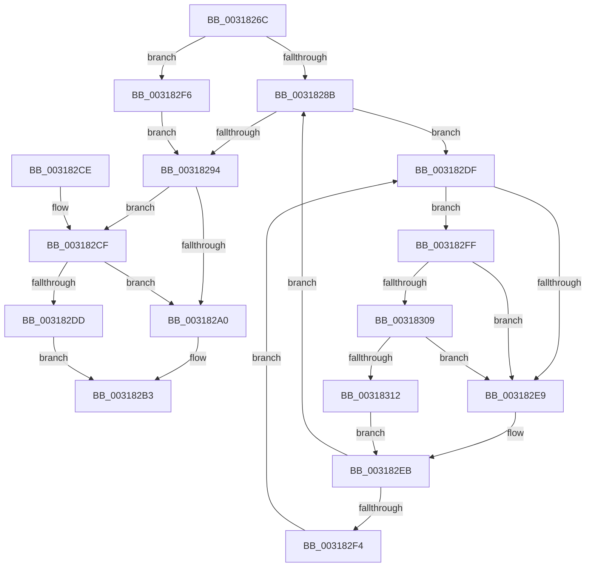

# MiRelockProtoPoolPage

- RVA: `0x0031826C`–`0x0031831B` (길이 `175` bytes)
- VA: `0x000000014031826C`
- 실행 섹션: `.text`
- PDB 이름 있음: `예`; PDB Function 태그: `아니요`
- unwind 정보 RVA: `0x00074BD0`
- 디코드: `55`개 명령, `175/175` bytes 표시
- 미해석 바이트: `0` (있으면 어셈블리에 `.byte`로 보존)

> 이 문서는 커널 이미지의 기계어와 PDB 기호를 분석해 생성했습니다. 4번과 5번은 함수 원형과 자료형을 바이너리 사용 방식에서 추정한 C 해석이며 원본 소스 복구 결과는 아닙니다.

## 1. Dependencies

- 직접 호출 지점: **6**; 고유 호출 대상: **6**
- 직접 호출자로 확인된 함수: **3**
- RIP 상대 이미지 참조: **2**

### Outgoing calls
- `0x00318297` → [MiAreChargesNeededToLockPage](MiAreChargesNeededToLockPage_function_00318720.md) (function, `0x00318720`)
- `0x003182B6` → [MiLockOwnedProtoPage](../32/MiLockOwnedProtoPage_function_00322560.md) (function, `0x00322560`)
- `0x003182D4` → [MiChargeForLockedPage](../28/MiChargeForLockedPage_function_00285AA0.md) (function, `0x00285AA0`)
- `0x003182F6` → [MiLockPageInline](MiLockPageInline_function_0031A340.md) (function, `0x0031A340`)
- `0x00318309` → [KiCheckVpBackingLongSpinWaitHypercall](../30/KiCheckVpBackingLongSpinWaitHypercall_function_0030F490.md) (function, `0x0030F490`)
- `0x00318314` → [HvlNotifyLongSpinWait](../30/HvlNotifyLongSpinWait_function_0030F460.md) (function, `0x0030F460`)

### Direct callers
- [MiFinishHardFault](../2B/MiFinishHardFault_function_002B6F10.md) at `0x002B7447`
- [MiWaitForCollidedFaultComplete](../36/MiWaitForCollidedFaultComplete_function_00369EDC.md) at `0x0036A09D`
- [MiIdealClusterPage](../4D/MiIdealClusterPage_function_004DB964.md) at `0x004DBFC2`

### Static image references
- `0x003182E1` → RVA `0x00FC52AC` (`ALMOSTRO`; reference)
- `0x003182FF` → RVA `0x00FC6AB8` (`ALMOSTRO`; read)

## 2. Other-region calls and transfers

- 다른 실행 섹션으로 향하는 call: **0**
- 별도 외부 분기/꼬리 이동을 확인하지 못했습니다.

## 3. Assembly (complete function range)

```asm
0031826C  48 89 5C 24 10                  mov qword ptr [rsp + 0x10], rbx
00318271  48 89 74 24 18                  mov qword ptr [rsp + 0x18], rsi
00318276  57                              push rdi
00318277  48 83 EC 20                     sub rsp, 0x20
0031827B  48 8B FA                        mov rdi, rdx
0031827E  48 8B D9                        mov rbx, rcx
00318281  BE 01 00 00 00                  mov esi, 1
00318286  48 85 D2                        test rdx, rdx
00318289  75 6B                           jne 0x1403182f6
0031828B  F0 48 0F BA 6B 18 3F            lock bts qword ptr [rbx + 0x18], 0x3f
00318292  72 4B                           jb 0x1403182df
00318294  48 8B CB                        mov rcx, rbx
00318297  E8 84 04 00 00                  call 0x140318720
0031829C  85 C0                           test eax, eax
0031829E  75 2F                           jne 0x1403182cf
003182A0  8B 43 20                        mov eax, dword ptr [rbx + 0x20]
003182A3  89 44 24 30                     mov dword ptr [rsp + 0x30], eax
003182A7  66 01 74 24 30                  add word ptr [rsp + 0x30], si
003182AC  8B 44 24 30                     mov eax, dword ptr [rsp + 0x30]
003182B0  89 43 20                        mov dword ptr [rbx + 0x20], eax
003182B3  48 8B CB                        mov rcx, rbx
003182B6  E8 A5 A2 00 00                  call 0x140322560
003182BB  48 8B 74 24 40                  mov rsi, qword ptr [rsp + 0x40]
003182C0  48 8B C3                        mov rax, rbx
003182C3  48 8B 5C 24 38                  mov rbx, qword ptr [rsp + 0x38]
003182C8  48 83 C4 20                     add rsp, 0x20
003182CC  5F                              pop rdi
003182CD  C3                              ret
003182CE  CC                              int3
003182CF  8B D6                           mov edx, esi
003182D1  48 8B CB                        mov rcx, rbx
003182D4  E8 C7 D7 F6 FF                  call 0x140285aa0
003182D9  85 C0                           test eax, eax
003182DB  75 C3                           jne 0x1403182a0
003182DD  EB D4                           jmp 0x1403182b3
003182DF  03 FE                           add edi, esi
003182E1  85 3D C5 CF CA 00               test dword ptr [rip + 0xcacfc5], edi
003182E7  74 16                           je 0x1403182ff
003182E9  F3 90                           pause
003182EB  48 8B 43 18                     mov rax, qword ptr [rbx + 0x18]
003182EF  48 85 C0                        test rax, rax
003182F2  79 97                           jns 0x14031828b
003182F4  EB E9                           jmp 0x1403182df
003182F6  E8 45 20 00 00                  call 0x14031a340
003182FB  88 07                           mov byte ptr [rdi], al
003182FD  EB 95                           jmp 0x140318294
003182FF  8B 05 B3 E7 CA 00               mov eax, dword ptr [rip + 0xcae7b3]
00318305  A8 40                           test al, 0x40
00318307  74 E0                           je 0x1403182e9
00318309  E8 82 71 FF FF                  call 0x14030f490
0031830E  84 C0                           test al, al
00318310  74 D7                           je 0x1403182e9
00318312  8B CF                           mov ecx, edi
00318314  E8 47 71 FF FF                  call 0x14030f460
00318319  EB D0                           jmp 0x1403182eb
```

## 4. C-style interpretation (structured pseudocode)

```c
__int64 __fastcall MiRelockProtoPoolPage(__int64 a1, __int64 a2)
{
    __int64 result;
    __int64 v_rdi;
    __int64 v_rsp;
    unsigned __int64 v_stack_p10;
    unsigned __int64 v_stack_p18;
    unsigned int v_stack_p8;

    v_stack_p10 = v_rbx;
    v_stack_p18 = v_rsi;
    v_rsp = (v_rsp) - (32);
    if (a2 != 0) goto loc_003182F6;
loc_0031828B:
    if (condition_is_below) goto loc_003182DF;
loc_00318294:
    result = MiAreChargesNeededToLockPage(a1, a2, a3, a4);
    if ((unsigned int)(result) != 0) goto loc_003182CF;
loc_003182A0:
    v_stack_p8 = (unsigned int)((unsigned int)(*(unsigned int *)(a1 + 32)));
    *(unsigned int *)(a1 + 32) = (unsigned int)((unsigned int)(v_stack_p8));
loc_003182B3:
    result = MiLockOwnedProtoPage(a1, a2, a3, a4);
    v_rsp = (v_rsp) + (32);
    return a1;
loc_003182CF:
    result = MiChargeForLockedPage(v_stack_p10, (unsigned int)((unsigned int)(v_stack_p18)), a3, a4);
    if ((unsigned int)(result) != 0) goto loc_003182A0;
    goto loc_003182B3;
loc_003182DF:
    v_rdi = (unsigned int)((a2) + ((unsigned int)(v_stack_p18)));
    if (((*(unsigned int *)(v_rip + 13291461)) & ((unsigned int)(v_rdi))) == 0) goto loc_003182FF;
loc_003182E9:
loc_003182EB:
    if (!sign_flag) goto loc_0031828B;
    goto loc_003182DF;
loc_003182F6:
    result = MiLockPageInline(v_stack_p10, (unsigned int)((unsigned int)(v_stack_p18)), a3, a4);
    *(unsigned __int8 *)(v_rdi) = (unsigned __int8)(result);
    goto loc_00318294;
loc_003182FF:
    if ((((unsigned __int8)((unsigned int)(*(unsigned int *)(v_rip + 13297587)))) & (64)) == 0) goto loc_003182E9;
    result = KiCheckVpBackingLongSpinWaitHypercall(v_stack_p10, (unsigned int)((unsigned int)(v_stack_p18)), a3, a4);
    if ((unsigned __int8)(result) == 0) goto loc_003182E9;
    result = HvlNotifyLongSpinWait((unsigned int)((unsigned int)(v_rdi)), (unsigned int)((unsigned int)(v_stack_p18)), a3, a4);
    goto loc_003182EB;
}
```

## 5. (Beta) C Style

```c
void *MiRelockProtoPoolPage(void *Arg1, void *Arg2)
{
    uint8_t *arg1 = (uint8_t *)Arg1;
    uint8_t *arg2 = (uint8_t *)Arg2;

    int64_t result;
    int64_t local_rdi;
    int64_t local_rsp;
    uint64_t v_stack_p10;
    uint64_t v_stack_p18;
    uint32_t v_stack_p8;

    v_stack_p10 = local_rbx;
    v_stack_p18 = local_rsi;
    local_rsp = (local_rsp) - (32);
    if (Arg2 != NULL) goto loc_003182F6;
loc_0031828B:
    if (condition_is_below) goto loc_003182DF;
loc_00318294:
    result = MiAreChargesNeededToLockPage(Arg1, Arg2, a3, a4);
    if ((uint32_t)(result) != 0) goto loc_003182CF;
loc_003182A0:
    v_stack_p8 = (uint32_t)((uint32_t)(*(uint32_t *)(arg1 + 0x20)));
    *(uint32_t *)(arg1 + 0x20) = (uint32_t)((uint32_t)(v_stack_p8));
loc_003182B3:
    result = MiLockOwnedProtoPage(Arg1, Arg2, a3, a4);
    local_rsp = (local_rsp) + (32);
    return Arg1;
loc_003182CF:
    result = MiChargeForLockedPage(v_stack_p10, (uint32_t)((uint32_t)(v_stack_p18)), a3, a4);
    if ((uint32_t)(result) != 0) goto loc_003182A0;
    goto loc_003182B3;
loc_003182DF:
    local_rdi = (uint32_t)((Arg2) + ((uint32_t)(v_stack_p18)));
    if (((*(uint32_t *)(v_rip + 0xCACFC5)) & ((uint32_t)(local_rdi))) == 0) goto loc_003182FF;
loc_003182E9:
loc_003182EB:
    if (!sign_flag) goto loc_0031828B;
    goto loc_003182DF;
loc_003182F6:
    result = MiLockPageInline(v_stack_p10, (uint32_t)((uint32_t)(v_stack_p18)), a3, a4);
    *(uint8_t *)(local_rdi) = (uint8_t)(result);
    goto loc_00318294;
loc_003182FF:
    if ((((uint8_t)((uint32_t)(*(uint32_t *)(v_rip + 0xCAE7B3)))) & (64)) == 0) goto loc_003182E9;
    result = KiCheckVpBackingLongSpinWaitHypercall(v_stack_p10, (uint32_t)((uint32_t)(v_stack_p18)), a3, a4);
    if ((uint8_t)(result) == 0) goto loc_003182E9;
    result = HvlNotifyLongSpinWait((uint32_t)((uint32_t)(local_rdi)), (uint32_t)((uint32_t)(v_stack_p18)), a3, a4);
    goto loc_003182EB;
}
```

### 관측된 메모리 오프셋

구조체 형식이 확인되지 않은 접근은 인자 기준의 오프셋으로만 기록했습니다.

| 기준 인자 | 오프셋 표현 | 폭 (bit) | 접근 |
|---|---:|---:|---|
| `Arg1` | `+ 0x18` | `64` | `R` |
| `Arg1` | `+ 0x18` | `64` | `R/W` |
| `Arg1` | `+ 0x20` | `32` | `R` |
| `Arg1` | `+ 0x20` | `32` | `W` |
| `Arg2` | `+ 0x0` | `8` | `W` |

## 6. Execution-region graph

[열기: 2D/3D 그래프와 함수 탐색 컨트롤 패널](../../../control-panel.html?section=text&rva=0x0031826C&view=graph)

- 2D 그래프는 위에서 아래로 흐르고, 3D 그래프는 빈 공간을 드래그해 회전합니다. Shift+드래그는 이동, 휠은 확대·축소, 함수 노드 선택은 대상 보고서 이동입니다.

### Static fallback


