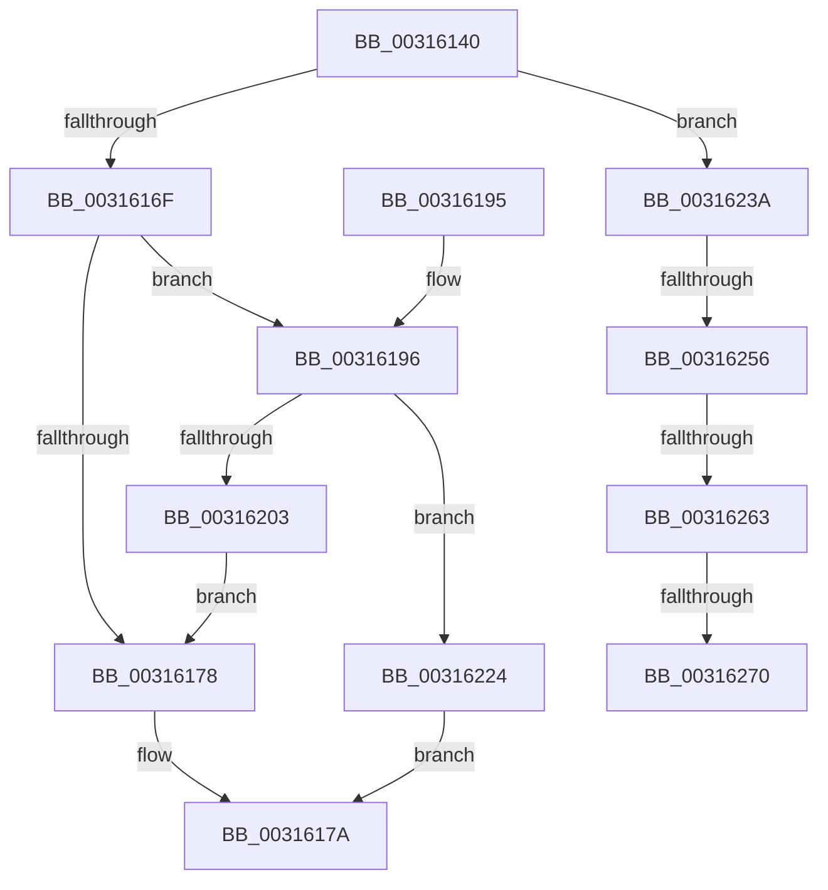

# MiReplenishCombineResources

- RVA: `0x00316140`–`0x00316288` (길이 `328` bytes)
- VA: `0x0000000140316140`
- 실행 섹션: `.text`
- PDB 이름 있음: `예`; PDB Function 태그: `예`
- unwind 정보 RVA: `0x00074930`
- 디코드: `79`개 명령, `328/328` bytes 표시
- 미해석 바이트: `0` (있으면 어셈블리에 `.byte`로 보존)

> 이 문서는 커널 이미지의 기계어와 PDB 기호를 분석해 생성했습니다. 4번과 5번은 함수 원형과 자료형을 바이너리 사용 방식에서 추정한 C 해석이며 원본 소스 복구 결과는 아닙니다.

## 1. Dependencies

- 직접 호출 지점: **2**; 고유 호출 대상: **2**
- 직접 호출자로 확인된 함수: **1**
- RIP 상대 이미지 참조: **1**

### Outgoing calls
- `0x003161F8` → [MiGetSlabPage](../37/MiGetSlabPage_function_00376FBC.md) (function, `0x00376FBC`)
- `0x00316241` → [ExAcquireSpinLockExclusiveAtDpcLevel](../24/ExAcquireSpinLockExclusiveAtDpcLevel_function_00248E80.md) (function, `0x00248E80`)

### Direct callers
- [MiSharePages](MiSharePages_function_00315110.md) at `0x003153E2`

### Static image references
- `0x003161BE` → RVA `0x00E2DCC0` (`.data`; read)

## 2. Other-region calls and transfers

- 다른 실행 섹션으로 향하는 call: **0**
- call이 아닌 외부 분기/꼬리 이동: **4**
  - `0x00316250` → [sub_006E13AE + 0x7](../6E/Unknown_function_006E13AE.md) (`tail-transfer`)
  - `0x0031625D` → [sub_006E13AE](../6E/Unknown_function_006E13AE.md) (`tail-transfer`)
  - `0x0031626A` → [sub_006E13AE](../6E/Unknown_function_006E13AE.md) (`tail-transfer`)
  - `0x00316283` → [sub_006E13AE + 0x7](../6E/Unknown_function_006E13AE.md) (`tail-transfer`)

## 3. Assembly (complete function range)

```asm
00316140  48 8B C4                        mov rax, rsp
00316143  48 89 58 08                     mov qword ptr [rax + 8], rbx
00316147  48 89 68 10                     mov qword ptr [rax + 0x10], rbp
0031614B  48 89 70 18                     mov qword ptr [rax + 0x18], rsi
0031614F  48 89 78 20                     mov qword ptr [rax + 0x20], rdi
00316153  41 56                           push r14
00316155  48 83 EC 30                     sub rsp, 0x30
00316159  48 8B 31                        mov rsi, qword ptr [rcx]
0031615C  45 33 F6                        xor r14d, r14d
0031615F  48 8B F9                        mov rdi, rcx
00316162  4C 39 B1 28 01 00 00            cmp qword ptr [rcx + 0x128], r14
00316169  0F 84 CB 00 00 00               je 0x14031623a
0031616F  4C 39 B7 30 01 00 00            cmp qword ptr [rdi + 0x130], r14
00316176  74 1E                           je 0x140316196
00316178  33 C0                           xor eax, eax
0031617A  48 8B 5C 24 40                  mov rbx, qword ptr [rsp + 0x40]
0031617F  48 8B 6C 24 48                  mov rbp, qword ptr [rsp + 0x48]
00316184  48 8B 74 24 50                  mov rsi, qword ptr [rsp + 0x50]
00316189  48 8B 7C 24 58                  mov rdi, qword ptr [rsp + 0x58]
0031618E  48 83 C4 30                     add rsp, 0x30
00316192  41 5E                           pop r14
00316194  C3                              ret
00316195  CC                              int3
00316196  44 8B 97 48 01 00 00            mov r10d, dword ptr [rdi + 0x148]
0031619D  48 8D 9F 38 01 00 00            lea rbx, [rdi + 0x138]
003161A4  4C 8B 1B                        mov r11, qword ptr [rbx]
003161A7  B8 01 00 00 00                  mov eax, 1
003161AC  48 8B 8F 40 01 00 00            mov rcx, qword ptr [rdi + 0x140]
003161B3  F0 0F C1 01                     lock xadd dword ptr [rcx], eax
003161B7  33 D2                           xor edx, edx
003161B9  44 89 74 24 28                  mov dword ptr [rsp + 0x28], r14d
003161BE  4C 8D 05 FB 7A B1 00            lea r8, [rip + 0xb17afb]
003161C5  41 8B CA                        mov ecx, r10d
003161C8  48 C1 E9 10                     shr rcx, 0x10
003161CC  83 E1 03                        and ecx, 3
003161CF  41 F7 34 88                     div dword ptr [r8 + rcx*4]
003161D3  48 8B 0E                        mov rcx, qword ptr [rsi]
003161D6  48 8B C3                        mov rax, rbx
003161D9  41 33 D2                        xor edx, r10d
003161DC  44 0F B6 C2                     movzx r8d, dl
003161E0  BA 06 00 00 00                  mov edx, 6
003161E5  45 33 C2                        xor r8d, r10d
003161E8  4D 85 DB                        test r11, r11
003161EB  49 0F 45 C6                     cmovne rax, r14
003161EF  44 8D 4A 0B                     lea r9d, [rdx + 0xb]
003161F3  48 89 44 24 20                  mov qword ptr [rsp + 0x20], rax
003161F8  E8 BF 0D 06 00                  call 0x140376fbc
003161FD  48 83 F8 FF                     cmp rax, -1
00316201  74 21                           je 0x140316224
00316203  48 8D 04 40                     lea rax, [rax + rax*2]
00316207  48 C1 E0 04                     shl rax, 4
0031620B  48 B9 00 00 00 00 00 DE FF FF   movabs rcx, 0xffffde0000000000
00316215  48 03 C1                        add rax, rcx
00316218  48 89 87 30 01 00 00            mov qword ptr [rdi + 0x130], rax
0031621F  E9 54 FF FF FF                  jmp 0x140316178
00316224  48 83 3B 01                     cmp qword ptr [rbx], 1
00316228  B8 2D 02 00 C0                  mov eax, 0xc000022d
0031622D  B9 9A 00 00 C0                  mov ecx, 0xc000009a
00316232  0F 46 C1                        cmovbe eax, ecx
00316235  E9 40 FF FF FF                  jmp 0x14031617a
0031623A  48 8D 4E 58                     lea rcx, [rsi + 0x58]
0031623E  49 8B DE                        mov rbx, r14
00316241  E8 3A 2C F3 FF                  call 0x140248e80
00316246  48 8D 46 48                     lea rax, [rsi + 0x48]
0031624A  48 8B 08                        mov rcx, qword ptr [rax]
0031624D  48 3B C8                        cmp rcx, rax
00316250  0F 84 5F B1 3C 00               je 0x1406e13b5
00316256  48 8B D9                        mov rbx, rcx
00316259  48 39 41 08                     cmp qword ptr [rcx + 8], rax
0031625D  0F 85 4B B1 3C 00               jne 0x1406e13ae
00316263  48 8B 09                        mov rcx, qword ptr [rcx]
00316266  48 39 59 08                     cmp qword ptr [rcx + 8], rbx
0031626A  0F 85 3E B1 3C 00               jne 0x1406e13ae
00316270  48 89 08                        mov qword ptr [rax], rcx
00316273  48 89 41 08                     mov qword ptr [rcx + 8], rax
00316277  48 8B C3                        mov rax, rbx
0031627A  48 25 00 F0 FF FF               and rax, 0xfffffffffffff000
00316280  FF 40 08                        inc dword ptr [rax + 8]
00316283  E9 2D B1 3C 00                  jmp 0x1406e13b5
```

## 4. C-style interpretation (structured pseudocode)

```c
__int64 __fastcall MiReplenishCombineResources(__int64 a1, int a2)
{
    __int64 result;
    __int64 v_r14;
    __int64 v_rsp;
    unsigned __int64 v_stack_p10;
    unsigned __int64 v_stack_p18;
    unsigned __int64 v_stack_p20;
    unsigned int v_stack_p28;
    unsigned __int64 v_stack_p8;

    *(unsigned __int64 *)(v_rsp + 8) = v_rbx;
    *(unsigned __int64 *)(v_rsp + 16) = v_rbp;
    *(unsigned __int64 *)(v_rsp + 24) = v_rsi;
    *(unsigned __int64 *)(v_rsp + 32) = v_rdi;
    v_rsp = (v_rsp) - (48);
    v_r14 = 0;
    if ((*(unsigned __int64 *)(a1 + 296)) == 0) goto loc_0031623A;
    if ((*(unsigned __int64 *)(a1 + 304)) == 0) goto loc_00316196;
loc_00316178:
    result = 0;
loc_0031617A:
    v_rsp = (v_rsp) + (48);
    return result;
loc_00316196:
    a2 = 0;
    v_stack_p28 = 0;
    a1 = ((unsigned int)((unsigned int)((unsigned int)(*(unsigned int *)(v_stack_p20 + 328))))) >> (16);
    a1 = (unsigned int)((a1) & (3));
    a2 = (unsigned int)((a2) ^ ((unsigned int)((unsigned int)(*(unsigned int *)(v_stack_p20 + 328)))));
    a3 = (unsigned int)(((unsigned __int8)(a2)) ^ ((unsigned int)((unsigned int)(*(unsigned int *)(v_stack_p20 + 328)))));
    result = v_stack_p20 + 312;
    if (*(unsigned __int64 *)(v_stack_p20 + 312) != 0) { result = 0; }
    v_stack_p20 = result;
    result = MiGetSlabPage(*(unsigned __int64 *)(v_stack_p18), 6, a3, 6 + 11);
    if (result == -1) goto loc_00316224;
    result = (result + result * 2) << (4);
    result = (result) + (*(unsigned __int64 *)(v_stack_p18));
    *(unsigned __int64 *)(v_stack_p20 + 304) = result;
    goto loc_00316178;
loc_00316224:
    result = (unsigned int)(0xC000022DULL);
    if ((*(unsigned __int64 *)(v_stack_p20 + 312)) <= 1) { result = (unsigned int)((unsigned int)(0xC000009AULL)); }
    goto loc_0031617A;
loc_0031623A:
    result = ExAcquireSpinLockExclusiveAtDpcLevel(v_stack_p18 + 88, 6, a3, 6 + 11);
    *(unsigned __int64 *)(v_stack_p18 + 72) = *(unsigned __int64 *)(*(unsigned __int64 *)(v_stack_p18 + 72));
    *(unsigned __int64 *)(*(unsigned __int64 *)(*(unsigned __int64 *)(v_stack_p18 + 72)) + 8) = v_stack_p18 + 72;
    result = (*(unsigned __int64 *)(v_stack_p18 + 72)) & (0xFFFFFFFFFFFFF000ULL);
}
```

## 5. (Beta) C Style

```c
int64_t MiReplenishCombineResources(void *Arg1, int32_t Arg2)
{
    uint8_t *arg1 = (uint8_t *)Arg1;

    int64_t result;
    int64_t local_r14;
    int64_t local_rsp;
    uint64_t v_stack_p10;
    uint64_t v_stack_p18;
    uint64_t v_stack_p20;
    uint32_t v_stack_p28;
    uint64_t v_stack_p8;

    *(uint64_t *)(local_rsp + 0x8) = local_rbx;
    *(uint64_t *)(local_rsp + 0x10) = local_rbp;
    *(uint64_t *)(local_rsp + 0x18) = local_rsi;
    *(uint64_t *)(local_rsp + 0x20) = local_rdi;
    local_rsp = (local_rsp) - (48);
    local_r14 = 0;
    if ((*(uint64_t *)(arg1 + 0x128)) == 0) goto loc_0031623A;
    if ((*(uint64_t *)(arg1 + 0x130)) == 0) goto loc_00316196;
loc_00316178:
    result = 0;
loc_0031617A:
    local_rsp = (local_rsp) + (48);
    return result;
loc_00316196:
    Arg2 = 0;
    v_stack_p28 = 0;
    Arg1 = ((uint32_t)((uint32_t)((uint32_t)(*(uint32_t *)(v_stack_p20 + 0x148))))) >> (16);
    Arg1 = (uint32_t)((Arg1) & (3));
    Arg2 = (uint32_t)((Arg2) ^ ((uint32_t)((uint32_t)(*(uint32_t *)(v_stack_p20 + 0x148)))));
    a3 = (uint32_t)(((uint8_t)(Arg2)) ^ ((uint32_t)((uint32_t)(*(uint32_t *)(v_stack_p20 + 0x148)))));
    result = v_stack_p20 + 312;
    if (*(uint64_t *)(v_stack_p20 + 0x138) != 0) { result = 0; }
    v_stack_p20 = result;
    result = MiGetSlabPage(*(uint64_t *)(v_stack_p18), 6, a3, 6 + 11);
    if (result == -1) goto loc_00316224;
    result = (result + result * 2) << (4);
    result = (result) + (*(uint64_t *)(v_stack_p18));
    *(uint64_t *)(v_stack_p20 + 0x130) = result;
    goto loc_00316178;
loc_00316224:
    result = (uint32_t)(0xC000022DULL);
    if ((*(uint64_t *)(v_stack_p20 + 0x138)) <= 1) { result = (uint32_t)((uint32_t)(0xC000009AULL)); }
    goto loc_0031617A;
loc_0031623A:
    result = ExAcquireSpinLockExclusiveAtDpcLevel(v_stack_p18 + 88, 6, a3, 6 + 11);
    *(uint64_t *)(v_stack_p18 + 0x48) = *(uint64_t *)(*(uint64_t *)(v_stack_p18 + 0x48));
    *(uint64_t *)(*(uint64_t *)(*(uint64_t *)(v_stack_p18 + 0x48)) + 0x8) = v_stack_p18 + 72;
    result = (*(uint64_t *)(v_stack_p18 + 0x48)) & (0xFFFFFFFFFFFFF000ULL);
}
```

### 관측된 메모리 오프셋

구조체 형식이 확인되지 않은 접근은 인자 기준의 오프셋으로만 기록했습니다.

| 기준 인자 | 오프셋 표현 | 폭 (bit) | 접근 |
|---|---:|---:|---|
| `Arg1` | `+ 0x0` | `64` | `R` |
| `Arg1` | `+ 0x128` | `64` | `R` |
| `Arg1` | `+ 0x130` | `64` | `R` |
| `Arg1` | `+ 0x130` | `64` | `W` |
| `Arg1` | `+ 0x138` | `64` | `R` |
| `Arg1` | `+ 0x140` | `64` | `R` |
| `Arg1` | `+ 0x148` | `32` | `R` |

## 6. Execution-region graph

[열기: 2D/3D 그래프와 함수 탐색 컨트롤 패널](../../../control-panel.html?section=text&rva=0x00316140&view=graph)

- 2D 그래프는 위에서 아래로 흐르고, 3D 그래프는 빈 공간을 드래그해 회전합니다. Shift+드래그는 이동, 휠은 확대·축소, 함수 노드 선택은 대상 보고서 이동입니다.

### Static fallback


