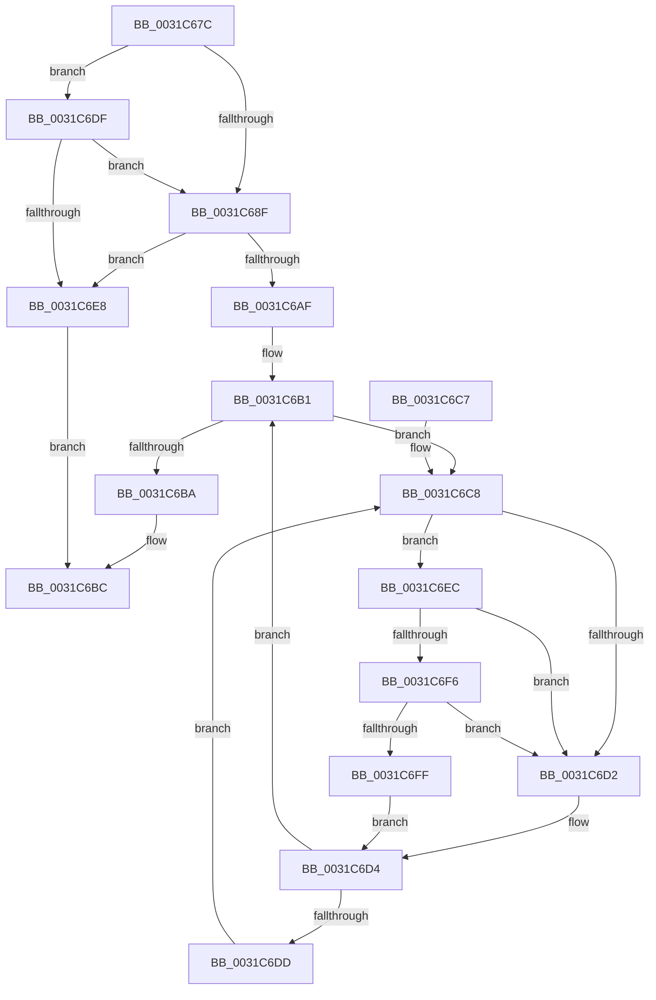

# MiSafeLockPageAtDpc

- RVA: `0x0031C67C`–`0x0031C708` (길이 `140` bytes)
- VA: `0x000000014031C67C`
- 실행 섹션: `.text`
- PDB 이름 있음: `예`; PDB Function 태그: `아니요`
- unwind 정보 RVA: `0x00074DAC`
- 디코드: `43`개 명령, `140/140` bytes 표시
- 미해석 바이트: `0` (있으면 어셈블리에 `.byte`로 보존)

> 이 문서는 커널 이미지의 기계어와 PDB 기호를 분석해 생성했습니다. 4번과 5번은 함수 원형과 자료형을 바이너리 사용 방식에서 추정한 C 해석이며 원본 소스 복구 결과는 아닙니다.

## 1. Dependencies

- 직접 호출 지점: **3**; 고유 호출 대상: **3**
- 직접 호출자로 확인된 함수: **9**
- RIP 상대 이미지 참조: **3**

### Outgoing calls
- `0x0031C6DF` → [MiIsDecayPfn](../2B/MiIsDecayPfn_function_002B9240.md) (function, `0x002B9240`)
- `0x0031C6F6` → [KiCheckVpBackingLongSpinWaitHypercall](../30/KiCheckVpBackingLongSpinWaitHypercall_function_0030F490.md) (function, `0x0030F490`)
- `0x0031C701` → [HvlNotifyLongSpinWait](../30/HvlNotifyLongSpinWait_function_0030F460.md) (function, `0x0030F460`)

### Direct callers
- [MiPfnsWorthTrying](MiPfnsWorthTrying_function_0031B0C0.md) at `0x0031B370`
- [MiProcessLargeCoalesceBitmapCandidates](../37/MiProcessLargeCoalesceBitmapCandidates_function_0037A3F0.md) at `0x0037A5EE`
- [MiCoalesceFreeLargePages](../37/MiCoalesceFreeLargePages_function_0037A7B4.md) at `0x0037AA59`
- [MiJoinHugeContext](../3E/MiJoinHugeContext_function_003E2748.md) at `0x003E2861`
- [MiInitializeNewUltraHugeContext](../3F/MiInitializeNewUltraHugeContext_function_003FB974.md) at `0x003FBA71`
- [MiGetPfnPageSizeIndexUnsynchronized](../46/MiGetPfnPageSizeIndexUnsynchronized_function_0046C008.md) at `0x0046C083`
- [MiChangePageAttributeLargeFreeZeroPage](../4A/MiChangePageAttributeLargeFreeZeroPage_function_004ACC10.md) at `0x004ACC76`
- [MiPurgeZeroListHead](../4C/MiPurgeZeroListHead_function_004CE464.md) at `0x004CE4FA`
- [MiDereferenceHugeContext](../4D/MiDereferenceHugeContext_function_004D9664.md) at `0x004D9708`

### Static image references
- `0x0031C686` → RVA `0x00E2DCE0` (`.data`; read)
- `0x0031C6CA` → RVA `0x00FC52AC` (`ALMOSTRO`; reference)
- `0x0031C6EC` → RVA `0x00FC6AB8` (`ALMOSTRO`; read)

## 2. Other-region calls and transfers

- 다른 실행 섹션으로 향하는 call: **0**
- 별도 외부 분기/꼬리 이동을 확인하지 못했습니다.

## 3. Assembly (complete function range)

```asm
0031C67C  48 89 5C 24 08                  mov qword ptr [rsp + 8], rbx
0031C681  57                              push rdi
0031C682  48 83 EC 20                     sub rsp, 0x20
0031C686  48 3B 0D 53 16 B1 00            cmp rcx, qword ptr [rip + 0xb11653]
0031C68D  77 50                           ja 0x14031c6df
0031C68F  48 8D 1C 49                     lea rbx, [rcx + rcx*2]
0031C693  48 C1 E3 04                     shl rbx, 4
0031C697  48 B8 00 00 00 00 00 DE FF FF   movabs rax, 0xffffde0000000000
0031C6A1  48 03 D8                        add rbx, rax
0031C6A4  48 8B 43 28                     mov rax, qword ptr [rbx + 0x28]
0031C6A8  48 0F BA E0 36                  bt rax, 0x36
0031C6AD  73 39                           jae 0x14031c6e8
0031C6AF  33 FF                           xor edi, edi
0031C6B1  F0 48 0F BA 6B 18 3F            lock bts qword ptr [rbx + 0x18], 0x3f
0031C6B8  72 0E                           jb 0x14031c6c8
0031C6BA  B0 02                           mov al, 2
0031C6BC  48 8B 5C 24 30                  mov rbx, qword ptr [rsp + 0x30]
0031C6C1  48 83 C4 20                     add rsp, 0x20
0031C6C5  5F                              pop rdi
0031C6C6  C3                              ret
0031C6C7  CC                              int3
0031C6C8  FF C7                           inc edi
0031C6CA  85 3D DC 8B CA 00               test dword ptr [rip + 0xca8bdc], edi
0031C6D0  74 1A                           je 0x14031c6ec
0031C6D2  F3 90                           pause
0031C6D4  48 8B 43 18                     mov rax, qword ptr [rbx + 0x18]
0031C6D8  48 85 C0                        test rax, rax
0031C6DB  79 D4                           jns 0x14031c6b1
0031C6DD  EB E9                           jmp 0x14031c6c8
0031C6DF  E8 5C CB F9 FF                  call 0x1402b9240
0031C6E4  85 C0                           test eax, eax
0031C6E6  75 A7                           jne 0x14031c68f
0031C6E8  B0 11                           mov al, 0x11
0031C6EA  EB D0                           jmp 0x14031c6bc
0031C6EC  8B 05 C6 A3 CA 00               mov eax, dword ptr [rip + 0xcaa3c6]
0031C6F2  A8 40                           test al, 0x40
0031C6F4  74 DC                           je 0x14031c6d2
0031C6F6  E8 95 2D FF FF                  call 0x14030f490
0031C6FB  84 C0                           test al, al
0031C6FD  74 D3                           je 0x14031c6d2
0031C6FF  8B CF                           mov ecx, edi
0031C701  E8 5A 2D FF FF                  call 0x14030f460
0031C706  EB CC                           jmp 0x14031c6d4
```

## 4. C-style interpretation (structured pseudocode)

```c
__int64 __fastcall MiSafeLockPageAtDpc(__int64 a1)
{
    __int64 result;
    __int64 v_rbx;
    __int64 v_rdi;
    __int64 v_rsp;
    unsigned __int64 v_stack_p8;

    v_stack_p8 = v_rbx;
    v_rsp = (v_rsp) - (32);
    if (a1 > (*(unsigned __int64 *)(v_rip + 11605587))) goto loc_0031C6DF;
loc_0031C68F:
    v_rbx = (a1 + a1 * 2) << (4);
    v_rbx = (v_rbx) + (result);
    if (condition_is_above_or_equal) goto loc_0031C6E8;
    v_rdi = 0;
loc_0031C6B1:
    if (condition_is_below) goto loc_0031C6C8;
loc_0031C6BC:
    v_rsp = (v_rsp) + (32);
    return 2;
loc_0031C6C8:
    v_rdi = (unsigned int)((v_rdi) + 1);
    if (((*(unsigned int *)(v_rip + 13274076)) & ((unsigned int)(v_rdi))) == 0) goto loc_0031C6EC;
loc_0031C6D2:
loc_0031C6D4:
    if (!sign_flag) goto loc_0031C6B1;
    goto loc_0031C6C8;
loc_0031C6DF:
    result = MiIsDecayPfn(a1, a2, a3, a4);
    if ((unsigned int)(result) != 0) goto loc_0031C68F;
loc_0031C6E8:
    goto loc_0031C6BC;
loc_0031C6EC:
    if ((((unsigned __int8)((unsigned int)(*(unsigned int *)(v_rip + 13280198)))) & (64)) == 0) goto loc_0031C6D2;
    result = KiCheckVpBackingLongSpinWaitHypercall(a1, a2, a3, a4);
    if ((unsigned __int8)(result) == 0) goto loc_0031C6D2;
    result = HvlNotifyLongSpinWait((unsigned int)((unsigned int)(v_rdi)), a2, a3, a4);
    goto loc_0031C6D4;
}
```

## 5. (Beta) C Style

```c
int64_t MiSafeLockPageAtDpc(int64_t Arg1)
{
    int64_t result;
    int64_t local_rbx;
    int64_t local_rdi;
    int64_t local_rsp;
    uint64_t v_stack_p8;

    v_stack_p8 = local_rbx;
    local_rsp = (local_rsp) - (32);
    if (Arg1 > (*(uint64_t *)(v_rip + 0xB11653))) goto loc_0031C6DF;
loc_0031C68F:
    local_rbx = (Arg1 + Arg1 * 2) << (4);
    local_rbx = (local_rbx) + (result);
    if (condition_is_above_or_equal) goto loc_0031C6E8;
    local_rdi = 0;
loc_0031C6B1:
    if (condition_is_below) goto loc_0031C6C8;
loc_0031C6BC:
    local_rsp = (local_rsp) + (32);
    return 2;
loc_0031C6C8:
    local_rdi = (uint32_t)((local_rdi) + 1);
    if (((*(uint32_t *)(v_rip + 0xCA8BDC)) & ((uint32_t)(local_rdi))) == 0) goto loc_0031C6EC;
loc_0031C6D2:
loc_0031C6D4:
    if (!sign_flag) goto loc_0031C6B1;
    goto loc_0031C6C8;
loc_0031C6DF:
    result = MiIsDecayPfn(Arg1, a2, a3, a4);
    if ((uint32_t)(result) != 0) goto loc_0031C68F;
loc_0031C6E8:
    goto loc_0031C6BC;
loc_0031C6EC:
    if ((((uint8_t)((uint32_t)(*(uint32_t *)(v_rip + 0xCAA3C6)))) & (64)) == 0) goto loc_0031C6D2;
    result = KiCheckVpBackingLongSpinWaitHypercall(Arg1, a2, a3, a4);
    if ((uint8_t)(result) == 0) goto loc_0031C6D2;
    result = HvlNotifyLongSpinWait((uint32_t)((uint32_t)(local_rdi)), a2, a3, a4);
    goto loc_0031C6D4;
}
```

## 6. Execution-region graph

[열기: 2D/3D 그래프와 함수 탐색 컨트롤 패널](../../../control-panel.html?section=text&rva=0x0031C67C&view=graph)

- 2D 그래프는 위에서 아래로 흐르고, 3D 그래프는 빈 공간을 드래그해 회전합니다. Shift+드래그는 이동, 휠은 확대·축소, 함수 노드 선택은 대상 보고서 이동입니다.

### Static fallback


